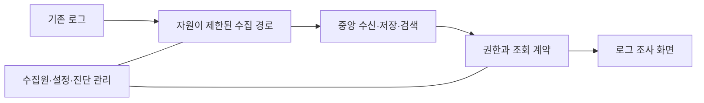

# LogDock 아키텍처 검토 상태

현재 단계는 기능·정책 명세 검토다. 이 문서는 현재 scaffold와 후속 설계의 책임 경계를 구분하며, 최종 기술 구성을 확정하지 않는다.

## 현재 구현

| 영역 | 소스에서 확인한 동작 |
| --- | --- |
| NestJS API | `GET /api/health` 상태 확인 응답, 로컬 loopback 바인딩 |
| React 화면 | API 연결 확인, 실패·시간 초과·재시도 |
| 개발 환경 | npm workspaces, typecheck/build, Vite API 프록시 |
| 로그 기능 | 수집·저장·검색·source 등록·운영 인증은 미구현 |

API health는 중앙 저장소나 로그 수집 상태를 의미하지 않는다. 현재 코드를 최종 기술 선택으로 간주하지 않는다.

## 선택 상태

초기 문서의 Loki 연동, Fluent Bit 우선 검토, NestJS 조회 API 구성은 이전 제안이다. 수집기·저장/검색 엔진·수신 서버·관리 DB는 기능·품질 요구를 기준으로 2026-11-03 D17에서 정했고(아래), 측정 근거로 확인한다. 기존 코드·의존성을 이번 문서 작업에서 변경하지 않는다.

2026-11-03 [D17 기술 선정안](planning/d17-tech-selection-v0.1.md)과 [공식 근거](research/d17-tech-evidence-2026-11-03.md)로 아래 절차의 1~3단계를 수행했다. 사용자 결정 D17-01~06으로 Go 에이전트 직접 구현·Go 수신 서버·ClickHouse·PostgreSQL을 채택했다. 로그는 중앙 서버 디스크에만 저장하고 object storage는 쓰지 않는다. 시각·레벨·필드 해석은 수신 서버에서 한다([결정 기록](decisions.md#제품과-운영의-검토-추적표)). 조회·관리 API(기존 NestJS)·웹(React)·중앙 queue 미도입·배포 방식과 연결별 순번 전달 설계는 제안 상태다. 측정 M1~M8은 사용자가 준비하는 실제 중앙 서버에서 할 예정이며 미실행이다. 결과에 따라 Elasticsearch나 Vector를 다시 제시할 수 있다.

합의한 기능 최소 범위와 미결정 정책은 [제품 명세](specs/product-features-v0.1.md), [수집 명세](specs/collection-agent-v0.1.md), [결정표](decisions.md)를 따른다. 중앙 SaaS·과금·여러 엔진 동시 지원·플러그인 체계는 자동으로 채택된 범위가 아니다.

초기 대상은 기존 기획의 D09 합의에 따른 한 운영팀용 자체 설치형이며 실제 설치 패키지와 지원 규모는 미정이다. [기획 리뷰와 사용자 협의 목록](planning/user-decisions-v0.1.md)은 사용자 판단이 필요한 선택과 설계/측정 작업을 구분한다. [잔여 기획](planning/remaining-plan-v0.1.md), [검색·조사 상세](specs/investigation-workflows-v0.1.md), [관리·운영 상세](specs/platform-operations-v0.1.md)는 통합한 검토 입력이다. 목록이나 상세 초안의 존재를 기술 채택 승인으로 간주하지 않는다.

Q01의 첫 출시 최소 기능 범위·후속 구분·제품 완료 기준 협의는 완료했다. 이 범위를 기술 평가의 입력으로 사용하며 검색 시간/연산·보존·저장/알림 등 상세 계약과 수치는 각 Q/설계에서 채운다. Q01 완료가 엔진·프레임워크·schema/API 선정이나 구현/실행 검증 완료를 뜻하지 않는다.

## 검토할 책임

논리적 책임을 나눈 그림이며 배포 단위·microservice 수·엔진을 정한 것이 아니다.

에이전트는 수집·대기·중앙 전송까지, 이후 저장·색인·검색·보존은 중앙 책임이다. Q04 합의에 따라 중앙은 프로그램 재시작 후에도 유지할 기록 확정 뒤 수신 완료 응답한다. 에이전트는 앞선 응답 전에도 한도 안에서 다음 로그를 보내며, 미확인 데이터는 유지하고 같은 식별로 재시도한다. 미확인 전송 한도에서는 새 전송 대기, 버퍼 포화에서는 D01 추가 읽기 pause다. 에이전트는 중앙의 전송 응답만 처리하며 저장소/검색을 직접 검사하지 않는다. 중앙 서버/디스크 고장 대비 별도 복제·자동 장애조치·로그 백업/복구 보장은 구현 범위에서 제외한다. 기록 확정·부분 승인/거부·ACK/버퍼 정리 순서·수치·검색 지연 목표는 후속 설계/검증이다.

| 영역 | 검토할 책임 |
| --- | --- |
| 에이전트 | 허용 로그 읽기, 최소 파싱·multiline, 출처 식별, bounded 버퍼·인증된 전송·진단. 본문 민감정보 처리는 앱 책임 |
| 중앙 수신 | source 자격·scope 검증, ACK/부분 거부/재시도·내구성 계약 |
| 저장·검색 | 보존·색인·원문/처리 상태, 시간 범위·집계·문맥과 지연 유입 |
| 조회 계층 | 권한·조건·예산·paging·취소·부분 결과 계약 |
| 관리 계층 | source·키·정책·설정 version·진단·저장 탐색/알림 등 채택된 객체 |
| 프런트엔드 | 탐색 상태·시간/필터·결과 완전성, 상세·주변 로그·실시간 읽기 안정성 |

## 데이터 계약 검토

source·service·environment·instance는 서로 다른 개념이다. 발생 시각·관측/수신 시각, 원본/정규화 severity, 앱 출력 본문과 parser/rule version, parse 상태를 구분한다. 실제 필드명·schema·API·색인 라벨은 미확정이다.

Q07 사용자 전제는 서비스 지정·수집 연결 등록을 확정한 뒤 그 등록정보에 연결된 키를 발급하는 것이다. 중앙은 키와 등록정보로 서비스를 판별한다. 서비스 없는 등록에는 키를 발급하지 않고 확인 불가 요청은 완료 처리하지 않으며 연결/등록 오류를 알리고 미확인 대기는 D01/D05/D08에 따라 보존한다. 앞선 미분류 보관/재분류 안건은 제거한다. 서비스는 분류 메타데이터이며 tenant/권한과 구분하고 본문/원래 수집 범위를 바꾸지 않는다. 한 에이전트의 여러 서비스 수집 방향은 유지하며 키 범위/개수는 [Q10-07](planning/q05-q07-q10-plan-v0.1.md#q10)의 연결별 키·평상시 1개/교체 중 2개 합의를 따른다. 실제 등록/입력 묶음·프로토콜/인증/설정 형식·UI/ID/schema와 이름/수명은 후속 설계/검토다.

2026-11-01 D04 사용자 합의에 따라 민감정보 처리는 앱이 로그 출력 전에 수행한다. LogDock은 앱 출력 본문을 별도 민감정보 판별·마스킹·내용에 따른 제외 없이 중앙화하며, 제거 실패 차단·별도 원문 격리 저장 기능은 범위에서 제외한다. 파싱·정규화 필드는 본문과 구분한다. D01~D03과 전송 인증·조회 권한·수집기 자격증명 관리·본문 없는 진단은 별도 계약이다. D08은 인증·권한·키·소속 변경과 기존 queue를 다루며 마스킹 변경은 제외한다.

고유 요청 ID·컨테이너/프로세스 ID를 무조건 색인 라벨로 넣지 않으며 선택 엔진의 비용과 cardinality를 확인한다. 파일 이름만으로 영구 식별을 보장하지 않는다. 출력 stream과 severity도 별도다.

Q10/Q11에서 초기 웹 로그인은 운영팀 공용 계정 하나, 검색 조건은 그 계정의 단일 저장 목록을 함께 사용하는 것으로 합의했다. 향후 필요 시 계정 분리를 고려해야 한다는 요구도 유지한다. 후속 설계에서는 로그인 주체의 식별과 인증, 저장 조건·알림 등 관리 객체의 귀속, 허용 작업 검사를 구분하고 확장 지점을 둔다. 초기 계정 수를 이유로 계정 ID를 코드 상수나 모든 객체의 소유자 부재로 고정하지 않는다. 실제 ID/schema/API·인증 제품은 미선정이며 복수 계정 UI·팀/역할 기능을 이번에 구현하는 범위는 아니다.

Q10-13/14 감사 일괄 정책을 합의했다. 감사 목표 90일/강제 저장 예산 우선·만료/가장 오래된 이력부터 정리·조기 정리/조회 가능 범위를 표시한다. 감사 저장만 실패하면 인증/세션·필수 상태/로그 저장이 정상인 기본 로그인/검색/수신은 계속하고 일반 민감 관리 변경은 적용 전 보류한다. 인증 차단을 확정 저장할 수 있는 긴급 키 폐기/전체 세션 종료와 인증된 호스트 운영자의 안전하게 확정 가능한 로컬 자격/세션 회수 복구는 예외로 허용하며 감사 공백/실제 결과를 표시한다. 실제 저장/권한·기록/정리/부분 실패/복구·예산/정합성/기술/시험은 개발팀 후속이다. 앱 로그/agent 대기·진단 수명과 구분하고 인증 상태 확정 불가를 성공으로 처리하거나 현재 scaffold/DB/라이브러리를 최종 채택한 것으로 확대하지 않는다.

계정 분리를 채택할 때 기존 저장 조건·알림의 귀속과 관리 권한 배분, 기존 공용 계정 이력의 표시·전환 절차를 별도로 정한다. 공용 계정 시절의 작업을 특정 사람의 이력으로 추정하지 않는다. 웹 로그인 주체와 수집 키의 등록/서비스 식별은 별개로 유지하며 계정 분리를 여러 조직 tenant 도입으로 확장하지 않는다.

## 기술 선택 절차 초안

D17에서는 아래 후보를 같은 사용자 흐름·workload·실패 모델로 비교한다. 기존 stash에서 보존한 평가 절차이며 제품 선정 결과가 아니다. 후보 이름은 조사 대상이고 현재 기능·보안·라이선스·호환성을 이 문서에서 보장하지 않는다. 채택 시점의 공식 자료·정확한 버전·필요한 격리 검증을 기록한다.

| 책임 | 비교 후보 | 필수 평가 항목과 탈락 조건 |
| --- | --- | --- |
| agent 수집 | Filebeat, Vector, Fluent Bit, OpenTelemetry Collector 또는 필요 최소 확장 | D01 버퍼 보존/read pause·복구 예산·FD 해제, D02 신규 경계/복구 보류, D03 전체 거부/진단, D04 앱 출력 본문, D05 디스크 오류, D06 동일 이벤트 식별, D08 전송 자격과 전체 자원 한도. 충족 수단과 한계를 확인하고 요구 미달 후보는 제외 |
| 저장·검색 | Loki, Elasticsearch, ClickHouse | 채택한 본문/타입 검색·동일 시각 paging·집계/partial·문맥·보존·중복 저장 방지·중앙 ACK 내구성·late event·접근 통제·운영 비용. 필요한 계약을 못 지키면 합의를 조용히 완화하지 않고 재검토. Q08 합의로 대소문자 미구분 부분 일치·제외 조건·발생/수신 두 시각 조회·타입 충돌 무거부는 필수이며 평가 입력은 [Q08 기획안 8절](planning/q08-search-plan-v0.1.md#8-엔진-평가-입력) |
| metadata | 별도 관계형 저장과 선택 엔진의 관리 저장 기능 | 객체 참조·채택한 권한/키·설정 version·감사·재시작/업데이트 정합성. DB 선정·접속·DDL 실행은 별도 |
| 중앙 queue | 별도 queue 도입과 선택 엔진의 내구 수신 경로 활용 | Q04의 중앙 보호 범위·ACK, 디스크 상한·중복·운영/복구 비용. 중간 queue만으로 검색 가능/무손실을 보장하지 않음. D05 에이전트 디스크 버퍼와 별도 선택 |
| backend와 API | 기존 NestJS 유지, Python 계열 대안 | ingest/query 동시성·deadline/취소·auth·stream·타입/schema·운영팀 유지보수와 검증 비용 |
| 인증 | OIDC 연동, 로컬 계정 | Q10의 필요 접근 범위, bootstrap·권한 회수·session·계정 복구·IdP 운영 부담·dependency 보안 |
| 웹과 packaging | 기존 React/Vite 활용 범위, 중앙 container 배포와 agent OS 서비스 실행 후보 | 긴 목록/실시간 메모리·접근성·지원 브라우저·권한/TLS/volume·upgrade/rollback·지원 OS |

1. 채택할 출시 범위와 합의된 정책·수치 목표를 입력으로 정한다. Q04의 한도 내 응답 전 후속 전송·미확인 버퍼 유지·중앙 프로그램 재시작 보존·하드웨어 장애 대응 제외는 고정한다. 검색 지연/한도 등 남은 미결정 입력은 평가 가정으로 표시한다.
2. 각 후보의 공식 capability·버전·license·지원/보안·호환 조건을 같은 표에 기록한다. 과거 조사값을 현재 근거로 재사용하지 않는다.
3. 문서로 탈락시킬 수 있는 후보부터 제외하고, 남은 후보에 합성 파일·분리된 수신 경로의 최소 검증 계획을 작성한다. 실제 설치·실험은 당시 요청 범위에 따른다.
4. AT/IT/OT 중 채택 기능의 전달·자원·검색·운영 분기를 평가해 한 가지 기본 구성을 제안한다. 독립 agent 비용·격리 시험과 실제 업무 서비스 영향은 구분한다.
5. 선택/탈락 이유·보장/미지원 조건·용량 가정·복구 절차·남은 검증을 ADR로 기록하고 사용자 채택을 반영한다. 여러 엔진 동시 지원을 초기 요구로 추가하지 않는다.

설계 산출물은 event/schema version, 관리 객체 관계·수명, ingest ACK·부분 거부·후속 전송/미확인 한도·queue 정리, query/cursor·취소·partial·시간 기준 전달, live 재개, auth/scope, error/capability, 설정 변경 충돌과 upgrade/rollback 호환 표다. 에이전트가 중앙 저장소/검색을 직접 검사하지 않는 책임 구분과 하드웨어 재해 복구 제외를 유지한다. 현재 scaffold의 유지와 대체 비용을 함께 비교한다.

## 기존 서비스 보호와 전달

기존 앱이 중앙 로그 전송을 기다리지 않도록 한다. 전체 agent 자원과 열린 파일 보유를 제한하고, 과부하·장애·복구에도 같은 예산을 적용한다. D01의 queue 보존·추가 읽기 pause와 원본 삭제 손실 경계를 함께 따른다.

원본 읽기 복구 위치·durable queue commit·중앙 전달 완료 위치·검색 가능을 구분한다. finite queue, 다중 AZ 또는 object storage만으로 무손실·제품 전체 HA를 가정하지 않는다.

D05에 따라 에이전트의 전송 대기 기본 방식은 크기가 제한된 디스크 버퍼다. 본문·동일 이벤트 식별·원래 전송 범위의 복원을 함께 설계하고 전체 디스크/I/O/메모리 예산과 D01 포화/복구를 유지한다. 사용 불가 시 자동 메모리 대체 없이 해당 수집을 대기/오류로 표시하고 사용자가 사유·영향·중단 여부를 확인할 수 있게 한다. 기존 버퍼 보존, 필수 상태 기록 불가 시 해당 전송 안전 정지, 정상 확인 후 제한 재개도 합의했다. 실제 기록 확정/복구·상태 보고·재개 검증 수단·수치/제품은 후속 설계이며 별도 중앙 queue 도입을 확정한 것은 아니다.

2026-11-01 사용자 합의에 따라 동일 이벤트의 재전송은 중앙에 한 건만 저장하며 검색·발생량 집계에도 한 번 반영하는 방향으로 설계한다. 같은 본문의 실제 별도 발생은 구분한다. 안전한 위치·원래 수집 경계·이벤트 식별을 복원할 수 있으면 재개하고, 복구 근거가 없으면 해당 파일의 자동 읽기를 보류한다. 구체 식별 생성/복원, 중앙의 동시 중복 판정·유지 기간·보존 만료·ACK/내구성 계약과 보장 범위는 D06 후속 설계다. 특정 저장 엔진·metadata DB·중앙 queue 도입이나 무조건적인 exactly-once 보장은 확정하지 않는다. 세부 합의와 미결정 사항은 [수집 명세](specs/collection-agent-v0.1.md)를 따른다.

Q05 합의에 따라 에이전트의 전송 대기는 에이전트 서버 디스크의 전용 폴더에 원본과 별도 대기 파일로 둔다. 키가 사용 불가하면 유지·전송 보류하고, 원래 수집원에 대한 새 키의 유효 전송 권한 확인 후 같은 이벤트 식별로 재개한다. 대기 공간 포화 시 D01 읽기 pause·앱 원본 기록 지속을 유지한다. 실제 폴더/형식/용량·기록 확정/정리 순서와 나머지 D08 세부는 후속 설계이며 특정 collector·파일 format이나 DB를 채택하지 않는다.

Q06 합의에 따라 기록을 끝내 복원할 수 없는 파일은 누락 안내 후 사용자 명시 선택에서만 지금부터 다시 수집한다. 새 기준은 적용 시 파일 끝 위치이며 이후 새 이벤트부터 읽고 기존 유효 대기 데이터는 원래 식별/수집원으로 유지한다. 정상 재시작에는 자동 EOF 초기화를 적용하지 않는다. 파일/경계/필수 기록 확인 불가 시 보류를 유지하며 기록 확정·재시작/동시 조작/파일 교체 정합성과 실행 검증은 후속 설계다.

Q16/Q02의 초기 연결은 중앙에서 서비스와 단일 파일/파일명 규칙 입력→수집 등록→키 발급과 주소/키/경로 설정 제공→사용자 복사 적용이다. 로컬 파일/읽기 권한은 에이전트가 확인하고 중앙의 원격 파일 접근/권한 변경을 추가하지 않는다. 기존 queue/진행 위치 보존과 실제 키 미노출을 유지한다. 지정 지원은 합의했고 에이전트 설치 대상 Linux는 확인했다. 구체 문법/탐색/파일/자원 한도·Linux 세부 지원/입력/형식/설치·중앙 Linux 세부 환경·프로토콜과 실제 검증은 남아 있다.

Q02-02에서 일반 로그 파일과 journald를 모두 초기 입력으로 채택했다. journal도 신규 로그·대기 보존·안전한 위치/식별 복원·재전송 중복 방지·전체 자원 예산을 유지한다. journal 대상 지정·최초 경계/진행 위치·분할 이벤트·권한·설정/운영은 [수집 명세](specs/collection-agent-v0.1.md#journald-입력-q02-02)의 설계/검증 과제다. 이 채택으로 특정 collector·journal API/명령·모든 Docker driver 지원·호스트 원본 보관 변경을 확정하지 않는다.

Q16-01에서 중앙 수집/저장/검색을 기존 서비스와 분리된 별도 서버에 배치하기로 합의했고 중앙 OS도 Linux로 확인했다. 중앙 Docker 사용도 가능하며 에이전트 호스트는 Docker 가능/불가가 혼재한다고 확인했다. 에이전트의 Docker 비필수·비컨테이너 실행 경로를 설계 조건으로 둔다. Q16-03 대상 로그 읽기·전용 대기 폴더 쓰기 권한 설정 가능도 확인했다. 실제 계정/권한·상태/진단 경로·디스크 여유/자원·적용 검증은 후속이다. 실제 바이너리/패키지·서비스 관리자·선택적 컨테이너 패키지·최소 권한·자원/호환성과 설치/지원 검증은 후속이다. 에이전트는 기존 로그 서버의 등록 대상을 읽는 방향을 유지한다. 중앙 Linux 세부 환경/사양·물리/가상·구체 배포/실행 방식·노드 수·디스크 크기·저장 기술은 후속 확인/설계다. 로그 저장 위치는 D17-06에서 중앙 서버 디스크로 합의했다. 중앙 별도 배치를 하드웨어 장애 보호·자동 장애조치·로그 백업 복구 기능이나 실제 서버 구성/배포 승인으로 확대하지 않는다.

Q16-01 추가 요구에 따라 서로 다른 Linux 환경·하드웨어 사양·Docker 사용 여부를 수용할 설치/실행 경로를 설계한다. 기존 서버를 특정 배포판/버전이나 동일 사양으로 바꾸는 것을 전제로 삼지 않고 CPU/메모리/디스크/I/O/네트워크 등 전체 자원 예산을 서버별 여유에 맞춰 적용할 수 있게 한다. 이는 자동 자원 감지/자동 튜닝 기능 채택이나 미검증 환경/무제한 처리 보장이 아니다. 실제 최소 요구·지원 조합/architecture·패키지/서비스 관리자·권한/호환·자원 검증은 개발팀이 확인하며 세부 규격 제출은 기획 선행 조건으로 두지 않는다.

Q15/Q16 초기 현황은 서비스 2개·서비스당 로그 서버 2대씩 총 4대이며 중앙은 별도다. 사용자는 서비스를 계속 늘릴 계획이라고 명시했다. service/서버 수·서비스당 서버 수를 하드코딩하지 않고 기존 등록/설정으로 서비스와 수집 서버를 추가할 수 있어야 한다. agent/source/키 수도 현재 현황으로 고정하지 않는다. 실제 처리/저장 용량·자원 한도는 로그량/동시성·증가 workload·병목 측정으로 제안/검증한다. 앞서 근거 없이 제안한 검색 가능 지연 5초는 철회·미합의이며 고정 송신 주기가 아니다. 자동 확장/분산 cluster·HA·실시간 화면 갱신을 이 답변으로 채택하지 않는다.

Q16-07에서 에이전트의 부팅 자동 시작과 프로세스 비정상 종료의 제한된 자동 재시작·반복 실패 중단/가시성을 합의했다. 종료 감지와 재실행은 에이전트 외부의 실행 관리 계층이 맡는 방향이며 systemd는 후보로 둔다. 실제 관리자/버전·패키지·정상 종료와의 구분·횟수/간격·상태 전달/미관측은 후속 설계/검증이다. 재실행이 위치/동일 식별·대기 보존·복구 불가 파일 보류나 전체 자원 예산을 우회하지 않도록 한다. 중앙 프로그램에도 아래와 같이 적용하며 실제 호스트 설정/설치 검증은 실행하지 않았다.

Q16-08에서 에이전트 버전 업데이트는 운영자가 시점을 정해 직접 실행하기로 합의했다. 부팅/비정상 종료 자동 재시작은 선택된 기존 버전 실행이고 새 버전 자동 교체와 구분한다. 위치/동일 식별·대기 보존을 유지하는 실제 패키지/명령·설정/상태/프로토콜 호환·중단/실패와 지원 범위는 후속 설계/검증이다. 운영자가 기존 대기/진행 기록을 유지할 수 있는 호환 이전 버전으로 직접 되돌리는 절차 제공도 합의했다. 실제 지원 범위/명령·호환/중단/실패·자원/검증은 후속이며 자동/무조건 되돌림이나 실제 설치/호스트 설정을 채택하지 않는다.

Q16-07 부팅 자동 시작·비정상 종료 제한 재시작/반복 실패 중단·가시성은 중앙 LogDock 프로그램에도 적용하기로 합의했다. 각 호스트의 실행 관리 계층에서 담당하며 에이전트에 중앙 제어/저장소 확인 역할을 추가하지 않는다. 중앙 구성요소별 실행 단위/의존·내구 기록/ACK 복원 확인·정상 종료/업데이트 구분·상태/미관측·횟수/간격·자원/호환성은 후속 설계/검증이다. 중앙 프로그램 재시작 수신 보존과 agent 위치/식별·대기/보류를 유지하고 하드웨어 장애조치/로그 백업 복구나 실제 호스트 설정으로 확대하지 않는다.

Q16-04/E01에서 모든 로그 서버와 중앙은 private 서버로 서로 연결 가능하며 중앙 HTTPS 인증서도 이미 관리 중이라고 사용자 확인했다. 이 설치의 전송은 private 연결을 전제로 하고 Q10-02의 HTTPS 기본을 유지한다. 인증서 관리 여부를 반복 질문하지 않으며 구체 적용/신뢰 배포·갱신 연동·proxy/TLS 종료·구체 네트워크 허용은 후속 설계/설치 확인이다. 실제 접속/TLS 시험은 미실행이고 특정 CA·제품·포트·공개 수신 기능이나 모든 설치의 네트워크 제한을 채택하지 않았다.

Q16-05에서 사용자 수동 설정 복사/적용 뒤 기존 진행 기록·동일 이벤트 식별·유효 대기를 보존한 에이전트 재시작과 일시 수집 중단을 허용했다. 앱은 계속 실행하고 변경 없는 입력은 안전하게 복원한 기존 위치에서 재개한다. 새 입력/규칙 변경 경계·검사/적용 상태·실패 처리·실제 중단 시간은 후속 설계/검증이다. 중앙 설정 중단·무중단 reload·원격 자동 변경을 채택한 것은 아니다. Q16-08 중앙 프로그램 업데이트는 개발팀 담당으로 사용자 직접/자동 선택 질문을 종료한다. 실제 중앙 배포·호환/중단·복원은 개발팀 설계이며 자동 업데이트나 되돌림 기능을 이 답변으로 채택하지 않는다. 다양한 Linux 환경/사양 지원을 요구하고 세부 호환 확인은 개발팀 검증으로 넘겼으며 초기 서비스 2개·로그 서버 총 4대 입력을 확보했고 서비스/서버 증가를 전제로 Q15 운영 기대와 로그량/증가 workload를 확인하고 구체 성능/용량은 측정 후 제안한다.

Q16-09/Q05-02 정상 중지 합의에 따라 agent는 요청 시 새 읽기/전송·재시도를 멈추고 잔여 전송/중앙 ACK 대기 없이 종료한다. 진행 기록/동일 식별·미전송/미확인 대기는 보존하고 재실행 때 기존 복구/같은 식별 재전송을 유지한다. 진행 중 중앙 요청의 뒤늦은 확정과 중지/전송 완료·미관측을 구분한다. 최소 로컬 정리/취소·실제 종료 한도/실패·서비스 관리자 연동은 개발팀 설계/검증이며 무기한 drain·대기 폐기·강제 kill을 채택하지 않는다. 키 폐기/개별 연결 보관과 전체 프로세스 중지는 별도다.

Q16-10/Q14 기본 정책은 제한된 요약의 재시작 확인·rotation/새 기록·전체 한도에서 미전달 진단도 오래된 파일부터 정리와 진단 저장만 실패/로그 대기·필수 상태 정상 시 실제 수집/전송 계속·진단 저장 오류/공백 표시로 정리했다. 기존 진단 보존·반복 비용 상한과 보고 불가 시 미관측·대기/필수 상태 실패 D05 안전 정지를 유지한다. 원본/대기/동일 식별·즉시 중지와 전체 자원 보호를 완화하지 않는다. 실제 파일/전체 한도·기록/정리/회전/복구·보고/재보고/신선도/정합성은 개발팀 설계/검증이며 Q14 기본 정책 정리를 구현/성능 검증 완료로 보고하지 않는다.

Q13 모든 서비스 공통 기본 보관 6개월은 각 로그 최초 중앙 유효 수신 시각을 기준으로 계산한다. agent 연결 시작 기준이 아니며 같은 이벤트 재전송/중복 수신·agent 재연결/재설치가 기존 로그 기준/기간을 갱신하지 않는다. 검색 기본 발생 시각(Q08)은 유지하고 최초 유효 수신/저장 확정·시계/기록 복원·달력/월말/시간대·중복/만료/삭제 정합성은 개발팀 검증으로 구체화한다. 공간 부족 시 오래된 로그 조기 삭제·새 로그 계속 수신, 기간 단축 소급·첫 출시 서버 설정 변경, 첫 출시 웹 연결/시간 구간 삭제, 판정 근거가 사라진 뒤 도착한 로그 저장도 합의했다. 로그 전용 저장 상한·저장 분할 단위·6개월 범위 중복 판정은 기술 선정 때 함께 설계하고 실제 용량/성장·공간 회수/복구 검증이 필요하다. 감사 90일/진단/agent 대기 TTL이나 중앙 하드웨어 복구 정책으로 확대하지 않는다.

## 공개 코드와 환경별 값

조직·서비스·서버 목록, 주소·로그 경로·토큰·실제 운영 로그는 배포 환경에서 관리한다. 공개 예시는 합성 데이터다. 외부 저장소의 비밀값을 브라우저로 전달하지 않는다.

각 외부 구성요소의 라이선스는 별도로 확인한다. LogDock의 Apache 2.0은 외부 소프트웨어·벤더 이미지의 권리를 대체하지 않는다.

## 검증 수준

현재 코드 범위는 정적으로 확인했다. 문서 정합성과 이전 PDF 가독성 확인은 실제 수집·검색·권한·부하·HA·복구 시험과 다르다. [AT-01~AT-18](specs/collection-agent-v0.1.md), [IT-01~IT-26](specs/investigation-workflows-v0.1.md), [OT-01~OT-10](specs/platform-operations-v0.1.md)은 미실행 후속 검증 시나리오다. 이번 통합에서 후보 capability를 새로 조사하거나 설치·실험하지 않았다. 앱 빌드/타입 검사도 로그 연동 검증을 대신하지 않는다.
