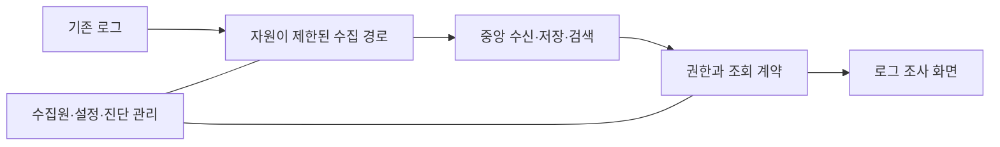

# LogDock 아키텍처 검토 상태

현재 단계는 기능·정책 명세 검토다. 이 문서는 현재 scaffold와 후속 설계의 책임 경계를 구분하며, 최종 기술 구성을 확정하지 않는다.

## 현재 구현

| 영역 | 소스에서 확인한 동작 |
| --- | --- |
| NestJS API | `GET /api/health` 상태 확인 응답, 로컬 loopback 바인딩 |
| React 화면 | API 연결 확인, 실패·시간 초과·재시도 |
| 개발 환경 | npm workspaces, typecheck/build, Vite API 프록시 |
| 로그 기능 | 수집·저장·검색·source 등록·운영 인증은 미구현 |

API health는 중앙 저장소나 로그 수집 상태를 의미하지 않는다. 현재 코드를 최종 기술 선택으로 간주하지 않는다.

## 선택 상태

초기 문서의 Loki 연동, Fluent Bit 우선 검토, NestJS 조회 API 구성은 이전 제안이다. 수집기·저장/검색 엔진·백엔드 최종 선택은 기능·품질 요구와 측정 근거로 다시 검토한다. 기존 코드·의존성을 이번 문서 작업에서 변경하지 않는다.

기능 후보와 정책은 [제품 명세](specs/product-features-v0.1.md), [수집 명세](specs/collection-agent-v0.1.md), [결정표](decisions.md)를 따른다. 중앙 SaaS·과금·여러 엔진 동시 지원·플러그인 체계는 자동으로 채택된 범위가 아니다.

초기 대상은 기존 기획의 D09 합의에 따른 한 운영팀용 자체 설치형이며 실제 설치 패키지와 지원 규모는 미정이다. [기획 리뷰와 사용자 협의 목록](planning/user-decisions-v0.1.md)은 사용자 판단이 필요한 선택과 설계/측정 작업을 구분한다. 이 목록이나 별도 작업 공간의 기술 후보 초안 자체를 기술 채택 승인으로 간주하지 않는다.

## 검토할 책임

논리적 책임을 나눈 그림이며 배포 단위·microservice 수·엔진을 정한 것이 아니다.

사용자 지시에 따라 에이전트는 중앙 전송까지 담당하고, 수신 이후의 저장·색인·검색과 중앙 보존은 중앙이 책임진다. 에이전트에 중앙 저장소/검색 상태를 직접 검증하는 책임을 두지 않는다. 중앙 수신 응답의 의미와 에이전트의 전송 완료·버퍼 정리 조건은 D06에서 연결하며 Q04의 내구성 수준은 아직 미합의다.

| 영역 | 검토할 책임 |
| --- | --- |
| 에이전트 | 허용 로그 읽기, 최소 파싱·multiline, 출처 식별, bounded 버퍼·인증된 전송·진단. 본문 민감정보 처리는 앱 책임 |
| 중앙 수신 | source 자격·scope 검증, ACK/부분 거부/재시도·내구성 계약 |
| 저장·검색 | 보존·색인·원문/처리 상태, 시간 범위·집계·문맥과 지연 유입 |
| 조회 계층 | 권한·조건·예산·paging·취소·부분 결과 계약 |
| 관리 계층 | source·키·정책·설정 version·진단·저장 탐색/알림 등 채택된 객체 |
| 프런트엔드 | 탐색 상태·시간/필터·결과 완전성, 상세·주변 로그·실시간 읽기 안정성 |

## 데이터 계약 검토

source·service·environment·instance는 서로 다른 개념이다. 발생 시각·관측/수신 시각, 원본/정규화 severity, 앱 출력 본문과 parser/rule version, parse 상태를 구분한다. 실제 필드명·schema·API·색인 라벨은 미확정이다.

2026-11-01 서비스 구분 요구에 따라 service는 로그 분류·검색/필터·집계의 기준이다. 여러 서비스를 구분해 조사하고 통합 조회할 수 있는 방향으로 설계하며, 서비스가 여러 개라는 이유로 서비스별 tenant나 권한 경계를 만들지는 않는다. 멀티테넌시 채택은 별도 결정이다. 수집원 자격·허용 범위와 서비스 분류를 구분하며 구체 식별·등록·이름 변경·미식별 처리와 schema/API/UI는 후속 설계다.

2026-11-01 D04 사용자 합의에 따라 민감정보 처리는 앱이 로그 출력 전에 수행한다. LogDock은 앱 출력 본문을 별도 민감정보 판별·마스킹·내용에 따른 제외 없이 중앙화하며, 제거 실패 차단·별도 원문 격리 저장 기능은 범위에서 제외한다. 파싱·정규화 필드는 본문과 구분한다. D01~D03과 전송 인증·조회 권한·수집기 자격증명 관리·본문 없는 진단은 별도 계약이다. D08은 인증·권한·키·소속 변경과 기존 queue를 다루며 마스킹 변경은 제외한다.

고유 요청 ID·컨테이너/프로세스 ID를 무조건 색인 라벨로 넣지 않으며 선택 엔진의 비용과 cardinality를 확인한다. 파일 이름만으로 영구 식별을 보장하지 않는다. 출력 stream과 severity도 별도다.

## 기존 서비스 보호와 전달

기존 앱이 중앙 로그 전송을 기다리지 않도록 한다. 전체 agent 자원과 열린 파일 보유를 제한하고, 과부하·장애·복구에도 같은 예산을 적용한다. D01의 queue 보존·추가 읽기 pause와 원본 삭제 손실 경계를 함께 따른다.

원본 읽기 복구 위치·durable queue commit·중앙 전달 완료 위치·검색 가능을 구분한다. finite queue, 다중 AZ 또는 object storage만으로 무손실·제품 전체 HA를 가정하지 않는다.

D05에 따라 에이전트의 전송 대기 기본 방식은 크기가 제한된 디스크 버퍼다. 본문·동일 이벤트 식별·원래 전송 범위의 복원을 함께 설계하고 전체 디스크/I/O/메모리 예산과 D01 포화/복구를 유지한다. 사용 불가 시 자동 메모리 대체 없이 해당 수집을 대기/오류로 표시하고 사용자가 사유·영향·중단 여부를 확인할 수 있게 한다. 기존 버퍼 보존, 필수 상태 기록 불가 시 해당 전송 안전 정지, 정상 확인 후 제한 재개도 합의했다. 실제 기록 확정/복구·상태 보고·재개 검증 수단·수치/제품은 후속 설계이며 별도 중앙 queue 도입을 확정한 것은 아니다.

2026-11-01 사용자 합의에 따라 동일 이벤트의 재전송은 중앙에 한 건만 저장하며 검색·발생량 집계에도 한 번 반영하는 방향으로 설계한다. 같은 본문의 실제 별도 발생은 구분한다. 안전한 위치·원래 수집 경계·이벤트 식별을 복원할 수 있으면 재개하고, 복구 근거가 없으면 해당 파일의 자동 읽기를 보류한다. 구체 식별 생성/복원, 중앙의 동시 중복 판정·유지 기간·보존 만료·ACK/내구성 계약과 보장 범위는 D06 후속 설계다. 특정 저장 엔진·metadata DB·중앙 queue 도입이나 무조건적인 exactly-once 보장은 확정하지 않는다. 세부 합의와 미결정 사항은 [수집 명세](specs/collection-agent-v0.1.md)를 따른다.

## 공개 코드와 환경별 값

조직·서비스·서버 목록, 주소·로그 경로·토큰·실제 운영 로그는 배포 환경에서 관리한다. 공개 예시는 합성 데이터다. 외부 저장소의 비밀값을 브라우저로 전달하지 않는다.

각 외부 구성요소의 라이선스는 별도로 확인한다. LogDock의 Apache 2.0은 외부 소프트웨어·벤더 이미지의 권리를 대체하지 않는다.

## 검증 수준

현재 코드 범위는 정적으로 확인했다. 문서 정합성과 이전 PDF 가독성 확인은 실제 수집·검색·권한·부하·HA·복구 시험과 다르다. [agent 명세의 AT-01~AT-18](specs/collection-agent-v0.1.md)은 후속 검증 시나리오다. 앱 빌드/타입 검사도 로그 연동 검증을 대신하지 않는다.
