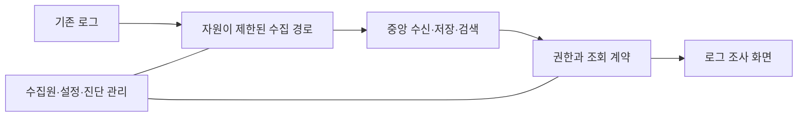

# LogDock 아키텍처 검토 상태

현재 단계는 기능·정책 명세 검토다. 이 문서는 현재 scaffold와 후속 설계의 책임 경계를 구분하며, 최종 기술 구성을 확정하지 않는다.

## 현재 구현

| 영역 | 소스에서 확인한 동작 |
| --- | --- |
| NestJS API | `GET /api/health` 상태 확인 응답, 로컬 loopback 바인딩 |
| React 화면 | API 연결 확인, 실패·시간 초과·재시도 |
| 개발 환경 | npm workspaces, typecheck/build, Vite API 프록시 |
| 로그 기능 | 수집·저장·검색·source 등록·운영 인증은 미구현 |

API health는 중앙 저장소나 로그 수집 상태를 의미하지 않는다. 현재 코드를 최종 기술 선택으로 간주하지 않는다.

## 선택 상태

초기 문서의 Loki 연동, Fluent Bit 우선 검토, NestJS 조회 API 구성은 이전 제안이다. 수집기·저장/검색 엔진·백엔드 최종 선택은 기능·품질 요구와 측정 근거로 다시 검토한다. 기존 코드·의존성을 이번 문서 작업에서 변경하지 않는다.

기능 후보와 정책은 [제품 명세](specs/product-features-v0.1.md), [수집 명세](specs/collection-agent-v0.1.md), [결정표](decisions.md)를 따른다. 중앙 SaaS·과금·여러 엔진 동시 지원·플러그인 체계는 자동으로 채택된 범위가 아니다.

## 검토할 책임

논리적 책임을 나눈 그림이며 배포 단위·microservice 수·엔진을 정한 것이 아니다.

| 영역 | 검토할 책임 |
| --- | --- |
| 에이전트 | 허용 로그 읽기, 최소 파싱·multiline·보안 처리, 출처 식별, bounded 버퍼·전송·진단 |
| 중앙 수신 | source 자격·scope 검증, ACK/부분 거부/재시도·내구성 계약 |
| 저장·검색 | 보존·색인·원문/처리 상태, 시간 범위·집계·문맥과 지연 유입 |
| 조회 계층 | 권한·조건·예산·paging·취소·부분 결과 계약 |
| 관리 계층 | source·키·정책·설정 version·진단·저장 탐색/알림 등 채택된 객체 |
| 프런트엔드 | 탐색 상태·시간/필터·결과 완전성, 상세·주변 로그·실시간 읽기 안정성 |

## 데이터 계약 검토

source·service·environment·instance는 서로 다른 개념이다. 발생 시각·관측/수신 시각, 원본/정규화 severity, 보안 처리 후 본문과 parser/rule version, parse 상태를 구분한다. 실제 필드명·schema·API·색인 라벨은 미확정이다.

고유 요청 ID·컨테이너/프로세스 ID를 무조건 색인 라벨로 넣지 않으며 선택 엔진의 비용과 cardinality를 확인한다. 파일 이름만으로 영구 식별을 보장하지 않는다. 출력 stream과 severity도 별도다.

## 기존 서비스 보호와 전달

기존 앱이 중앙 로그 전송을 기다리지 않도록 한다. 전체 agent 자원과 열린 파일 보유를 제한하고, 과부하·장애·복구에도 같은 예산을 적용한다. D01의 queue 보존·추가 읽기 pause와 원본 삭제 손실 경계를 함께 따른다.

원본 읽기 복구 위치·durable queue commit·중앙 전달 완료 위치·검색 가능을 구분한다. finite queue, 다중 AZ 또는 object storage만으로 무손실·제품 전체 HA를 가정하지 않는다.

## 공개 코드와 환경별 값

조직·서비스·서버 목록, 주소·로그 경로·토큰·실제 운영 로그는 배포 환경에서 관리한다. 공개 예시는 합성 데이터다. 외부 저장소의 비밀값을 브라우저로 전달하지 않는다.

각 외부 구성요소의 라이선스는 별도로 확인한다. LogDock의 Apache 2.0은 외부 소프트웨어·벤더 이미지의 권리를 대체하지 않는다.

## 검증 수준

현재 코드 범위는 정적으로 확인했다. 문서 정합성과 이전 PDF 가독성 확인은 실제 수집·검색·권한·부하·HA·복구 시험과 다르다. [agent 명세의 AT-01~AT-18](specs/collection-agent-v0.1.md)은 후속 검증 시나리오다. 앱 빌드/타입 검사도 로그 연동 검증을 대신하지 않는다.
