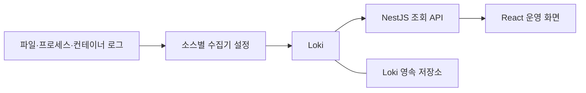

# LogDock 아키텍처

LogDock은 여러 서비스의 로그를 공통 필드로 조회하는 self-hosted 도구를 목표로 합니다. 서비스명과 서버 수, 실행 환경과 저장소 설정은 배포 환경에서 정하며, 애플리케이션은 그 값을 데이터로 다룹니다.

이 문서는 목표 설계입니다. 현재 구현은 상태 확인 API와 API 연결 상태 화면까지이며, 아래의 수집·검색·운영 인증 경로는 아직 연결되지 않았습니다.

## 현재 구현

| 영역 | 구현된 동작 |
| --- | --- |
| NestJS API | `GET /api/health` 상태 확인 응답 |
| React 화면 | API 응답 확인, 실패·시간 초과 표시와 재시도 |
| 개발 환경 | npm workspaces, 타입 검사, 빌드, Vite API 프록시 |

현재 앱은 로그 수집기나 외부 저장소에 접근하지 않습니다. 화면의 API 연결 상태와 실제 로그 수집 상태는 별개의 상태입니다.

## 목표 구성과 책임

| 구성요소 | 목표 책임 | 배포 환경에서 정할 값 |
| --- | --- | --- |
| 수집기 | 로그 읽기, 시간 파싱, multiline, 필드 추가, 마스킹과 전송 | 로그 경로·출력 방식, 서버 식별자, 파서와 전송 설정 |
| Loki | 로그 저장·검색과 보관 정책 적용 | 엔드포인트, 접근 경계, 저장소와 용량·보관 설정 |
| NestJS | 사용자 인증·권한 확인, 조회 조건 검증, Loki 호출과 결과 변환 | 서버 측 연결·인증 설정 |
| React | 서비스·서버·시간·키워드 조건 입력, 목록과 오류 상세 표시 | API가 제공하는 서비스·서버 값 |

첫 검색 엔진 연동은 Loki를 대상으로 합니다. NestJS의 조회 처리와 Loki HTTP 호출을 분리하고, React에는 LogDock의 응답 형식으로 결과를 제공합니다. 여러 검색 엔진의 동시 지원이나 별도 플러그인 실행 체계는 현재 범위에 포함하지 않습니다.

Loki는 별도 서비스로 실행하고 HTTP API로 연결하는 구성을 목표로 합니다. 이 저장소에는 Loki 소스를 포함하거나 수정하지 않습니다. 배포에 사용하는 외부 소프트웨어의 라이선스는 각각 유지하고 확인해야 합니다.

## 공통 로그 필드

다음 필드는 목표 계약이며, 조회 API에는 아직 구현되어 있지 않습니다.

| 필드 | 의미 | 처리 방향 |
| --- | --- | --- |
| `service` | 로그를 생성한 서비스 | 배포 환경에서 정한 식별자 |
| `environment` | 개발·스테이징·운영 등 환경 | 배포 환경에서 정한 식별자 |
| `server` | 로그가 발생한 서버 또는 호스트 | 수집기에서 식별 가능한 안정적인 값 |
| `source` | 로그 출처 또는 출력 방식 | 소스별 수집 설정으로 부여 |
| `event_time` | 원본 로그 발생 시각 | 원본 형식과 시간대를 확인해 파싱 |
| `collected_at` | 수집 시각 | 원본 발생 시각과 구분 |
| `level` | 원본에서 확인한 로그 등급 | 알 수 없는 등급을 오류로 추정하지 않음 |
| `message` | 오류 본문과 stack trace | 여러 줄 예외의 경계를 보존 |

서비스와 환경은 고정된 이름의 목록으로 코드에 넣지 않습니다. 예를 들어 합성 데이터의 `api`, `web`, `worker`는 가능한 서비스 식별자일 뿐 필수 구성이나 예약어가 아닙니다. 수집기 배포 설정이 조직별 이름을 공통 필드에 대응시킵니다.

Loki 라벨은 서비스·환경·서버·소스처럼 조회 범위를 좁히는 값으로 구성하되, 실제 규모에서 카디널리티를 확인해야 합니다. 요청 ID, 컨테이너 ID와 프로세스 ID 같은 값은 필요 시 본문 또는 structured metadata로 보존하며 색인 라벨에 무조건 추가하지 않습니다.

## 수집 소스와 파싱

수집기는 Fluent Bit를 우선 검토합니다. 설치할 OS와 CPU 아키텍처, 패키지 의존성, 읽기 권한과 HTTPS 전송을 확인한 뒤 수집기 버전을 정합니다.

| 출력 방식 | 연동 시 확인할 항목 |
| --- | --- |
| 파일 로그 | 실제 경로, 인코딩, 시간 형식, multiline, 회전·압축 방식 |
| PM2 | error·out 파일, 실행 사용자, 프로세스별 분리·병합과 별도 앱 로그 |
| Docker | logging driver, stdout·stderr, 별도 파일 로그, 컨테이너 교체 시 식별과 재개 |
| 웹 서버·애플리케이션 런타임 | 서로 다른 오류 소스의 수집 범위와 동일 사건의 중복 기록 |

출력 스트림과 오류 등급은 별도로 다룹니다. stderr에서 출력됐다는 이유만으로 모든 메시지를 오류로 단정하지 않고, stdout의 오류 메시지도 수집 범위에서 빠지지 않도록 소스와 파서를 확인합니다.

정규화와 마스킹은 원본 형식에 맞춰 수집 단계에서 적용하는 방향입니다. 서로 다른 형식의 로그를 한 파서에 강제로 맞추기보다 소스별 설정을 공통 필드로 변환합니다.

## 공개 코드와 배포별 설정

공개 저장소에는 애플리케이션 코드, 공통 필드 정의, 합성 데이터로 작성한 예시와 범용 실행 절차를 둡니다. 실제 서버 주소·서비스 목록·로그 경로·인증 값과 운영 데이터는 배포 환경에서 관리합니다.

외부 연결 값은 서버 측 런타임 설정으로 주입합니다. 조직별 설정 파일을 사용하게 될 경우 해당 파일을 Git 추적에서 제외하고, 공개 예시는 비밀 값이 없는 형식 안내로 제공합니다. 현재 앱에는 외부 로그 저장소의 설정 로딩 기능이 없으며 구체적인 변수명과 설정 형식은 연동 구현 때 정합니다.

브라우저에는 조회에 필요한 API 응답만 전달하며, Loki와 저장소의 자격 증명을 포함하지 않습니다. 서비스별 차이를 처리하기 위해 코어 코드에 조직 이름이나 특정 배포의 주소를 조건문으로 추가하지 않습니다.

## 저장소와 운영 정책

Loki의 데이터 보관은 Loki 배포 구성의 책임입니다. 로컬 개발용 저장소와 운영용 영속 저장소를 구분하고, 선택한 백엔드의 API 호환성과 권한을 실제 버전에 맞춰 검증해야 합니다. LogDock API가 특정 클라우드 SDK로 로그 파일을 직접 관리하는 구성은 현재 설계에 포함하지 않습니다.

수집량, 조회 패턴, 보관 기간과 중앙 시스템의 가용성 요구는 배포 환경에서 결정합니다. 원본 로그의 로컬 보존과 중앙 저장소의 보관은 별도 정책으로 다룹니다.

읽기 위치와 전송 버퍼의 영속화, 재시도 한도와 버퍼 포화 시 동작을 확인해야 합니다. 제한된 버퍼만으로 무손실을 보장하지 않으며, 수집 실패·폐기·지연을 확인할 운영 방법도 연동 범위에서 정합니다.

운영 인증·권한·네트워크 접근 경계는 아직 미구현입니다. 개발용 서버를 그대로 외부에 공개하는 운영 절차는 제공하지 않습니다. 조직별 인증 정책과 보관 정책을 제품의 고정 기본값으로 확정하지 않습니다.

## 데이터와 검증

공개 예시와 자동화 검증에는 합성 로그를 사용합니다. 실제 운영 로그, 토큰·원시 키·인증 정보와 개인 식별 정보는 공개 저장소나 이슈에 포함하지 않습니다.

연동 시에는 다음을 확인합니다.

1. 소스별 시간·인코딩·multiline·긴 메시지 파싱과 서버 식별.
2. 로그 회전, 프로세스 재시작과 컨테이너 재생성 후의 수집 재개.
3. 전송 장애·재시도·버퍼 포화와 중복·누락 가능성.
4. 저장소의 기록·목록·조회·재시작 복구와 보관 정책 적용.
5. 인증·조회 권한과 서버 측 자격 증명의 노출 여부.

현재 기본 앱의 빌드·상태 확인 결과는 로그 연동이나 운영 배포 검증을 대신하지 않습니다. 설정 검토, 테스트 실행과 실제 배포 환경 관찰 결과는 구분해서 기록합니다.
