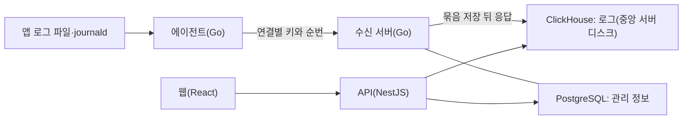

# D17 기술 선정안과 사용자 결정표 v0.1

작성일: 2026-11-03. **상태: 사용자 결정 6개 모두 합의(2026-11-03). D17-01~04·D17-06은 A안, D17-05는 B안이다. 1절의 나머지 행과 5절 전달 설계는 설계 제안이다. 버전은 2026-11-05 설계로 고정했다(1절 표 아래).** 어떤 후보도 측정하지 않았고 구현 승인이 아니다. 개발 PC에는 2026-11-05 Go와 개발용 PostgreSQL만 설치했다.

[아키텍처 평가 절차](../architecture.md#기술-선택-절차-초안)의 1~3단계를 수행했다. 입력은 [결정 기록](../decisions.md), [수집 명세](../specs/collection-agent-v0.1.md), [Q08 기획안](q08-search-plan-v0.1.md), [Q12 기획안](q12-plan-v0.1.md), [운영 명세](../specs/platform-operations-v0.1.md)의 합의다. 외부 사실은 [D17 공식 자료 조사](../research/d17-tech-evidence-2026-11-03.md)의 R번호와 [Q08 조사](../research/q08-search-evidence-2026-11-02.md)의 S번호로 표시한다.

## 1 결론

| 책임 | 추천 | 판정 이유 |
| --- | --- | --- |
| 에이전트 | Go로 자체 구현 **(D17-01 합의)** | 기성 수집기 4종 모두 합의한 동작과 충돌한다(3절) |
| 중앙 수신 | Go로 구현 **(D17-03 합의)** | 파싱 부하를 API와 분리하고 추출 규칙을 입력 크기에 선형인 시간으로 실행한다(R30) |
| 저장·검색 | ClickHouse **(D17-02 합의)** | 두 시각 조회, 타입 충돌 무거부, 구간 삭제, 압축이 맞는다(4절) |
| 로그 저장 위치 | 중앙 서버 디스크만 사용 **(D17-06 합의)** | 가장 단순하고 오래된 로그도 빠르게 찾는다. object storage는 로그량 측정 뒤 다시 판단한다(7절) |
| 관리 DB | PostgreSQL **(D17-04 합의)** | Q12 TD-11의 원자적 기록이 필요하다. 트랜잭션은 MySQL도 충족하므로 스키마 변경 안전성이 차이다 |
| 조회·관리 API | 기존 NestJS 유지 | 공식 ClickHouse 클라이언트가 있고 팀 주력 언어다(R20) |
| 웹 | 기존 React·Vite 유지 | Q15-01로 데스크톱 Chrome만 지원하므로 바꿀 이유가 없다 |
| 중앙 queue | 도입하지 않음 | 에이전트 대기가 보호 역할을 하고 수신 쪽 저장 실패는 재시도로 돌린다(5절) |
| 배포 | 중앙은 Docker Compose, 에이전트는 단일 실행 파일과 systemd | Q16 환경과 일치한다 |

버전은 2026-11-05 Go 1.27, ClickHouse 26.8 LTS, PostgreSQL 18로 고정했다. 메이저와 LTS 계열만 고정하고 패치는 보안·버그 수정을 따라 올린다. 지원 기간, 라이선스, 고른 이유는 [공식 자료 조사 8절](../research/d17-tech-evidence-2026-11-03.md#8-버전-고정)에 있다.

## 2 평가 기준

합의에서 뽑은 탈락 기준이다. 수치는 아직 없으므로 동작만 판정했다.

| 합의 | 수집기가 지켜야 할 동작 |
| --- | --- |
| D01 | 대기가 가득 차면 기존 대기를 지키고 읽기만 멈춘다 |
| D02·Q06 | 파일별 끝 위치에서 시작하고 쓰던 이벤트를 뺀다. 생성 확인 파일과 불확실한 파일을 구분한다. 복구 근거가 없으면 자동 재개하지 않고 보류한다 |
| D03 | 큰 이벤트는 전체를 거부한다. 분할·잘림을 쓰지 않고 본문 없는 진단을 남긴다 |
| D05 | 디스크를 못 쓰면 메모리로 넘어가지 않고 멈춘다 |
| D06 | 재전송에도 같은 식별을 유지한다 |
| Q05 | 키 오류 중에는 전송만 보류하고 대기를 지킨다 |
| Q10-07 | 한 에이전트가 연결별 키를 함께 쓴다 |
| Q14 | 본문 없는 진단을 재시작 뒤에도 확인한다 |
| Q16 | Docker 없이 실행하고 다양한 Linux를 지원한다 |

| 합의 | 저장소가 지켜야 할 동작 |
| --- | --- |
| Q08-01 | 대소문자 미구분 부분 일치. 본문 전체 비교 |
| Q08-02 | 제외 조건 |
| Q08-04·Q12·Q13 | 발생 시각과 수신 시각 두 축 조회 |
| Q08 필드·Q02-05 | 서비스마다 타입이 달라도 거부하지 않고 숫자 범위를 지원 |
| D06 | 검색과 집계에 동일 이벤트 한 건. 실제 별도 발생은 구분 |
| Q04 | 프로그램 재시작 뒤에도 남는 저장 확정 후 응답 |
| Q13 | 로그별 수신 기준 만료, 공간 부족 시 오래된 로그 삭제, 연결·구간 삭제 |
| D01·Q15-02 | 주말을 넘긴 대기 로그가 늦게 도착해도 거부하지 않음 |
| Q08 SD-29·SD-31 | 정확한 건수, 실행 예산, 부분 결과, 취소 |

## 3 수집기 비교

| 합의 | Vector | Fluent Bit | Filebeat | OTel Collector |
| --- | --- | --- | --- | --- |
| D01 포화 | 충족. `block`(R02) | **위반.** 오래된 chunk 폐기(R07) | 입력 설정에 따라 정지 또는 폐기(R05) | **위반.** 큐·디스크 한도에서 폐기(R09) |
| D03 전체 거부 | 줄 단위 폐기. 여러 줄 전체는 미확인(R01) | 여러 줄에 미적용(R06) | **위반.** 잘라서 전송(R05) | **위반.** 분할 또는 잘림(R10) |
| Q05 키 오류 보존 | **위반.** 401·403은 폐기, 5xx로 위장해야 함(R03) | HTTP 출력의 4xx 처리 미확인(R08) | 일반 HTTP 출력 없음 | **위반.** 재시도 불가 오류 폐기(R09) |
| Q10-07 연결별 키 | sink 분리. 연결마다 버퍼 최소 약 256MB(R02) | 출력 분리 | **위반.** 출력 하나(R05) | exporter 분리 |
| D02 파일 구분 | **미달.** `read_from` 하나(R01) | 일부 가능(R06) | 미확인 | **미달.** `start_at` 하나(R10) |
| D02·Q06 복구 보류 | 기능 없음. 체크포인트가 없으면 `read_from`을 따름 | 확인된 기능 없음 | 확인된 기능 없음 | 확인된 기능 없음 |
| 라이선스 | MPL-2.0 | Apache-2.0 | 식별 불가 | Apache-2.0 |

판정: Fluent Bit, Filebeat, OTel Collector는 D01이나 D03, Q10-07의 합의와 직접 충돌해 제외한다. Vector가 가장 가깝지만 D02·Q06 복구 보류와 연결별 대기 비용이 남고 Q05는 인증 오류를 5xx로 위장해야 한다. 설정으로 맞출 수 없는 합의가 여럿이라 자체 구현을 추천한다.

자체 구현은 Go를 추천한다. 런타임을 설치하지 않는 단일 실행 파일이고 `journalctl` 호출로 journald를 읽으면(R04) 별도 라이브러리 없이 다양한 Linux를 지원할 수 있다. 강제 자원 한도는 systemd로 준다(R31). 회전 추적은 OTel fileconsumer 설계를 참고하되 copytruncate 문제가 보고돼 있어 라이브러리 재사용은 검증 뒤에 판단한다(R11). Node.js는 런타임 설치와 메모리 때문에 에이전트에 맞지 않는다는 판단이며 측정값은 아니다.

## 4 저장·검색 비교

| 합의 | ClickHouse | Elasticsearch | Loki | PostgreSQL |
| --- | --- | --- | --- | --- |
| 부분 일치 | 함수로 전체 스캔. 전체 비교가 보장됨. 긴 기간은 느림(S08, R18) | `wildcard` 타입 필요(S07) | 포함 검사. 대소문자 미구분은 정규식(S09) | `pg_trgm`. 두 글자는 색인 이득 없음(R26) |
| 두 시각 조회 | 수신일 파티션과 발생 시각 정렬로 가능 | 가능 | **위반.** 시간축 하나. 수신 시각 색인 불가(R25) | 가능 |
| 타입 충돌 | 충족. 같은 경로 여러 타입(S18) | **미달.** 기본 거부(S17). `flattened`는 숫자 범위 불가(R22) | 조회 때 해석 | 충족. JSON 값 그대로 |
| D06 한 건 | 엔진 기능은 약함(S20). 5절 순번 방식으로 해결 | 강함. `op_type=create`(R21). 시간별 인덱스 사이 중복은 별도 처리 | **위반 위험.** 같은 시각·본문을 무시(S21) | 파티션 전체 유일성 불가(R27). 순번 방식 필요 |
| Q04 저장 확정 | 동기 삽입 또는 대기 비동기 삽입(R13). `fsync_after_insert` 선택(R12) | 기본 fsync(R21) | 조사 안 함 | 커밋 |
| Q13 만료·구간 삭제 | 일 파티션 삭제와 경량 삭제(R14) | 인덱스 삭제와 조건 삭제 | 삭제 API. 로그별 수신 기준 미확인(S22) | 파티션 삭제(R27) |
| 늦은 도착 | 제한 없음으로 파악. 측정 시 확인 | 제한 없음으로 파악 | **위반 위험.** 스트림별 거부(S04) | 제한 없음 |
| 부분 결과·취소 | 시간 조각 실행과 `KILL QUERY`(R15, R16) | 시간 제한과 부분 응답 | 조사 안 함 | 조사 안 함 |
| 저장 효율 | 컬럼 압축. 측정 필요 | 측정 필요 | 측정 필요 | 측정 필요. 색인 포함 시 가장 불리할 것으로 예상 |
| 설치 부담 | 메모리 8GB 이상, 권장 32GB(R17) | JVM과 호스트 설정 검사(R23) | 단일 바이너리 가능 | 낮음 |
| 라이선스 | Apache-2.0 | 배포물은 Elastic License(R24) | AGPL-3.0 | 채택 전 확인 |

판정: Loki는 두 시각 조회와 D06 위험으로 제외한다. Elasticsearch는 저장 확정과 중복 방지가 가장 좋지만 임의 필드 숫자 범위와 타입 충돌을 별도로 설계해야 하고 메모리·라이선스 부담이 있다. OpenSearch는 라이선스 대안이지만 같은 계열로 기능 조사는 하지 않았다. PostgreSQL은 구성이 가장 단순하고 의미를 다 지킬 수 있지만 6개월 보관과 서비스 증가에서 용량과 두 글자 검색이 위험하다. ClickHouse는 D06이 약점인데 5절로 엔진 밖에서 해결하므로 추천한다.

탈락하지 않은 약점도 있다. 부분 일치는 스캔이라 긴 기간 검색이 느리고 이는 Q08-01에서 감수하기로 한 영향이다. 메모리 권장치가 높아 중앙 서버 사양이 8GB 미만이면 다시 판단해야 한다. 2026-11-03 사용자는 중앙 서버 메모리를 16GB로 준비하기로 했다([결정 기록](../decisions.md)). 공식 권장 32GB보다 작으므로 M2·M5에서 16GB로 충분한지 확인한다.

## 5 전달 설계 제안

D06을 엔진 기능에 맡기지 않고 연결별 순번으로 해결한다. 이벤트 ID를 6개월치 조회하는 대신 연결마다 `여기까지 받음` 값 하나를 관리한다.

1. 에이전트는 이벤트를 대기 파일에 쓸 때 연결별로 1씩 늘어나는 순번을 붙인다. 같은 기록에 읽기 위치를 함께 남겨 위치와 대기가 어긋나지 않게 한다.
2. 응답 전에도 한도 안에서 다음 묶음을 보낸다. 재전송은 같은 순번을 쓴다.
3. 수신 서버는 연결별로 다음 순번만 받는다. 이미 받은 순번은 저장 없이 완료로 답하고 건너뛴 순번은 재전송을 요청한다.
4. 수신 서버는 여러 연결의 묶음을 모아 수신일 파티션 하나에 한 번에 저장하고, 저장 성공 뒤 연결별 `여기까지 받음`을 응답한다.
5. 수신 서버가 재시작되면 관리 DB의 마지막 기록과 ClickHouse의 최근 순번으로 값을 복원한다.

| 합의 | 이 방식에서의 충족 |
| --- | --- |
| D06 | 재전송은 순번으로 걸러 저장되지 않는다. 같은 본문의 실제 발생은 순번이 달라 유지된다. 무조건적인 exactly-once를 약속하는 것은 아니다 |
| Q04 | 저장 뒤 응답한다. 응답 전 후속 전송은 순번 창으로 처리한다 |
| AG-12·AG-14 | 위치와 대기를 한 기록에 둔다. 거부 이벤트는 사유만 남기고 순번을 넘겨 뒤 로그를 막지 않는다 |
| Q05·Q10-11 | 연결별 대기라 키 문제는 그 연결만 보류한다. 새 키로 같은 순번을 재전송한다 |
| Q06 | 복구 근거가 없으면 보류하고 사용자가 재개하면 새 세대 순번으로 시작한다 |
| Q12 TD-02, Q08 SD-28 | 수신 서버가 처리 중인 묶음 중 가장 오래된 수신 시각을 알므로 집계 가능 시각을 직접 낼 수 있다. 수신 서버가 하나일 때 성립한다 |
| Q13-03 | 저장 전에 차단 기록을 검사한다. 대기 로그에는 수신 시각이 없어 삭제 구간은 검색 기준 시각으로 판정한다(Q08 기획안 7절) |
| Q13-04 | 순번 값은 로그 만료 뒤에도 남아 판정 근거가 사라지는 경우가 드물어진다. 순번 기록을 잃은 경우에만 Q13-04를 따른다 |

해석은 수신 서버에서 한다. 에이전트는 이벤트 경계와 크기만 확인하고 시각·레벨·필드 해석은 중앙에서 하면 에이전트 CPU를 줄이고 규칙을 바꿔도 서버마다 설정을 다시 적용하지 않아도 된다. 여러 줄 시작 규칙은 경계 판별에 필요하므로 에이전트 설정에 남는다. JSON 깊이·필드 수 한도(AG-09)와 해석 실패 표시는 중앙으로 옮기고 행·이벤트 크기와 조립 한도는 에이전트에 남는다. 해석을 수신 서버에서 하는 것은 D17-03 합의로 정해졌다. D17-03의 두 안이 모두 중앙 해석을 전제했다. 위의 세부 분담은 Q08-07의 `설계에서 정한다` 항목에 대한 설계 제안으로 남는다.

중앙 queue를 두지 않는 이유는 수신 서버가 저장 전에 응답하지 않기 때문이다. ClickHouse가 멈추면 응답하지 않고 대기는 에이전트에 남는다(D01, Q15-02). 중앙 프로그램 재시작 보존은 저장 뒤 응답으로 충족한다.

Q04가 제외한 서버 고장까지는 지키지 않지만 정상 종료가 아닌 전원 차단에 대비해 `fsync_after_insert`를 켜는 것을 기본 안으로 측정한다. 비용이 크면 영향을 다시 제시한다.

## 6 나머지 책임

| 책임 | 제안 | 경계 |
| --- | --- | --- |
| 로그 테이블 | 수신일 파티션, 검색 기준 시각 정렬, 수신 시각 범위 색인 | 정렬 키와 필드 저장 형식(JSON 타입 또는 타입별 맵)은 측정으로 정한다 |
| 검색 실행 | 최신 시간 조각부터 나눠 실행하고 완료 구간을 기록 | Q08 SD-29·SD-31의 부분 결과 근거다. 엔진의 `break`만으로는 완료 구간을 알 수 없다(R15) |
| 검색어 비노출 | 검색 전용 계정에 `log_queries=0` | 파라미터 기록 여부는 확인 필요(R16) |
| 자원 분리 | 검색·알림 평가용 워크로드 분리 | 병합은 대상이 아니므로 완전한 격리는 아니다(R19) |
| 알림 작업 | PostgreSQL 상태·메일 작업 테이블 | 별도 메시지 브로커를 두지 않는다(R29, Q12 TD-11) |
| 인증 | Q10 합의대로 로컬 공용 계정. NestJS에서 구현 | 해시·세션 라이브러리는 구현 때 선정한다 |
| 에이전트 강제 한도 | systemd 자원 제어와 내부 한도 | systemd가 없는 호스트는 내부 한도만 남는다는 지원 제한을 표시한다(RS-01) |

## 7 사용자 결정

[AGENTS.md](../../AGENTS.md) 협의 방식을 따랐다. 2026-11-03 여섯 안건 모두 사용자 답을 받았고 결과는 [결정 기록](../decisions.md)에 남겼다. 감수할 영향은 사용자가 이 선택으로 받아들인 결과이고 미채택 안은 재검토 때 참고하도록 남긴다.

### D17-01 에이전트를 무엇으로 만들 것인가

2026-11-03 사용자 답 `우선 go 로 할게`로 A안을 채택했다. C안은 사용자가 Rust를 물어 대화에서 같은 기준으로 비교한 안이다.

| 안 | 실제 동작 | 쉬운 예시 | 감수할 영향 |
| --- | --- | --- | --- |
| **A안 (합의)** Go로 직접 구현 | 합의한 동작을 그대로 구현한다 | 키가 폐기되면 그 연결만 보류하고 대기를 지킨다 | 파일 회전과 장애 복구를 직접 만들고 검증해 개발량이 가장 크게 늘어난다 |
| **B안** Vector 사용 | 기성 제품에 설정과 중앙 응답 조정을 더한다 | 키 폐기를 5xx로 돌려주고 위치 복구 실패는 자동으로 다시 읽는다 | 개발은 줄지만 쓰던 줄 제외, 파일 구분, 복구 보류 합의를 완화해야 한다 |
| **C안** Rust로 직접 구현 | A안과 같은 동작을 Rust로 구현한다 | GC가 없어 메모리 사용을 예측하기 쉽다 | Go보다 배우기 어렵다. 메모리 강제 상한은 어느 언어든 systemd로 걸어(R31) 이점이 작다. Go 수신 서버(D17-03 A안)와 코드를 공유하지 못한다 |

### D17-02 중앙 로그 저장소를 무엇으로 할 것인가

2026-11-03 사용자 답 `clickhouse`로 A안을 채택했다. 같은 날 사용자가 ClickHouse가 과하다며 다시 보자고 했다. 실측한 서비스 서버 1대의 하루 로그가 약 4.5MB라 이 기준으로는 C안이 맞아 보이지만, 사용량이 더 많은 서비스 3개의 로그량을 잰 뒤 A안 유지와 C안 전환을 다시 정하기로 했다. 2026-11-04 사용자는 로그량을 재기 전에 `clickhouse 유지해서 해보자`로 답해 A안 유지를 확정했고 재검토를 닫았다. C안은 재검토용으로 남긴다([결정 기록](../decisions.md)).

| 안 | 실제 동작 | 쉬운 예시 | 감수할 영향 |
| --- | --- | --- | --- |
| **A안 (합의)** ClickHouse | 압축 저장하고 부분 일치는 훑어서 찾는다 | 6개월 전체에서 `주문`을 찾으면 최근 구간부터 결과가 나온다 | 중앙 메모리가 최소 8GB, 권장 32GB다. 긴 기간 검색이 느리다 |
| **B안** Elasticsearch | 저장 확정과 중복 방지를 엔진에 맡긴다 | 같은 ID 재전송을 엔진이 거절한다 | 메모리가 크고, 임의 필드 숫자 범위와 타입 충돌을 별도로 풀어야 하며 배포 라이선스 조건을 확인해야 한다 |
| **C안** PostgreSQL 하나 | 로그와 관리 정보를 한 DB에 둔다 | 구성요소가 하나 줄어 설치가 쉽다 | 저장 공간이 크고 `주문` 같은 두 글자 검색은 로그가 늘수록 느려진다 |

### D17-03 중앙 수신 서버를 무엇으로 만들 것인가

2026-11-03 사용자 답 `A`로 A안을 채택했다.

| 안 | 실제 동작 | 쉬운 예시 | 감수할 영향 |
| --- | --- | --- | --- |
| **A안 (합의)** Go로 분리 | 수신과 해석을 별도 프로세스로 두고 에이전트와 코드를 공유한다 | 로그가 몰려도 웹 API 응답이 밀리지 않는다 | 백엔드 언어가 둘이 된다 |
| **B안** NestJS에 포함 | 언어를 하나로 유지한다 | 수신도 TypeScript로 작성한다 | 파싱이 API 응답을 늦출 수 있어 프로세스를 나눠야 하고 위험한 정규식 대비를 따로 해야 한다 |

### D17-04 관리 정보 DB를 무엇으로 할 것인가

2026-11-03 사용자 답 `A`로 A안을 채택했다. 답을 받기 전에 A안의 근거를 공식 자료로 확인했다(R35).

| 안 | 실제 동작 | 쉬운 예시 | 감수할 영향 |
| --- | --- | --- | --- |
| **A안 (합의)** PostgreSQL | 서비스, 키, 저장 검색, 알림 상태를 저장한다 | 스키마 변경이 중간에 실패해도 트랜잭션으로 되돌린다(R35) | 주력 DB가 아니라 익혀야 한다. `CREATE INDEX CONCURRENTLY`처럼 트랜잭션 안에서 못 쓰는 명령은 따로 다룬다(R35) |
| **B안** MySQL | 같은 내용을 MySQL에 저장한다 | 익숙한 도구와 운영 경험을 쓴다 | 스키마 변경 도중 실패하면 트랜잭션으로 되돌릴 수 없다(R28) |

### D17-05 측정을 어디서 시작할 것인가

선정안을 확정하려면 8절 측정이 필요하다. 모두 합성 로그만 쓴다.

2026-11-03 사용자 답 `개발은 로컬에서 하지만 서버는 내가 바로 준비할거야`를 B안으로 반영했다. 사용자가 중앙 서버를 바로 준비하므로 B안의 시작 지연이 줄어든다. 개발은 로컬에서 한다. 처음 추천한 A안은 채택하지 않았다.

| 안 | 실제 동작 | 쉬운 예시 | 감수할 영향 |
| --- | --- | --- | --- |
| **A안** 이 PC의 Docker | 개발 PC에서 ClickHouse를 띄워 측정한다 | 바로 시작하고 운영 서버에 영향이 없다 | 이미지와 데이터로 디스크를 쓰고 실제 서버 사양과 달라 참고치다 |
| **B안 (합의)** 실제 중앙 서버 | 중앙 서버에서 측정한다 | 실제 사양의 수치를 얻는다 | 서버 준비와 접속 승인이 필요하고 시작이 늦어진다 |

### D17-06 중앙 로그를 어디에 저장할 것인가

처음 결정표에는 없던 안건이다. 기존 문서는 저장 매체를 후속 설계로 남겼는데 이 기획안이 서버 디스크를 암묵적으로 전제했다. 사용자가 object storage에 넣기로 하지 않았는지 물어 이를 확인하고 추가했다. 2026-11-03 사용자 답 `A안으로 가자`로 A안을 채택했다.

| 안 | 실제 동작 | 쉬운 예시 | 감수할 영향 |
| --- | --- | --- | --- |
| **A안 (합의)** 중앙 서버 디스크만 사용 | 모든 로그를 중앙 서버 디스크에 저장한다 | 6개월 전 로그도 최근 로그와 같은 속도로 찾는다 | 디스크가 차면 Q13-01대로 오래된 로그부터 지워져 6개월을 못 채울 수 있다 |
| **B안** 오래된 로그만 object storage로 이동 | 최근 로그는 디스크에 두고 정한 기간이 지난 로그를 object storage로 자동으로 옮긴다(R33) | 최근 며칠은 디스크, 그보다 오래된 로그는 object storage에서 찾는다. 기간은 예시이며 기본값이 아니다 | 오래된 로그 검색이 느려지고, 쓸 수 있는 object storage와 늘어난 장애 경로의 검증이 필요하다 |
| **C안** 전부 object storage에 저장 | 디스크는 캐시로만 쓴다(R32) | 디스크 용량 걱정이 가장 적다 | 저장 뒤 응답과 병합이 느려지고(R34), object storage가 멈추면 수신도 멈춰 로그가 에이전트 대기에 쌓인다 |

서버 고장 대비는 Q04에서 범위 밖으로 합의했으므로 판단 기준으로 쓰지 않았다. 메타데이터가 서버에 남아 object storage만으로 고장에 대비되지도 않는다(R32, 추론). B·C안의 동작은 ClickHouse 기준이고 A안은 어느 저장소를 고르든 같으므로 D17-02 선택을 바꾸지 않는다. B안은 기존 디스크를 포함한 새 저장 정책에 object storage를 더하는 방식이라 나중에 추가할 수 있다(R32·R33, 미시험). M1의 6개월 환산량이 중앙 서버에서 로그에 쓸 수 있는 공간을 넘으면 B안을 영향과 함께 다시 제시한다.

## 8 측정 계획

아래 값은 시험 입력이며 목표나 기본값이 아니다. 실제 로그량을 모르므로 일일 1GB, 10GB, 50GB의 합성 로그를 가정한다. 2026-11-03 실측한 서비스 서버 1대는 하루 약 4.5MB였고 사용량이 더 많은 서비스는 아직 재지 않았다. 사내 앱 형식 4종(Q08 기획안 4절)을 합성해 쓴다. 합격 수치는 결과를 보고 Q15로 제안한다.

| ID | 무엇을 재는가 | 판단에 쓰는 곳 |
| --- | --- | --- |
| M1 | 압축 후 저장량과 6개월 환산량 | D17-02, D17-06 재검토, Q15 용량 |
| M2 | 한글·영문 부분 일치, 제외 조건, 필드 조건의 기간별 응답 시간 | D17-02, Q08 실행 예산 |
| M3 | 묶음 저장 지연과 `fsync_after_insert` 비용 | 5절, 검색 가능 지연 |
| M4 | 동시 검색 5명(Q15-03)일 때 수신 지연 변화 | Q08 SD-31 |
| M5 | ClickHouse를 8GB로 제한했을 때와 16GB 중앙 서버에 PostgreSQL·API·수신 서버를 함께 올렸을 때의 동작 | D17-02, 중앙 메모리 |
| M6 | 수신 서버를 강제 종료했을 때 유실·중복이 없는지 | D06, Q04, OT-03 |
| M7 | 에이전트 시제품의 CPU·메모리, 회전 시나리오 | D17-01, AT-04·AT-05 |
| M8 | 미래 시각 허용 오차 후보 | Q08-05 |

D17-05 B안에 따라 측정은 사용자가 준비하는 실제 중앙 서버에서 하고 개발은 로컬에서 한다. 2026-11-05부터 로컬에는 개발용 PostgreSQL만 두고 ClickHouse 연동 개발은 중앙 서버의 ClickHouse를 쓴다. 운영에서도 PostgreSQL은 ClickHouse와 같은 중앙 서버에 두므로 M5는 그 배치를 잰다([결정 기록](../decisions.md)). 중앙 서버 메모리는 16GB다. 측정에 쓸 디스크 여유, CPU, 서버 접근과 실행 방식은 측정 전에 확인한다.

측정은 2026-11-05에 고정한 ClickHouse 26.8 LTS, PostgreSQL 18, Go 1.27로 한다([공식 자료 조사 8절](../research/d17-tech-evidence-2026-11-03.md#8-버전-고정)). 측정 기록에는 설치한 정확한 패치 번호를 남긴다. 패치만 바뀌면 결과를 그대로 쓰고, LTS 계열이나 메이저가 바뀌면 결과가 달라질 수 있는 측정을 다시 한다.

| 측정 | 준비물 |
| --- | --- |
| M1~M4 | ClickHouse, 합성 로그를 만들어 넣는 스크립트, 검색 질의 스크립트 |
| M5 | M1~M4의 준비물과 PostgreSQL, 수신 서버·조회 API 시제품. ClickHouse를 8GB로 제한하는 부분은 ClickHouse만으로 먼저 잴 수 있다 |
| M6 | ClickHouse, 수신 서버 시제품, 묶음을 보내는 쪽(에이전트 시제품이나 송신 시험 도구) |
| M7 | 에이전트 시제품 |
| M8 | 에이전트 시제품(관측 시각)과 수신 서버 시제품(발생 시각 해석) |

시제품에 쓸 Go 1.27은 2026-11-05 이 PC에 설치했다(1.27.3).

**실패 시 경로:** M2·M5가 쓸 수 없는 수준이면 Elasticsearch를 다시 평가한다. M5에서 16GB 서버에 함께 올릴 수 없으면 증설 가능 여부와 함께 PostgreSQL 하나(D17-02 C안)도 다시 제시한다. M7에서 회전·복구 구현이 감당할 수 없는 수준이면 Vector와 완화할 합의를 다시 제시한다. M1의 6개월 환산량이 중앙 서버 디스크에 들어가지 않으면 D17-06 B안을 다시 제시한다. 실제 중앙 디스크 크기는 환경 입력이다.

## 9 남는 위험

- 자체 에이전트는 이 제품에서 가장 큰 구현 위험이다. 파일 회전과 장애 복구의 예외를 직접 책임진다.
- 순번 방식은 수신 서버 하나를 전제로 한다. 여러 대로 늘리면 집계 가능 시각과 연결별 순번을 다시 설계해야 한다.
- ClickHouse의 대소문자 규칙은 영어 기준이라 비ASCII 범위를 시험해야 한다(R18).
- 언어가 Go와 TypeScript 둘이 되어 유지 비용이 늘어난다.
- 중앙 서버 메모리가 공식 권장 32GB의 절반인 16GB라 페이지 캐시가 작아 긴 기간 검색이 느릴 수 있다. M2·M5로 확인하고, 부족하면 증설 가능 여부를 포함해 다시 제시한다.
- 로그를 중앙 서버 디스크에만 두므로(D17-06) 로그량이 예상보다 많으면 6개월이 되기 전에 오래된 로그가 지워진다. 경고와 조회 가능 시작일 표시로 알리고(Q13-01) 측정 뒤 B안 재검토로 대응한다. 디스크 고장으로 로그를 잃는 것은 Q04에서 범위 밖으로 합의한 영향이다.
- 이 표는 문서 근거다. 실제 동작은 측정과 AT·IT·OT 시나리오로 확인한다.

## 10 결과 반영과 확인 범위

답을 받으면 결정 기록과 아키텍처 문서에 채택 결과와 탈락 이유를 ADR로 남기고 합의 항목을 갱신한다. D17-06은 2026-11-03 [결정 기록](../decisions.md)과 [아키텍처 문서](../architecture.md)에 반영했다. D17-01~05도 같은 날 같은 문서에 채택 결과와 탈락 이유를 남겼다.

이번 작업은 공식 자료 조사와 Markdown 작성, GitHub API의 공개 메타데이터 조회다. 제품 코드·의존성·DB·운영 서버·설치·시험·commit/push를 실행하지 않았다. 사용자 협의 잔여 집계는 바뀌지 않는다. D17-06 반영 때도 공식 자료 R32~R34를 추가하고 문서만 고쳤다. D17-01~05 반영 때는 R35를 추가하고 문서만 고쳤다. 2026-11-05 버전 고정 때는 R38~R49를 추가하고 문서만 고쳤다. 같은 날 사용자 요청으로 이 PC에 Go와 개발용 PostgreSQL을 설치했다([개발 환경](../agent/refs/dev-environment.md)).
