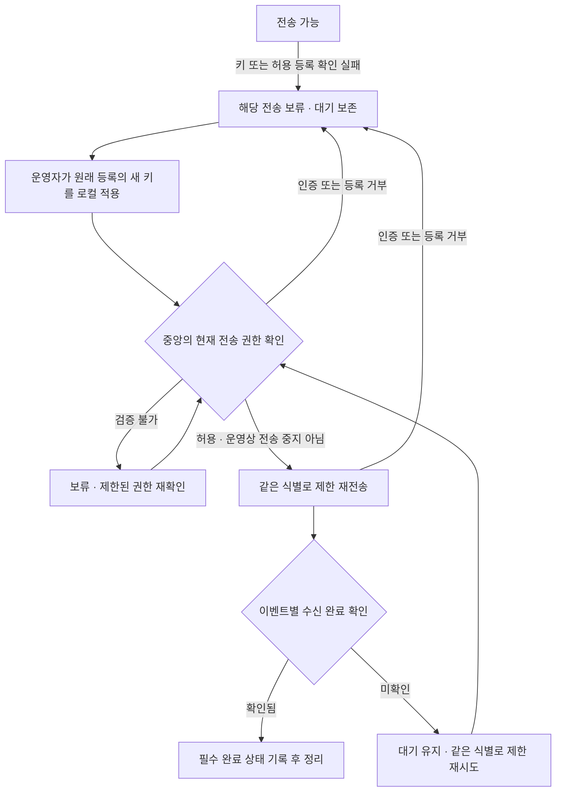

# Q05·Q07·Q10 기획안과 사용자 선택표 v0.1

작성일: 2026-11-01. 합의 상태 갱신: 2026-11-02. **상태: Q05·Q07·Q10 사용자 항목 채택/유예/설계 인계 정리 완료. Q10-13/14의 일괄 질문 6개 추천을 모두 합의해 전용 표의 미완료 사용자 선택은 0개.** MFA·전용 강제 대기 폐기 등 유예는 유지하며 실제 기술/구현/검증 완료나 서버/DB·계정/키/설치/삭제/배포·commit/push 승인은 아니다.

기준 문서는 [결정 기록](../decisions.md), [협의 목록](user-decisions-v0.1.md), [수집 명세](../specs/collection-agent-v0.1.md), [운영 명세](../specs/platform-operations-v0.1.md)다. 외부 사실과 제안의 근거는 [공식 자료 조사 15건](../research/q05-q07-q10-evidence-2026-11-01.md)에 확인일·적용 범위와 함께 기록했다. 기존 작업 트리의 다른 협의는 유지한다.

## 1 완료 범위와 기존 합의

이번 완료 범위는 대안/추천·위험·정상/실패 흐름·권한/수명/관측 계약·의존성·설계 인계·미실행 수용 조건 조사와 사용자 협의다. 검토 항목 25개(Q05 3개·Q07 8개·Q10 14개)는 채택/유예/설계 인계로 정리됐고, 2026-11-02 Q10 감사 일괄 질문 6개를 사용자가 모두 채택했다. 이 전용 표의 미완료 사용자 선택은 0개이며 초기 유예 기능·환경 입력/실제 수치/기술·구현/검증은 별도로 남는다. 원래 출처/식별·대기/자원 보호는 유지한다.

2026-11-01 사용자는 운영 조건 질문에 ‘사내망·VPN 전용, 자체 로그인 선호’라고 답했다. 기존 공용 1계정 합의와 연결해 초기 인증은 로컬 공용 로그인 방향으로 진행한다. 이어 웹과 에이전트 전송 모두 HTTPS를 기본으로 하는 제안에 동의했고 MFA는 후속으로 선택했다. 첫 출시는 자체 공용 계정의 비밀번호 로그인이며 Q16-04에서 ingest의 private 상호 연결 가능 환경은 확인했고 인증서 실제 적용/배포는 설계이며 초기 자격/복구·웹 세션은 Q10-03/06 합의를 따른다. 사내 SSO가 없다고 판단한 것은 아니다.

| 다시 묻지 않을 합의 | 이번 기획의 고정 경계 |
| --- | --- |
| D09 / Q10·Q11 | 한 운영팀용 자체 설치형, 공용 웹 로그인 1계정·공동 저장 목록. 초기 개인 계정·역할·팀 목록 추가 없음. 향후 계정 분리 확장 고려 |
| Q10-01 / Q10-02 / Q10-04 | 초기 자체 공용 비밀번호 로그인. 웹은 사내망·VPN 전용, 웹/에이전트 전송은 HTTPS 기본 사용. MFA는 후속. Q16-04에서 ingest private 상호 연결 가능 확인. 자격/복구·세션은 Q10-03/06 합의, 인증서 실제 적용·구체 네트워크 허용/기술·실행 검증은 후속 |
| Q07 / Q07-01 | 수집 연결 등록 화면에서 기존 서비스를 고르거나 새 서비스 이름을 입력해 등록. 서비스/수집 등록 확정 뒤 키 발급, 중앙은 키와 등록정보로 서비스 판별. 서비스는 분류이며 tenant/사람별 권한 경계가 아님 |
| Q07 오류 | 서비스 없는 키 발급·미분류 저장/재분류·서비스 자동 생성 제외. 확인할 수 없는 요청은 수신 완료로 처리하지 않고 오류·미확인 대기 보존 |
| Q05 / D08 | 키 사용 불가 시 해당 전송 보류, 원본과 별도 전용 디스크 대기 파일 보존. 원래 수집원에 새 키의 현재 전송 권한 확인 후 같은 이벤트 식별로 재개 |
| D01 / D05 | 제한된 디스크 대기, 포화 시 기존 데이터 유지·추가 읽기 pause. 사용 불가 시 자동 메모리 대체 없음. 필수 상태 기록 실패 시 해당 전송도 안전 정지. 원본 rotation/삭제의 누락 가능성 표시 |
| Q04 / D06 | 중앙 프로그램 재시작 후 유지할 기록 확정 뒤 완료 응답. 미확인 데이터는 같은 식별로 재시도. 같은 이벤트는 저장·검색·집계 한 건. 중앙 하드웨어 재해 복제/복구 제외 |
| Q06 / D02 | 복구 근거 없으면 자동 읽기 보류, 사용자가 누락 가능성 확인 후 지금부터 수집을 선택할 수 있음. 기존 유효 대기는 보존. 정상 재시작을 최초 EOF로 초기화하지 않음 |
| D04 / Q02 / Q16 | 앱 출력 본문 마스킹·재마스킹·과거 가져오기 없음. Linux의 파일/journald·텍스트/JSON/여러 줄·UTF-8 초기 지원. 중앙 제공 설정을 사용자가 로컬에 복사 적용. 원격 명령·자동 설치/설정 변경은 채택하지 않음 |

본문의 ‘운영자’는 업무 책임을 뜻한다. 별도 사람 계정·역할을 만들지 않는다. ‘키 폐기’는 중앙 전송 자격 무효화이며 대기 데이터 삭제와 다르다. ‘등록 보관’은 관리 객체의 상태이며 중앙 로그 보존일과 다르다.

## 2 Q05: 남은 대기 로그와 중단·재개

### 사용자 선택 3개

| ID | 선택할 결과 | A 추천안과 이유 | 대안과 감수할 영향 |
| --- | --- | --- | --- |
| Q05-01 | 키 오류 중 포화 전 새 로그 읽기 — 합의 | **사용자 합의(2026-11-02):** 디스크/필수 상태 기록이 정상이고 별도 수집 중단 요청이 없으면 전송만 보류하고 정한 로컬 대기 용량 한도까지 계속 읽어 보관. 포화 때 D01대로 추가 읽기를 멈추고 기존 대기 보존 | 오류 확인 즉시 새 읽기까지 중단하는 비교안은 채택하지 않음. D05 쓰기/상태 실패의 안전 정지와 명시 중지를 우선하며 기존 앱 로그 기록은 계속됨. 원본 rotation/삭제에 따른 누락 가능성을 표시하고 원래 등록의 유효 키 확인 뒤 같은 식별로 제한 재전송. 실제 한도/자원·상태/기록 정합성·구현/검증은 후속 설계 |
| Q05-02 | 정상 수집 종료와 사고 대응 — 합의 | **사용자 합의(2026-11-02, Q16-09 연계):** agent 중지 요청 시 새 읽기/전송·재시도를 멈추고 잔여 전송/중앙 ACK 대기 없이 즉시 종료. 진행 기록/동일 이벤트 식별·미전송/미확인 대기 보존, 재실행 때 기존 복구/같은 식별 재전송. 중지 완료와 전송 완료는 별도 **사고 대응 합의(2026-11-02):** 중앙에서 사고 대상 키의 폐기를 우선 시도하고 서버 운영자가 해당 연결의 로컬 읽기를 중지. 중앙 조치 실패/단절이 로컬 중지를 지연시키지 않으며 기존 대기 보존. | 기존 대기 전송 후 종료 추천은 미채택. 정상 중지의 최소 로컬 정리/취소·실제 종료 한도/강제 종료/상태는 후속 설계이며 강제 kill/대기 폐기를 채택하지 않음. 중앙 폐기 요청/확정·로컬 중지/관측을 구분하고 미확정을 완료로 표시하지 않음. 해당 연결 중단 단위·전체 agent 중지의 다른 연결 영향·동시성/실패는 E03/T03/T05/Q16 설계/검증. 원격 즉시 중지·기존 앱 정지/원본 삭제를 추가하지 않음 |
| Q05-03 | 미전송/미확인 대기 전용 폐기 기능 — 후속 합의 | **사용자 선택 A(2026-11-02):** 미전송/수신 미확인 대기를 강제로 지우는 전용 도구/UI는 첫 출시에서 유예. 기존 대기는 보존하고 상태/조치 필요 표시와 유효 키/복구 안내를 제공 | 중앙 수신 완료 항목의 정상 정리는 기존 계약대로 유지하며 원본/중앙 로그 보존 정책과도 별개. TTL/키 오류/중지로 미확인 대기를 자동 삭제하지 않음. 향후 기능을 채택할 때 복구 불가 손실·대상/미상 범위·동시 처리/감사/부분 실패·새 읽기 경계를 설계/검증. 실제 파일 삭제/서버 조작은 승인/실행하지 않음 |

Q05-01은 포화 전까지도 한도 내 새 읽기를 계속하는 것으로 합의했다. 이미 합의한 전송 보류·포화 시 D01 읽기 중단/대기 보존과 D05 오류 안전 정지를 유지한다. 명시적 수집/agent 중지 요청은 공간이 남아 있어도 우선하며 Q16-09/Q05-02 정상 중지의 잔여 전송/ACK 대기 없는 종료를 바꾸지 않는다. 원래 등록의 유효 키 확인 뒤 같은 식별로 재개하는 원칙도 재승인받지 않는다.

### 권고 흐름과 실패 계약

아래 흐름은 기존 D01/D05/D06/D08과 Q10-11 합의를 기초로 Q05 추천안·실패 설계를 정리한 검토안이다. Q05-01과 Q05-02 정상/사고 중지는 합의했고 Q05-03 전용 대기 폐기는 후속으로 유예했다. ACK의 실제 형식·기록 순서·수집기 선택은 D06/P17의 설계다.

| 상황 | 제안 동작·표시 | 계속 지킬 경계 |
| --- | --- | --- |
| 키 파일 없음/읽기 실패 | 로컬 자격 확인 필요. 중앙 폐기 완료라고 단정하지 않음 | 키 원문 진단 금지. 기존 대기·출처·식별 유지 |
| 신뢰한 중앙의 인증/등록 거부 | 해당 전송 보류, 확인 가능한 사유와 조치 표시. 같은 거부 요청을 빠르게 무한 반복하지 않음 | HTTP를 쓰더라도 401/403만으로 상세 원인을 추정하지 않음(S01/S03) |
| 네트워크/TLS/검증 서비스 불능 | 권한 ‘미확인’과 전송 장애를 표시, 예산 안에서 재시도 | 정상·폐기 완료로 추정하지 않음. 인증서 확인을 자동 해제하지 않음 |
| 새 키가 다른 등록에서만 유효 | 원래 등록에 대한 권한이 없으므로 보류 유지 | 현재 설정의 서비스/등록으로 과거 대기를 덮어쓰지 않음 |
| 교체 키 검증 직후 권한 회수 | 실제 수신 판단에도 현재 권한 적용, 허용되지 않은 미확인 항목 유지 | 사전 검증 한 번이 이후 전송의 무기한 허가가 아님 |
| 중앙 확정 뒤 키 폐기, ACK 지연 | 원래 이벤트에 대한 유효한 완료 응답이면 필수 상태 기록/정리 계약에 따라 처리 | 키 폐기로 이미 수신 확정한 로그를 소급 삭제하지 않음 |
| 확정 여부를 모르는 ACK 유실/부분 응답 | 확인된 항목과 미확인을 분리, 미확인은 같은 식별·원래 등록으로 재시도 | 전체 batch를 추정 완료하거나 새 식별을 부여하지 않음 |
| 대기/출처/위치 기록 손상 | 검증 가능한 범위만 처리, 불명확한 범위는 보류·복구 필요 | Q06의 새 읽기 시작은 유효 대기 삭제나 손상 대기 복구를 대신하지 않음 |
| 대기 포화/공유 상태 쓰기 실패 | D01/D05, 안전하게 분리할 수 있는 다른 연결만 계속 | 공유 공간을 쓰면 다른 연결도 영향을 받을 수 있음. 완전 격리 보장 아님 |
| 키가 막혀 상태 보고도 불가 | 중앙은 마지막 보고 시각·현재 미관측, agent는 제한된 로컬 진단 | 옛 대기량/정상을 현재 값처럼 표시하지 않음 |

일반 인증 장애에서 새 키를 적용하면 **원래 등록 권한 검증 후 재개**하는 흐름을 사용한다. timeout이나 검증 서비스 장애만으로 새 키 발급을 강제하지 않는다. 운영자가 읽기/전송을 중단한 의도는 별도 유지하고 키 교체만으로 이를 해제하지 않는다. 중앙은 저장·색인·검색을 책임지며 agent가 검색 성공을 직접 확인하도록 추가하지 않는다.

## 3 Q07: 등록·이름·출처·수명

### Q07 검토 항목 8개: 사용자 선택 7개·설계 인계 1개

| ID | 선택할 결과 | A 추천안과 이유 | 대안과 감수할 영향 |
| --- | --- | --- | --- |
| Q07-01 | 등록 화면에서 서비스 선택/이름 등록 — 합의 | **사용자 선택 A(2026-11-01):** 수집 연결 등록 화면에서 기존 서비스를 고르거나 새 서비스 이름을 직접 입력해 등록한 뒤 연결을 이어감. 서비스는 LogDock의 로그 분류 이름을 뜻함. 서비스/수집 등록 확정 뒤 키 발급 | 비교 기록 B: 별도 서비스 목록에서 먼저 생성한 항목만 선택하는 방식은 채택하지 않음. 별도 관리 화면의 구체 UI/API와 확정/실패 정합성은 후속 설계. 수신 로그로 서비스 자동 생성은 제외 |
| Q07-02 | 서비스 이름은 별칭 — 연결 식별 우선, 이름 규칙 설계 인계 | 사용자 취지 확인(2026-11-01): 실제로 어느 서버의 어떤 agent가 어떤 로그를 수집하는지와 등록/키의 일치가 중요. 별칭은 인증·동일 연결 판정 근거로 쓰지 않음. 이름 검증과 구분 표시는 T02/T05에서 구체화 | 기존 설치 전체/보관 이름 중복 금지는 미채택 제안이며 필수 사용자 질문에서 제외. 중복 허용도 아직 합의하지 않음. 이름이 같다고 연결을 합치거나 이름이 다르다고 같은 원본의 이중 수집을 허용하지 않음 |
| Q07-03 | 서비스 별칭 변경 — 합의 | **사용자 합의(2026-11-01):** 등록한 서비스 이름을 나중에 수정할 수 있음. 서버/agent/수집 연결·기존 로그와 원래 출처는 유지하고 화면의 서비스 이름을 현재 별칭으로 표시 | 이름 변경으로 새 연결/서비스를 만들거나 기존 로그 본문·출처를 소급 재작성하지 않음. 구체 이전 이름/변경 이력 UI·동시 수정·이름 규칙·저장 조건/알림 참조 계약은 후속 설계. 다른 서비스 분류로의 이동은 Q07-04와 별도 |
| Q07-04 | 기존 연결의 다른 서비스 분류로 직접 이동 — 후속 합의 | **사용자 합의(2026-11-01): 후속으로 유예.** 초기에는 기존 연결 종료/잔여 처리 후 새 분류에 새 연결을 등록하는 일반 흐름을 사용. 기존 로그/대기는 원래 분류·연결/이벤트 식별 유지. 중단부터 새 D02 시작 경계 사이 수집 공백/누락 가능성 표시 | 기존 연결에서 앞으로의 로그만 새 분류로 바꾸는 기능·전환 version/경계 처리는 후속 채택 때 설계/검증. 별칭 수정은 Q07-03대로 유지. 종료/새 등록의 중복 차단과 재사용 조건은 Q07-06/07·T02/T03에서 정합성 확인. 키 발급/허용 범위 갱신 단위는 Q10-07에서 별도 선택 |
| Q07-05 | 서버/실제 수집 대상 교체 시 새 연결 — 원칙 합의 | **사용자 합의(2026-11-01):** 다른 서버나 전혀 다른 로그를 수집하게 되면 새 연결로 등록해 기존 대상/이력과 구분. 별칭 수정·정상 파일 rotation·추적 파일 rename·재시작은 기존 연결과 D02 복구 원칙 유지 | 기존 로그/대기는 원래 연결/식별로 유지하고 새 연결은 D02 시작 기준 적용. 같은 입력의 설정 수정·실제 서버/입력 판정·종료/새 등록·기존 서버 대기 처리와 제거 절차는 T02/T03/Q16에서 설계. 자동 이전/새 서버로 대기 복사·무중단 보장·등록당 agent 수는 이 항목으로 채택하지 않음. 키 범위/개수는 Q10-07 합의 |
| Q07-06 | 확인된 실제 수집 연결 중복 차단 — 원칙 합의 | **사용자 합의(2026-11-01):** 같은 서버의 같은 로그를 수집하는 연결이 이미 등록됐다고 확인되면 기존 연결을 안내하고 추가 등록을 차단. 별칭이 달라도 같은 입력이면 이 원칙 적용. 같은 서버의 다른 로그는 구분 | 동일 서버/입력 판정 방법·검사 시점·동시 등록·복제/겹치는 패턴·파일/journal 중복 가능성과 불확실한 경우의 경고/확인 흐름은 후속 설계. 모든 중복 자동 판별·1서버/1agent·기존 데이터 자동 병합/삭제를 채택한 것은 아님. 키 범위/개수는 Q10-07 합의 |
| Q07-07 | 보관·재활성화 초기 제공, 등록 완전 삭제 후속 — 합의 | **사용자 합의(2026-11-01):** 초기 보관/재활성화 제공, 연결 등록의 완전 삭제는 후속. 사용하지 않음은 운영자가 더 수집할 필요가 없다고 판단해 보관을 선택하는 관리 의도로 구체화. 보관은 중앙 새 수신을 막고 과거 로그/참조는 보존 정책에 따라 유지 | 로그 0건·오래된 마지막 로그·agent 단절/미보고·키/네트워크 오류로 자동 보관하지 않음. 로컬 읽기 중단은 별도 적용/관측. 재활성화는 원래 서버/입력·현재 유효 자격/설정·위치 확인 후 같은 등록으로 진행. 효력/동시 조작·권한·실제 정합성은 후속 설계. 원본/대기 자동 삭제·옛 키 자동 부활·보존일 연장 없음 |
| Q07-08 | 환경 태그·서버 표시명 선택 입력 — 합의 | **사용자 합의(2026-11-01):** 사람이 입력하는 운영/개발 환경 태그와 서버 표시명은 선택. 실제 서버/agent/수집 대상의 연결 식별과 구분하며 서비스 선택·입력 종류·수집 대상의 기존 필수 흐름 유지 | 선택 정보가 비어 있어도 그 이유로 등록을 막거나 가짜 값을 요구하지 않음. 미입력과 관측 불가를 구분하고 모르는 실행 instance를 hostname으로 추정하지 않음. 실제 식별/허용 등록 검증·표시 fallback·필드/schema는 후속 설계이며 환경/별칭을 권한·동일 서버 판정 근거로 쓰지 않음 |

서비스 이름은 사람이 알아보기 위한 분류 별칭이다. 실제 연결은 등록된 서버·agent와 수집 대상(파일/패턴 또는 journal 대상), 현재 허용 등록/키의 관계로 판단한다. 같은 서버의 한 agent가 여러 서비스 입력을 읽을 수 있으므로 서버/agent 연결 여부만으로 모든 출처를 합치지 않는다. 서버/agent를 신뢰성 있게 식별하는 방법·ID/schema·허용 연결 수는 T02/T03의 설계이며 IP/hostname/별칭만으로 동일 서버임을 보장하지 않는다.

Q07-06의 확실한 중복은 새 등록을 막고 기존 연결을 안내한다. 서비스 별칭만 바꿔 같은 원본을 이중 등록하는 우회도 허용하지 않는다. 중앙의 등록정보만으로 확인할 수 있는 범위와 agent 로컬 검사가 필요한 범위는 구분하고, 원격 파일 탐색·무제한 스캔을 도입하지 않는다. 같은 서버의 다른 입력은 별개일 수 있으며 미확인 겹침을 확실한 중복이나 중복 없음으로 단정하지 않는다. 중복 판정/적용 실패와 동시 등록·기존 연결의 종료/보관·재사용 절차는 T02/T03/T05 및 Q07-07에 연결한다. 기존 연결·원본·대기/중앙 로그를 이 동작으로 자동 정리하거나 합치지 않는다.

Q07-04 직접 분류 이동은 첫 출시에서 유예했다. 필요 시 기존 연결의 새 읽기를 종료하고 잔여 대기를 원래 등록/분류로 처리한 뒤 새 분류에 새 연결을 등록한다. 새 연결에는 기존 D02 시작 기준을 적용하므로 중단~새 경계 사이 수집 공백/누락 가능성을 보여준다. 기존 대기를 새 분류로 옮기거나 자동 폐기하지 않는다. 새 등록 전에 기존 연결의 종료 상태와 Q07-06 중복 차단을 일치시키는 절차·남은 대기/미확인 처리·보관/재사용 조건은 Q05-02/Q07-07·T02/T03의 후속 설계다. 이 흐름이 자동 전환·무중단 이전·별도 이전 wizard의 초기 채택을 뜻하지 않는다.

Q07-05에 따라 서버 또는 실제 수집 대상 자체를 교체하면 새 연결로 등록하고 기존 대상/이력과 구분한다. 표시 별칭만 바꾸거나 같은 입력의 정상 rotation·재시작이면 기존 연결을 유지한다. 새 연결에 옛 위치/이벤트 식별을 임의로 재사용하지 않고 기존 D02 최초/생성/발견 기준을 따른다. 기존 서버의 유효 대기는 원래 등록/식별로 보존하고 처리하며 자동으로 새 서버에 복사/승계한다고 약속하지 않는다. 서버 제거 전 잔여 처리·설정/진행 상태의 안전한 변경은 Q16의 운영 설계다. 같은 입력인지의 판정·설정 version·agent 관계와 실제 검증은 남아 있으며 키 범위/개수는 Q10-07 합의를 따른다.

Q07-08에서 환경 태그와 사람이 읽을 서버 표시명은 선택 입력으로 합의했다. 이는 실제 서버/agent/입력 연결 식별이나 현재 허용 등록 확인을 생략하는 뜻이 아니다. 선택 항목의 미입력과 실제 정보의 미확인을 구분하며 미확인 값을 추정해 정상 값으로 채우지 않는다. 표시명이 없을 때 확인 가능한 등록/agent 참조로 구분하는 UI와 실제 서버 판정·상태/출처 필드의 표현은 T02/T05 설계다. 실제 운영값·서버 주소·자격을 공개 예시/진단에 복사하지 않는다.

### 등록의 정상 흐름

1. 공용 웹 계정으로 로그인해 수집 연결 등록 화면에서 기존 서비스를 고르거나 새 서비스 이름을 입력해 등록하고 수집 대상을 입력한다. 파일 경로/패턴과 journal 대상의 정확한 문법·검사는 Q02의 계약을 따른다.
2. 등록의 서비스·입력·중복 가능성·설정 범위를 확인하고 확정한다. 확정 전 실패/취소면 사용할 수 있는 키를 발급하지 않는다. 동시 생성/수정 충돌은 기존 내용이나 잘못된 서비스로 조용히 저장하지 않는다.
3. 발급된 키와 중앙 주소·대상을 담은 설정을 제공한다. Q10-08의 1회 표시를 선택하면 이때만 실제 키를 포함하고 이후 재다운로드는 비밀을 뺀 틀을 제공한다. 복사 실패·분실은 명시적 교체로 처리한다.
4. 사용자가 로그 서버에서 설정을 적용한다. agent는 로컬 파일/journal 접근·권한·상태 기록·등록 일치를 확인한다. 중앙은 원격으로 파일을 열거나 설정을 자동 적용하지 않는다.
5. `등록 완료 → 설정 제공 → agent 적용 확인 → 읽기 → 중앙 수신 확인 → 검색 가능`의 증거를 구분한다. 등록 성공이나 로그 0건만으로 전체 연결 성공을 표시하지 않는다.

서비스 생성은 LogDock의 로그 분류 이름 등록을 뜻한다. 같은 화면에서 이어지는 서비스/수집 연결 확정 단위와 부분 실패·중복 생성 처리는 T03/T05에서 설계하고, 서비스/수집 연결 확정 전 사용할 수 있는 키를 발급하지 않는 기존 원칙을 유지한다.

### 보관을 선택하는 기준

사용하지 않음은 자동 판정용 런타임 상태가 아니라 운영자의 사용 중단 의도다. 예를 들어 서버 교체 뒤 기존 연결이 더 필요 없거나 해당 앱의 운영을 종료한 경우 운영자가 보관을 선택한다. 보관/재활성화 기능과 삭제 유예는 사용자가 승인했으며 이 관리 의도와 실제 관측 상태의 구분을 함께 설명한다.

| 상황 | 상태/조치 기준 |
| --- | --- |
| 더 수집하지 않을 연결을 운영자가 보관 선택 | 보관 관리 상태로 전환하고 중앙 새 수신 차단. 과거 로그는 보존 정책 적용, 로컬 중단 적용/확인은 별도 |
| 정상적으로 한동안 로그가 없음 | 조용함/무로그와 마지막 관측을 표시. 자동 보관하지 않음 |
| agent 미보고·네트워크/인증 장애·서버 재시작 | 장애/미관측과 마지막 보고를 표시. 더 이상 사용하지 않는다고 추정하지 않음 |

미보고 기간이나 마지막 로그 시각으로 자동 보관하는 기능/기간 기본값은 채택하지 않았다. UI는 모호한 미사용 대신 운영자가 선택한 보관과 실제 연결/수집 상태를 분리한다. 보관 시 잔여 대기의 전송/보류와 정상 종료·사고 차단의 순서는 Q05-02, 진행 중 수신과 효력 경계는 Q10-11, 변경 권한은 Q10-05에서 정합성을 맞춘다.

### 관리 상태와 관측 상태

아래 상태 이름은 설명용이며 실제 enum/schema/API 확정이 아니다.

| 관리 단계 | 새 읽기/전송의 권고 계약 | 사용자에게 표시할 사실 |
| --- | --- | --- |
| 등록·연결 대기 | 등록 확정 후 자격/설정 제공. 실제 읽기는 로컬 적용 뒤 | 설정 제공 여부와 실제 적용/수신 확인을 구분 |
| 사용 | 해당 등록의 현재 허용 범위에서 수집 | 원래 출처·설정 version, 읽기/전송과 freshness |
| 평상시 종료 진행 | Q05-02 정상 중지 합의: 요청 시 읽기/전송·재시도를 멈추고 잔여 전송/ACK 대기 없이 종료 | 중지 완료와 잔여 전송 완료를 구분하고 기존 진행 기록/동일 식별·미전송/미확인 대기 보존. 중앙은 실제 관측/신선도 근거 없이 로컬 중지 완료를 단정하지 않음 |
| 보안 전송 차단 | 키/등록 차단의 중앙 효력 확인. 대기 보존, 로컬 정지는 별도 적용 | 중앙 차단 결과와 로컬 마지막 보고/미관측. 전송 차단과 읽기 중단을 구분 |
| 보관 | 운영자가 명시적으로 선택하는 관리 상태. 중앙 새 수신 불허, 과거 검색/참조는 보존 정책 유지. 로컬 중단과 실제 관측은 별도 | 잔여 대기/미관측을 그대로 표시하고 조용함·단절을 자동 보관 사유로 삼지 않음. 대기 0·삭제 완료·로컬 정지 완료를 추정하지 않음 |
| 재활성화 | 운영자의 명시 재개와 원래 서버/입력·현재 유효 전송 자격·설정/위치 검증 후 같은 등록으로 재개 | 옛 키/설정 자동 부활 없음. 위치 복구 근거가 없으면 Q06 보류, 실제 대상이 바뀌면 Q07-05 새 등록. 기존 유효 대기는 원래 식별 유지 |

`운영 중` 같은 관리 의도와 `전송 보류·디스크 포화·보고 끊김` 같은 실제 상태는 별개다. 서비스 보관은 하위 등록의 종료/차단과 남은 대기·설정·저장 조건/알림 영향을 먼저 보여준다. 미관측 agent의 상태를 확인한 것으로 간주하지 않는다.

Q07-03의 별칭 변경은 동일 연결/기존 로그를 유지하고 서비스 표시만 현재 이름으로 바꾸는 합의다. 원문 본문·읽기 위치·대기/동일 이벤트 식별·허용 등록을 초기화하지 않는다. 서비스/연결 참조를 쓰는 저장 조건/알림도 이름 변경만으로 다른 대상으로 바뀌지 않도록 설계한다. 본문/문자열 검색어를 자동으로 바꾸는 기능을 추가하지 않으며 실제 참조 표현과 이력 표시는 Q11/Q12·T02/T05에서 구체화한다. 보관 대상도 검색에서 명시적으로 선택할 수 있게 하고 과거 보존 기간은 Q13을 따른다. 보관된 서비스만 대상으로 하는 알림은 자동 삭제하지 않고 영향/정책 확인 필요로 표시한다. 실제 평가 중지·재활성 자동 복구·검색 시간 의미는 Q11/Q12에 남겨 이번 안건에서 독립 채택하지 않는다.

## 4 Q10: 인증·권한·키·감사

### 사용자 선택 14개

| ID | 선택할 결과 | A 추천안과 이유 | 대안과 감수할 영향 |
| --- | --- | --- | --- |
| Q10-01 | 공용 계정의 인증 방식 — 방향 선택 | 사용자 자체 로그인 선호를 반영해 초기 로컬 공용 로그인으로 진행(2026-11-01). MFA는 Q10-04에서 후속으로 결정. 초기 자격/변경·복구는 Q10-03, 웹 세션은 Q10-06 합의이며 실제 구현은 후속 설계 | 비교 기록 B: 공용 IdP 계정 OIDC 연동. 이번 초기 방향으로 선택하지 않음. 기존 SSO의 존재/조직 정책이나 향후 연동 가능성을 부정한 것은 아님 |
| Q10-02 | 접속·전송 보안 원칙 합의, private 연결/인증서 기존 관리 확인, 실제 적용 설계 남음 | 웹은 사내망·VPN 전용, 웹과 agent 전송은 HTTPS 기본 합의. Q16-04/E01에서 모든 대상은 private 상호 연결 가능하고 HTTPS 인증서도 이미 관리 중이라고 사용자 확인 | HTTPS 사용과 인증서 관리 여부를 다시 묻지 않음. 기존 관리 환경에 맞춘 적용/신뢰 배포·갱신 연동·TLS 종료/이후 구간·구체 허용/실패 처리는 T04/PT-17 설계/검증. 특정 CA·제품·mTLS·TLS 버전·외부 노출이나 실제 설정 적용을 선택/실행한 것은 아님 |
| Q10-03 | 초기 자격·비밀번호 변경·분실/잠금 복구 — 합의 | **사용자 합의(2026-11-02):** 설치 시 서버 운영자가 고유 초기 비밀번호 설정. 웹에서 재인증 후 변경하고 분실/잠금은 서버 운영자가 인증된 로컬 절차로 재설정. 이메일 자동 복구는 초기 제외. 최소 15자/긴 문구 허용·흔한/알려진 유출 값 차단·로그인 시도 제한·정기 강제 변경 없음, 유출 확인 시 변경. 변경/복구 시 기존 웹 세션 전체 종료는 Q10-06 합의 유지 | 실제 초기 설정/로컬 복구 명령·운영 권한 확인·저장/해시·거부목록 출처/갱신·시도/잠금 수치·동시 변경/실패·라이브러리/검증은 T04 후속 설계. 최대 길이 64자 이상 수용/붙여넣기·문자 처리 등 추가 S07 설계 권고와 사용자 합의 범위를 구분. 공용 자격 변경의 팀 전달/로컬 복구 담당 협조는 E03. 실제 비밀번호/계정/설정을 생성하거나 수집하지 않음 |
| Q10-04 | MFA — 후속 합의 | 비교 기록 A: 공용 계정에도 MFA를 초기 제공하는 안은 채택하지 않음. 요소 보관·인계·분실 복구·방식 선택은 향후 도입 때 검토 | **사용자 선택 B(2026-11-01): MFA는 후속.** 첫 출시는 사내망·VPN 전용 웹의 자체 공용 비밀번호 로그인과 HTTPS 사용. MFA를 첫 출시 필수 기능/검증에 넣지 않음. 외부 접속 확대·조직 인증 요구 변경 또는 사용자가 요청할 때 재검토하며 VPN의 MFA 제공 여부는 단정하지 않음 |
| Q10-05 | 공용 계정 관리 권한·민감 작업 보호 — 원칙 합의 | **사용자 합의(2026-11-01):** 공용 웹 계정이 첫 출시의 조회/관리 기능을 사용. 키 발급/교체/폐기·자격 변경·보관/재활성·Q06 수동 재개 등 민감 작업은 대상/영향 확인과 최근 비밀번호 재인증을 요구 | 일반 조회/낮은 영향 작업마다 재인증을 요구하지 않음. 대상 동작 목록·최근 재인증 유효시간/재사용·실패/회수 처리와 실제 구현/검증은 후속 설계이며 Q10-06의 세션 1시간/24시간과 구분. 개인 역할·수집 키의 조회/관리 권한·미채택 복구 방식/삭제 기능을 이 원칙만으로 추가하지 않음. 호스트 설치/TLS/인증 복구는 별도 로컬 운영 |
| Q10-06 | 동시 로그인·만료·로그아웃 — 합의 | **사용자 합의(2026-11-01):** 팀원 동시 로그인 허용. 비활동 1시간 또는 로그인 후 최대 24시간이 지나면 재인증. 현재 세션 로그아웃·전체 세션 종료 제공. 비밀번호 변경/복구 시 기존 웹 세션 모두 종료 | 웹 세션에 적용하며 agent 수집 키/대기와 독립. 1시간/24시간은 사용자 선택한 제품 정책이며 AAL2 적합성 주장이 아님. 활동 판정·재인증 시 수명 갱신·회수 효력/진행 중 요청·자원 상한·구현/검증은 후속 설계. 민감 작업의 최근 재인증 유효시간이나 복구 방식은 이 선택으로 확정하지 않음 |
| Q10-07 | 수집 키가 허용하는 등록 범위·개수 — 합의 | **사용자 합의(2026-11-01):** 등록된 수집 연결마다 별도 키 사용. 한 agent가 여러 연결을 수집하면 연결별 키를 함께 사용. 특정 키의 교체/폐기는 해당 연결에만 적용. 연결마다 평상시 유효 키 1개, 교체 중 기존/신규 키 2개까지 허용 | 서비스 별칭/payload로 권한을 확장하거나 웹 조회/관리 권한을 부여하지 않음. 등록/입력 묶음·agent의 실제 모델·자격 전달/저장·동시 발급의 개수 제한과 교체/폐기 효력은 T02~T04 후속 설계/검증. 1서버/1agent 제한이나 키 만료/중첩 기간은 이 선택으로 채택하지 않음 |
| Q10-08 | 키 재표시·분실과 설정 전달 — 합의 | **사용자 합의(2026-11-01):** 키 원문은 발급/교체 화면에서만 표시하며 화면을 닫은 뒤 중앙 원문 재조회 불가. 연결·발급일·상태 등 비밀 아닌 메타데이터는 계속 조회. 복사하지 못했거나 분실하면 새 키를 발급해 agent에 교체 적용 | 설정 재다운로드/새로고침이 기존 원문 재조회 경로가 되지 않도록 설계. 표시/응답 유실·동시 교체와 Q10-07의 최대 2개 제한·키 전달/저장·화면/클립보드 보안·구현/검증은 후속 설계. 기존 키 자동 폐기/대기 초기화·원격 자동 적용·특정 저장 알고리즘을 이 답변만으로 채택하지 않음 |
| Q10-09 | 수집 키 자동 만료 — 초기 없음 합의 | **사용자 선택 B(2026-11-01):** 첫 출시에는 수집 키의 자동 만료를 두지 않음. 명시적으로 교체/폐기할 때까지 사용하며 발급 후 경과 시간만으로 무효화하지 않음 | 비교 기록 A의 90일 자동 만료/정기 교체 기한은 초기 채택하지 않음. 현재 키/등록 권한 확인은 유지. 교체 중 기존 키 종료는 Q10-10의 수동 확인/직접 폐기 합의, 폐기 효력은 Q10-11 합의. 웹 세션/인증서 수명과 구분하며 필요 시 향후 재검토. 실제 표시/메타데이터·구현/검증은 후속 설계 |
| Q10-10 | 정상 키 교체·기존 키 종료 — 합의 | **사용자 합의(2026-11-01):** 새 키 발급 후 기존/신규 키를 함께 허용. agent에 새 키를 수동 적용하고 정상 수신 확인 뒤 운영자가 기존 키를 직접 폐기해 교체 완료. 자동 종료 기한 없이 직접 폐기할 때까지 기존 키도 유효하며 교체 중 최대 2개 유지 | 24시간/7일 자동 종료·중첩 없음은 초기 채택하지 않은 비교안. 정상 수신/적용 확인 근거(무로그 상황 포함)·동시 조작/부분 적용·폐기 실패/완료 표시와 실제 저장/전달은 T03~T05 후속 설계/검증. 새 키 발급/화면 닫기/로그아웃만으로 기존 키를 자동 폐기하거나 세 번째 키를 발급하지 않음. 폐기 효력/진행 중 요청은 Q10-11 합의 |
| Q10-11 | 폐기 효력·진행 중 요청과 완료 표시 — 합의 | **사용자 합의(2026-11-01):** 중앙이 폐기 완료를 확정한 시점 기준. 그전에 유효하게 내구 저장 완료한 로그는 유지하고 늦은 완료 응답도 인정. 진행 중이어도 저장 미완료 로그는 폐기된 키로 수신 완료 처리하지 않음. agent 대기는 보존하고 원래 연결의 유효 키로 같은 식별로 재전송 | 요청 시작 때의 인증만으로 미완료 건을 계속 허용하거나 별도 전파 유예를 허용하는 비교안은 초기 채택하지 않음. 폐기 요청/중앙 확정/agent 관측은 별개. 인증 상태·내구 기록/부분 요청·완료 응답·재시작/실패 정합성과 구현/지연 검증은 T03/PT-12 후속 설계. 기존 로그 보존 정책·원래 대기/식별을 유지하며 실제 구현/시험 완료를 뜻하지 않음 |
| Q10-12 | 감사 이벤트·기록 내용·개인정보 범위 — 합의 | **사용자 합의(2026-11-02):** 로그인 성공/실패·로그아웃·비밀번호 변경/복구·세션 종료와 연결/키/보관·주요 설정 변경의 시도/결과를 기록. 시각·공용 계정·동작·대상·결과를 남기고 비밀번호/키 원문·로그 본문/검색어 원문은 제외. 모든 검색/본문 조회의 상세 추적과 IP/기기 정보 장기 보관은 초기 제외 | 채택한 기능의 관리 동작에 적용하며 새 역할/미채택 기능을 추가하지 않음. 세션 쿠키/토큰 등 비밀값도 기록하지 않으며 대상 참조/상관 참조·필드/주입 방어·실패 폭주 집계/상한·조회 권한은 T06 설계. 시도 제한용 임시 정보와 장기 감사를 구분하고 공용 계정으로 실제 개인을 단정하지 않음. 보존/용량과 기록 실패 처리는 Q10-13/14 합의를 따름 |
| Q10-13 | 감사 보존/용량 — 합의 | **사용자 합의(2026-11-02):** 중앙 감사 목표 90일, 강제 디스크 예산 우선. 만료 이력과 전체 한도에서 가장 오래된 이력부터 정리하며 90일 전 이력도 정리될 수 있음. 실제 조회 가능 시작/조기 정리·누락 구간 표시 | 90일은 사용자 채택 목표이며 전건/최소 90일 보장·표준 요구/실측은 아님. 실제 예산/기준 시각·정리/실패/복구·구현/검증은 T06/Q15 후속. 앱 로그(Q13)/agent 대기/진단과 별도 |
| Q10-14 | 감사 저장 실패 동작/예외 — 합의 | **사용자 합의(2026-11-02):** 감사 저장만 실패하면 인증/세션·필수 상태/로그 저장이 정상인 로그인/검색/로그 수신은 계속하고 감사 장애/공백 표시. 채택된 일반 민감 관리 변경(새 키 발급·일반 등록/설정·웹 비밀번호 변경 등)은 적용 전 보류. 긴급 키 폐기/전체 웹 세션 종료는 차단할 인증 상태를 확정 저장할 수 있을 때 허용. 로컬 자격 복구는 Q10-03의 인증된 호스트 운영자가 새 자격/기존 세션 회수를 안전하게 확정할 수 있을 때 허용. 공백/실제 결과 표시 | 감사 실패를 인증 상태/로그 저장 실패의 성공 처리로 확대하지 않음. 확정 불가를 차단/복구 완료로 표시하지 않고 기존 키/세션·대기/식별을 자동 폐기하지 않음. 실제 기록/작업 순서·부분 실패/동시성·권한/복구·시험은 T04/T06 후속. 원격 복구/새 웹 역할을 추가하지 않음 |

MFA의 방식·복구 수단, OIDC 제공자, 비밀번호 해시·토큰·쿠키·인증 라이브러리는 이 표로 선정하지 않는다. 각각 실제 운영 가능성·위협·호환성을 확인하는 설계 대상이다. 웹 자격과 수집 자격은 별개라서 웹 세션 만료·전체 로그아웃이 수집 키나 미전송 대기를 자동으로 폐기하지 않는다.

Q10-08의 한 번 표시는 해당 발급/교체 화면의 표시 단계에 한정한다. 화면 안에서의 복사 동작과 표시 종료/새로고침 경계는 UI/API 설계로 구체화하며 닫은 뒤 중앙의 기존 키 원문 재조회 기능은 제공하지 않는다. Q16의 설정 제공은 발급 단계에서 키를 전달하는 흐름과 함께 설계하고 이후 설정 재다운로드가 기존 원문을 되돌려주는 경로가 되지 않게 한다. 표시/응답을 받지 못했어도 발급 상태가 이미 확정됐을 수 있으므로 상태 확인·필요한 키 폐기/재발급과 최대 2개 제한을 함께 설계한다. 복사 실패/분실만으로 현재 사용 중인 다른 키를 자동 폐기하거나 세 번째 키를 발급하지 않는다. 키 교체/로컬 적용은 원래 등록·대기/이벤트 식별을 유지하며 실제 저장/전달 형식·비밀 노출 방지와 실패/경합 검증은 T03/T04의 후속 설계다.

Q10-09/10 합의에 따라 일반 수집 키의 나이 기준 자동 만료와 교체 중 기존 키의 자동 종료 기한을 모두 두지 않는다. 새 키 발급 뒤에도 운영자가 agent에 수동 적용하고 정상 수신을 확인한 뒤 기존 키를 직접 폐기할 때까지 두 키를 허용한다. 폐기 전에는 교체 중 상태로 최대 2개가 남으며 추가 발급은 기존 키 정리와 개수 제한을 따른다. 표시/응답 유실·로그아웃·중앙/agent 재시작이나 24시간/7일 경과만으로 기존 키를 자동 폐기하지 않는다. 정상 적용/수신 확인 방법(무로그 상황 포함)·부분 적용/동시 조작·기존 키 폐기 실패/완료 표시는 T03~T05에서 Q10-11 합의에 맞춰 설계/검증한다. 교체 중에도 원래 등록/이벤트 식별·유효 대기는 유지하며 실제 키 형식/프로토콜·원격 자동 적용을 새로 채택하지 않는다.

### 초기 자격·복구 합의와 설계 경계

Q10-03의 합의는 초기 고유 비밀번호 설정 주체·웹 재인증 후 변경·인증된 서버 운영자의 로컬 분실/잠금 복구·이메일 자동 복구 초기 제외·최소 15자/긴 문구·알려진 약한 값 차단/시도 제한·정기 강제 변경 없음(유출 확인 시 변경)이다. 비밀번호는 문서/대화/진단에 수집하지 않는다. 변경/복구 시 기존 웹 세션 전체 종료는 Q10-06을 따르고 수집 키·agent 대기/진행 위치와 독립이다. 로컬 복구의 실제 운영 권한·경로/명령·인증 상태 확정/실패·시도 제한/잠금 수치·공용 계정의 팀 접근 복구는 T04/E03에서 설계/검증한다. S07의 최대 길이 64자 이상 수용·붙여넣기·문자 처리 등은 설계 권고로 구분하며 해시/저장/인증 라이브러리나 복구 우회 계정을 이 선택만으로 확정하지 않는다.

### 초기 권한 원칙과 적용 범위

다음은 Q10-05에서 합의한 공용 계정 관리·민감 작업 보호 원칙의 제품 인터페이스 권한이다. 각 행의 기능은 해당 Q의 채택/유예 상태를 따르며 해당 Q에서 채택하지 않은 복구·삭제 기능을 권한 표만으로 추가하지 않는다. 로컬 운영자는 OS 관리 권한을 가진 업무 주체이며 두 번째 웹 역할이 아니다. 호스트 관리자를 실제 저장 파일에서 기술적으로 격리한다는 보장은 없다.

| 작업 | 공용 웹 계정 | 수집 키 | 로컬 운영 절차 |
| --- | --- | --- | --- |
| 모든 등록 서비스의 검색·본문·집계·상태·공동 저장 검색 | 허용 | 불가 | 웹 인증 우회 조회 기능 제공 안 함 |
| 등록/설정·키 발급/교체/폐기·보관/재활성 | 허용, 민감 변경 확인·재인증·감사 | 불가 | 승인된 로컬 설정 적용/중단만 수행 |
| 초기 채택한 알림 설정·연결/시간 구간 로그 삭제 | Q12 알림 설정과 Q13-03 삭제만 허용. 삭제는 민감 변경 확인·재인증·감사 | 불가 | Q13-02 보관 기간 변경은 서버 설정으로 수행 |
| Q06 지금부터 다시 수집 | 누락 영향·대상과 로컬 적용 방법 안내. 원격 명령을 채택하지 않았으므로 웹에서 에이전트에 실행을 지시하지 않음 | 자기 판단으로 실행 불가 | 서버 운영자가 로컬에서 선택·적용. 적용/기록 확인은 Q06/Q16 계약 |
| 감사 조회·공용 자격 변경·전체 세션 종료 | 허용, 이력/재인증 정책 적용 | 불가 | 분실/잠금 복구만 별도 인증 절차 |
| 해당 등록의 ingest·허용된 자체 상태 제출 | 웹 권한만으로 대체 불가 | 현재 허용한 등록만 | 호스트 권한만으로 전송 자격 대체 불가 |
| 인증 초기화/복구·TLS 신뢰 배포·서버 설치 | 웹의 임의 명령 기능 없음 | 불가 | 필요한 호스트 접근 권한과 절차로 수행 |
| 원본/대기 로그 삭제 | 기능 채택 안 함. 중앙 로그는 위 Q13-03 범위만 | 불가 | 이번 기획이 실행 권한을 부여하지 않음 |

### 세션·감사의 구체 경계

- Q10-06 합의는 동시 로그인 허용·비활동 1시간/로그인 후 최대 24시간 재인증·현재/전체 로그아웃·비밀번호 변경/복구 시 기존 웹 세션 전부 종료다. 세션은 구분하되 계정 이력을 실제 사람에게 소급 배정하지 않는다. 전체 세션 종료에는 현재 세션도 포함하고 완료 후 로그아웃한다. 최근 재인증의 유효시간·인증 실패 제한/잠금 해제·동시 세션 강제 상한은 실제 업무와 중앙 자원 예산에 맞춰 설계한다.
- 비활동은 사용자의 보호된 작업 기준으로 정의하고 자동 heartbeat나 백그라운드 polling이 무기한 세션을 연장하지 않도록 한다. 만료·회수 뒤 새 요청은 거부하고 진행 중 검색/관리 작업의 중단 가능 범위·결과 확정 경합을 검증한다. 이미 브라우저로 전달한 본문은 회수할 수 없다.
- MFA는 후속이며 첫 출시의 추가 요소 등록·교체·분실 복구는 필수 범위에서 제외한다. 향후 채택하면 추가 요소 등록·교체·비활성화의 민감 작업 처리와 인증된 복구·세션/복구 수단 무효화를 설계한다. OIDC도 향후 채택할 때 IdP 장애·종료와 앱 세션의 독립 수명·복구 책임을 제공자별 확인한다.
- Q10-12에서 감사의 시각·공용 계정·동작·대상·결과와 비밀값/로그 본문/검색어 원문 제외, 모든 검색/본문 조회의 상세 추적 및 IP/기기 정보 장기 보관 초기 제외를 합의했다. 시각 신뢰·비밀 아닌 등록/키 참조·설정 version/사유 분류·요청 상관 참조 등의 구체 필드와 주입 방어·실패 폭주 집계/한도·누락 가시성은 T06 설계다. 임시 시도 제한 정보와 장기 감사를 구분하고 원문 설정/세션 쿠키/토큰을 덤프하지 않는다.
- 감사 저장 장애 시 ‘폐기 요청’, ‘중앙 차단 상태 확정’, ‘감사 저장 성공’, ‘agent 관측’은 별도 사실이다. 한 단계 실패를 숨기고 전체 성공으로 응답하지 않는다. 제한된 대체 진단도 실패할 수 있으므로 독립 영구 기록이 항상 가능하다고 가정하지 않는다.
- 감사의 정기 정리(Q10-13)와 기록할 수 없는 장애(Q10-14)를 구분한다. 중앙 감사 이력 정리가 D01의 agent 대기 데이터를 지우는 조건이 되지 않는다. 공용 계정·호스트 관리자가 관리하는 자체 이력에 독립 불변 저장·개인별 부인방지 보장을 붙이지 않는다.

### Q10 남은 협의 일괄 질문

2026-11-02 사용자는 Q10의 남은 질문을 한 번에 전달하도록 요청했고 이후 아래 감사 관련 6개 추천을 모두 채택했다. Q10-13/14 두 ID의 협의를 정리했으며 아래 표는 질문과 확정한 결과다. 일반 로그인/로컬 복구의 감사 장애 경계도 함께 합의했고 기존 Q10-03/06의 운영자 복구/세션 회수와 연결한다. 이로써 Q05·Q07·Q10 전용 표의 미완료 사용자 선택은 0개이며 실제 기술/구현/실행 검증은 후속이다.

여기서 감사 이력은 LogDock 자체의 로그인·자격·키/등록/주요 설정 변경 기록이다. 중앙에 모은 앱 로그(Q13), agent 로컬 오류/거부 진단(Q14), 미전송/미확인 로그 대기(D01/D05)와 수명/실패 정책을 구분한다.

| 번호 | 관련 ID | 협의 항목 | 합의 결과와 영향 |
| --- | --- | --- | --- |
| 1 | Q10-13 | 감사 이력의 목표 보관 기간 | **합의: 90일 목표.** 전체 감사 예산 우선이므로 목표 전에 정리될 수 있으며 전건/최소 90일 보장은 아님. |
| 2 | Q10-13 | 목표 기간 전 용량 한도 도달 | **합의: 만료/가장 오래된 이력부터 정리.** 실제 조회 가능 시작/조기 정리 구간을 표시. |
| 3 | Q10-14 | 감사 저장만 실패할 때 정상 운영 | **합의: 인증/세션·필수 상태/로그 저장이 정상이면 정상 로그인·검색·로그 수신 계속.** 감사 장애/공백 표시. |
| 4 | Q10-14 | 일반 민감 관리 변경 | **합의: 감사 저장 복구까지 적용 전 보류.** 새 키 발급·일반 등록/설정·웹 비밀번호 변경 등 채택된 작업에 적용. 기존 키/세션·대기를 자동 폐기하지 않음. 2026-11-05 후속 합의: 복구돼도 자동 적용하지 않고 요청을 남기지 않으며 사용자가 복구 뒤 다시 실행한다([결정 기록](../decisions.md)). |
| 5 | Q10-14 | 긴급 권한 축소 | **합의: 차단할 인증 상태를 확정 저장할 수 있을 때 키 폐기/전체 웹 세션 종료 허용.** 감사 공백/실제 결과 표시, 확정 불가를 성공 처리하지 않음. |
| 6 | Q10-14 | 감사 장애 중 로컬 자격 복구 | **합의: Q10-03의 인증된 호스트 운영자가 새 자격/기존 웹 세션 회수를 안전하게 확정할 수 있을 때 허용.** 감사 공백 표시. 일반 웹 비밀번호 변경(질문 4)과 구분. |

실제 저장 예산/기준 시각·기록 확정/부분 실패/동시성·조회/정리/복구·라이브러리·명령/테스트는 T04/T06/E03/Q15 설계/검증으로 남긴다. 90일 목표/한도 우선·일반 운영 계속·민감 변경 보류/긴급 차단·로컬 복구 예외는 사용자 채택 제품 정책이다. [OWASP Logging](https://cheatsheetseries.owasp.org/cheatsheets/Logging_Cheat_Sheet.html#event-collection)의 로깅 장애/자원 고갈 시험과 가용성 지침은 참고 근거이며, OWASP가 90일·일률 작업 차단/예외를 요구한다는 뜻이나 적합성/실행 검증 완료 판정은 아니다(자료 재확인 2026-11-02).

위 6개 결과를 결정표·운영 명세·협의 목록·handoff·잔여 집계에 반영한다. Q10 기본 사용자 협의는 정리했으며 같은 추천을 다시 승인받지 않는다. 실제 자격/키 생성·서버/DB 접근·복구/삭제/설치/배포는 이번 문서 합의에 포함되지 않는다. 다음 사용자 안건은 Q13의 공통 앱 로그 보관 기간이다.

## 5 UI에서 보여줄 최소 정보

기능 이름과 정보 구조의 제안이다. 화면 디자인·endpoint·필드명은 후속 설계다. 실제 경로·키·조직명·운영 로그 대신 합성 예시를 사용한다.

| 위치/흐름 | 필요한 정보와 조작 | 실패·경계 표현 |
| --- | --- | --- |
| 서비스/등록 목록 | 현재 이름·지속 참조·보관 여부·등록된 서비스/입력·설정 제공 version | 동명 충돌, 과거 이름, 보관 대상 선택. 운영상 의도와 실제 미관측 상태 분리 |
| 등록 상세 | 적용 확인 version·마지막 보고·새 읽기/전송 상태·키 메타데이터·대기량/공간·중단/원본 유실 가능 범위 | 못 받은 값은 미확인. 키 차단 후 마지막 보고를 실시간 현황으로 표시하지 않음 |
| 키 발급/교체 | 대상 등록/서비스, 자동 만료 없음, 기존/신규 키와 교체 진행·수동 적용/수신 확인·기존 키 직접 폐기 상태, 영향 범위, 발급 화면 비밀 복사/설정 제공 | 원문 재조회 불가·복사 실패·다른 등록 키·새 키 미적용/미확인·기존 키 폐기 실패/완료를 구분 |
| 정상 종료/보안 차단/보관 | 새 읽기 중단 적용 절차와 잔여 전송 허용 여부, 남은 데이터·미관측 영향 | 중앙 차단이 로컬 정지로 오인되지 않음. 남은 대기 미상은 0이 아님. 폐기 버튼으로 다른 저장물을 묶어 삭제하지 않음 |
| 로그인/세션 | 초기 공용 비밀번호 로그인, 만료/잠금 원인, 현재/전체 로그아웃. MFA 화면은 후속 | 실제 계정 존재/자격 세부 누출을 피하는 오류. 초기 복구 절차는 Q10-03에서 협의 |
| 관리 변경/감사 | 대상/영향 확인·재인증·성공/실패 이력과 조회 가능한 기간 | 감사 공백·권한 축소 결과·부분 실패·시각 신뢰를 표시. 비밀/본문 미포함 |

## 6 설계 담당이 구체화할 사항

다음은 사용자에게 구현 선택으로 떠넘기지 않는다. 이번 기획이 특정 구현을 확정한 것은 아니다. 구현 인계 시 각 항목에 실제 version·단위·상한·실패 동작·증거를 채운다.

| 인계 ID | 설계 산출물 | 선행/완료 조건 |
| --- | --- | --- |
| T01 | 대기 디렉터리/파일 형식·상태/자체 로그 예산·최대 공간·재개 속도·디스크 여유·필수 기록 순서 | D01/D05/D06, Q15/Q16. 사용자는 허용 영향/장애 목표를 정하고 설계자가 산정·측정 |
| T02 | 지속 서비스/등록/agent/입력/이벤트 식별과 설정 version, 이름 규칙·충돌 검증·중복/복제 방어 | Q07-02~08. hostname·경로·키 값을 영구 이벤트 식별로 대체하지 않음 |
| T03 | 등록/키 발급·변경 충돌·폐기 효력·인증 상태 확정과 ingest/ACK의 순서 | Q10-07~11, D06. 동시 요청·재시작·부분 결과·늦은 ACK를 검증 가능한 계약으로 표현 |
| T04 | 초기 로컬 비밀번호 인증·세션/쿠키·CSRF·TLS·키 생성/비밀 검증값 저장·최소 로컬 권한. OIDC/MFA는 향후 채택 시 구체화 | Q10-01~08. 선택한 제공자/라이브러리의 당시 공식 보안·호환성·라이선스와 위협 모델 확인 |
| T05 | API/화면 권한 검사와 현재 권한 회수·재인증·오류/신선도 상태 | 모든 조회·집계·상세·상태·저장·알림·관리 경로 일관 적용. 수집 키로 조회/관리 불가 |
| T06 | 감사 허용 필드·보존/정리·공간·기록과 변경의 순서·장애/비상 결과·로그 주입 방어 | Q10-12~14, Q13~15. 공백을 숨기거나 기존 서비스 자원을 무제한 사용하지 않음 |
| T07 | 로컬 설치/설정 적용·키 교체/분실·종료/보관/재활성·인증 복구 운영 절차 | Q16 및 [전용 인계서](q02-q16-handoff-v0.1.md). 중앙 원격 명령이나 실제 배포를 자동 추가하지 않음 |
| T08 | 오래된 미확인 이벤트의 판정 기록 수명·등록 최소 참조 수명·중앙 보존과 재시도 관계 | Q04/D06·Q13/Q15. Q13-04 합의: 판정 근거가 사라진 뒤 도착한 로그는 같은 식별로 저장하며 새 ID를 만들지 않음 |

## 7 사용자 입력과 다른 Q의 경계

### 환경·운영 입력

정책 선택 25개와 구분할 입력이다. 실제 조직명·주소·계정·키·운영 경로는 필요 없고 종류·대략적 범위·담당 가능 여부만 받는다. 모르는 값은 미확인으로 둔다.

| 입력 ID | 필요한 입력 | 없을 때의 처리 |
| --- | --- | --- |
| E01 | 웹/ingest 통신 경로와 인증서 운영 조건 | 웹 사내망·VPN 전용과 웹/agent HTTPS 기본 합의. Q16-04에서 모든 로그 서버와 중앙은 private 서버로 상호 연결 가능하며 HTTPS 인증서는 이미 관리 중이라고 사용자 확인. 사용자는 다음 안건 진행을 요청했으므로 관리 여부를 반복 질문하지 않음. 구체 적용/신뢰 배포·갱신 연동·proxy/TLS 종료·허용 설정은 설계/설치 확인이며 실제 접속/TLS 검증은 미실행 |
| E02 | 공용 IdP 계정 허용 여부·OIDC 제공자 유무, 공용 MFA의 운영 가능 여부 | 초기 로컬 공용 비밀번호 로그인·MFA 후속 합의. IdP 유무와 공용 MFA 운영 가능 여부는 미확인이며 첫 출시의 선행 입력으로 요구하지 않음. 향후 채택 때 확인 |
| E03 | 중앙 키/등록 관리자·로그 서버 설정 담당·호스트 인증 복구 담당이 협조 가능한지, 안전한 비밀 전달 수단 | 같은 사람이 겸임 가능. 새 웹 역할은 만들지 않음. 로컬 복구/설정 변경이 원격으로 가능하다고 가정하지 않음 |
| E04 | 등록/서비스/서버 수의 대략적 규모, 수동 키 적용/정상 수신 확인·기존 키 폐기 담당 가능 여부와 작업 시간 | 일반/교체 중 자동 종료 기한 없음과 수동 완료를 합의. 작업량/오조작 영향을 비교하며 정기 교체 의무나 규모 지원 약속을 추가하지 않음 |
| E05 | 중앙 단절/키 사고 중 허용 지연·기존 서버 자원 여유·복구 속도 목표 | Q15에서 workload와 대기/진단/FD 등 전체 예산 산정. 임의 용량/속도 숫자로 완료 처리하지 않음 |
| E06 | 합의한 감사 운영 정책과 후속 공간/이력 검증 | Q10-12 감사 범위/IP·상세 조회 장기 보관 제외, Q10-13 90일 목표/강제 한도 우선·조기 정리 가능/조회 범위 표시와 Q10-14 작업별 계속/보류/예외를 합의. 실제 예산/정리/실패·기록/복구 검증은 T06/Q15 후속이며 90일을 최소 보장/법정 기간으로 쓰지 않음 |

### 이 문서가 독립적으로 정하지 않는 것

| 연결 안건 | 이번 기획에서 필요한 연결 | 별도 확정/검증이 남는 내용 |
| --- | --- | --- |
| Q02 / Q16 | 등록 입력·로컬 적용·새/기존 입력의 경계 | Linux 조합·journal 대상·패턴 문법·실제 설치/권한/업데이트. 기존 수집 합의는 유지 |
| Q04 / D06 | 키 교체·차단 중 같은 이벤트 재시도/완료 응답 | 구체 부분 승인·거부·상태 확정·중복 판정 기록 수명. 장기 대기와 유한 판정 기록의 안전 처리 |
| Q06 | 재활성/위치 유실에도 유효 대기 보존 | 지금부터 수집의 실제 파일/journal 경계·적용 정합성. Q10에서 허용 주체를 정해도 실행 검증이 되지는 않음 |
| Q08 / Q11 / Q12 | 서비스 참조/이름/보관의 영향 | 검색 시간 의미·저장 조건의 정확한 참조 표현·알림 평가/재개·키 교체/구 키 종료 외부 알림의 필요성. 새 이메일 알림 종류를 자동 추가하지 않음 |
| Q13 / Q14 / Q15 | 보관 등록/감사와 중앙 로그/대기 수명·상태 가시성 | 중앙 보존/물리 삭제·진단 기간/신선도·규모/자원 목표. 중앙 보존일로 agent 대기를 삭제하지 않음 |
| P17 / D17 | 위 정책의 실현과 기술 후보 평가 | collector·저장/metadata·backend/auth·API/schema/프로토콜. scaffold나 본문 예시를 최종 선택으로 취급하지 않음 |

## 8 수용 조건과 미실행 검증

모두 **정의한 시나리오이며 미실행**이다. 사용자 선택에 따라 해당 분기의 기대값을 확정한다. 기존 AT-17·AT-18 / OT-01·OT-02·OT-03·OT-04·OT-07·OT-10을 보완하며 새 추적 ID가 실제 통과를 뜻하지 않는다.

| 검증 ID | 대상 선택/계약 | 확인할 결과 |
| --- | --- | --- |
| PT-01 | Q07-01/02/08, Q10-07 | 등록 화면의 기존 서비스 선택/새 이름 등록 확인. 환경 태그·서버 표시명 미입력만으로 등록 차단/가짜 값 요구 없음. 서비스/입력 종류/대상 필수와 실제 연결/허용 등록 검증은 유지. 서비스 미지정·취소/실패/동시 생성에는 잘못된 등록/키가 생기지 않음. 표시명 없이도 등록 참조를 구분하며 미입력/미확인 표시 준수 |
| PT-02 | Q07 등록 관계 | 한 agent의 서로 다른 서비스 등록과 한 서비스의 여러 서버/파일을 정확히 분류. payload의 서비스 변경으로 허용 범위 확대 불가 |
| PT-03 | Q07-03, Q11/Q12 경계 | 별칭 수정 뒤 동일 서버/agent/수집 연결과 기존 로그·원문 본문·출처·읽기 위치·대기/이벤트 식별 유지. 화면의 서비스 이름은 현재 별칭. 서비스/연결 참조 조건의 대상 유지, 문자열 검색어 자동 변경 없음. 동시 수정·이름 충돌/이력 표시·참조 표현은 설계한 계약으로 검증 |
| PT-04 | Q07-04 유예/Q07-05 합의, D02 | 직접 분류 이동 기능 유예 확인. 다른 서버/실제 입력 교체는 새 연결로 등록해 기존 대상/이력과 구분, 옛 offset/이벤트 식별을 임의 재사용하지 않음. 새 D02 경계/수집 공백·기존 대기 원래 등록/식별·종료/중복 차단 정합성 확인. 별칭 수정·같은 입력의 정상 rotation/재시작은 기존 연결/복구 유지. 직접 전환/자동 이전은 후속 채택 시 검증 |
| PT-05 | Q07-06, T02/T03/T05 | 같은 서버/같은 로그의 확인된 중복은 기존 연결 안내·새 등록 차단. 다른 별칭의 같은 입력도 차단, 같은 서버의 다른 입력은 구분. 동일 서버/입력 판정·동시 등록·겹치는 패턴·파일/journal 중복 가능성·복제된 상태를 검증하고 불가능한 탐지를 완료했다고 표시하지 않음. 기존 연결/데이터 자동 병합·삭제 없음 |
| PT-06 | Q05-01 합의, D01/D05/D08 | 키 오류 중 전송 보류와 정상 디스크/필수 상태·별도 중지 없음 조건에서 로컬 대기 한도 내 새 읽기 지속. 포화 시 추가 읽기 중단/기존 대기 보존·상태 쓰기 실패 시 D05 안전 정지·원본 기록 지속/전체 자원 제한/rotation·삭제 누락 표시. 명시 중지는 공간과 관계없이 우선하며 유효 키 확인 뒤 원래 등록/같은 식별로 제한 재개. 실제 한도/상태/자원·정합성은 설계/실행 검증 |
| PT-07 | Q05 원래 등록 재개/Q10-09~11 합의 | 키 부재·무효·폐기·교체 중 기존 키 직접 폐기·다른 등록의 유효 키를 분리. 시간 경과만으로 일반 키를 차단하지 않고 현재 키/원래 등록 권한을 확인. 효력 전 저장 완료/늦은 응답과 미완료/폐기 뒤 새 재시도를 구분하며 출처/식별/유효 대기 유지 |
| PT-08 | Q05 오류/미관측 | 인증 거부·등록 오류·DNS/TLS/timeout·상태 보고 불가를 구별. 제한된 재확인·마지막 관측 표시·비밀 미노출 |
| PT-09 | Q05-02 합의, Q07-07, Q10-05/11 | 정상/진행 중 전송·중앙 단절/응답 지연에서 중지 요청 후 새 읽기/전송·재시도 중단과 잔여 전송/ACK 대기 없는 종료·기록/대기 보존·같은 식별 재개 검증. 중지/전송 완료·중앙 미관측을 구분. 무로그/단절/오류 자동 보관 없음과 명시 보관/재활성의 중앙 차단·로컬 정지/잔여·현재 자격/위치/효력 정합성을 별도로 검증. 미정 한도/미실행 시나리오를 통과 처리하지 않음 사고 시 대상 키 폐기 우선 시도·서버 운영자의 해당 연결 로컬 읽기 중지와 중앙 실패/단절에도 로컬 중지 지연 없음·대기 보존을 검증. 중앙 요청/확정과 로컬 적용/관측·대상 연결/전체 agent 중지 영향을 구분하고 부분 실패/미확정을 완료로 표시하지 않음. |
| PT-10 | Q10-07/08/10 합의, T02/T03/T04/T05 | 한 agent의 여러 연결 키 사용·등록 간 권한 확장/교차 전송 불가·해당 연결에만 키 변경 적용. 평상시 1개/교체 중 최대 2개·동시/반복 발급/제3키 제한. 원문 표시/닫기·새로고침/설정 재다운로드/응답 유실·분실 교체. 새 키 수동 적용/정상 수신 확인 뒤 기존 키 직접 폐기, 확인/폐기 실패는 미완료로 구분. 무로그 상황·부분 적용/동시 조작·로그아웃/재시작/24시간·7일 경과에도 자동 종료 없음. 기존 대기의 원래 등록/이벤트 식별 유지 |
| PT-11 | Q10-09/10 합의, T03/T04 | 일반 키가 장기간/90일 경과·중앙/agent 재시작/단절 뒤에도 나이만으로 자동 만료되지 않고 현재 등록/권한 상태로 판단하는지 검증. 교체 중 기존 키도 시간 경과만으로 종료하지 않음. 명시 폐기/차단은 채택한 Q10-11 효력에 따라 적용하고 보류/재개 시 원래 등록/이벤트 식별 유지 |
| PT-12 | Q10-11 합의, T03 | 폐기 요청/인증 상태 확정·현재 권한 확인·로그 내구 기록·완료 응답 전후 경합과 재시작/부분 실패. 효력 전 유효하게 저장 완료된 로그/늦은 응답 인정, 미완료는 폐기된 키로 완료 금지, 폐기 뒤 새 재시도는 현재 권한 검사. 전체 batch를 추정 완료하지 않고 원래 등록/이벤트 식별·미확인 대기를 유지. 중앙 차단/agent 관측과 실패/미확정/완료 표시를 구분 |
| PT-13 | Q06, T01/T08 | 위치/대기/등록 기록 손상·복원 불가·수동 새 읽기. 유효 대기는 유지, 불명확 데이터에 임의 새 식별/출처 부여 없음 |
| PT-14 | T08, Q04/Q13 | 보존 만료·조기 삭제로 판정 근거가 사라진 뒤 도착한 로그는 같은 식별로 저장하고 저장 시점부터 6개월 계산. 대기열을 막지 않음. Q13-03 차단 구간은 저장하지 않음 |
| PT-15 | Q10-01/03/06 합의, Q10-04 유예 | 운영자의 안전한 초기 설정·최소 15자/긴 문구·흔한/알려진 유출 값 차단·시도 제한과 잠금/복구. 웹 변경 재인증과 인증된 로컬 분실/잠금 복구·이메일 자동 복구 초기 제외·정기 강제 변경 없음/유출 확인 시 변경. 비인증 웹 우회/비밀 노출·동시 변경/부분 실패·기존 웹 세션 잔존과 수집 키/대기에 영향 없음. 실제 수치/형식/로컬 권한·보호 기법은 채택 설계로 검증하고 MFA 요소 분실/교체는 후속 |
| PT-16 | 향후 OIDC 채택 시 재검토 | 초기 로컬 인증 방향에 따라 첫 출시 필수 검증에서 유예. 향후 IdP 주체·issuer/subject·장애·종료·복구와 앱 세션 관계를 검증하며 개인 계정/역할 기능을 묵시적으로 추가하지 않음 |
| PT-17 | Q10-02, T04 | 인증서 이름/체인/만료·사설 CA 갱신·신뢰 미배포·proxy 경계 실패. 자동 검증 해제/비밀 평문 노출 없음 |
| PT-18 | Q10-05/07 합의, T04/T05 | 공용 계정은 채택된 조회/관리 기능을 사용하고 수집 키/비인증 요청은 조회/관리 불가. 수집 키는 허용된 연결만 전송. 민감 작업의 대상/영향 확인·서버 측 최근 비밀번호 재인증 확인, 증거 부재/실패/만료/회수 및 권한/대상 변경 경합을 검증. 일반 조회에 반복 재인증 없음. 구체 시간·실패/감사 처리·키 검증은 채택 설계로 검증 |
| PT-19 | Q10-06 합의, T04/T05 | 동시 로그인과 비활동 1시간/로그인 후 최대 24시간 경계의 재인증, 자동 polling만으로 수명 무한 연장 없음, 현재/전체 로그아웃(전체는 현재 포함), 비밀번호 변경/복구 시 모든 기존 웹 세션 회수 및 동시 요청 경합. agent 수집 키/대기는 독립이며 민감 작업 최근 재인증 시간과 구분. 실제 활동/회수/실패는 채택 설계로 검증 |
| PT-20 | Q10-12/13 합의, T06 | 인증/주요 관리 시도/결과의 합의된 범위/필드와 비밀·본문/검색어 원문/상세 조회 추적/IP·기기 장기 보관 제외, 임시 시도 제한 정보 구분 검증. 감사 90일 목표/강제 예산 우선·만료/가장 오래된 이력 정리·목표 전 조기 정리/실제 조회 시작·누락 구간과 주입/폭주/권한/시계·정리/복구 검증. 실제 예산/실행 미정은 통과 처리하지 않음 |
| PT-21 | Q10-14 합의, T04/T06 | 감사 저장만 실패와 인증/세션·로그 저장 실패를 별도로 주입. 정상 조건의 로그인/검색/수신 계속·일반 민감 변경 적용 전 보류와 복구 뒤 자동 적용 없음·확정 가능한 긴급 키 폐기/전체 세션 종료와 인증된 로컬 자격/세션 회수 복구 예외·감사 공백/실제 결과를 검증. 부분 실패/동시성·재시작에서 확정 불가를 성공 처리하지 않고 기존 키/대기/식별·정상화 후 동작을 유지. 실제 구현/실행 전 통과 처리하지 않음 |
| PT-22 | Q05-03 후속 합의 | 첫 출시의 미전송/미확인 대기 전용 폐기 기능 유예와 기존 보존/조치 안내·수신 완료 항목 정상 정리를 구분. 강제 폐기 동작의 대상/미상·손실 확인/동시 처리/감사/부분 실패·새 읽기 경계 검증은 향후 채택 시에만 구체화하며 첫 출시 필수 실행 검증으로 요구하지 않음 |
| PT-23 | 전 범위, Q15 | 정상·거부/재시도 폭주·중앙 단절·포화·복구·감사 장애에서 CPU/RAM/디스크/I/O/네트워크/FD/진단 전체 예산과 기존 서비스 영향 |

실제 구현/합성 시험·설치·부하/장애 시험·운영 영향은 당시 요청한 범위에서만 진행한다. 프로젝트의 DB 규칙은 그대로 적용되며 이번에는 DB에 접근하거나 상태 변경 API/스크립트를 실행하지 않았다.

## 9 누락 점검과 협의 완료 조건

### 기존 미결정 사항의 추적

| 기존 문서에 남아 있던 항목 | 이번 산출물에서의 위치 |
| --- | --- |
| Q05 소속/전송 권한 변경·조치 담당·명시 폐기 | Q05-01~03, Q07-04/07, Q10-05/07~11, E03 |
| Q05 폴더/형식/용량·기록/정리·재시도/재개 속도·정상 확인 | Q05 실패표, T01/T03/T08, E05, Q15/Q16·D06 의존 |
| Q07 키 단위/연결 수·등록정보 정합성 | Q10-07/10/11, T02/T03, PT-01/02/10/12 |
| Q07 이름/서비스·수집원 수명과 변경 | Q07-01~08, 관리 상태표, PT-03~05/09 |
| Q07 ID/UI/schema·제공/적용 설정·journal/파일 | 5절·T02/T05/T07, Q02/Q16 인계. 새 기술 선정 안 함 |
| Q10 인증 방식·공용 자격 초기화/변경·잠금/분실 복구 | Q10-01~04, E01~03, T04/T07, PT-15~17 |
| Q10 세션·동시 접속·허용 관리 작업 | Q10-05/06, 권한 표·세션 경계, PT-18/19 |
| Q10 키 최초 표시·만료·중첩·폐기/효력·로컬 자격 | Q10-07~11, Q05 실패표, T03/T04, PT-07/08/10~12 |
| Q10 감사 범위/보존/접근/실패·공용 계정 한계 | Q10-12~14, 감사 경계, E06, T06, PT-20/21 |
| 향후 계정 분리와 기존 객체/이력 귀속 | 1절 고정 합의 유지. 실제 개인 계정/역할/이전 정책은 도입 때 협의, 과거 공용 이력의 개인 귀속 금지 |

### 이번 검토에서 해소한 충돌

- 정상 종료의 잔여 전송과 사고 키 폐기를 분리했다. 중앙의 차단이 오프라인 agent의 읽기 중단 완료가 되지 않게 했다.
- 서비스 이동을 단순 이름 변경과 분리하고 기존 대기/ACK의 원래 등록을 유지했다. 새 등록으로 전환하는 추천안에도 D02의 시작 경계와 누락 가능성을 명시했다.
- 이름/보관/키 수명과 중앙 로그 보존·미전송 대기 폐기를 분리했다. 보관만으로 물리 삭제나 대기량 0을 선언하지 않는다.
- 공용 1계정과 개인 OIDC·MFA·감사의 의미를 분리했다. 사람별 역할·tenant를 초기 기능으로 되살리지 않는다.
- 감사 실패 시 보안 작업을 일괄 차단하는 안의 사고 대응 문제를 발견해, 권한 확대 보류와 확정 가능한 권한 축소의 대안을 명시했다. 상태 기록도 실패하면 차단 완료가 아니다.
- 자동 만료/중첩/세션/감사 기간을 표준·합의·실측 수치와 구분했다. 무기한 대기와 유한한 중복 판정 기록의 미해결 경계는 T08로 남겼다.

조사/기획안 작성과 Q05·Q07·Q10 사용자 항목의 채택/유예/설계 인계를 정리했다. Q10-13/14 일괄 질문 6개까지 모두 사용자 합의했고 이 전용 표의 미완료 사용자 선택은 0개다. 후속 기능·원래 출처/식별/대기와 자원 보호를 유지하며 실제 기술/환경·정합성/구현/실행 검증은 별도다.

Q05·Q07·Q10의 기본 사용자 정책은 정리했으므로 재승인받지 않는다. 앱 로그 보관은 Q13 합의를 따르며 감사 90일 목표를 앱 로그 기간으로 자동 적용하지 않는다. 실제 감사 예산/기록·정리/실패·복구/관측/정합성은 개발팀 설계/검증으로 진행한다.

## 10 이번 작업에서 실제 확인한 것

2026-11-01 다음 순서로 검토를 반복했다.

1. 기존 Q05/Q07/Q10·D08/D11/D13·P03/P05/P14와 관련 수집/운영 명세의 미결정 항목을 공식 자료 15건과 대조하고 선택 후보를 수집했다.
2. 통합 기획안을 대기/등록 수명·공용 인증·권한·감사 경계로 다시 읽고 9절의 충돌을 정리했다. 특히 timeout을 새 키 발급으로 잘못 연결하지 않도록 권한 재확인/재시도 흐름을 수정하고, 일반 키의 자동 만료 없음 합의와 교체 중 기존 키 종료의 미선택 경계를 구분했다.
3. 정적 검사에서 선택 ID 25개, 환경 입력 6개, 설계 인계 8개, 시나리오 23개, 근거 15개의 순서/중복을 확인했다. 새 문서의 상대 링크·선택표/Markdown 표 구조·코드 fence·공백과 전용 기획안 링크의 명시 anchor를 확인했고 `git diff --check`가 통과했다.

이는 공개 자료·Markdown 정합성 확인 결과다. PT/AT/OT 실행·앱 빌드·보안 시험·실제 서버 자원/수집/검색/복구·설치/배포를 수행한 증거로 사용하지 않는다. 사용자 정책 선택·환경 입력과 다른 Q의 수치/기술·실행 검증은 해당 표의 상태대로 남아 있다.

같은 날 후속 운영 조건 답변을 반영해 Q10-01의 자체 공용 로그인 방향과 Q10-02의 웹 접속 범위만 갱신했다. E01/E02의 확인/미확인 부분과 OIDC 전용 PT-16의 초기 유예를 연결하고, 결정표·관련 명세·협의 목록·handoff의 상태를 맞췄다. HTTPS/인증서·MFA·ingest 네트워크를 자동 확정하지 않았다.

이어 웹과 에이전트 전송 모두 HTTPS를 기본으로 적용하는 제안을 사용자가 승인해 Q10-02에 반영했다. 인증서 발급/배포 방식은 후속 설계로 남겼고 MFA·ingest 네트워크나 실제 설치/설정을 함께 승인한 것으로 확대하지 않았다. 다음 사용자 선택은 Q10-04 MFA의 초기 포함 여부다.

이어 사용자는 Q10-04에 ‘후속’이라고 답했다. 초기 MFA를 유예하고 첫 출시는 자체 공용 비밀번호 로그인과 HTTPS로 기획한다. MFA 기능/운영 입력·요소 분실/교체 검증을 첫 출시 필수에서 제외했으며 외부 접속·조직 인증 요구 변경 또는 사용자 요청 시 재검토한다. 다음은 Q07-01 서비스 생성/선택 흐름이다.

2026-11-01 Q07-01 합의: 서비스 생성이 LogDock의 분류 이름 등록이라는 설명을 확인한 뒤 사용자가 동의했다. 수집 연결 등록 화면에서 기존 서비스 선택과 새 이름 등록을 제공하며 서비스/연결 확정 후 키 발급 순서를 유지한다. 별도 서비스 관리 화면의 세부 구성·이름 중복/보관/재활성·API/schema나 실제 기능 구현을 함께 승인한 것은 아니다. 다음은 Q07-02 이름 중복이다.

2026-11-01 Q07-02 재검토: 사용자는 서비스 이름은 별칭이며 동일 서버의 agent 연결이 중요하다고 지적했다. 별칭 중복 금지를 핵심 정책처럼 앞세운 순서를 정정해 이름 규칙을 설계로 인계했다. 중복 허용/금지·agent 수/서버 판별 알고리즘·키 단위를 새로 합의한 것은 아니다. 기존 한 agent의 여러 서비스/입력 수집을 유지하며 실제 연결/입력의 중복(Q07-06)을 다음 안건으로 앞당긴다.

2026-11-01 Q07-06 합의: 사용자는 같은 서버의 같은 로그가 이미 등록돼 있으면 기존 연결을 안내하고 추가 등록을 막는 안에 동의했다. 확인된 중복의 처리 원칙만 확정했으며 동일 서버/입력 판정·검사 시점·불확실한 겹침/복제·동시 등록과 실제 실행 검증은 남아 있다. 다음은 Q07-03 별칭 변경이다.

2026-11-01 Q07-03 합의: 사용자는 나중에 서비스 별칭을 수정할 수 있게 하고 실제 서버/로그 연결과 기존 로그는 유지하며 화면의 이름만 현재 별칭으로 표시하는 안에 동의했다. 다른 서비스 분류로 이동·본문 재작성·읽기/대기 초기화를 채택한 것이 아니다. 구체 이름 규칙·변경 이력 표시·참조/동시 수정은 후속 설계이며 다음은 Q07-04 분류 이동이다.

2026-11-01 Q07-04 합의: 사용자는 기존 연결을 다른 서비스 분류로 직접 옮기는 기능을 후속으로 유예했다. 초기 일반 절차는 기존 연결 종료/잔여 처리 후 새 분류의 새 연결 등록이며 기존 로그/대기는 원래 분류로 유지하고 새 D02 경계까지의 수집 공백 가능성을 표시한다. 키 단위·종료/보관·중복 차단 해제 조건과 실제 적용/검증은 후속 설계로 남는다. 직접 전환 기능/검증은 첫 출시 필수에서 제외하고 재검토 시 전환 경계·기존 대기·ACK와 저장 조건/알림 영향을 다룬다. 다음은 Q07-05 서버/입력 교체다.

2026-11-01 Q07-05 합의: 사용자는 다른 서버나 전혀 다른 로그를 수집하게 되면 새 연결로 등록해 기존 대상/이력과 구분하고, 별칭 수정·정상 rotation·재시작은 기존 연결을 유지하는 원칙에 동의했다. 기존 대기는 원래 연결/식별로 유지하고 새 연결은 D02 시작 기준을 적용한다. 서버 판별·같은 입력의 설정 변경·agent/키 단위·잔여 대기/서버 제거 절차·실제 적용/검증은 후속 설계이며 자동 이전/복사·무중단을 보장한 것은 아니다. 다음은 Q07-07 보관/재활성화·삭제다.

2026-11-01 Q07-07 합의와 용어 설명: 사용자는 초기 보관/재활성화 제공·연결 등록 완전 삭제 후속 범위에 동의하고 사용하지 않음의 기준을 질문했다. 이 표현은 운영자가 더 수집하지 않겠다고 정해 보관을 선택하는 관리 의도이며 로그 0건·agent 단절/미보고로 자동 판단하는 상태가 아니라고 구체화했다. 보관의 중앙 새 수신 차단·과거 로그의 보존 정책 유지·로컬 중단 별도 적용과 잔여/재개 정합성을 연결했다. 자동 보관 기능/기간은 채택하지 않았고 실제 구현/검증은 미실행이다. 다음은 Q07-08 등록 정보다.

2026-11-01 Q07-08 합의: 사용자는 서버/agent의 실제 연결 식별과 별도로 운영/개발 환경 태그·사람이 읽을 서버 표시명을 선택 입력으로 두는 안에 동의했다. 실제 연결/허용 등록 검증과 서비스/입력/대상의 기존 필수 흐름은 유지하고 미입력/미확인·표시 fallback·instance 판정/schema는 설계로 남겼다. Q07의 사용자 항목은 채택/유예/설계 인계로 정리했으며 실제 구현/검증 완료를 뜻하지 않는다. 다음은 Q10-05 공용 계정의 관리 권한/민감 작업 보호다.

2026-11-01 Q10-05 합의: 사용자는 공용 계정으로 첫 버전의 조회/관리 기능을 쓰고 키 발급/폐기·연결 보관·비밀번호 변경 같은 민감 작업은 대상/영향 확인과 비밀번호 재확인을 거치는 안에 동의했다. 최근 재인증 증거를 요구하는 원칙으로 구체화하며 매번의 입력 여부·유효시간·범위/회수/실패는 후속 설계다. 아직 미선택인 복구·세션·삭제 기능의 채택이나 실제 계정/키/설정 적용·검증을 뜻하지 않는다. 다음은 Q10-06 동시 로그인·세션 만료/로그아웃이다.

2026-11-01 Q10-06 합의: 사용자는 팀원 동시 로그인 허용·1시간 미사용 또는 로그인 후 최대 24시간 재인증·현재/전체 세션 로그아웃·비밀번호 변경/복구 시 기존 웹 세션 모두 종료에 동의했다. 웹 로그인 정책이며 agent 수집 키의 수명/폐기와 대기 보존은 별개다. 민감 작업 최근 재인증 유효시간과 초기 자격/복구 방식은 별도 설계/선택으로 남겼다. 실제 활동 판정·회수 효력/진행 중 요청·자원 상한·구현/실행 검증은 미완료다. 다음은 Q10-07 수집 키의 등록 범위다.

2026-11-01 Q10-07 합의: 사용자는 등록된 수집 연결마다 별도 키를 사용하고 한 agent가 여러 연결의 키를 함께 사용하며 특정 키의 교체/폐기는 해당 연결에만 적용하는 안에 동의했다. 연결마다 평상시 유효 키 1개, 교체 중 기존/신규 키 2개까지 허용한다. 실제 등록/입력 묶음·agent 모델과 자격 전달/저장·동시 발급/회수 정합성은 후속 설계/검증이며 키 만료·중첩 시간·폐기 효력이나 1서버/1agent 제한은 이 답변으로 정하지 않는다. 기존 대기는 원래 등록/이벤트 식별을 유지한다. 다음은 Q10-08 키 재표시/분실이다.

2026-11-01 Q10-08 합의: 사용자는 키 원문을 발급/교체 화면에서만 표시하고 화면을 닫은 뒤 중앙 원문 재조회는 제공하지 않으며 연결/발급일/상태 등 메타데이터는 계속 확인하는 안에 동의했다. 복사하지 못했거나 분실하면 새 키를 발급해 agent에 교체 적용한다. 구체 화면/새로고침·설정 재다운로드·응답 유실과 최대 2개 제한·동시 발급/폐기·저장/전달·구현/검증은 후속 설계로 남긴다. 원래 대기/식별과 수동 적용을 유지하며 현재 사용 중 키의 자동 폐기나 대기 초기화는 추가하지 않는다. 다음은 Q10-09 키 자동 만료다.

2026-11-01 Q10-09 합의: 사용자는 90일 자동 만료 추천을 채택하지 않고 일단 수집 키의 만료를 없애도록 요청했다. 첫 출시에는 발급 후 경과 시간만으로 수집 키를 자동 무효화하지 않으며 명시 교체/폐기와 현재 등록 권한 검증은 유지한다. 정기 만료/교체 기한과 90일 미교체 차단은 초기 범위에 넣지 않는다. 웹 세션과 인증서 수명은 별개이며 키 교체 중 기존 키 종료 기간은 Q10-10에서 별도 협의한다. 구현/실행 검증은 미완료이며 실제 키/설정을 바꾸지 않았다. 다음은 Q10-10 교체 중 기존/신규 키 중첩이다.

2026-11-01 Q10-10 합의: 사용자는 새 키 발급 후 기존/신규 키를 함께 허용하고 agent에 새 키를 수동 적용해 정상 수신을 확인한 뒤 운영자가 기존 키를 직접 폐기하는 교체 절차에 동의했다. 자동 종료 기한은 두지 않고 직접 폐기할 때까지 기존 키도 유효하며 최대 2개 제한을 유지한다. 적용/수신 확인 근거와 무로그 상황·부분 적용/동시 조작·폐기 실패/완료 표시·실제 구현/검증은 후속 설계로 남겼다. 시간 경과/로그아웃/새 키 화면 닫기만으로 기존 키를 자동 폐기하지 않으며 원래 대기/등록/이벤트 식별을 보존한다. 다음은 Q10-11 폐기 효력과 진행 중 요청이다.

2026-11-01 Q10-11 합의: 사용자는 중앙이 폐기 완료를 확정한 시점을 기준으로 그전에 저장 완료한 로그와 늦은 완료 응답을 인정하고 진행 중 저장 미완료 로그는 폐기된 키로 수신 완료 처리하지 않는 안에 동의했다. agent 대기는 보존하며 원래 연결의 유효 키로 같은 이벤트 식별을 유지해 재전송한다. 중앙 차단과 agent 로컬 읽기/관측은 별개이며 권한/내구 기록·부분 요청/완료 응답·재시작/실패 정합성과 실제 구현/지연/실행 검증은 T03/PT-12에 남겼다. Q05-01~03은 아직 미선택이다. 다음은 Q05-01 인증 보류 중 포화 전 새 읽기다.

2026-11-02 Q05-01 합의: 사용자는 키 오류로 전송을 보류한 동안 디스크/필수 상태 기록이 정상이라면 정한 로컬 대기 용량 한도까지 새 로그를 계속 읽어 보관하는 안에 동의했다. 포화 때 추가 읽기를 멈추고 기존 대기를 보존한다. 명시 중지와 D05 쓰기/상태 오류 안전 정지가 우선하며 원래 등록의 유효 키 확인 뒤 같은 식별로 제한 재개한다. Q16-09/Q05-02 정상 중지의 잔여 전송/ACK 대기 없는 종료를 그대로 유지한다. 실제 용량/속도·기록 정합성/구현·실행 검증은 후속이다. 다음은 Q05-02 중 사고 차단/담당 순서만 남은 범위다.

2026-11-02 Q05-02 사고 대응 합의: 사용자는 중앙에서 사고 대상 키 폐기를 우선 시도하고 서버 운영자가 해당 연결의 로컬 읽기도 중지하는 안에 동의했다. 중앙 조치 실패/단절이 로컬 중지를 지연시키지 않고 기존 대기를 보존한다. Q16-09 정상 중지의 잔여 전송/ACK 대기 없는 종료·기록/식별/대기 보존은 그대로다. 중앙 요청/확정·로컬 적용/관측과 대상 연결/전체 agent 중지 영향을 구분하며 실제 단위/적용·동시성/실패·시간 한도/구현/검증은 E03/T03/T05/Q16의 후속이다. 사고 시 데이터 폐기나 원격 즉시 정지·기존 앱 정지를 추가하지 않았다. 다음은 Q05-03 미전송/미확인 대기 전용 폐기 기능의 초기 포함 여부다.

2026-11-02 Q05-03 합의: 사용자는 미전송/수신 미확인 대기의 전용 강제 폐기 기능을 후속으로 유예했다. 첫 출시는 대기 보존·상태/조치 안내·유효 키/복구 흐름을 유지하며 중앙 수신 완료 항목의 정상 정리는 기존 계약대로다. 미확인 대기를 TTL/키 오류/정상·사고 중지로 자동 삭제하지 않는다. 향후 기능 채택 시 손실/대상 확인·동시 처리/감사/부분 실패·새 읽기 경계를 설계/검증하고 첫 출시의 강제 폐기 동작 검증은 필수 범위에 넣지 않는다. Q05 사용자 항목은 정리했고 실제 기술/구현/실행 검증은 별도다. 다음은 Q10-03 초기 비밀번호/변경/분실·잠금 복구다.

2026-11-02 Q10-03 합의: 사용자는 운영자의 고유 초기 비밀번호 설정·웹 재인증 후 변경·분실/잠금의 인증된 로컬 운영자 재설정·이메일 자동 복구 초기 제외를 선택했다. 최소 15자/긴 문구 허용·흔한/알려진 유출 값 차단·로그인 시도 제한·정기 강제 변경 없음/유출 확인 시 변경도 합의했다. 변경/복구 시 기존 웹 세션 전체 종료는 유지하고 수집 키/대기와 독립이다. 실제 최대 길이/문자 처리·저장/해시·복구 인증/경로·시도/잠금 수치·실패/동시성·구현/실행 검증은 T04/E03의 후속이다. 실제 비밀번호/계정/설정을 생성하거나 수집하지 않았다. 다음은 Q10-12 감사 기록 범위다.

2026-11-02 Q10-12 합의: 사용자는 로그인 성공/실패·로그아웃·비밀번호 변경/복구·세션 종료와 연결/키/보관/주요 설정 변경 시도/결과를 감사하는 안에 동의했다. 시각·공용 계정·동작·대상·결과를 남기고 비밀번호/키 원문·로그 본문/검색어 원문은 제외한다. 모든 검색/본문 조회 상세 추적과 IP/기기 정보 장기 보관은 초기 제외다. 임시 시도 제한 정보와 장기 감사·공용 계정과 실제 개인을 구분하며 실제 필드/주입 방어·집계/한도/권한·저장/구현/검증은 T06의 후속이다. 수집 본문 D04를 바꾸지 않고 실제 감사/계정/서버/DB 동작을 실행하지 않았다. 다음은 Q10-13 감사 보존/용량이다.

2026-11-02 Q10-13/14 합의 반영과 전체 보고 정리: 최신 결정 기록의 감사 일괄 합의를 기준으로 Q10-01~14의 채택/유예 상태를 맞췄다. 감사는 90일 목표보다 강제 디스크 예산을 우선하며 조기 정리/실제 조회 가능 범위를 표시한다. 감사 저장 단독 실패에서는 정상 인증/필수 상태/로그 저장을 전제로 기본 운영을 계속하고 일반 민감 변경은 적용 전 보류한다. 인증 상태를 확정 저장 가능한 긴급 차단과 인증된 호스트 운영자의 안전한 로컬 자격/기존 세션 회수 복구는 허용하며 감사 공백/실제 결과를 표시한다. 이 전용 표의 미완료 사용자 선택은 0개다. 실제 예산/암호·세션/키/감사 정합성·복구 절차와 PT 시나리오의 구현/실행 검증은 후속이며 이번에는 문서 정합성만 확인한다.
