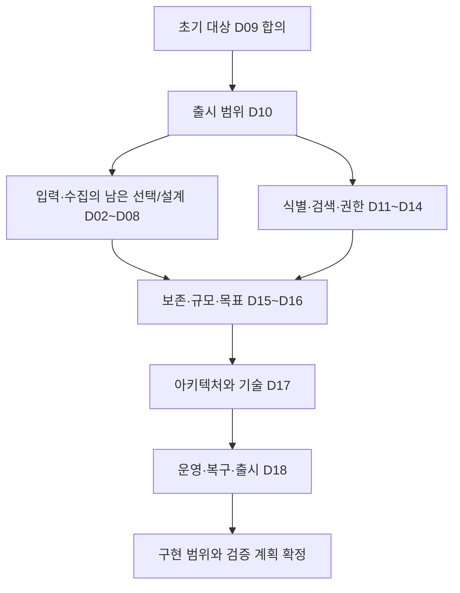

# LogDock 잔여 기획과 결정 순서

최종 갱신: 2026-11-02. 상태: 최신 합의에 맞춘 상세 초안 통합과 잔여 범위 관리. 초기 대상은 사용자와 합의한 **한 운영팀용 자체 설치형**이다. 기능 채택·정책·수치·기술 선택은 아래 상태에 따라 구분한다.

이 문서는 P01~P18 범위와 상세 명세·완료 기준을 연결한다. 사용자 협의의 순서와 질문은 [Q01~Q16 협의 목록](user-decisions-v0.1.md), 합의 상태는 [결정 기록](../decisions.md)이 기준이다. 같은 정책의 별도 추천표를 유지하지 않으며, 구현 작업 목록이나 출시 승인서로 취급하지 않는다.

- [결정 기록](../decisions.md)
- [제품 기능 후보](../specs/product-features-v0.1.md)
- [수집과 에이전트](../specs/collection-agent-v0.1.md)
- [검색과 조사 상세 기획](../specs/investigation-workflows-v0.1.md)
- [관리와 운영 상세 기획](../specs/platform-operations-v0.1.md)
- [아키텍처 검토](../architecture.md)

## 1 점검 결과

기존 문서는 제품 방향과 F01~F10 후보, 수집·에이전트의 자원·장애 계약을 다룬다. 다른 에이전트의 상세 초안에서 검색·실시간의 상태표와 관리·운영 절차·검증 시나리오를 보존하고 최신 합의와 충돌하는 정책을 정리했다. 아래 P01~P18은 확정 상태와 남은 작업을 함께 추적한다. 사용자 협의 Q와의 전체 대응표는 협의 목록 8절에 있다.

| 기획 ID | 범위와 기존 근거 | 현재 상태 | 이번에 채운 내용과 남은 결정 | 완료 판단 주체 |
| --- | --- | --- | --- | --- |
| P01 | 초기 사용자·배포 모델 | 사용자 합의 D09 | 한 운영팀 자체 설치형. 사용자 수·서버 수·실행 환경은 P04/P16에서 구체화 | 사용자 |
| P02 | F01~F10 채택·출시 순서 | Q01 첫 출시 최소 범위·제품 완료 기준 협의 완료 D10 | 세부 정책/수치·기술·검증은 각 Q/P로 연결. 후속 기능의 R2/R3 배정·일정은 필요 시 재검토 | 사용자 |
| P03 | F01 식별·수집원 수명 | Q07 사용자 항목의 채택/유예/설계 인계 정리. 등록/키·별칭·새 대상·중복 차단·보관/재활성·환경 태그/서버 표시명 선택 입력 원칙 합의 | 분류 이동/등록 완전 삭제 후속·이름 규칙 설계 인계. 실제 판정/중단/잔여/효력·표시/참조·키/ID/schema·구현/검증은 후속. [전용 기획안](q05-q07-q10-plan-v0.1.md#q07) 참조 | 사용자 정책, 설계 담당 구체화/검증 |
| P04 | F02 입력·OS 지원 | 파일/패턴·폴더별 탐색·일반 파일/journald·텍스트/JSON/여러 줄·UTF-8 합의. 컨테이너 로그는 journald로 읽고 json-file 직접 읽기는 후속(2026-11-03). Linux 환경/사양이 달라도 지원 요구 | 실제 설치 환경/최소 요구·지원 조합은 개발팀 검증. 인코딩 오류·journal 경계/위치·권한/설정·탐색 문법/동시 파일/자원 한도는 설계/검증이며 정확한 배포판·사양 제출은 기획 선행 조건 아님 | 사용자 목표, 설계 담당 확인/검증 |
| P05 | D02~D05·D08 수집 정책 | Q05 사용자 항목 정리: 한도 내 읽기/원래 등록 재개·정상/사고 중지 합의, [전용 대기 폐기](q05-q07-q10-plan-v0.1.md#q05)는 후속. D01~D06·Q06 유지 | 실제 한도/형식·기록/정리·재개 UI/권한·상태 정합성/구현과 T01/T03/T05/T08 검증은 후속 | 개발팀 구체화/검증, 향후 기능 재검토 |
| P06 | D06 ACK·재시도·내구성 | 중복 방지·응답 전 후속 전송·중앙 프로그램 재시작 보존·하드웨어 대응 제외 합의 | 미확인 데이터 유지·같은 식별 재시도. 수신 완료 기록 확정·부분 승인/거부·버퍼 정리·한도/검색 지연 목표와 검증 남음 | 설계 담당 제안/검증, 사용자 목표 |
| P07 | 공통 이벤트·시간·원문 | D04 본문과 Q02-03~05 형식/UTF-8/일반 파싱 실패 기본 처리 합의, D11 상세 검토 | Q02 형식별 세부 처리, Q08 기본 검색의 발생 시각 기준은 합의. 시각 네 종류·검색 기준 시각·레벨 정규화는 [Q08 기획안](q08-search-plan-v0.1.md) SD로 정리, 미래 시각·시간대·일반 텍스트 인식은 Q08-05~07 합의. 추출 규칙 문법·schema·정밀도 구현은 설계 담당. LogDock 본문 마스킹 제외 | 설계 담당 구체화 |
| P08 | F03 검색·집계 | Q01 기본 검색·발생량 초기 포함과 Q08 발생 시각/본문 대소문자 옵션·필드 세 연산 합의. [Q08 기획안](q08-search-plan-v0.1.md) Q08-01~09 합의로 사용자 범위 정리 | 조건·정렬·페이지·부분 결과·지연 유입은 SD로 설계 확정. 허용 오차·한도 수치는 측정 후 제안, 실행 검증은 IT-13~IT-26 | 설계 담당 검증 |
| P09 | F04 상세·주변·요청 연관 | Q01 상세/주변 초기 포함·요청 연관 후속, Q09 주변 조회의 레벨/본문 조건 해제·원래 검색 유지 합의. D12 상세 검토 | Q09-01~04 주변 조건 전체 해제·회전 경계 연결·같은 서버 시간순 전환·한 건 복사 합의. 요청 ID 여러 서비스 연관 모드는 후속 검토 | 사용자 |
| P10 | F05 실시간 | Q01 후속 합의 | pause/reconnect·화면 한도·gap·late event와 복구 보장은 후속 검토. 첫 출시 필수 범위에서 분리 | 사용자 보장 범위, 설계 담당 검증 |
| P11 | F06 진단·품질 | Q14 기본 사용자 정책 정리: 제한된 진단의 재시작 확인·rotation/새 기록·전체 한도 정리·진단 저장 단독 실패 시 로그 수집/전송 계속과 오류/공백 표시 | 대기/필수 상태 실패 D05 정지·미관측/전체 자원 보호 유지. 실제 수치·기록/정리/복구/신선도/정합성 검증은 개발팀 후속 | 설계 담당 구체화/검증 |
| P12 | F07 저장·공유·내보내기 | Q01 저장 초기 포함·내부 링크/export 후속 합의 | Q11 공용 1계정 목록 공동 사용과 상대/고정 시간 모두 지원·선택 방식 유지 합의. Q11-01~03 이름·조건·시간 수정, 확인 후 즉시 삭제, 자동 삭제 없음 합의. 계정 분리 시 귀속/이전과 공유/반출은 후속 검토 | 사용자 |
| P13 | F08 알림 | Q01 초기 포함, Q12 건수 기준·이메일·중앙 수신 시각 집계·기본 검색 필터·규칙별 시간 구간/임계 건수·수신 목록·요약/조사 링크·제한된 메일 재시도·기준 미만 일정 기간 후 해소와 지속 중 최초 한 번·해소 후 재발 시 새 발송과 회복 메일 생략 합의. 급증은 후속 | Q12 세부 협의 정리. 규칙 수 상한·평가 비용 측정, 중앙의 외부 SMTP 연결 확인 필요 | 사용자 |
| P14 | F09 인증·권한·키·감사 | Q10-01~14 기본 사용자 협의 정리. 감사 90일 목표/강제 예산 우선 정리·정상 운영 계속/일반 민감 변경 보류·확정 가능한 긴급 차단/인증된 로컬 복구·공백 표시 합의. MFA 후속 | 실제 예산/저장/권한·기록/정리/부분 실패/복구·기술/정합성/구현/검증은 개발팀 후속. 웹 세션/agent 키·대기 독립 유지 | 개발팀 보안 설계/검증 |
| P15 | F10 보존·사용량·삭제 | Q13 모든 서비스 공통 기본 6개월·각 로그 최초 중앙 유효 수신 기준 합의. 재전송/재연결로 기존 기준 갱신 없음, 초기 서비스별 기간 설정 불필요 | 공간 부족 시 오래된 로그 조기 삭제·새 로그 계속 수신, 기간 단축 소급·첫 출시 서버 설정 변경, 첫 출시 웹 연결/시간 구간 삭제, 판정 근거가 사라진 뒤 도착한 로그 저장 합의. 사본/queue는 기존 경계 유지. 유효 수신/저장 확정·달력/용량/중복/만료 정합성은 개발팀 검증. 중앙 하드웨어 복구 제외 유지 | 사용자 정책, 개발팀 설계/검증 |
| P16 | 자원·성능·접근성·규모 | Q15 초기 서비스 2개·로그 서버 총 4대 확인, 향후 서비스/서버 추가 요구. 2026-11-03 사용량이 더 많은 서비스 3개(서버 2·2·3대) 추가 예정, 실측 서비스 서버 1대 하루 약 4.5MB | 현재 서비스/서버·서비스당 서버 수를 고정하지 않음. 근거 없는 5초 지연 추천 철회·미합의. Q15-01~03 데스크톱 Chrome·주말을 넘기는 대기 목표·동시 검색 5명 이내 합의. 2026-11-07 Q15 수치 합의(검색 가능 지연·7일 검색 응답 목표·에이전트 대기 500MB, [결정 기록](../decisions.md)). 에이전트 자원 상한은 M7 뒤 제안(Q15 유보). 실제 검증은 측정 M5~M8과 설계 | 사용자 요구, 설계 담당 확인/측정 |
| P17 | 아키텍처·API·기술 선택 | [D17 기술 선정안](d17-tech-selection-v0.1.md)으로 공식 자료 비교 완료, 사용자 결정 D17-01~06 합의(Go 에이전트·Go 수신 서버·ClickHouse·PostgreSQL·중앙 서버 디스크, 측정은 실제 중앙 서버). 2026-11-05 외부 공개 API는 첫 출시에 두지 않기로 합의([결정 기록](../decisions.md)). 같은 날 버전을 Go 1.27·ClickHouse 26.8 LTS·PostgreSQL 18로 고정([D17 근거 8절](../research/d17-tech-evidence-2026-11-03.md#8-버전-고정))했고 웹 React 유지와 조회·관리 API NestJS 유지도 합의 | 측정 M1~M8·계약 검증. 설계 제안(전달 설계·queue·배포) 확정 필요 | 설계 담당 제안, 사용자 채택 |
| P18 | 설치·복구·업그레이드·출시 | 중앙 별도 Linux·설정 제공/사용자 복사 적용·Q06 재개·설정 변경 일시 수집 중단과 이기종 Linux/하드웨어 지원 요구. 중앙 업데이트 개발팀 담당 | 다양한 환경의 설치/실행 경로와 최소 요구/호환·서버별 자원 예산을 개발팀 설계/검증. 종료/남은 기록·진단은 연결 Q 기준이며 실제 적용/검증은 후속 | 사용자 운영 목표, 개발팀 설계/검증 |

P02의 Q01 첫 출시 범위 협의는 완료했으며 후속 단계의 세부 순서·일정은 미정이다. P03/P05/P06/P07/P09/P10/P11/P12/P13의 부분 합의도 각 상세 기획 완료를 뜻하지 않는다. 합의된 원칙과 출시 구분은 유지하고 나머지 기능 범위·절차·수치·설계·측정 근거만 보완한다.

2026-11-01 [전용 기획안](q05-q07-q10-plan-v0.1.md)과 [공식 자료 조사](../research/q05-q07-q10-evidence-2026-11-01.md)를 추가했다. Q05·Q07 사용자 항목 정리와 Q10의 최신 합의/미완료 하위 선택은 전용 기획안의 현재 표를 기준으로 확인한다. Q05-03 전용 대기 폐기·MFA 등 유예를 초기 필수로 다시 세지 않고 환경 입력/설계 인계·미실행 검증과 구분한다. 하위 선택 수와 전체 Q 범위 잔여 수를 합산하지 않는다.

2026-11-02 P13의 남은 범위를 [Q12 기획안](q12-plan-v0.1.md)과 [공식 근거](../research/q12-evidence-2026-11-02.md)로 구체화했고 사용자 협의를 정리했다.

## 2 초기 사용 시나리오

같은 운영팀의 설치 관리자, 수집 운영자, 로그 조사자가 한 배포를 사용한다. 이 명칭은 업무 구분이며 초기 로그인은 공용 1계정이다. 사람별 역할·권한 분리는 필요 시 후속 검토한다.

1. 설치 관리자가 중앙 시스템과 사용자 접근을 준비한다.
2. 수집 운영자가 service/environment/instance/source를 연결하고 별도 합성 이벤트의 검색 가능까지 확인한다.
3. 조사자가 시간·서비스·서버로 오류를 찾고 상세·같은 로그 흐름의 주변 로그를 조사한다. 요청 ID 기반 여러 서비스 연관 조회는 Q01에 따라 후속이다.
4. 로그가 없으면 조회 완료 여부·보존·권한·수집 상태를 확인한다.
5. 운영자가 포화·전송 실패·정책 변경·보존 만료를 처리하고 결과와 남는 불확실성을 확인한다.
6. 검색 조건을 저장해 반복 조사에 사용하고, 선택할 조건·채널로 오류 알림을 받는다. 첫 출시 포함은 Q01 합의이며 검색 저장은 공용 계정 하나의 목록을 함께 사용한다. 저장 시간은 상대/고정을 선택한 방식대로 유지하며 건수 기준 알림의 초기 채널은 이메일이다. 저장 수정/삭제·시간 세부와 알림 조건 수치·메일 연결 설정·수신 주소 검증/한도 등은 Q11/Q12에서 구체화한다.

중앙 SaaS·과금·여러 조직의 격리는 초기 대상 밖이며 Issue 관리 보류는 유지한다. 서비스 분류를 서비스별 tenant/권한 경계로 확장하지 않는다. 인증·운영팀 공통 조회 또는 세분화한 권한 범위는 Q10에서 검토하고, 원격 호스트 명령 기능도 자동 채택하지 않는다.

## 3 출시 범위 제안

단계 이름은 기획 순서다. Q01 사용자 선택에 따라 검색 조건 저장·오류 알림을 첫 출시로 옮기고 네 기능을 후속으로 구분했다. 이후 기본 기능 최소 범위와 제품 완료 기준도 합의했다. 아래 R1은 그 범위 합의이고 R2/R3의 구체 배정은 검토안이며 기간·인원·일정은 범위와 측정 조건을 합의한 뒤 산정한다.

| 단계 | 사용자에게 제공할 결과 | 포함 범위와 상태 | 후속·남은 판단 |
| --- | --- | --- | --- |
| R0 기획 확정 | 구현할 범위·보장·미지원 조건을 판단할 수 있음 | 기존 합의를 유지하며 Q01~Q16의 남은 선택·설계/수치·기술 평가 계획 정리 | 실제 설치·실험·구현은 당시 요청 범위에 따름 |
| R1 최초 운영 후보 | 연결→검색→상세→수집 문제 확인과 반복 검색·오류 알림을 제공 | **Q01 최소 범위 합의:** F01/F02 연결·수집, F03 기본 검색/발생량, F04 상세/주변, F06 상태, F07 검색 저장, F08 건수 기준 이메일 알림, F09 공용 로그인·키/주요 관리 이력, F10 기본 보존·사용량·용량 보호·연결/시간 구간 로그 삭제 | 공용 1계정의 검색 저장 목록을 함께 사용하며 향후 계정 분리를 고려. 알림은 건수 기준·이메일·중앙 수신 시각 집계·기본 검색 필터·규칙별 시간 구간/임계 건수·수신 목록·요약/조사 링크·제한된 메일 재시도·기준 미만 일정 기간 후 해소와 지속 중 최초 한 번·해소 후 재발 시 새 발송을 합의했고 급증은 후속이다. 회복 메일은 생략하고 규칙마다 한 개 이상의 수신 주소를 지정하고 메일은 요약·로그인 후 조사 링크로 구성하며 원문 로그 본문은 포함하지 않는다. 기본 검색 필터로 알림 집계 대상을 좁힐 수 있다. 임계 미만 상태가 정한 기간 유지된 뒤 해소로 확정하며 실제 대기 시간은 미정이다. 메일 실패 수신자는 횟수/총시간 상한 안에서 재시도하며 성공 확인 주소는 제외하고 상한 후 최종 실패를 표시한다. 조건 수치·메일 연결 설정·수신 주소 검증/한도는 미정. F05 live·F07 내부 공유 링크/export·F04 요청 연관 조회는 첫 출시 유예 합의 |
| R2 조사 편의 후보 | 현재 흐름을 보거나 공동 조사를 재개 | 후속 검토안: F05, F07 인증된 내부 공유 링크, 요청 ID 조회 편의. 이 기능들의 후속 배정 자체만 합의했고 R2 배정은 미정 | 저장·알림은 R1 포함 합의이므로 이 단계만의 기능으로 되돌리지 않음. 익명 공유·결과 snapshot은 별도 채택 전까지 제공하지 않음 |
| R3 후속 운영 확장 후보 | 통제된 결과 반출과 선택한 운영 편의 확장 | 후속 검토안: F07 한도 있는 export. 개인별/팀별 저장은 필요 시 계정 분리와 함께 후속 검토. 급증 알림은 Q12에서 후속으로 합의했으며 상세는 재검토 시 정함 | 초기 알림을 R3까지 미루지 않음. AI 분석·Issue는 포함하지 않으며 후속 일정은 미정 |

Q01에서 F09 공용 로그인·수집 키 관리/주요 관리 이력과 F10 기본 보존·사용량·용량 관리의 초기 포함을 합의했다. 계정/키 수명·감사 항목은 Q10, 보존일·기준 시각·삭제/포화는 Q13 합의를 따른다. Q01에서 live를 후속으로 두었으므로 R1은 고정 검색을 다시 실행해 신규 로그를 확인한다. 저장은 공용 계정 목록 공동 사용으로 합의했으며 첫 알림 건수 기준·급증 후속도 합의했다. 이메일 채널도 합의했으며 기본 기능 최소 범위와 제품 완료 기준은 Q01 합의 완료이며 조건 수치·메일 연결 설정·수신 주소 검증/한도와 나머지 상세 계약은 남아 있다. 향후 계정 분리의 실제 기능·이전 정책은 추후 정한다.

각 기능은 채택·범위 축소·유예 중 하나로 정한다. 유예는 기획 누락과 다르며 재검토 조건과 선행 결정을 남긴다. R2/R3의 상세 초안이 있다는 사실만으로 채택되지 않는다.

## 4 수집 정책의 확정 상태와 남은 작업

정책의 상세 원문은 [결정 기록](../decisions.md)과 [에이전트 명세](../specs/collection-agent-v0.1.md)를 따른다. 이전 초안의 과거 가져오기·민감정보 차단/격리·크기 초과 분할/잘림 대안은 제거했다.

| 결정 | 합의된 전제 | 남은 작업과 연결 |
| --- | --- | --- |
| D01/D05 | 기존 버퍼 보존·추가 읽기 pause·제한 복구. 제한된 디스크 버퍼가 기본이며 사용 불가 시 자동 메모리 대체 없이 대기/오류와 사용자 가시성 제공 | Q03 수치·기록 확정/복구·지원 수단을 설계/측정. 필수 상태 기록 불가 시 해당 전송도 안전 정지 |
| D02 | 신규 로그·쓰던 이벤트 제외·파일 생성/발견/복구 구분 유지. 복원 불가 시 자동 읽기 보류, 누락 안내 후 사용자 선택으로 적용 시 끝 위치 뒤 새 이벤트 재개·유효 queue 보존. 과거 가져오기 제외 | Q02 지원 조건·경계 규칙, Q06 상세 UI/권한·파일/기록 정합성·진단/검증 |
| D03 | 상한 초과 이벤트 전체 본문 거부·본문 없는 거부 가시성·다음 이벤트 경계 확인 후 계속 수집 | Q14 진단 보존/표시·전송, Q15 크기 상한과 자원 예산. 1MB는 예시 |
| D04 | 민감정보는 앱이 출력 전에 처리하고 LogDock은 출력 본문을 그대로 중앙화 | 일반 파싱·형식 지원은 Q02. 마스킹·격리·queue 재마스킹은 설계에 다시 넣지 않음 |
| D06 | 동일 이벤트 중앙 한 건. 프로그램 재시작 후 보존할 기록 확정 뒤 완료 응답. 응답 전에도 한도 내 후속 전송·미확인 버퍼 유지. 중앙 서버/디스크 고장용 별도 보호/복구 제외 | ID·판정 유지/복원·부분 승인/거부·ACK/버퍼 정리·한도와 검색 지연 목표는 후속 설계/검증 |
| D07 | 전체 자원 제한과 기존 서비스 보호 원칙 유지 | Q02/Q15 목표 OS·입력·workload·지원/수치·실측 |
| D08 | 키 오류 보류/한도 내 읽기·포화 중단/보존·원래 등록/같은 식별 재개. 정상 중지는 잔여 전송/ACK 대기 없는 종료·기록/대기 보존, 사고 시 중앙 키 폐기 우선 시도와 로컬 읽기 중지·중앙 실패가 로컬 중지를 지연시키지 않음 합의 | Q05-03 전용 대기 폐기 기능은 후속 유예. 실제 폴더/형식/용량·상태/기록/정리 순서·정합성·구현/검증은 후속 |

일시적 실패로 재시도가 끝났다는 이유와 영구 거부 판정은 다르다. D01의 보존 queue에 TTL·retry deadline·업그레이드·보존 정책을 붙여 조용히 폐기하지 않는다. D03 거부와 Q05에서 검토할 명시적 폐기, 확인되지 않은 유실 가능성은 구별한다.

## 5 결정 순서와 검토 묶음

| 검토 묶음 | 구체적으로 선택할 것 | 검토 자료 | 완료 기준 |
| --- | --- | --- | --- |
| A 출시 목적 | R1/R2/R3 범위와 입력 방식 | 이 문서 2~4절 | F01~F10을 각 단계 또는 유예로 배정 |
| B 전송과 복구 | Q04의 전송/보호 범위 합의 유지, Q05 자격 변경 queue, Q06 복구 해제 | 수집 명세와 운영 명세 | 각 실패의 보존·거부·재시도·표시가 모순 없이 결정됨 |
| C 조사 경험 | 시간·본문/필드 검색·문맥·실시간·공유 | 조사 명세 | 정상·0건·부분·만료·권한 변경 흐름이 선택됨 |
| D 접근과 수명 | 인증·역할·source scope·키·보존·삭제·알림 | 운영 명세 | 권한 표·객체 수명·데이터 반출/파괴 정책이 채워짐 |
| E 규모와 설계 | workload·자원/성능 목표·배포·복구 목표 | 운영 명세, 아키텍처 | 목표값 합의, 후보 탈락 조건과 평가 절차 확정 |
| F 기획 종료 | 결정표·명세·추적표 일치 | 전체 문서 | 아래 종료 기준 충족, 미실행 검증과 구현 요청 범위 명시 |

사용자는 기능 채택·손실·보존·권한·운영 목표를 결정한다. 설계 담당은 합의된 목표 안에서 schema·API·배포·기술 후보를 구체화하고 근거를 제시한다. 측정값은 수행한 검증에서만 채운다. 추천안의 일괄 승인으로 수치가 자동 결정되지는 않는다.

## 6 기획 종료 기준

- P01~P18 각각이 합의·설계 확정 또는 사유 있는 유예에 도달하고, 관련 D/F/명세/검증 ID와 연결된다.
- 채택 기능에 사용자, 시작 조건, 정상 흐름, 권한, 실패·경계 동작, 관측 상태, 검증 기준이 있다.
- 보장할 수 없는 내구성·조회 일관성·복구 범위는 기능 설명과 같은 위치에 명시한다.
- 필수 설정의 단위·목표·강제 상한·한도 동작·검증 조건을 채운다. 실측 전 수치는 목표로 표시하며 출시 판정과 분리한다.
- 기술 결정에는 공식 자료 확인일·버전·license·지원 capability와 탈락 이유가 있고, 필요한 실험은 실행 허용 범위와 연결된다.
- 구현 가능한 계약 초안(API/schema/상태 전이), UX 흐름, 운영 절차와 합격 기준이 같은 정책을 사용한다.
- 남는 후속 기능에는 재검토 조건을 남긴다. 기존 scaffold·문서 존재·타입 검사만으로 수집/검색/운영 검증을 통과시키지 않는다.

2026-11-04 전체 점검(정적 문서 대조, 실행 검증 아님): 사용자 협의는 Q15 수치(측정 뒤 제안)만 남았고 문서 간 충돌은 결정 기록 기준으로 정리했다. 기준별로는 보장하지 않는 내구성·복구 범위 표시와 후속 기능의 재검토 조건은 충족했다. P01~P18 중 설계 확정이 남은 범위, 필수 설정의 수치 목표·강제 상한, 기술 버전 고정과 측정 M1~M8, API·schema·전송 규약 계약 초안은 미충족이다. 채택 기능의 흐름·권한·실패·관측·검증 요소는 명세에 있으나 세부 계약이 후속으로 남은 곳이 많다. 따라서 기획 완료는 아직 아니며, 남은 일은 사용자 결정이 아니라 설계와 측정이다. 와이어프레임은 같은 날 합의로 기획 완료가 아니라 [화면 흐름 명세](../specs/screen-flows-v0.1.md) 확정 뒤 시작하고, 화면 구현은 기획 완료와 와이어프레임 뒤에 한다([결정 기록](../decisions.md)). D17-02는 같은 날 ClickHouse 유지로 확정해 재검토를 닫았다.

## 7 이번 작업과 후속 검증

초기 상세 기획 작업은 P01~P18 점검, D09 기록, 검색/조사·관리/운영의 초안 작성이었다. 이후 사용자와 합의한 수집 정책은 결정표·수집 명세·협의 목록에 반영했고, 문서 commit `4398e9c`가 원본 저장소 main에 반영됐다.

이번 후속 정리는 사용자가 승인한 상세 초안 선별 통합과 중복 stash 정리다. 제품 정책의 새 채택·제품 코드/의존성/PDF 변경·DB/운영 접근·설치/시험/배포·추가 commit/push는 수행하지 않는다. AT/IT/OT는 모두 미실행 시나리오다.

Q03~Q07과 Q16/Q02 기본 흐름에 이어 단일 파일/파일명 규칙 지정 지원을 합의했다. 후속 Q01 응답으로 검색 조건 저장·오류 알림을 첫 출시에 포함하고 실시간·내부 링크·export·요청 연관 조회를 후속으로 구분했다. 공용 1계정·검색 저장 목록 공동 사용과 향후 계정 분리 확장을 고려하기로 합의했다. Q01 기본 범위·제품 완료 기준도 합의해 범위 협의를 완료했다. Q08 기본 검색은 발생 시각 기준으로 합의했고 시각 대체는 기존 설계안·합의 상태를 유지하며 본문 검색의 기본 대소문자 미구분·선택적 구분 옵션도 합의했고 필드 검색의 값 일치·존재·숫자 범위도 합의했고 새 로그는 기존 고정 검색 재실행으로 확인하며 Q09 주변 조회의 레벨/본문 조건 해제·원래 검색 유지도 합의했고 Q11 상대/고정 시간 지원·선택 방식 유지도 합의했고 메일 세부 협의는 보류하고 잔여 항목을 일괄 보고하며 수집·설치 쪽은 에이전트 Linux와 일반 파일/journald 초기 입력 확인/합의와 일반 텍스트/JSON/여러 줄 초기 형식 및 UTF-8 초기 지원 채택 후 인코딩 오류/형식 처리·journal 세부 설계/검증이 남아 있다. 아래 9절에 남은 사용자 협의와 설계/측정을 구분했다. 미분류 안건은 제외하고 지원/문법/한도·설치/프로토콜·기술 선정·수명/수치·실행 검증은 남아 있다.

## 8 상세 초안과 stash 통합 기록

통합 기준은 main의 `4398e9c`와 그 이후 사용자 지시다. 원본 stash 식별은 `b4aaefd8694dd166aed3b5b55ba203f2152987c5`이며, 기반 commit은 `b2833bf`다. stash를 통째로 적용하지 않고 변경 파일 7개의 추가 내용을 대조했다. 별도 미추적 상세 문서 3개는 아래와 같이 수정해 문서 체계에 연결했다.

| 원본 내용 | 처리와 보존 위치 |
| --- | --- |
| 검색/조사 상세 문서 | 상태표·화면 흐름·조회 계층 계약·IT-01~IT-12 보존. D03/D04 본문 의미, 서비스 분류, 알림 시간 기준을 최신 합의에 맞춤 |
| 관리/운영 상세 문서 | 수집원 수명·운영 절차·수치 입력표·OT-01~OT-10·출시 게이트 보존. D02~D06과 에이전트/중앙 책임 구분 반영 |
| 잔여 기획 문서 | P01~P18·R 단계 제안·완료 기준·의존 관계 보존. 중복된 낡은 수집 추천표는 확정 상태/후속 작업과 Q 연결로 대체 |
| stash의 `docs/architecture.md` | 기술 후보 평가 절차·평가표·설계 산출물 목록을 현재 아키텍처 문서에 선별 통합 |
| stash의 `docs/decisions.md` | D09는 기존 합의 유지. D10~D18 ID는 Q 항목과 연결한 검토 추적표로 복원 |
| stash의 `docs/specs/product-features-v0.1.md` | F01~F10과 상세 명세의 연결표를 최신 합의 상태로 통합 |
| stash의 루트/문서 README·handoff·수집 명세 | 유효한 문서 링크·읽기 순서·IT/OT 미실행 표시를 최신 문서에 통합. 이전 정책 상태/다음 안건 안내는 폐기 |
| 제외한 옛 제안 | 과거 가져오기, 민감정보 차단/격리/재마스킹, 큰 이벤트 분할/잘림, 기합의 정책의 미결정 표기. 별도 기능 후보로 보존하지 않음 |

선별 통합과 문서 정합성 확인 후 위 식별의 원본 stash만 제거했다. 링크·참조 heading·AT/IT/OT/P/Q/D ID와 변경 범위를 정적으로 확인했으며 제품 실행 검증은 하지 않았다. 상세 원문은 최신 합의와 맞춘 문서에 남겼다. 통합 변경은 작업 트리에 있으며 이번 정리에서 추가 commit/push하지 않았다. 이후 실제 Git 반영 여부는 `git status`·`git log`로 확인한다.

## 9 남은 기획 요약

2026-11-02 Q13 모든 서비스 공통 기본 6개월을 각 로그 최초 중앙 유효 수신 시점부터 계산하고 재전송/agent 재연결로 기존 기준을 갱신하지 않기로 합의했다. 검색 기본 발생 시각은 유지한다. 공간 부족 시 오래된 로그 조기 삭제·새 로그 계속 수신, 기간 단축 소급·첫 출시 서버 설정 변경, 첫 출시 웹 연결/시간 구간 삭제, 판정 근거가 사라진 뒤 도착한 로그 저장도 합의했고 실제 유효 수신/저장 확정·달력/만료/중복/정리/공간 회수·자원 정합성은 개발팀 설계/검증이다. [잔여 집계](user-decisions-v0.1.md#잔여-협의-집계-기준)는 Q15의 1개 Q 범위다. 기존 감사/진단/원본/대기·성장/지연 수치 유보와 실제 서버/DB 접근·설치/삭제/시험 미실행을 유지한다.

기준일: 2026-11-01. 단일 파일/파일명 규칙 지정과 Q01의 여섯 기능 초기 포함/후속 구분, 에이전트 설치 대상 Linux 확인과 일반 파일/journald 입력·일반 텍스트/JSON/여러 줄 형식·UTF-8 초기 지원 합의까지 반영했다. 기본 수집·전송·연결 원칙과 일부 출시 범위를 정리했으며 검색/운영 기능 전체나 기술 구성·구현·실행 검증을 완료한 것이 아니다. Q01 범위 협의는 완료했으며 상세 정책은 각 Q로 연결했다. 부분 합의된 Q03~Q07·Q16의 상세 작업도 아래에 포함한다. 진행률을 임의의 퍼센트로 환산하지 않는다.

Q16-07 양쪽 부팅 자동 시작·제한된 비정상 종료 재시작/반복 실패 중단·가시성과 Q16-08 에이전트 운영자 직접 업데이트/호환 버전 수동 되돌림을 유지한다. Q16-04/E01에서 모든 로그 서버와 중앙 서버가 private 서버이며 서로 연결 가능하다고 확인했다. HTTPS 인증서 기존 관리도 확인했고 Q16-05 설정 적용/재시작의 일시 수집 중단도 합의했고 중앙 업데이트는 개발팀 담당으로 정리했고 다양한 Linux 환경/사양 지원을 요구하고 세부 호환 확인은 개발팀 검증으로 넘겼으며 초기 서비스 2개·로그 서버 총 4대 입력을 확보했고 서비스/서버 증가를 전제로 Q15 운영 기대와 로그량/증가 workload를 확인하고 구체 성능/용량은 측정 후 제안하며 기존 HTTPS 기본은 유지한다. 실제 관리자/의존/수치·명령/호환·자원/상태·설치/접속/TLS 검증은 후속이다.

### 지금까지 정한 범위

- 한 운영팀의 자체 설치형, 서비스는 분류/검색 기준이며 서비스 지정·수집 등록 확정 후 키 발급. 미분류 보관/재분류는 제외.
- UTF-8을 초기 인코딩으로 채택하고 다른 인코딩은 실제 필요 확인 시 후속 추가. BOM/줄 구분·부분/잘못된 문자·지원 외 인코딩의 오류 계약/검증은 남음.
- 일반 텍스트·JSON·여러 줄을 초기 본문 형식으로 채택. 여러 줄은 명시한 새 이벤트 시작 규칙/D02 유지. 인코딩 오류·파싱 세부 표시/필드·한도/검증은 남음. 일반 파싱 실패 기본 처리는 아래 합의 유지.
- 일반 파싱 실패는 지원 조건/이벤트 경계가 유효하면 본문 보존 전송·실패 표시·확인 불가 항목 미확인·다음 로그 계속 수집. 세부 schema/표시/검색/진단·검증은 남음.
- 파일은 지정 폴더 안에서만 탐색하고 필요한 하위 폴더는 별도로 지정. 문법/경로·중복 일치·자원 한도와 검증은 남음.
- 일반 로그 파일과 journald를 모두 초기 수집 대상으로 채택. journal 대상/경계/진행 위치·권한·설정/운영은 설계/검증하며 기존 앱/driver/호스트 원본 보관을 자동 변경하지 않음.
- 중앙에서 단일 파일과 파일명 규칙을 입력하고 주소/키/경로 설정을 제공해 사용자가 에이전트에 복사 적용. 파일 확인은 해당 서버 에이전트가 수행.
- 신규 로그부터 수집, 연결 당시 쓰던 이벤트 제외, 파일 생성/발견/재시작 구분. 복원 불가 시 읽기 보류와 누락 확인 후 사용자 선택 재개.
- 제한된 디스크 대기·키 문제 시 보존/보류·유효 새 키 확인 후 재개. 포화 시 기존 내용 유지/추가 읽기 pause, 디스크 사용 불가 시 대기/오류와 가시성.
- 응답 전 한도 내 후속 전송, 미확인 대기 보존, 동일 이벤트 재전송은 중앙 한 건. 중앙 프로그램 재시작 후 보존할 기록 확정 뒤 완료 응답.
- 큰 이벤트 전체 본문 거부/거부 가시성, 민감정보 처리는 앱 책임. 본문은 LogDock에서 마스킹하지 않음.
- 첫 출시에는 검색 조건 저장·오류 알림 포함. 실시간·인증된 내부 공유 링크·파일 내보내기·요청 ID 기반 여러 서비스 연관 조회는 후속. 검색 저장은 공용 로그인 1계정의 목록을 함께 사용하며 초기 개인/팀 구분은 없다. 향후 계정 분리를 고려한다. 첫 알림은 건수 기준·이메일, 급증은 후속이며 조건 수치·메일 연결 설정·수신 주소 검증/한도는 미정.

과거 가져오기·LogDock의 민감정보 마스킹/격리·중앙 서버/디스크 고장용 별도 복제/백업 복구·미분류 기능은 남은 필수 기획에 다시 넣지 않는다. Issue 관리는 보류, SaaS/과금/여러 조직 격리는 초기 범위 밖이다.

### 현재 보고와 협의 방식

2026-11-01 사용자는 메일 발송 정책을 너무 세분화한 협의를 중단하고 넘어간 뒤 남은 항목 전체를 보고하도록 요청했다. 해소 후 대기 중인 메일을 계속 보낼지/취소할지는 A/B 어느 쪽도 선택하지 않은 미결정·협의 보류 상태다. 이 보류는 2026-11-02 Q12-11(계속 전송·해소 사실 표시) 합의로 닫았다. 이미 합의한 첫 출시 이메일 알림과 필터·조건·수신자·요약/조사 링크·해소·제한 재시도 정책은 유지한다. 추가 메일 세부 선택을 자동으로 이어 묻지 않고, 사용자 정책/환경 입력과 설계·검증을 구분해 큰 묶음으로 보고한다. 논의 보류를 기능의 첫 출시 제외나 미결정 추천안의 승인으로 취급하지 않는다.

사용자에게는 기능 범위·데이터 보존/삭제·권한·운영 목표에 영향을 주는 선택과 실제 환경 입력을 묶어 제시한다. 문법·API·기록 순서·재시도 실제값/한도·페이지 처리 등은 설계안과 검증 근거를 먼저 준비하며 작은 분기를 순서대로 모두 승인받는 방식으로 진행하지 않는다. 아래 표의 세부 구현 항목은 자동으로 사용자 질문이 되지 않는다.

### 사용자와 협의할 범위

| 묶음 | 남은 판단 | 관련 Q/P |
| --- | --- | --- |
| 첫 출시 범위 | Q01 최소 기능·제품 완료 기준 협의 완료. 범위를 다시 묻지 않고 각 상세 Q를 진행. 후속 기능 구체 단계·일정은 필요 시 재검토 | Q01, P02 |
| 지원 환경/로그 | Linux·일반 파일/journald·텍스트/JSON/여러 줄·UTF-8·패턴/폴더별 탐색은 합의. 컨테이너 로그는 journald로 읽고 Docker json-file 직접 읽기는 후속(2026-11-03). 사용자 환경 입력은 중앙/에이전트 배포판·버전·아키텍처. 인코딩 오류·형식별 필드/이벤트 경계·journal 진행 위치·구체 문법/권한은 설계·검증 | Q02/Q15, P04/P07 |
| 검색/조사 | 기본 발생 시각·본문의 기본 대소문자 미구분/선택적 구분 옵션 합의. 필드 세 연산은 초기 지원 합의. 시각 대체 설계안/합의 상태는 유지. 타입·지연 유입은 [Q08 기획안](q08-search-plan-v0.1.md) SD로 설계 확정, 사용자 결정 Q08-01~09도 합의했다. 상세/앞뒤 로그 범위는 Q09-01~04로 합의했다. 요청 연관 조회·실시간의 세부 복구/경험은 후속 검토 | Q08/Q09, P08/P09/P10 |
| 서비스/계정/키 관리 | Q05·Q07·Q10 기본 사용자 항목 정리. 감사 90일 목표/강제 예산 우선 정리와 장애 시 기본 운영 계속·일반 민감 변경 보류·확정 가능한 긴급 차단/로컬 복구·공백 표시까지 합의. MFA·전용 대기 폐기·직접 분류 이동/등록 완전 삭제는 후속이고 실제 기술/권한·실패/정합성/구현/검증과 계정 분리는 개발팀 후속/향후 채택 범위다. | Q05/Q07/Q10, P03/P14 |
| 저장 검색/알림 | 공용 저장 목록·상대/고정 시간은 합의. Q11-01~03 수정·삭제·수명도 합의. Q12 이메일 채택과 필터·조건·수신자·요약/링크·해소·재시도 합의는 유지. 메일 세부 협의도 [Q12 기획안](q12-plan-v0.1.md)으로 정리. 내부 공유/export는 후속 | Q11/Q12, P12/P13 |
| 보존/상태 관리 | Q13 사용자 협의 정리: 공통 6개월·최초 중앙 수신 기준, 공간 부족 시 오래된 로그 조기 삭제·새 로그 계속 수신, 기간 단축 소급·첫 출시 서버 설정 변경, 첫 출시 웹 연결/시간 구간 삭제, 판정 근거가 사라진 뒤 도착한 로그 저장. Q14 진단 이력의 제한된 영속 기록/회전/전체 한도 정리·단독 저장 실패 시 계속 동작/표시 기본 정책은 정리했으며 실제 수치/신선도·기록/복구·자원 검증은 개발팀 후속 | Q13/Q14/Q15, P11/P15 |
| 설치/운영 | 중앙 별도 Linux/Docker·에이전트 Linux/Docker 혼합·private 연결/기존 인증서 관리와 읽기/대기 쓰기 권한 설정 가능 확인. 자동 시작/제한 재시작·에이전트 수동 업데이트/호환 되돌림·중앙 업데이트 개발팀 담당·설정 적용 중 일시 수집 중단은 합의. 배포판/버전·아키텍처·사양·실제 경로/권한 입력과 구체 지원/설정/설치·중단/복원/제거 절차·검증은 남음 | Q16, P18 |
| 목표 규모/품질 | 초기 서비스 2개·로그 서버 총 4대에서 서비스/서버 증가 전제. 2026-11-03 사용량이 더 많은 서비스 3개(서버 2·2·3대) 추가 예정. 근거 없는 5초 지연 추천은 철회·미합의. Q15-01~03 데스크톱 Chrome·주말을 넘기는 대기 목표·동시 검색 5명 이내 합의. 2026-11-07 Q15 수치(검색 가능 지연 95% 10초 안, 7일 본문 처음 검색 5초 안·기간 고정 상한 없음, 에이전트 대기 서버마다 500MB) 합의. 남은 것은 에이전트가 서비스 서버에서 쓸 자원 상한으로 M7 뒤 제안. 첫 대상 제품의 v1·v2·결제 서비스 뒤에 비슷한 규모의 서비스를 더할 예정. 현재 구성을 제품 상한으로 고정하지 않음 | Q15, P16 |

기능을 유예하면 해당 기능의 세부 정책도 유예 사유와 재검토 조건을 남긴다. 모든 선택지를 첫 출시 필수 기능으로 취급하지 않는다.

### 설계·측정으로 제안할 작업

- 초기 공용 1계정을 유지하면서 로그인 주체·저장 조건/알림 귀속·권한 검사에 향후 계정 분리 확장 지점을 두는 설계. 실제 복수 계정·역할 기능과 기존 객체의 배분/이전은 채택 시점에 별도 협의하며 웹 계정과 수집 키는 별개로 유지한다.
- 수집기/저장·검색/백엔드/인증/metadata·중앙 queue/packaging 후보 비교와 정확한 버전·공식 근거·license/보안/호환성 확인. 에이전트·수신 서버·저장소·관리 DB·저장 위치는 D17-01~06으로 정했고, 조회·관리 API는 2026-11-05 NestJS 유지로 합의했으며, 버전은 같은 날 고정했다([D17 근거 8절](../research/d17-tech-evidence-2026-11-03.md#8-버전-고정)). 중앙 queue·packaging과 구현 때 쓸 라이브러리 버전은 설계로 남는다.
- event/관리 객체 schema·API/전송·키/등록정보 연결·수신 응답/부분 거부/재시도·동일 식별/중복 판정·디스크 기록/위치/버퍼 정리·수동 재개 정합성 설계.
- 로그 경로/패턴 문법과 안전한 제한 탐색, rotation/파일 교체·규칙 겹침·파일/FD 상태, 기존 D02 경계·복구와의 연결.
- 초기 검색 시간/정렬/페이지/부분 결과·주변 문맥·검색 저장·오류 알림의 UI/UX와 접근성·운영 상태/진단 설계. 실시간·공유/export·요청 연관 조회는 후속 검토. 첫 출시 화면 목록·이동·상태는 [화면 흐름 명세](../specs/screen-flows-v0.1.md)로 정리했다(2026-11-04).
- CPU/RAM/디스크/I/O/네트워크/파일/진단 전체 상한, 이벤트 크기·대기 공간·전송/복구·검색/화면 한도의 산정과 강제/실측. 사용자가 임의의 구현 수치를 먼저 정할 필요는 없다.
- 합성 workload와 AT/IT/OT의 채택 기능 시나리오·기술 검증·실제 업무 서비스 영향 관찰 계획. 정의/정적 확인/격리 실행/운영 적용 증거를 구분한다.

설계 완료와 구현 승인은 구분한다. 현재 코드는 health API·연결 확인 화면에 더해 조회·관리 API의 인증·세션·비밀번호 변경과 계정 설정 로컬 명령·서비스와 서버 이름 관리·수집 연결 등록·수집 키 관리·저장 검색·알림 규칙과 사건 조회·메일 상태와 테스트 발송·설정값·배너·감사 조회와 메일 발송·기록 정리 worker, 관리 DB 마이그레이션, 측정용 에이전트 시제품까지다(2026-11-07, [개발 환경의 현재 코드](../agent/refs/dev-environment.md)). 중앙 저장·검색과 알림 평가는 미구현이고 수신 서버는 시제품을 만드는 중이다. AT/IT/OT는 미실행이며 이번 반영은 문서 내용/링크/ID 정합성 확인 범위다.

### 권장 진행 순서

Q01 첫 출시 최소 범위·제품 완료 기준 협의는 완료했다. Q08 기본 검색은 발생 시각으로 합의했다. 사용자 요청으로 시각 대체 질문을 반복하지 않고 본문 검색의 기본 대소문자 미구분·선택적 구분 옵션도 합의했고 필드 검색의 값 일치·존재·숫자 범위도 합의했고 새 로그는 기존 고정 검색 재실행으로 확인하며 Q09 주변 조회의 레벨/본문 조건 해제·원래 검색 유지도 합의했고 Q11 상대/고정 시간 지원·선택 방식 유지도 합의했고 메일 세부 협의는 보류하고 잔여 항목을 일괄 보고하며 이후 연산 등 조사 세부 정책을 구체화한다. 조건 수치·메일 연결 설정·수신 주소 검증/한도 등은 Q12 상세 협의로 이어가며 Q01 범위 완료와 구분한다. 필요 시 계정 분리 확장 고려는 설계 입력으로 유지한다. Q02는 에이전트 Linux와 일반 파일/journald 초기 입력 확인/합의와 일반 텍스트/JSON/여러 줄 초기 형식 및 UTF-8 초기 지원 채택 후 인코딩 오류/형식 처리·journal 세부 설계/검증이 남아 있으며, 이후 검색/조사·관리/보존 정책 → 설치/운영·규모/품질 목표 → 기술 비교/설계·검증 계획 순으로 진행한다. 기존 합의는 전제/영향이 바뀌지 않으면 다시 승인받지 않는다.
