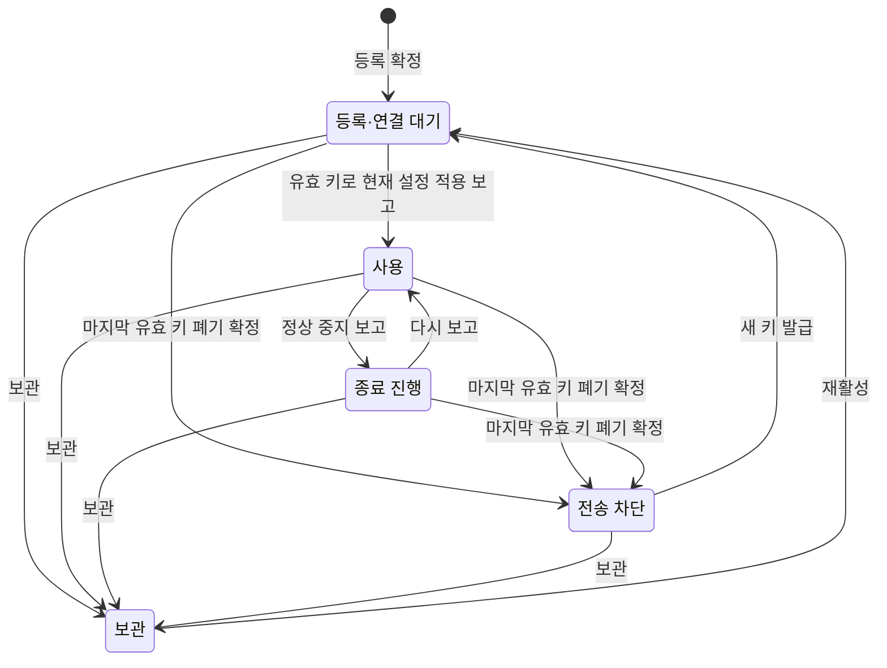
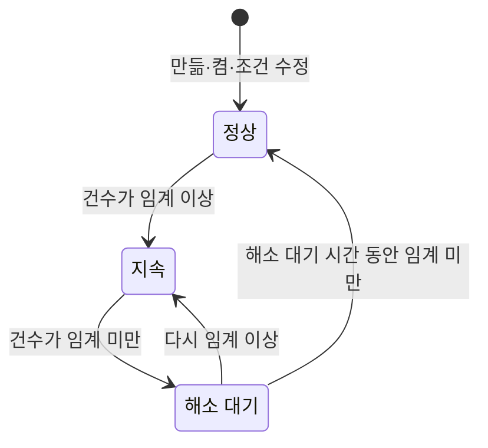

# LogDock API·저장 구조·전송 규약 계약 초안 v0.1

작성일: 2026-11-05. **상태: 2~5절과 8절 첫 초안을 모두 썼다. 7절에서 검증 시나리오 77건과 대조해 빈 곳 18군데를, 9절 누락 조사에서 빠진 계약 34건과 어긋남 6건을 고쳤다. 누락 조사에서 올린 공개 API 제공 여부는 2026-11-05 두지 않기로 합의했다. 3.4절에 PostgreSQL DDL 초안을 썼고, 2026-11-05 사용자가 개발용 PostgreSQL 18.6에 한 트랜잭션으로 적용해 테이블과 도메인이 만들어지는 것을 확인했다. 버전은 2026-11-05 ClickHouse 26.8 LTS, PostgreSQL 18, Go 1.27로 고정했고, 버전에 따라 달라지는 기능(ClickHouse `JSON` 타입·text 색인·경량 삭제, PostgreSQL 생성 열·`IS NFC NORMALIZED` 등)을 그 버전의 공식 문서로 확인했다. 같은 날 사용자 요청으로 계약 전체를 검토해 12곳을 고쳤다(10절). 남은 것은 수치 `N`과 측정이다. DDL은 2026-11-06 마이그레이션 파일로 옮기고 제약 동작을 임시 PostgreSQL에서 시험했다(3.6절).** 이 문서는 설계 초안이며 사용자 합의가 아니다. 합의는 [결정 기록](../decisions.md)이 기준이고, 이 문서는 그 합의를 지키는 구현 계약을 제안한다. 구현·실행 검증은 하지 않았다.

입력은 [D17 기술 선정안](../planning/d17-tech-selection-v0.1.md) 5·6절, [수집 명세](collection-agent-v0.1.md) 04~09절, [관리·운영 상세](platform-operations-v0.1.md) 3·4절, [Q05·Q07·Q10 기획안](../planning/q05-q07-q10-plan-v0.1.md), [화면 흐름 명세](screen-flows-v0.1.md), [와이어프레임 검토 항목 정리표](../planning/wireframe-review-items-v0.1.md)다.

## 1 범위

| 절 | 내용 | 상태 |
| --- | --- | --- |
| 2 | 에이전트와 수신 서버 사이 전송 규약: 인증, 이벤트 묶음, 순번, 응답, 상태 보고, 에이전트 설정 파일 | 초안 |
| 3 | 저장 구조: ClickHouse 로그 테이블과 PostgreSQL 관리 테이블(DDL 포함) | 초안. PostgreSQL DDL은 개발용 DB에 적용 확인(사용자 실행), ClickHouse DDL은 실행하지 않음 |
| 4 | 조회·관리 API와 오류 사유 코드 | 초안 |
| 5 | 수집 연결·키·서비스·알림 규칙·메일 작업의 상태 전이와 감사 동작 | 초안 |
| 6 | 정리표에서 `정하는 곳`이 `API`인 46건의 처리 | 46건 모두 초안에 반영 |
| 7 | 검증 시나리오(AT·OT·PT·IT 77건)와의 문서 대조 | 대조 완료. 실행 검증 아님 |
| 8 | 중앙 서버 설정과 로컬 명령(중앙·에이전트) | 초안 |
| 9 | 합의·화면 흐름·설계 인계와 다시 대조한 누락 조사 | 조사 완료. 실행 검증 아님 |
| 10 | 계약 전체 검토(이름·코드 교차 대조, 규약·상태 전이의 경쟁 조건) | 검토 완료. 12곳 고침. 실행 검증 아님 |

필드 이름과 코드 이름은 초안이다. 화면 흐름 명세의 상태 이름과 다르게 정하면 명세와 와이어프레임을 함께 고친다(병행 규칙, [결정 기록](../decisions.md) 2026-11-05). 수치는 정하지 않고 `N`으로 쓴다. 예시의 이름·경로·숫자는 합성이며 기본값이 아니다.

## 2 에이전트와 수신 서버 사이 전송 규약

### 2.1 지키는 합의

| 합의 | 규약에서 지키는 방법 |
| --- | --- |
| Q04 | 중앙 저장이 끝난 뒤에만 `acked_through`로 응답한다. 응답 전에도 한도 안에서 다음 묶음을 보낸다 |
| D06 | 연결·세대·순번으로 같은 이벤트를 알아보고 이미 받은 순번은 다시 저장하지 않는다. 본문이 같은 별개 발생은 순번이 달라 따로 남는다 |
| D01·D05 | 대기는 에이전트 디스크에 남고 응답이 없거나 거부돼도 지우지 않는다. 전송 창이 차면 전송만 기다리고, 대기가 차면 읽기를 멈춘다 |
| D03 | 크기 초과 이벤트는 본문 없는 `rejected` 기록이 순번 하나를 차지해 뒤 로그를 막지 않는다 |
| Q05·Q05-01·Q10-07~11 | 키는 연결마다 하나, 교체 중에는 둘이다. 키 오류는 그 연결만 보류하고 대기 한도 안에서 읽기를 이어간다. 새 유효 키로 같은 순번을 다시 보낸다 |
| Q07-07 | 보관된 연결의 묶음은 받지 않는다. 에이전트는 대기를 보존한다 |
| Q06 | 복구 근거가 없어 다시 시작하면 새 세대로 순번을 1부터 시작하고, 건너뛴 구간을 경계 기록으로 보낸다 |
| Q10-02 | HTTPS만 쓰고 인증서와 호스트 이름을 검증한다 |
| Q13-03·Q13-04 | 저장 전에 삭제 차단 구간을 검사해 저장하지 않고 응답만 한다. 연결별 순번 기록을 잃은 드문 경우에만 Q13-04를 따른다 |
| Q08-06·SD-01·SD-05 | 에이전트는 관측 시각과 서버 시간대를 보내고, 상태 보고에 서버 시각을 실어 중앙이 시계 오차를 감지한다 |
| D17-03 | 시각·레벨·필드 해석은 수신 서버가 한다. 에이전트는 이벤트 경계와 크기만 판단한다 |

### 2.2 연결과 인증

- 수신 서버는 조회·관리 API와 다른 프로그램·주소로 둔다(D17-03). 경로는 `/ingest/v1/...`이다.
- 키 형식은 `ldk_<키 ID>_<비밀 값>`이다. 키 ID는 비밀이 아니며 화면의 키 메타데이터와 감사에 쓴다. 비밀 값은 무작위 `N`바이트이고 중앙은 해시만 저장한다. 원문은 발급·교체 화면에서 한 번만 보인다(Q10-08). 설계(2026-11-07): 키 ID는 무작위 8바이트의 16진수 16자, 비밀 값은 무작위 32바이트의 base64url 43자다(`_`가 들어갈 수 있어 키 ID 뒤 첫 `_`까지만 나눈다). `ingest_keys.secret_hash`는 SHA-256(`ingest_key` 0x00 비밀 32바이트 0x00)이고 수신 서버도 같은 식으로 맞춘다.
- 요청마다 `Authorization: Bearer <키>`를 보낸다. 중앙은 키로 수집 연결을 찾고 본문의 `connection_id`가 그 연결과 다르면 거부한다. 본문의 어떤 값도 인증 범위를 바꾸지 못한다(AG-03, SC-01).
- 에이전트 전체를 대표하는 자격은 없다. 에이전트는 연결마다 그 연결의 키로 보낸다(Q10-07).
- 에이전트 인스턴스 ID는 에이전트가 처음 실행할 때 만들어 로컬에 저장하는 무작위 값이다. 인증 근거가 아니고 같은 에이전트의 연결을 묶어 보이거나 같은 대상의 중복을 확인하는 데만 쓴다. IP나 hostname만으로 같은 서버라고 판정하지 않는다(Q07-02).
- 한 연결은 한 에이전트 인스턴스만 쓴다. 중앙은 연결마다 마지막으로 보고한 인스턴스를 기억한다. 그 인스턴스가 아직 관측되는데(`관측 오래됨` 기준 안) 다른 인스턴스가 같은 연결로 보내면 `409 instance_conflict`로 막고 연결에 `설정/복구 확인 필요`를 표시한다. 설정을 다른 서버에 복사해 두 에이전트가 같은 연결을 쓰는 경우를 조용히 섞지 않기 위해서다. 앞 인스턴스가 기준보다 오래 보고하지 않았으면 교체로 보고 새 인스턴스가 새 세대로 시작한다(AT-08, PT-05).
- 중앙 인증서가 사설 CA로 발급됐으면 에이전트 설정에 CA 파일 경로를 넣는다. 인증서 검증을 끄는 설정은 두지 않는다(SC-02).
- **수신 능력 조회 `GET /ingest/v1/capabilities`:** 연결 키로 인증하고 수신 서버가 지원하는 규약 버전 목록, 묶음·기록·이벤트 상한, 전송 창, 응답 방식(`acked_through`까지 묶음 단위 확인), 응답 시점에 검색 가능한지(`searchable_on_ack`), 상태 보고 주기를 돌려준다. 에이전트는 시작할 때와 `protocol_unsupported`를 받았을 때 읽는다. 수신 서버가 주지 않는 단계는 화면에 `미확인`으로 보인다(OB-03, UI-11 7단계).
- **규약 버전 호환:** `protocol`은 정수다. 운영자가 원하는 때 에이전트를 올리거나 호환되는 이전 버전으로 되돌릴 수 있게(Q16-08) 수신 서버는 지원 범위 안의 이전 규약 버전을 계속 받는다. 범위를 벗어나면 `protocol_unsupported`로 답하고 에이전트는 대기를 지우지 않고 보류한다. 에이전트의 대기·상태 파일에도 형식 버전을 두어, 되돌린 버전이 읽을 수 없는 대기를 만나면 지우지 않고 보류한다(Q16-08 되돌림 합의, T01).
- **상태 확인:** 수신 서버와 조회·관리 API는 인증 없는 `GET /healthz`(프로세스가 응답함)와 `GET /readyz`(PostgreSQL·ClickHouse에 닿고 받을 수 있음)를 둔다. 상태 코드와 구성요소별 정상·이상만 돌려주고 주소·계정·오류 원문은 담지 않는다. 외부 실행 관리자의 재시작 판단과 OT-09 시험에 쓴다.
- 키는 요청 헤더로만 보낸다. 주소·쿼리 문자열·본문·자체 로그·진단 파일에 키를 넣지 않는다(SC-02).

### 2.3 이벤트 묶음 보내기 `POST /ingest/v1/batches`

요청 본문은 gzip으로 압축한 JSON이다(`Content-Encoding: gzip`). 묶음 하나는 연결 하나·세대 하나의 연속된 순번이다.

```json
{
  "protocol": 1,
  "connection_id": "c_8f3k2",
  "generation": 1,
  "agent": {"instance_id": "a_71d0c9", "version": "0.1.0", "timezone": "Asia/Seoul"},
  "config_version": 3,
  "records": [
    {"seq": 1001, "kind": "event", "observed_at": "2026-11-05T01:00:00.123456Z",
     "stream": {"type": "file", "file_id": "f_2b9a", "path": "/var/app/order/app.log", "offset": 104857, "length": 63},
     "body": "2026-11-05 10:00:00 error [request-id: r-1]: payment timeout"},
    {"seq": 1002, "kind": "rejected", "observed_at": "2026-11-05T01:00:01.004000Z",
     "stream": {"type": "file", "file_id": "f_2b9a"}, "reason": "event_too_large", "limit_bytes": N}
  ]
}
```

예시의 `N`은 정하지 않은 한도다. 다른 숫자는 표시용 합성 값이다.

| 기록 종류 | 뜻 | 본문 |
| --- | --- | --- |
| `event` | 에이전트가 조립한 이벤트 하나. 여러 줄은 줄바꿈으로 이어 붙인다 | 있음 |
| `rejected` | 크기 상한을 넘어 거부한 이벤트(D03). 사유·적용 상한·관측 시각을 담는다 | 없음 |
| `boundary` | 읽기 경계. 최초 연결의 시작 위치(D02), 회전 뒤 새 파일, 새로 발견한 파일, 복구 근거가 없어 건너뛴 구간(Q06), 읽기 전에 원본이 사라진 구간 | 없음. 경계 종류와 알 수 있는 범위만 담는다 |

- 경계 종류는 `initial_tail`(최초 연결, 끝에서 시작), `new_file_head`(새로 생긴 파일을 처음부터), `new_file_tail`(생성 시점을 모르는 파일을 끝부터), `rotated`(회전 뒤 다음 파일), `truncated`(같은 파일이 잘림·copytruncate), `identity_reused`(inode 재사용 의심), `gone_before_read`(읽기 전에 사라짐), `resume_after_hold`(Q06 다시 수집)다. 건너뛴 바이트·시각 범위를 알면 담고 모르면 미확인으로 둔다(D02, AT-05). journald는 `initial_tail`(최초 연결 때 journal의 마지막 항목 뒤부터)과 `source_dropped`(journald가 속도 제한으로 버림)를 쓴다. `source_dropped`는 버린 unit(`unit`)과 수(`dropped_entries`)를 담고, 컨테이너 대상이면 그 수가 Docker 데몬 unit 전체의 수라 `skipped_unknown: true`도 단다(2026-11-06 에이전트 시제품 7단계 설계).
- `rotated` 경계는 앞 파일의 `file_id`와 순서 확인 여부(`order_confirmed`)를 담는다. 같은 경로의 이름 바꾸기를 관측하는 등 앞뒤 파일의 순서를 에이전트가 확인했을 때만 `true`이고, 주변 로그는 `true`일 때만 경계 너머를 이어 붙인다(Q09-02, UI-04).
- 파일명 규칙(`file_pattern`) 연결은 파일마다 따로 읽고 파일 사이의 순서는 없다. 이름이 아니라 장치·inode로 파일을 구분해, 규칙 안에서 이름이 바뀐 파일은 같은 `file_id`로 이어 읽고 `rotated`를 내지 않는다. 처음 보는 파일의 시작은 D02대로 가른다. 최초 연결 때 있던 파일은 `initial_tail`, 연결 뒤 폴더 목록에 새로 나타난 파일은 `new_file_head`다. 같은 규칙으로 다시 시작하면 저장한 상태에 없는 파일은 마지막으로 폴더를 본 뒤에 생긴 것이므로 `new_file_head`로 처음부터 읽는다. 정상 재시작에 끝 위치 규칙을 다시 쓰지 않는다는 D02 원칙에 맞추기 위해서다. 규칙을 바꿨거나 한도·열기 오류로 따라가지 못한 파일이 있었으면 그런 파일은 언제 생겼는지 모르므로 `new_file_tail`이다(2026-11-06 에이전트 시제품 6단계 설계).
- `seq`는 빈틈 없이 1씩 는다. 에이전트는 이벤트를 대기 파일에 쓸 때 순번을 붙이고 같은 기록에 읽기 위치를 남긴다(D17 5절, AG-12).
- `config_version`은 이 묶음의 기록을 읽고 조립할 때 쓴 설정 버전이다. 설정이 바뀌면 에이전트는 버전 경계에서 묶음을 나눈다. 수신 서버는 그 버전의 추출 규칙·로그 시간대로 해석해, 대기 중이던 로그도 원래 설정대로 해석한다(Q08-07, AT-09).
- 같은 순번을 다시 보낼 때 내용은 처음과 같아야 한다. 관측 시각도 대기에 함께 기록해 바뀌지 않는다(SD-01).
- `stream`은 이벤트가 나온 흐름이다. 파일은 `file_id`(장치·inode로 에이전트가 만든 값. 경로가 같아도 회전으로 바뀐 파일은 다른 값), 표시용 `path`, 바이트 `offset`·`length`를 담는다. journald는 기록 첫 항목의 `cursor`, `realtime_us`(`__REALTIME_TIMESTAMP`), 있으면 `source_realtime_us`(`_SOURCE_REALTIME_TIMESTAMP`)·`priority`(`PRIORITY`), 컨테이너 대상이면 `container_id`(`CONTAINER_ID_FULL`, 같은 이름으로 다시 만든 컨테이너를 가른다)를 담는다(SD-02, SD-10). 커서는 조사용 표시이고 위치 확인에 쓰지 않는다. systemd 문서상 같은 항목도 커서 문자열이 다를 수 있어서다(2026-11-06 설계).
- 본문은 UTF-8 문자열이다. 잘못된 UTF-8이 있으면 원래 바이트를 `body_base64`로 보내고 `flags`에 `encoding_error`를 단다. 중앙의 표시·검색 방식은 남은 설계다(Q02-04).
- 묶음 하나의 상한은 압축 전 `N`바이트·기록 `N`개다. 이벤트 하나의 상한은 에이전트의 D03 상한과 같은 값을 쓴다.
- `rejected`와 `boundary`도 순번 자리를 차지하므로 주변 로그에서 거부·경계가 흐름 안 정확한 자리에 보일 수 있다(UI-04 상태 5, 정리표 WQ-25 참고).

### 2.4 응답과 에이전트 동작

성공하면 `200`과 아래 본문을 돌려준다.

```json
{"acked_through": 1050, "generation": 1, "stored": 47, "duplicate": 0, "deleted_range": 2, "rejected": 1}
```

- `acked_through`까지는 중앙 저장이 끝났다. 에이전트는 그 순번까지 대기에서 지운다.
- 수신 서버는 여러 연결의 묶음을 모아 ClickHouse에 한 번에 저장할 수 있다(D17 5절). 한 번의 삽입에 든 기록은 모두 같은 수신 시각을 받아 수신일 파티션 하나에 들어간다. ClickHouse 삽입은 파티션 하나 안에서만 전부 들어가거나 전부 빠지므로, 자정을 걸친 삽입이 반만 저장되지 않게 하기 위해서다(R12). 저장이 끝나면 연결·세대별 `다음 순번`을 관리 DB에 기록하고 연결마다 응답한다. 저장 뒤 기록 전에 멈추면 재시작 때 ClickHouse의 최대 순번으로 복원한다.
- 관리 DB 기록에 실패하면 성공으로 답하지 않고 `503`으로 답한다. 에이전트가 다시 보내면 ClickHouse의 최대 순번으로 이미 저장한 기록을 거른다(OT-09).
- 기록 하나가 형식에 맞지 않으면(필수 항목 누락 등) 묶음 전체를 거부하지 않는다. 그 기록을 `rejected`(사유 `invalid_record`)로 저장하고 순번을 넘긴다. 잘못된 기록 하나가 뒤 로그를 막지 않게 하기 위해서다(AG-14, AT-15).
- 이미 받은 순번은 저장하지 않고 `duplicate`로 센다(D06).
- 삭제 차단 구간에 드는 이벤트는 저장하지 않고 응답만 하며 `deleted_range`로 센다(Q13-03). 판정은 수신 서버가 해석한 검색 기준 시각으로 한다(Q08 기획안 7절).
- 수신 시각은 처음 저장할 때 한 번 정하고 다시 보내도 바뀌지 않는다(SD-01, Q13).
- 동기 삽입이면 응답 시점에 검색할 수 있다. 측정에서 비동기 삽입을 쓰기로 하면 `수신 확인`과 `검색 가능`을 나눠 보인다(수집 명세 04절).

| HTTP | code | 뜻 | 에이전트 동작 |
| --- | --- | --- | --- |
| 400 | `protocol_unsupported` | 규약 버전이 맞지 않음 | 전송 보류. 상태 보고에 `에이전트 업데이트 필요` |
| 400 | `bad_batch` | 묶음 머리(규약 버전·연결·세대·순번 연속성)가 잘못됨. 기록 하나의 오류는 여기에 들지 않음 | 같은 묶음을 반복해 보내지 않고 `설정/복구 확인 필요`로 보고. 에이전트 업데이트가 필요한 경우다. 대기는 그대로 |
| 401 | `key_invalid`·`key_revoked` | 키가 없거나 폐기됨 | 그 연결만 보류. 대기 보존, 대기 한도 안에서 읽기 계속(Q05-01). 새 키가 설정되면 같은 순번부터 다시 보냄(Q10-11) |
| 403 | `connection_mismatch` | 키와 본문의 연결이 다름 | 보류. 설정 확인 필요로 보고 |
| 403 | `connection_archived` | 보관된 연결 | 보류. 대기 보존. 서버 운영자가 이 연결을 에이전트 설정에서 빼면 읽기를 멈춤(Q07-07). 재활성 뒤 새 키를 받으면 같은 순번부터 보냄 |
| 409 | `seq_gap` | 앞 순번이 아직 없음. `expected_seq`를 함께 줌 | `expected_seq`부터 다시 보냄 |
| 409 | `duplicate_target` | 같은 에이전트의 같은 대상을 다른 연결이 이미 수집 중 | 보류. 설정 확인 필요로 보고(Q07-06) |
| 409 | `instance_conflict` | 다른 에이전트 인스턴스가 이 연결을 쓰는 중 | 보류. 설정 확인 필요로 보고(2.2절) |
| 413 | `batch_too_large` | 묶음이 상한을 넘음 | 묶음을 나눠 다시 보냄. 이벤트는 나누지 않음(D03) |
| 429 | `busy` | 수신 서버 혼잡. `Retry-After`를 줌 | 그 시간 뒤 재시도 |
| 503 | `storage_unavailable` | 저장소를 쓸 수 없음 | 백오프 재시도. 대기 유지(D01) |
| 5xx | 그 밖 | 서버 오류 | 지수 백오프와 지터로 재시도 |

- 오류 본문은 `{"code", "retryable", "message"}`이고 키와 로그 본문을 담지 않는다(SC-02).
- 재시도는 연결별·전체 재시도 예산 안에서 한다. 일반 시간 초과나 오래 이어진 재시도를 영구 거부로 바꾸지 않는다(운영 명세 3절).

### 2.5 전송 창과 순서

- 응답 전에도 연결마다 묶음 `N`개, 에이전트 전체 `N`바이트까지 보낼 수 있다(Q04). 이 창이 차면 전송만 기다리고 읽기는 계속한다. 대기가 차면 D01대로 읽기를 멈춘다.
- 수신 서버는 한 연결의 묶음을 도착 순서대로 하나씩 처리한다. 순서가 뒤바뀌어 도착한 묶음은 `seq_gap`으로 답하고 에이전트가 다시 보낸다.
- 순서는 연결 안에서만 지킨다. 연결 사이의 순서는 없다(수집 명세 04절).

### 2.6 세대

- 세대는 한 연결에서 순번을 새로 시작한 횟수다. 처음은 1이다.
- 복구 근거가 없어 보류한 파일에 서버 운영자가 `지금부터 다시 수집`을 적용하거나(Q06), 에이전트의 상태 기록을 잃어 다시 설치하면 새 세대로 순번 1부터 시작한다. 새 세대의 첫 기록은 `boundary`이고 건너뛴 구간을 알 수 있는 만큼 담는다.
- 옛 세대에 남은 유효 대기는 옛 세대 번호로 계속 보낸다. 수신 서버는 연결·세대마다 다음 순번을 따로 관리한다.
- **세대 번호는 수신 서버가 정한다.** 에이전트는 새 대기를 시작할 때(최초 설치, 상태를 잃은 재설치, Q06 다시 수집) `POST /ingest/v1/generations`로 번호를 받는다. 연결 키로 인증하고 본문은 `protocol`·`connection_id`·`agent`다. 수신 서버는 그 연결에서 쓴 가장 큰 세대보다 1 큰 번호를 `ingest_progress`에 다음 순번 1로 만들고 `{"generation": n}`을 돌려준다. 상태를 잃은 에이전트는 마지막 세대를 모르므로, 번호를 스스로 정하면 옛 순번과 겹쳐 수신 서버가 중복으로 버리기 때문이다. 응답을 잃어 다시 요청하면 번호가 하나 건너뛸 수 있지만 문제없다. 에이전트는 받은 번호를 대기 상태에 확정한 뒤에만 보내고, 번호를 받기 전에도 읽기와 대기는 계속한다. 오류 응답은 2.4절 표를 따른다(다른 인스턴스가 쓰는 중이면 `409 instance_conflict`). 2026-11-05 에이전트 시제품 3단계에서 찾은 빈 곳을 4단계에서 메웠다.

### 2.7 상태 보고 `POST /ingest/v1/status`

연결마다 그 연결의 키로 `N`초마다 보내고, 상태가 바뀌면 빈도 제한 안에서 바로 보낸다. 대기에 쌓지 않는 최선 노력 전송이며 보내지 못한 보고는 다음 보고가 대신한다. 중앙은 마지막 보고 시각으로 `관측 오래됨/미확인`을 판정하고(OB-01), 보고 내용과 자체 관측으로 CM-05 관측 상태를 만든다.

```json
{
  "protocol": 1,
  "connection_id": "c_8f3k2",
  "agent": {"instance_id": "a_71d0c9", "version": "0.1.0", "timezone": "Asia/Seoul", "sent_at": "2026-11-05T01:20:13.000000Z"},
  "config": {"version": 3, "applied_at": "2026-11-05T00:41:02.000000Z"},
  "read": {"state": "running", "last_read_at": "2026-11-05T01:20:12.884000Z", "bytes": 52428800},
  "queue": {"records": 120, "bytes": 4194304, "oldest_observed_at": "2026-11-05T01:18:40.000000Z", "limit_bytes": N},
  "send": {"state": "retrying", "reason": "storage_unavailable", "acked_through": 980, "last_ack_at": "2026-11-05T01:18:39.500000Z"},
  "rejected": {"event_too_large": 2, "since": "2026-11-05T00:41:02.000000Z", "limit_bytes": N},
  "loss": [{"kind": "gone_before_read", "file_id": "f_2b88", "offset": 1048576, "skipped_bytes": 20480, "observed_at": "2026-11-05T00:52:00Z"}],
  "resources": {"cpu_ratio": 0.02, "rss_bytes": 41943040, "disk_bytes": 4718592, "open_files": 12},
  "diag_write_error": false
}
```

| 항목 | 내용 | 쓰는 곳 |
| --- | --- | --- |
| `agent` | 인스턴스 ID, 버전, 시간대, 보낸 시각 | 같은 에이전트 묶음, 시계 오차 감지(SD-05) |
| `config` | 적용한 설정 버전과 적용 시각 | UI-11 7단계, 관리 상태 `사용` 전환(WQ-61) |
| `read` | 읽기 상태와 사유, 마지막 읽기 시각, 읽은 바이트 | CM-05 관측 상태 |
| `queue` | 대기 기록 수·바이트, 가장 오래된 관측 시각, 한도 | UI-12 대기량. 보고가 없으면 미확인 |
| `send` | 전송 상태와 사유, 에이전트가 아는 마지막 `acked_through`와 응답 시각 | UI-12 |
| `rejected` | 크기 초과 건수, 집계 시작 시각, 적용 상한 | UI-12, D03 |
| `loss` | 누락 의심 구간과 사유. 사유는 2.3절 경계 종류 가운데 누락이 생길 수 있는 `truncated`·`identity_reused`·`gone_before_read`·`new_file_tail`·`resume_after_hold`를 쓴다. 구간은 파일 위치(`offset`)와 잃은 바이트 수(`skipped_bytes`, 모르면 `skipped_unknown: true`), 에이전트가 알아챈 시각(`observed_at`)으로 보낸다. 읽지 못한 내용의 발생 시각은 에이전트가 알 수 없기 때문이다(2026-11-05 에이전트 시제품 5단계에서 정함). journald는 파일 위치 대신 `source_dropped`와 `unit`·`dropped_entries`를 보낸다(2026-11-06) | UI-04, UI-12 |
| `resources` | CPU·메모리·디스크·열린 파일 | UI-12 진단 |
| `diag_write_error` | 진단 저장 실패 여부 | Q14, OB-04 |

- 응답은 `{"server_time", "connection_state"}`다. 에이전트는 이 응답으로 설정을 바꾸지 않는다. 원격 설정은 없다(Q16, 수집 명세 08절).
- 키가 폐기된 뒤의 보고는 `401`로 받지 않는다. 중앙은 마지막 성공 보고를 `키 차단 뒤 마지막 보고`로 보인다(UI-12 상태 12).
- 같은 에이전트 인스턴스의 다른 연결이 같은 대상(같은 파일 경로·파일명 규칙 또는 journald 대상)을 보고하면 중앙은 뒤에 등록한 연결을 중복으로 표시하고 그 연결의 묶음에 `duplicate_target`으로 답한다(Q07-06, WQ-58). 파일명 규칙이 겹쳐 같은 인스턴스의 두 연결이 같은 파일(`file_id`)을 읽게 되면 에이전트가 이를 보고하고 중앙은 같은 방식으로 막는다(PT-05).
- 크기 초과 거부 건수는 `logs`의 `rejected` 기록으로 센다. 순번으로 중복이 걸러져 재보고·재시작에도 같은 건을 두 번 세지 않는다. 상태 보고의 `rejected`는 아직 보내지 못한 거부를 보이는 보조 값이다(D03, AT-02).

상태 보고의 상태와 사유는 아래 값을 쓰고 중앙은 이를 CM-05 관측 상태로 바꾼다. 여러 관측 상태가 함께 켜질 수 있다.

| 보고 값 | 사유 | CM-05 관측 상태 |
| --- | --- | --- |
| `read.state = running`, `send.state = ok` | | `수집/전송 진행`. 받은 이벤트가 없으면 `관측됨·무로그` |
| `read.state = paused` | `queue_full`, `disk_low` | `읽기 일시정지`(D01) |
| `read.state = held` | `boundary_unknown`(D02), `recovery_hold`(Q06), `config_invalid`, `permission_denied`, `path_missing` | `설정/복구 확인 필요` |
| `read.state = failed` | `disk_unavailable`, `state_write_failed`(D05) | `디스크 사용 불가` |
| `read.state = stopping` | `operator_stop`(Q05-02) | 관리 상태 `종료 진행`과 함께 `중단/보관` |
| `send.state = retrying` | `timeout`, `dns_error`, `tls_error`, `server_busy`, `storage_unavailable`, `server_error` | `전송 오류/보류` |
| `send.state = held` | `key_invalid`, `key_revoked`, `connection_archived`, `connection_mismatch`, `duplicate_target`, `instance_conflict`, `protocol_unsupported`, `bad_batch` | `전송 오류/보류` |
| `send.state = ok`이고 쌓인 대기가 줄어드는 중 | 앞선 오류에서 회복 | `복구 중` |
| 최근 `rejected` 기록 | `event_too_large`, `invalid_record` | `이벤트 거부 관측` |

- 보고가 기준보다 오래 없으면 `관측 오래됨/미확인`, 첫 보고 전이면 `연결 대기`다. TLS·DNS 오류가 이어지면 보고 자체가 오지 않으므로 중앙은 사유를 모르고 `관측 오래됨/미확인`으로만 보인다(PT-08, PT-17).
- `시각 확인 필요`는 중앙이 계산한다(4.4절).

### 2.8 에이전트 설정 파일

- 중앙이 만든 설정을 사용자가 복사해 에이전트에 적용한다. 중앙은 원격으로 바꾸지 않는다(Q16, Q16-05).
- 설정 폴더에 연결마다 설정 파일 `<connection_id>.toml` 하나와 키 파일 `<connection_id>.key` 하나를 둔다. 키 파일은 에이전트 실행 계정만 읽을 수 있게 둔다(SC-03). 연결을 더하면 파일을 더하고, 보관한 연결은 파일을 빼면 읽기를 멈춘다.
- 에이전트 전체 설정(대기 폴더, 대기 한도, 자원 한도)은 별도 파일 하나에 둔다.
- UI-12의 `설정 내려받기`는 키 파일을 뺀 연결 설정 파일이다.

```toml
connection_id = "c_8f3k2"
config_version = 3
ingest_url = "https://logdock.example.com:8443/ingest/v1"
# ca_file = "/etc/logdock/ca.pem"

[target]
type = "file_pattern"            # file | file_pattern | journald
path = "/var/app/order/app-*.log"

[format]
type = "multiline"               # text | json | multiline
event_start = '^\d{4}-\d{2}-\d{2} '
log_timezone = "Asia/Seoul"      # 선택. 비우면 에이전트 서버 시간대(Q08-06)
max_event_bytes = N              # 정하지 않음(D03)
```

수집 대상과 형식의 입력 규칙은 아래와 같다. 등록(`POST /api/v1/connections`)과 사전 검사(`validate`), 설정 파일이 같은 규칙을 쓴다.

| 항목 | 규칙 | 근거 |
| --- | --- | --- |
| `file` | 로그 서버 기준 절대 경로의 파일 하나 | Q02·Q16 인계서 3절 |
| `file_pattern` | 폴더는 고정 경로이고 파일 이름 부분에만 `*`·`?`를 쓴다. 하위 폴더를 찾지 않으며(`**` 불가) 하위 폴더는 따로 등록한다. 설계(2026-11-06): `[`·`]`·`\`는 받지 않고, 경로는 `..`·`//`·끝 `/`가 없는 절대 경로다. 이름에 `*`·`?`가 없으면 `file`로 등록하게 한다. 폴더 안의 심볼릭 링크는 따라가지 않는다. 링크는 폴더 밖 파일을 가리키거나 같은 파일을 두 번 읽게 할 수 있기 때문이며, 링크만 있는 폴더는 링크가 가리키는 실제 폴더를 등록해야 한다. 이름이 맞으면 숨김 파일도 읽는다. 수집 대상 폴더가 에이전트 상태 폴더이거나 그 아래면 받지 않는다(자체 재수집 방지) | Q02-06 |
| `journald` | 대상 종류 하나와 이름을 받는다. 종류는 `container`(컨테이너 이름)와 `unit`(systemd 서비스 단위 이름)이다. 이름이 비었거나 호스트 전체를 뜻하는 입력은 받지 않는다. 컨테이너를 다시 만들어도 이름이 같으면 같은 대상이다. 설계(2026-11-06): 설정 파일은 `[target]`의 `kind`·`name`이다. 컨테이너 이름은 영문자·숫자로 시작하고 영문자·숫자·`_`·`.`·`-`만, unit 이름은 영문자·숫자와 `:`·`-`·`_`·`.`·`\`·`@`만 받는다(와일드카드 불가). unit 이름에 `.service` 같은 종류 접미사가 없으면 `.service`를 붙인다. journal 조건은 `CONTAINER_NAME`(Docker journald 드라이버가 컨테이너를 시작할 때의 이름. `docker rename`은 반영되지 않는다)과 `_SYSTEMD_UNIT`이다 | 수집 명세 journald 입력, 2026-11-03 컨테이너 로그 합의 |
| 새 이벤트 시작 규칙 | `multiline`에만 쓰는 정규식. 한 줄의 시작에 맞춘다 | Q02-03, D02 |
| 로그 시간대 | IANA 시간대 이름(`Asia/Seoul`). 비우면 에이전트 서버 시간대로 해석하고 `시간대 추정`을 단다 | Q08-06 |
| 추출 규칙 | 내장 형식이 맞지 않을 때만 넣는 선택 입력. 이름 붙은 묶음 `time`·`level`과 필드용 이름 묶음을 쓰고, `time`에는 시각 형식 문자열을 함께 넣는다. 규칙을 바꾸면 새 설정 버전부터 적용하고 지난 로그는 다시 해석하지 않는다 | Q08-07, SD-25, Q02-05 |

- 정규식은 입력 길이에 선형 시간으로 도는 엔진(역참조·전후방 탐색 없음)으로만 실행해 규칙 하나가 수신을 붙잡지 못하게 한다. 후보는 Go 표준 `regexp`(RE2 문법)이며 보장 범위는 구현 때 공식 문서로 확인한다. 규칙 길이·묶음 수에 `N` 상한을 둔다.
- `validate`는 규칙을 컴파일해 오류 위치를 돌려주고, 사용자가 붙여 넣은 예시 줄이 있으면 시각·레벨·필드 해석 결과를 미리 보여 준다. 예시 줄은 저장하지 않고 자체 로그·감사에 남기지 않는다(Q08-07 규칙 입력·검증·오류 표시, SD-35와 같은 방향).
- **같은 규칙을 쓰는 방법(2026-11-07):** 수집 대상과 형식의 규칙은 에이전트의 Go 패키지(`agent/internal/rules`) 하나에 두고, 조회·관리 API는 이것을 WebAssembly로 빌드해 불러 쓴다. 그래서 화면에서 통과한 새 이벤트 시작 규칙(Go RE2 문법, 예: `(?i)`)을 에이전트가 거부하는 일이 없다. JavaScript 정규식은 문법이 달라 쓰지 않는다. 대가로 API 빌드와 시험에 Go가 필요하다(고정 버전 1.27). 시간대 이름만은 WebAssembly 안에서 시간대 자료를 읽을 수 없어 API가 Node의 IANA 자료로 본다. 예시 줄 미리보기와 추출 규칙은 해석을 맡는 수신 서버와 함께 만든다.
- 같은 원본을 파일과 journald 양쪽으로 등록한 겹침은 경로로 알 수 없어 막지 못한다. 두 연결의 로그는 따로 저장되며 본문이 같다는 이유로 합치지 않는다(수집 명세 journald 입력). 안내 문구는 화면 쪽에서 정한다.

### 2.9 남은 것

- 수치: 묶음·기록 상한, 전송 창, 상태 보고 주기, 재시도 예산, 이벤트 크기 상한(측정 M1~M8, Q15).
- 압축: gzip으로 시작하고 CPU 비용을 측정한다. 다른 방식은 측정 결과로 다시 본다.
- HTTP/1.1 keep-alive와 HTTP/2 중 무엇을 쓸지, 에이전트당 동시 연결 수.
- 잘못된 UTF-8의 중앙 표시·검색, journald의 Q06 다시 수집 절차(수집 명세 journald 입력). journald 커서와 대상 필드는 2.3·2.8절에 설계로 적었다(2026-11-06).
- journald 시제품이 쓰는 값을 계약에 더할지: 마지막 조각을 받지 못하고 낸 이벤트의 `incomplete` 표시, journal 파일이 없을 때의 `path_missing` 재사용(전용 사유를 둘지), 컨테이너별 기록 번호(`CONTAINER_LOG_ORDINAL`, 처음 들어간 Docker 판 확인 전)로 이 컨테이너의 버려진 수를 셀지.
- 지원할 이전 규약 버전의 범위와 대기 형식 버전의 호환 규칙(Q16-08).
- 상태 보고 사유에 원본을 읽다 난 그 밖의 입출력 오류(`read_error`, `read.state`)와 대기를 읽을 수 없는 손상(`queue_corrupt`, `send.state`)을 더할지. 에이전트 시제품은 이 값으로 각각 `held`를 보고한다. 파일명 규칙에 맞는 파일이 따라가는 파일 수나 동시에 여는 파일 수의 한도를 넘어 못 읽는 파일이 있다는 사유(`file_limit`)도 같다. 시제품은 이때 `read.state = paused`로 보고한다.
- 응답 전에 여러 묶음을 보내는 전송 창(2.5절)의 크기. 에이전트 시제품은 측정 전까지 연결마다 한 묶음씩 보낸다.
- 검증 시나리오와의 문서 대조는 7절, 누락 조사는 9절에 있다. 실행 검증은 하지 않았다.

## 3 저장 구조

### 3.1 원칙

- 로그는 ClickHouse 테이블 하나(`logs`)에 이벤트와 거부·경계 기록을 함께 둔다. 순번 자리를 지켜 주변 로그에서 거부·경계를 흐름 안에 보이기 위해서다(2.3절). 검색·발생량·알림은 `kind = 'event'`만 센다.
- 관리 정보와 상태는 PostgreSQL에 둔다(D17-04). 알림의 상태 전이·사건 기록·메일 작업은 한 트랜잭션에 쓴다(TD-11).
- 출처 값(서비스·서버·환경)은 수신할 때 그 연결의 등록 정보로 정해 로그 행에 남긴다. 등록 정보를 고치면 그 뒤에 받은 로그부터 바뀐다(운영 명세 1절 검토안). 서비스와 서버는 ID만 남기고 화면은 지금 이름을 보인다(Q07-03, SD-11).
- 서버 표시명은 이름 목록(`servers`)의 한 항목을 가리킨다. 같은 이름을 넣으면 같은 서버로 묶여 필터 값이 하나가 되고, 서버 이름을 바꿔도 저장 검색·알림 규칙의 대상이 그대로다(SD-11). 표시명이 없으면 `미입력`이다(SD-12). 화면 쪽 참고: `서버 이름 바꾸기`와 `이 연결의 서버 바꾸기`는 다른 동작이다.
- 시각은 모두 UTC 마이크로초로 저장하고 화면에서 배포 설정의 시간대로 바꾼다(SD-07). 외부에 보이는 연결 ID(`c_8f3k2`)는 내부 정수 ID를 인코딩한 값이다. 설계(2026-11-07): 순번이 그대로 보이지 않게 홀수를 곱해 2^31 위에서 섞고 36진수로 쓴다(`c_` 뒤 1~7자, 되돌릴 수 있음). 비밀이 아니며 인증은 키로 한다. 같은 ID의 다른 표기(앞자리 0 등)는 받지 않는다.

### 3.2 ClickHouse 로그 테이블

```sql
-- 초안. 실행하지 않았다. 정렬 키·필드 형식·색인은 측정으로 정한다.
CREATE TABLE logs
(
    connection_id      UInt32,
    generation         UInt16,
    seq                UInt64,
    kind               Enum8('event' = 1, 'rejected' = 2, 'boundary' = 3),

    service_id         UInt32,
    server_id          Nullable(UInt32),
    environment        LowCardinality(String),

    stream_type        Enum8('file' = 1, 'journald' = 2),
    stream_id          String,
    stream_label       String,
    stream_offset      Nullable(UInt64),
    journald_cursor    String,

    received_at        DateTime64(6, 'UTC'),
    observed_at        DateTime64(6, 'UTC'),
    occurred_at        Nullable(DateTime64(6, 'UTC')),
    ref_time           DateTime64(6, 'UTC'),
    ref_time_source    Enum8('body' = 1, 'envelope' = 2, 'observed' = 3),
    time_flags         UInt8,

    level              Enum8('UNKNOWN' = 0, 'TRACE' = 1, 'DEBUG' = 2, 'INFO' = 3,
                             'WARN' = 4, 'ERROR' = 5, 'FATAL' = 6),
    level_raw          String,

    body               String,
    body_unescaped     String,
    body_is_base64     Bool,
    parse_status       Enum8('none' = 0, 'ok' = 1, 'partial' = 2, 'failed' = 3),
    parse_rule_version UInt32,
    fields             JSON,
    field_paths        Array(String),
    fields_truncated   Bool,

    reject_reason      LowCardinality(String),
    reject_limit_bytes Nullable(UInt64),
    boundary_kind      LowCardinality(String),
    boundary_detail    String,

    INDEX idx_received   received_at   TYPE minmax GRANULARITY 1,
    INDEX idx_connection connection_id TYPE set(0) GRANULARITY N,
    INDEX idx_service    service_id    TYPE set(0) GRANULARITY N
)
ENGINE = MergeTree
PARTITION BY toDate(received_at)
ORDER BY (ref_time, connection_id, generation, seq)
TTL toDateTime(received_at) + INTERVAL 6 MONTH DELETE
SETTINGS ttl_only_drop_parts = 1;
```

| 열 | 뜻 | 근거 |
| --- | --- | --- |
| `connection_id`·`generation`·`seq` | 이벤트 식별. 같은 값은 한 번만 저장한다 | D06, 2.4절 |
| `kind`·`reject_*`·`boundary_*` | 기록 종류. 거부는 사유와 적용 상한만, 경계는 종류와 알 수 있는 범위만 담고 본문이 없다 | D03, D02, Q06 |
| `service_id`·`server_id`·`environment` | 수신 때의 출처. 서버·환경이 없으면 `NULL`·빈 값으로 두고 화면은 `미입력` | SD-11, SD-12 |
| `stream_*`·`journald_cursor` | 같은 로그 흐름과 흐름 안 위치. 주변 로그와 회전 경계에 쓴다 | Q09-01, Q09-02 |
| `received_at` | 최초 중앙 저장 시각. 다시 보내도 바뀌지 않는다. 보관·알림의 기준 | SD-01, Q13, TD-03 |
| `observed_at`·`occurred_at` | 관측 시각과 발생 시각. 발생 시각을 읽지 못하면 `NULL`(미확인) | SD-01, Q02-05 |
| `ref_time`·`ref_time_source` | 검색 기준 시각과 그 출처(본문·외피·관측). 저장 때 한 번 정한다 | SD-02 |
| `time_flags` | `시각 의심`(미래 시각, Q08-05)과 `시간대 추정`(Q08-06) 표시 비트. `시각 대체`는 `ref_time_source = 'observed'`로 안다 | CM-06 |
| `level`·`level_raw` | 정규화 레벨과 원본 값. 읽지 못하면 `UNKNOWN`(미확인)이며 INFO로 바꾸지 않는다 | SD-09, SD-10 |
| `body` | 앱 출력 본문 그대로. 잘못된 UTF-8이면 원래 바이트의 base64 | D04, Q02-04 |
| `body_unescaped` | JSON 이스케이프를 푼 본문. 원본과 같으면 빈 값. 본문 검색은 두 열을 함께 본다 | SD-16 |
| `parse_status`·`parse_rule_version` | 해석 결과와 그때의 추출 규칙 버전. 규칙을 바꿔도 지난 로그는 다시 해석하지 않는다 | Q02-05, Q08-07, SD-25 |
| `fields`·`fields_truncated` | 해석한 필드. 숫자·문자열·참거짓 타입을 지키고 2^53을 넘는 정수도 손실 없이 둔다. 상한을 넘은 부분은 빼고 `필드 일부 생략` 표시 | SD-19~SD-21, SD-24 |
| `field_paths` | 값이 null인 키까지 포함한 필드 경로 목록. `JSON` 타입은 null 값을 따로 남기지 않을 수 있어 항목 존재(null도 존재)를 이 열로 판정한다 | SD-21, AT-01, IT-06 |

- 정렬 키는 시간 범위 검색에 맞춘 후보다. 서비스 필터가 많은 사용 형태면 `(service_id, ref_time, ...)` 후보를 측정해 비교한다(D17 6절).
- 필드는 ClickHouse `JSON` 타입이 타입 보존(SD-20·SD-21)을 만족하는 후보다. 타입별 `Map` 열과 비용을 측정해 정한다. `JSON` 타입은 25.3부터 운영용이라 고정한 26.8 LTS에서 쓸 수 있다([D17 근거 R45](../research/d17-tech-evidence-2026-11-03.md#8-버전-고정)).
- 본문 부분 일치는 스캔이 기본이다(Q08-01). n-gram 색인을 붙일지, 대소문자·NFC 비교(SD-17)를 미리 계산한 열을 둘지는 측정으로 정한다. n-gram 색인 후보에는 26.2부터 정식 기능인 text 색인의 `ngrams` 토크나이저가 들어간다. 실험 옵션은 쓰지 않는다(R46). 본문의 앞부분만 색인해 뒤를 놓치는 방식은 쓰지 않는다(SD-14).
- 주변 로그는 선택한 로그의 검색 기준 시각 앞뒤 구간에서 같은 흐름을 찾아 세대·순번으로 정렬한다. 시각이 크게 어긋난 흐름에서 느리면 순번 정렬 projection을 측정한다. projection을 붙이면 구간 삭제(3.3절)의 경량 삭제가 기본으로 막히므로 `lightweight_mutation_projection_mode`를 함께 정한다(R47).

### 3.3 보관·삭제·검색 가능 시점

- **보관:** 각 로그는 `received_at`부터 6개월이다(Q13). 6개월은 UTC 기준 달력 달이고, 그달에 같은 날이 없으면 그달 마지막 날이다(예: 8월 31일 수신 → 2월 말일). 일수로 바꾸지 않는다(OT-05). 검색은 로그마다 `received_at`이 조회 가능 시작보다 뒤인지 조건을 붙여 만료 로그를 빼고, 실제 디스크 회수는 일 파티션 단위라 늦을 수 있다(운영 명세 6절 Q13 설계 인계). 서버 설정으로 보관 기간을 바꾸면 TTL을 바꿔 이미 저장된 로그에도 적용한다(Q13-02).
- **조기 삭제:** 로그 전용 저장 상한을 넘으면 가장 오래된 일 파티션부터 지우고 `early_deletions`에 남긴다(Q13-01). 지우는 단위가 하루라 상한을 맞추려고 필요한 양보다 조금 더 지울 수 있다.
- **구간 삭제:** 연결과 검색 기준 시각 구간을 `deletion_blocks`에 `requested`로 남기고 응답한다. 그때부터 검색·알림 평가·주변 로그·상세 조회는 차단 구간을 조건으로 빼서 그 구간이 바로 보이지 않는다. 수신 서버는 키 폐기와 같은 알림 경로로 차단을 받아 반영하고(그 뒤로 그 구간 이벤트는 저장하지 않는다), 반영 전에 시작한 삽입이 끝나면 `DELETE FROM logs WHERE connection_id = ? AND ref_time >= ? AND ref_time < ?`를 실행해 `confirmed`로 바꾼다. 차단 반영과 삭제를 수신 서버가 이 순서로 하므로, 차단이 반영되기 전에 시작된 저장이 삭제 뒤에 끝나 그 구간 로그가 남는 일이 없다. 삭제가 실패하면 `failed`로 두고 차단은 유지한 채 다시 시도한다. 수신 서버는 시작할 때 차단 목록을 모두 읽은 뒤에 묶음을 받는다. 경량 삭제라 공간은 병합 때 회수된다(Q13-03, WQ-69).
- **검색 가능 시점:** 수신 서버가 저장 중인 묶음의 가장 이른 수신 시각을 `ingest_watermark`에 `N`초마다 쓴다. 조회와 알림 평가는 이 시각 앞의 수신분으로 확정 결과를 낸다(SD-28, TD-02). 수신 서버가 하나일 때 성립한다(D17 5절).
- **쓰기 설정:** 동기 삽입을 쓰고 `fsync_after_insert`를 켠 경우를 기본으로 측정한다(D17 5절). 조회용 계정은 쿼리 기록을 끈다(SD-35, D17 6절).

### 3.4 PostgreSQL 관리 테이블

아래 표는 개요이고 열의 정확한 목록과 제약은 [마이그레이션 파일](../../db/postgres/migrations/0001_initial.sql)이 기준이다(이 절 끝 `DDL 초안`). 모든 수정 대상 행에는 `version` 열을 두어 동시 수정을 감지한다(TD-06, Q11 덮어쓰기 경고, UI-11 동시 수정 충돌).

| 묶음 | 테이블 | 주요 열 | 근거 |
| --- | --- | --- | --- |
| 수집 | `services` | id, name, state(사용·보관), archived_at | Q07-01·03·07 |
| | `servers` | id, display_name(유일) | SD-11·12 |
| | `connections` | id, service_id, server_id, environment, 수집 대상(종류·경로·파일명 규칙·journald 대상), 형식과 새 이벤트 시작 규칙, log_timezone, 추출 규칙, max_event_bytes, config_version, management_state, agent_instance_id, duplicate_of, created_at, archived_at, archived_with_service, 등록 단계 시각(config_issued_at, agent_applied_at, first_read_at, first_received_at, first_searchable_at), target_identity(중복 판정용 생성 열) | UI-10~12, CM-05, Q07-06, Q08-06·07, 5.3절 |
| | `connection_configs` | connection_id, version, 설정 내용(키 없음), created_at | UI-12 설정 버전·설정 내려받기 |
| | `ingest_keys` | key_id, connection_id, secret_hash, state(유효·폐기 요청·폐기 확정·보관으로 무효), slot(유효 키 자리 1·2), issued_as(등록·발급·교체), issued_at, revoke_requested_at, revoked_at, revoke_observed_at, invalidated_at | Q10-07~11, 5.2절 |
| | `ingest_progress` | connection_id, generation, next_seq, updated_at | D06, 2.4절 |
| | `deletion_blocks` | id, connection_id, ref_time_from, ref_time_to, state(요청 접수·삭제 확정·삭제 실패), requested_at, confirmed_at | Q13-03 |
| | `connection_status` | connection_id, last_report_at, 마지막 상태 보고, agent_instance_id, agent_version, clock_offset_ms, 보고에 쓴 key_id, observed_states | CM-05, OB-01, SD-05 |
| | `status_history` | connection_id, reported_at, 바뀐 상태 요약, diag_write_error. 보관 `N`일 | UI-12 진단 이력, Q14 |
| | `ingest_watermark` | 한 행. 검색 가능이 확정된 수신 시각 | SD-28, TD-02 |
| 검색·알림 | `saved_searches` | id, name(유일), condition(구조화 조건), time_mode, time_range, time_basis, owner_account_id, updated_at | Q11, SD-30 |
| | `alert_rules` | id, name, enabled, condition, window_minutes, threshold, resolve_wait_minutes, eval_state, state_since, resolve_streak(해소 대기의 연속 회차), condition_version, last_success_eval_at, last_fired_at, owner_account_id | Q12, TD-01·05·06, Q12 5절 상태 전이 |
| | `alert_rule_recipients` | rule_id, address, confirmed_at(사람이 `받았음`을 누른 시각) | Q12-12, WQ-42 |
| | `alert_incidents` | id, public_ref(메일 링크용 불투명 값), rule_id, condition_version, 당시 규칙 이름, 당시 조건, threshold, fired_at, 평가 구간(수신 시각), matched_count, unknown_count, oldest_occurred_at(가장 오래된 발생 시각), partial, quality, closed_at, close_reason(해소·규칙 꺼짐·규칙 삭제·조건 수정). (rule_id, condition_version, 평가 구간 끝)은 유일하고 한 규칙의 열린 사건은 하나다. 수신자 스냅샷은 발화 때 만든 `mail_jobs` 행이다 | Q12 5절 사건 기록, TD-13·14·16, UI-08·09, WQ-45 |
| | `alert_evaluations` | rule_id, 평가 구간, status(충족·미만·평가 불가·건너뜀), 건수, quality | UI-08 미평가 구간, TD-12, Q12 5절 회차 판정. 알림 이력과 같은 기간 보관 |
| | `mail_jobs` | id, kind(알림·운영·테스트), incident_id 또는 ops_batch_id, recipient, message_id, state(대기·전송 중·재시도 대기·전송 여부 불명·메일 서버 수락·최종 실패·취소), attempts, next_attempt_at, last_attempt_at, last_error(5.5절 사유 코드), accepted_at, sent_after_resolve, cancel_reason(규칙 꺼짐·규칙 삭제·주소 삭제), acknowledged_at(최종 실패 확인). (incident_id, recipient)와 (ops_batch_id, recipient)는 유일하다 | Q12-09~11, TD-10·11, WQ-02, Q12 5절 메일 작업 |
| | `mail_status` | 한 행. 마지막 발송 시도·마지막 성공 전송 시각, 마지막 오류 코드 | UI-14, WQ-77 |
| | `ops_recipients` | address, confirmed_at | Q12-06, TD-21 |
| | `ops_recipient_list` | 한 행. 운영 수신 주소 목록 전체의 `version` | 4.3절 `PUT .../ops-recipients` 동시 수정 |
| | `ops_mail_batches` | id, created_at. 한 통으로 묶어 보낸 운영 메일 | Q12-06 묶어서 1통 |
| | `ops_episodes` | id, kind(연결 관측 불가·알림 평가 실패·디스크 경고), connection_id(연결일 때), started_at, ops_batch_id(이 일을 실어 보낸 운영 메일 묶음), ended_at | Q12-06 연결별 지속 중 1회, TD-21 |
| 계정·감사 | `accounts` | id, name, password_hash, password_changed_at | Q10-03 |
| | `sessions` | 세션 ID 해시, account_id, created_at, last_active_at, reauth_at(최근 비밀번호 재확인), revoked_at, revoke_reason, csrf_token(세션별 CSRF 토큰, 마이그레이션 0002) | Q10-05·06, T04 |
| | `login_throttle` | 시도 키 해시, failures, blocked_until, 계정 이름 열쇠의 연속 실패 수·잠긴 시각(0003). 감사와 따로 짧게 보관 | Q10-03, Q10-12 |
| | `audit_log` | id, logged_at, actor_type(공용 계정·서버 운영자 로컬·시스템), account_id, action, target_type, target_ref, result, stage, changed_fields, reason_code, event_count, time_trusted | Q10-12~14, TD-17 |
| | `audit_gaps` | 공백 시작·끝 | Q10-14 |
| | `audit_cleanups` | cleaned_at, removed_from, removed_to, removed_rows, early(90일 전 정리 여부) | Q10-13, UI-15 조기 정리 구간 |
| 운영 | `storage_metrics` | measured_at, log_bytes, log_limit_bytes, disk_free_bytes, estimated, earliest_available_at | UI-13 |
| | `early_deletions` | happened_at, received_from, received_to, bytes | Q13-01, UI-13 |
| | `notices` | kind(4.4절 배너 종류), raised_at, cleared_at, acknowledged_at, 건수 | CM-01 |
| | `idempotency_keys` | account_id, idem_key, 요청 종류, 요청 해시, 결과 요약(대상 ID·상태 코드. 비밀 값 없음), created_at. `N`시간 보관 | 4.1절 중복 요청 방지 |

- **지우지 않는 행:** `connections`·`ingest_progress`·`deletion_blocks`는 연결을 보관해도 지우지 않는다. 연결 등록의 완전 삭제는 후속이고(Q07-07), 순번 판정 근거와 삭제 차단 구간을 잃으면 늦게 온 재전송이 다시 저장되기 때문이다. 판정 근거를 잃은 드문 경우만 Q13-04를 따른다(T08).
- **보관 기간:** `alert_incidents`·`alert_evaluations`·`mail_jobs`·`ops_episodes`는 로그 보관 기간과 같이 두고 전용 저장 상한 안에서 관리한다(Q12-14, TD-19). `audit_log`는 90일이 목표이고 감사 저장 상한이 우선이라 일찍 정리하면 `audit_cleanups`에 남긴다(Q10-13). `status_history`는 `N`일(Q14), `login_throttle`과 끝난 `sessions`는 `N`시간 뒤 지운다. 연속 실패로 잠긴 `login_throttle` 행은 로컬 재설정 전까지 지우지 않는다(4.3절). `early_deletions`는 최근 보관 기간 안을 보이므로 보관 기간만큼 둔다(WQ-72).

#### DDL 초안

PostgreSQL 관리 DB의 DDL은 [`db/postgres/migrations/0001_initial.sql`](../../db/postgres/migrations/0001_initial.sql)이 기준이다(테이블 31개, 도메인 2개). 2026-11-06 이 절에 있던 초안 블록 넷을 그대로 옮겼다(2026-11-05 [결정 기록](../decisions.md)의 "구현 때 마이그레이션 파일로 옮긴다"). 2026-11-05 사용자가 개발용 로컬 PostgreSQL 18.6에 같은 내용을 한 트랜잭션으로 적용했고 테이블·도메인 개수 확인까지 마쳤다고 알렸다. DB에 적용하는 일은 사용자가 한다(AGENTS.md DB 안전 규칙). 정하지 않은 상한 `N`은 SQL에 넣지 않고 앱이 검사한다. 제약이 실제로 막는지는 2026-11-06 시험이 스스로 띄우고 지우는 임시 PostgreSQL에서 확인했다(3.6절). 적용한 뒤의 변경은 이 파일을 고치지 않고 번호를 이은 새 파일로 더한다. 2026-11-06 `0002_session_csrf.sql`로 세션 CSRF 토큰 열을 더했다(4.1절 `비밀 저장`). 적용 기록과 되돌리는 절차는 3.6절의 남은 것이다.

#### 저장 값과 화면 이름

상태 값은 영어 코드로 저장하고 API도 같은 코드를 쓴다. 화면 이름은 오류 문구처럼 디자인 쪽이 코드로 만든다(4.5절).

| 대상 | 저장 값과 화면 이름 |
| --- | --- |
| 수집 연결 관리 상태 | `pending` 등록·연결 대기, `active` 사용, `stopping` 종료 진행, `blocked` 전송 차단, `archived` 보관 |
| 키 | `valid` 유효, `revoke_requested` 폐기 요청, `revoked` 폐기 확정, `invalidated` 보관으로 무효 |
| 서비스 | `active` 사용, `archived` 보관 |
| 구간 삭제 | `requested` 요청 접수, `confirmed` 삭제 확정, `failed` 삭제 실패(차단은 유지하고 다시 시도) |
| 알림 평가 상태 | `normal` 정상, `firing` 지속, `resolving` 해소 대기 |
| 감시 품질 | `complete` 완전, `partially_unobserved` 일부 미관측, `unmonitorable` 감시 불가, `no_targets` 대상 없음 |
| 회차 판정 | `met` 충족, `below` 미만, `unevaluable` 평가 불가, `skipped` 건너뜀 |
| 사건을 닫는 이유 | `resolved` 해소, `condition_changed` 조건 수정, `rule_disabled` 규칙 꺼짐, `rule_deleted` 규칙 삭제 |
| 메일 작업 | `queued` 대기, `sending` 전송 중, `retry_wait` 재시도 대기, `unknown` 전송 여부 불명, `accepted` 메일 서버 수락, `failed` 최종 실패, `cancelled` 취소 |
| 감사 단계 | `requested` 요청 접수, `confirmed` 중앙 확정, `agent_observed` 에이전트 관측 |

#### 설계 메모

- **DB 조건:** UTF8 인코딩 DB가 필요하다(`IS NFC NORMALIZED`). 앱 연결의 시간대는 UTC로 둔다. 고정한 PostgreSQL 18의 공식 문서로 식별 열, 저장 생성 열, 부분 유일 색인, `IS NFC NORMALIZED`, `NOTIFY`를 확인했다([D17 근거 R42](../research/d17-tech-evidence-2026-11-03.md#8-버전-고정)). 18부터 생성 열의 기본이 virtual이므로 `target_identity`의 `STORED`를 지우지 않는다. DB는 builtin 로캘 공급자의 `C.UTF-8`로 만든다. libc 로캘은 같은 이름이라도 OS마다 동작이 달라 개발 PC(macOS)와 중앙(Linux)에서 `lower()` 유일성과 정렬이 어긋날 수 있기 때문이다(R50). 이 로캘의 정렬은 코드 포인트 순이라 한글은 가나다순이지만 영문 대문자가 소문자보다 앞서므로, 화면 목록의 이름 정렬은 `lower()` 기준으로 한다.
- **이름과 유일성:** 이름 규칙은 `name_text` 도메인이, 대소문자를 가리지 않는 유일성은 `lower()` 색인이 막는다. `lower()`는 DB의 문자 분류 설정을 따르므로 DB를 builtin `C.UTF-8`로 만든다(DB 조건). 길이 상한 `N`은 앱이 검사하고, 알림 규칙 이름 100자는 TD-01에서 정한 값이라 DB에도 둔다. 알림 규칙 이름은 겹쳐도 경고만 해서 유일 색인이 없다.
- **동시 처리:** 수정은 `UPDATE ... WHERE id = ? AND version = ?`가 0행이면 `version_conflict`다. 키 발급은 연결 행을 잠그고 유효 키 수를 센 뒤 넣고, `slot` 유일 색인이 유효 키가 둘을 넘지 않게 한 번 더 막는다(PT-10). 등록은 한 트랜잭션이다. 같은 이름의 서비스는 유일 색인 위반으로 `name_taken`이고, 서버 표시명은 `ON CONFLICT (lower(display_name))`로 기존 서버를 쓴다. 같은 서버·같은 대상은 부분 유일 색인 위반으로 `duplicate_connection`이다.
- **알림 기록:** 상태 전이·사건·메일 작업을 한 트랜잭션에 쓴다(TD-11). 규칙 삭제는 `deleted_at`만 남겨 사건이 당시 규칙을 계속 가리키게 하고, 그 규칙의 사건이 보관 기간으로 모두 정리되면 행을 지운다(UI-07). `met`·`below` 회차는 `N`일, `unevaluable`·`skipped` 회차는 알림 이력과 같은 기간 두고, 이어진 건너뜀(중앙이 멈춘 구간 포함)은 한 행으로 묶는다(TD-12, TD-19).
- **키 폐기 전달:** 수신 서버가 폐기 요청을 바로 알아야 하므로 PostgreSQL `LISTEN/NOTIFY`나 짧은 주기 조회로 전한다. 처리 중이던 묶음을 마무리한 수신 서버가 `revoked`로 바꾼다(5.2절).
- **같은 서버 배치:** 운영에서 PostgreSQL과 ClickHouse가 같은 서버와 디스크를 쓰므로 관리 DB 공간은 로그 전용 상한 밖에 두고 디스크 경고 기준에 함께 넣는다. 디스크가 차서 관리 DB에 쓰지 못하면 수신 서버는 성공으로 답하지 않는다(2.4절, Q04). 감사가 같은 DB에 있어 감사만 쓰지 못하는 경우는 감사 테이블 쓰기 오류처럼 드물다.
- **정리:** 보관 기간 정리는 시각 색인으로 지운다. 감사·평가·진단 이력을 월 단위로 나눌지는 측정 뒤 정한다.
- **한 행 테이블:** `ingest_watermark`·`mail_status`·`ops_recipient_list`는 행이 하나여야 갱신이 된다. DDL은 행을 넣지 않으므로, 그 테이블을 쓰는 프로그램이 시작할 때 없으면 `INSERT ... ON CONFLICT DO NOTHING`으로 넣는다.
- **남긴 것:** CSRF 토큰과 비밀번호 해시의 저장 형식은 2026-11-06 4.1절 `비밀 저장`에 설계로 정했고, CSRF 토큰 열은 마이그레이션 0002로 더했다(T04). 스키마 변경 절차는 3.6절이다.

DB 역할은 프로그램마다 나눠 최소 권한을 준다(T05).

| 역할 | 쓰는 곳 | 권한 |
| --- | --- | --- |
| `logdock_owner` | 스키마 소유. 마이그레이션은 사용자가 이 역할로 실행한다 | 전체 |
| `logdock_api` | 조회·관리 API와 알림 평가·메일 발송 | 관리 테이블 읽기·쓰기. `ingest_progress`·`ingest_watermark`는 읽기만 |
| `logdock_ingest` | 수신 서버 | `connections`·`connection_configs`·`ingest_keys`·`deletion_blocks` 읽기, `ingest_progress`·`connection_status`·`status_history`·`ingest_watermark` 쓰기, `connections`의 관리 상태·인스턴스·등록 단계 열, `ingest_keys`의 폐기 확정·관측 열, `deletion_blocks`의 상태·확정 시각 열만 열 단위로 쓰기, `audit_log`에 단계 행 넣기. 구간 삭제의 ClickHouse `DELETE`도 수신 서버가 실행한다(3.3절) |

### 3.5 정리표 항목

| WQ | 처리 |
| --- | --- |
| WQ-13 | 보존 만료는 보관 기간, 조기 삭제는 `early_deletions`, 수동 삭제는 `deletion_blocks`로 사건마다 해당 여부를 확인한다. 늦은 반영은 기록이 없어 `미확인`이다. 기본안과 같다 |
| WQ-18 | stack trace는 따로 저장하지 않는다. 상세 조회 때 내장 필드 이름 목록에 맞는 필드와 여러 줄 이벤트의 이어진 줄에서 뽑는다 |
| WQ-69 | 요청하면 차단 구간 조건으로 바로 검색에서 빠지고, 확정 때 경량 삭제로 지워 공간은 병합 때 회수된다(3.3절) |
| WQ-71 | 저장량은 로그 테이블의 디스크 바이트, 남은 양은 로그 전용 저장 상한에서 뺀 값이다. 전체 디스크 여유는 참고로 따로 둔다 |
| WQ-72 | 집계 기간은 지금 보관 중인 로그 전체다. 조기 삭제 있음·없음은 `early_deletions`에서 최근 보관 기간 안을 본다 |
| WQ-73 | 저장량은 측정 시점 값이라 초기화가 없다. 엔진이 추정값을 주면 `estimated`로 표시한다 |
| WQ-85 | 에이전트에 닿는 작업은 요청 접수·중앙 확정·에이전트 관측을 `stage`가 다른 행으로 남긴다 |
| WQ-86 | 없는 계정 이름의 로그인 실패는 입력한 이름을 남기지 않고 account_id를 비운 채 `없는 계정`으로 남긴다 |
| WQ-87 | 결과는 `result`와 `stage`로 단계와 부분 실패를 남기고, 서버 시각을 믿을 수 없을 때는 `time_trusted = false`로 둔다 |
| WQ-89 | 서버 운영자의 로컬 재설정은 `actor_type = 서버 운영자(로컬)`로 남긴다 |
| WQ-90 | 감사 이력을 읽지 못하면 조회 API가 `audit_unavailable`을 돌려준다(4절) |

### 3.6 남은 것

- 측정: 정렬 키 후보, 필드 형식(`JSON` 타입과 타입별 `Map`), 본문 색인과 대소문자·NFC 비교 비용, 경량 삭제와 TTL의 실제 공간 회수 시간(M1~M8).
- PostgreSQL DDL은 2026-11-06 [마이그레이션 파일](../../db/postgres/migrations/0001_initial.sql)로 옮겼고, 2026-11-05 사용자가 개발용 PostgreSQL 18.6에 같은 내용을 적용했다. 제약 동작은 2026-11-06 시험이 스스로 띄우고 지우는 임시 PostgreSQL 18.6에 마이그레이션 0001·0002를 적용해 [시험 18건](../../db/postgres/schema.test.mjs)으로 확인했다(`npm run test:db`). 2026-11-07 로그인 잠금 열(0003)을 더해 시험은 19건이다. 같은 대상 중복, 유효 키 둘 초과, 열린 사건·회차 중복을 막는 부분 유일 색인과 CHECK, 이름 규칙과 builtin `C.UTF-8`의 대소문자 무시 유일성, 한 행 테이블이다. 임시 DB에서 돌린 시험이며 개발 DB나 중앙 서버에서 확인한 것은 아니다. 마이그레이션 적용 기록(어디까지 적용했는지 남기는 표)과 적용 도구는 아래 스키마 변경 절차와 함께 정한다. 감사·진단·알림 이력의 저장 상한(TD-19, Q10-13, Q14)은 측정 뒤 정한다.
- 스키마 변경 절차(관리 DB 마이그레이션, ClickHouse 테이블 변경, 되돌릴 때의 호환)는 중앙 업데이트와 함께 개발팀이 정한다(Q16-08 담당 범위 확인, OT-09).

## 4 조회·관리 API

### 4.1 공통 규칙

- 조회·관리 API는 수신 서버와 다른 프로그램이며 NestJS로 만든다(D17-03, 2026-11-05 [합의](../decisions.md)). 경로는 `/api/v1/...`, 본문은 JSON이다. 웹은 사내망·VPN 안에서만 연다(Q10-01).
- 로그인은 세션 쿠키(HttpOnly·Secure·SameSite=Strict)로 유지하고, 상태를 바꾸는 요청은 CSRF 토큰 헤더를 함께 보낸다. CSRF 토큰은 로그인 응답과 `GET /api/v1/auth/session`이 돌려주고 화면은 `X-CSRF-Token` 헤더로 보낸다. 세션은 비활동 1시간 또는 로그인 후 24시간에 끝난다(Q10-06). 끝나면 `401 session_expired`를 돌려주고 화면은 UI-01로 보낸다.
- 검색 조건은 주소에 넣지 않는다. 검색·필드 이름 후보·감사 이력 조회는 `POST` 본문으로 보낸다. 서버의 접근 기록·자체 로그·감사에도 조건을 남기지 않는다(SD-35, Q10-12).
- **비밀번호 재확인(CM-07):** 민감 작업은 최근 재확인이 없으면 `403 reauth_required`를 돌려준다. 화면은 CM-07 창에서 비밀번호를 받아 `POST /api/v1/auth/reauth`를 부르고 같은 요청을 다시 보낸다. 재확인 유효 시간은 `N`분이다(Q10-05).
- **감사 장애 보류(Q10-14):** 감사 기록을 저장할 수 없으면 민감 변경과 알림 규칙 변경은 적용하지 않고 `409 held_audit_unavailable`을 돌려준다. 요청은 저장하지 않으며 복구 뒤 사용자가 다시 실행한다(2026-11-05 후속 합의). 긴급 키 폐기·전체 세션 종료는 차단 상태를 확정할 수 있으면 진행하고 응답에 `audit_gap: true`를 단다.
- **동시 수정:** 수정 요청은 읽을 때 받은 `version`을 함께 보낸다. 다르면 `409 version_conflict`와 지금 값을 돌려준다. 저장 검색은 사용자가 확인하면 `force: true`로 덮어쓸 수 있고(Q11 설계 기본값), 알림 규칙과 수집 연결 등록은 덮어쓰지 않고 다시 불러온다(TD-06, UI-11).
- **자동 요청과 세션:** 화면이 스스로 보내는 요청(배너·상태 새로고침)은 `X-LogDock-Background: 1` 헤더를 단다. 서버는 이런 요청으로 비활동 시간을 늘리지 않아 자동 새로고침만으로 세션이 끝없이 이어지지 않는다(Q10-06, PT-19).
- **결과 알림:** 작업 결과는 CM-08 토스트로 보인다. 성공 응답은 바뀐 대상을 돌려주고, 실패·보류는 4.5절의 오류 형식을 쓴다. 입력 칸 오류(`422 validation_failed`)만 칸 옆에 보인다.
- **권한 검사:** 공용 계정 하나지만 모든 `/api/v1` 요청은 서버의 한 검사 지점에서 세션을 확인한다(로그인과 `GET /api/v1/auth/session` 제외). 수집 키로는 조회·관리 API를 쓸 수 없고 웹 세션으로는 수신 API를 쓸 수 없다(T05, SD-36). 검색·조회·로그인은 감사 저장에 기대지 않아 감사 장애에도 계속된다(Q10-14, SD-36).
- **API 범위:** `/api/v1`은 함께 배포하는 웹 화면 전용이다. 첫 출시에는 외부 프로그램용 공개 API를 두지 않으므로 외부용 토큰과 버전 호환 보장이 없고, 화면과 함께 바뀔 수 있다(2026-11-05 합의, [결정 기록](../decisions.md)). 실시간 조회와 내보내기는 Q01 합의로 후속이라 경로를 두지 않는다(조사 명세 5·6절).
- **중복 요청 방지:** 무언가를 새로 만들거나 보내는 요청(연결 등록, 키 발급·교체, 구간 로그 삭제, 저장 검색·알림 규칙 만들기, 테스트 메일)은 화면이 만든 `Idempotency-Key` 헤더를 단다. 같은 키가 다시 오면 다시 실행하지 않고 처음 결과를 돌려준다. 같은 키로 내용이 다른 요청이 오면 `409 idempotency_key_reused`다(요청 해시로 판정, 3.4절). 두 번 누름처럼 같은 키의 앞 요청이 아직 처리 중이면 뒤 요청은 앞 요청이 끝날 때까지 기다렸다가 같은 결과를 받는다. 키 행을 작업과 같은 트랜잭션의 처음에 넣어 유일 제약이 두 번째 실행을 막게 한다. 실행 전에 거절한 응답(재확인 필요·입력 오류·감사 장애 보류)은 남기지 않아 같은 키로 다시 보낼 수 있다. 키 원문은 다시 돌려줄 수 없으므로 등록·발급의 재응답은 만든 대상과 `secret_unavailable: true`만 담고, 화면은 그 키를 폐기하고 새로 받으라고 안내한다(5.2절, PT-10).
- **비밀 저장:** 계정 비밀번호는 느린 비밀번호 해시로, 수집 키의 비밀 값과 세션 ID는 단방향 해시로 저장한다. 알고리즘·비용 값·라이브러리는 구현 때 당시 공식 보안 자료로 정한다(T04, Q10-03). 설계(2026-11-06): 비밀번호는 Node 내장 `crypto.argon2`(v24.7.0부터)의 Argon2id로, [OWASP 비밀번호 저장 지침](https://cheatsheetseries.owasp.org/cheatsheets/Password_Storage_Cheat_Sheet.html)의 최소 설정(메모리 19456KiB, 반복 2, 병렬 1)과 무작위 16바이트 salt, 32바이트 결과를 쓴다. `password_hash`에는 비용 값이 함께 든 PHC 문자열(`$argon2id$m=19456,t=2,p=1$<salt>$<hash>`, base64)로 두어, 비용 값을 올리면 다음 로그인 때 새 값으로 다시 해시한다. 개발 PC(Node 24.22.2)에서 한 번에 약 15ms였고 중앙 서버에서 다시 잰다. 세션 ID는 무작위 32바이트로 쿠키에는 base64url, DB에는 SHA-256만 둔다. 수집 키의 비밀 값도 SHA-256이다. 둘 다 무작위 값이라 느린 해시가 필요 없다. CSRF 토큰은 [OWASP CSRF 방지 지침](https://cheatsheetseries.owasp.org/cheatsheets/Cross-Site_Request_Forgery_Prevention_Cheat_Sheet.html)이 서버에 세션 상태가 있는 앱에 권하는 synchronizer token이다. 세션마다 무작위 32바이트를 `sessions.csrf_token`(마이그레이션 0002)에 두고 `X-CSRF-Token`과 일정 시간 비교로 맞춘다. SameSite=Strict 쿠키는 함께 두는 겹 방어다.
- **값 표기:** 응답의 시각은 UTC RFC 3339 문자열(마이크로초)이고 요청은 오프셋을 담은 RFC 3339 시각을 받는다. 화면은 `GET /api/v1/settings`의 표시 시간대로 바꿔 보인다(SD-07). 모르는 값은 `null`로 보내고 0이나 빈 값으로 채우지 않는다(UI-12 대기량 미상, SD-22). 경로와 본문의 ID는 수집 연결이 외부에 보이는 ID(`c_8f3k2`, 3.1절), 사건이 `public_ref`(4.2절), 서비스·서버·저장 검색·알림 규칙이 정수 ID다.
- **목록 나누기:** 관리 목록(연결·저장 검색·알림 규칙·사건·감사)은 `limit`과 불투명한 `cursor`로 나눠 받는다. 정렬은 목록마다 고정하고 같은 값이면 ID로 정렬한다.
- **자체 로그:** 두 서버의 접근 기록과 자체 로그에는 경로 틀·상태 코드·걸린 시간·요청 참조(`request_id`)만 남긴다. 검색 조건·로그 본문·키·쿠키·비밀번호·메일 수신 주소는 남기지 않는다(SD-35, SC-02, TD-20).

### 4.2 검색과 조사

| 요청 | 하는 일 | 근거 |
| --- | --- | --- |
| `GET /api/v1/sources` | 조건 편집기의 값 목록. 서비스, 서버(`미입력` 포함), 환경(`미입력` 포함), 수집 대상(서비스별로 묶은 수집 연결, 서버 표시명·대상·`보관됨`) | CM-03, SD-12, SD-37 |
| `POST /api/v1/fields/suggest` | 필드 이름 후보. 최근 `N`시간 수신분의 `field_paths`에서 고른 출처에 나온 경로를 많이 나온 순서로 `N`개 | SD-25 |
| `POST /api/v1/search` | 검색 실행. 목록 첫 페이지와 실행 기준을 돌려준다 | 조사 명세 3·9절 |
| `POST /api/v1/search/{run_id}/page` | `더 보기`. 커서로 다음 페이지 | SD-27 |
| `POST /api/v1/search/{run_id}/histogram` | 시간별 발생량. 구간 경계·간격·시간대 포함 | Q08-08, SD-29 |
| `POST /api/v1/search/{run_id}/distribution` | 서비스·서버·레벨별 건수 | Q08-08 |
| `POST /api/v1/search/{run_id}/unknown` | 판정 불가로 뺀 로그 보기 | SD-22 |
| `DELETE /api/v1/search/{run_id}` | 실행 취소. 서버 중단을 확인했는지 돌려준다 | CM-04 취소 |
| `GET /api/v1/events/{event_ref}` | 이벤트 상세 | UI-03 |
| `POST /api/v1/events/{event_ref}/nearby` | 주변 로그. 같은 흐름 또는 같은 서비스·서버 시간순 | Q09-01~03 |
| `GET /api/v1/incidents/{id}/investigation` | 알림 조사 모드의 당시 조건·평가 구간·당시 건수와 차이 사유 | Q12 5절, UI-02 알림 조사 |

검색 요청의 모양은 아래와 같다. 조건은 저장 검색·알림 규칙과 같은 구조화 형식이다(SD-30).

```json
{
  "run_id": "6f1c2a7e-0b4e-4d55-9c1e-7a2f0c9d8b11",
  "condition": {
    "sources": {"service_ids": [3], "server_ids": [], "environments": ["운영"], "connection_ids": ["c_8f3k2"]},
    "levels": ["ERROR", "WARN"],
    "body": [{"op": "contains", "text": "timeout", "case_sensitive": false},
             {"op": "not_contains", "text": "health check", "case_sensitive": false}],
    "fields": [{"path": "http.status", "op": "gte", "value": 500}]
  },
  "time": {"mode": "relative", "last": "PT1H", "basis": "occurred"},
  "sort": "newest",
  "page_size": 100
}
```

- 조건 연산: 본문은 `contains`·`not_contains`(대소문자 구분은 조건마다 선택), 필드는 `eq`·`ne`·`exists`·`not_exists`·`gt`·`gte`·`lt`·`lte`다. 배열 필드는 `exists`·`not_exists`만 받는다(SD-19). 출처와 레벨은 값 목록이다(IT-20).
- 서버는 조건을 바인딩 파라미터로 쿼리에 넣고 문자열을 이어 붙이지 않는다. 부분 일치의 `%`·`_`·`\`는 이스케이프해 글자 그대로 찾는다(SD-15, IT-17, IT-24).
- `run_id`는 브라우저가 만든 무작위 값이다. 같은 값으로 취소·다음 페이지·집계를 부르고, 조건을 바꾸면 새 값을 쓴다. 늦게 온 이전 응답은 화면이 버린다(조사 명세 3절).
- 서버는 실행할 때 상대 시간을 절대 범위로 바꾸고, `ingest_watermark`로 검색 가능이 확정된 수신 시점을 잡는다. 목록·발생량·분포·다음 페이지가 이 실행 기준을 같이 쓴다(SD-06, SD-28). 실행 기준은 서버에 `N`분 보관하고 지나면 `410 run_expired`다.
- 최신 시간 조각부터 나눠 실행하고 실행 예산을 넘으면 끝낸 구간까지만 돌려준다(SD-29, SD-31, D17 6절).
- 예시의 `PT1H`는 형식을 보여 주는 값이다. 첫 화면 기본 범위는 정하지 않았다(화면 흐름 명세 7절).
- **시간:** 상대 범위는 `{"mode": "relative", "last": "PT1H"}`, 고정 범위는 `{"mode": "absolute", "from": "2026-11-05T10:00:00+09:00", "to": "2026-11-05T11:00:00+09:00"}`처럼 오프셋을 담은 시각으로 받는다. `basis`가 `occurred`면 범위와 정렬에 검색 기준 시각(`ref_time`)을, `received`면 수신 시각을 쓴다(Q08-04, SD-08).
- **정렬과 커서:** 기준 시각 다음에 연결·세대·순번을 보조 키로 써서 행 순서가 유일하다. 커서는 마지막 행의 이 값들과 실행 기준을 담아 같은 마이크로초의 행도 빠지거나 겹치지 않는다(SD-26, SD-27, IT-21).
- **특수 값:** 서버·환경의 `미입력`은 값 목록 안의 `null`, 레벨 `미확인`은 `UNKNOWN`으로 보낸다. `ERROR`를 골라도 `UNKNOWN`은 들지 않는다(SD-09, SD-12). 보관된 서비스·연결도 ID로 고를 수 있다.
- **동시 실행:** 검색은 설치 전체 `N`개, 세션마다 `N`개까지 동시에 돈다. 넘으면 `429 search_busy`다. 동시 검색 인원 5명 이내(Q15-03)는 이 값을 정할 측정 입력이며 제품 상한이 아니다. 검색 쿼리에는 메모리·스레드·실행 시간 상한을 걸어 수신·저장을 밀어내지 않게 하고, 알림 평가는 따로 둔 예산으로 돈다(SD-31, TD-19).

응답의 주요 항목은 아래와 같다.

| 항목 | 뜻 | 화면 |
| --- | --- | --- |
| `status` | `complete`·`partial`·`timeout`·`error`·`cancelled` | CM-04 상태. 0행인 `complete`는 `완료 0건` |
| `applied` | 절대 범위(시작 포함·끝 제외), 시간 기준, 표시 시간대 | CM-02 `적용 범위` |
| `received_through` | 이 실행이 본 검색 가능 확정 수신 시각 | `HH:MM:SS까지 수신된 로그 기준` |
| `completed_range` | 부분 결과일 때 끝낸 구간과 이유(예산·행 수) | `부분·한도` |
| `rows` | 행마다 `event_ref`, 검색 기준 시각, 서비스, 서버, 레벨, 본문 요약, 시각·품질 표시 | SD-34, CM-06 |
| `next_cursor` | 다음 페이지 커서. 조건·정렬·시간 기준·실행 기준에 묶인다 | SD-27 |
| `unknown_count` | 판정 불가로 뺀 건수. 예산 안에서 세지 못하면 `null`(미확인) | SD-22 |
| `available_from` | 조회 가능 시작일(수신 시각 기준) | SD-33 |
| `collection_issues` | 선택한 출처와 범위의 수집 문제 요약: 대기 중, 미관측, 크기 초과 거부, 수집 제외, 복구 보류, 수신 확인·검색 가능 미확인 | SD-32 |

- `event_ref`는 연결·세대·순번과 수신일을 담은 불투명한 값이다. 상세를 가져올 수 없으면 `410 event_unavailable`과 가능한 사유(보존 만료·조기 삭제·수동 삭제)를 돌려준다(UI-03 상태 7).
- 상세는 출처(서비스·서버·환경·수집 연결), 세 시각과 시각 출처, 레벨 원본과 정규화 값, 본문, 필드, 상세 조회 때 뽑은 stack trace, CM-06 표시를 돌려준다(3.5절 WQ-18).
- 필드 값은 타입을 함께 돌려준다. 2^53을 넘는 정수와 시각은 문자열로 보내 브라우저에서 정밀도가 줄지 않게 한다(SD-07, SD-21, IT-18).
- 주변 로그는 방향마다 상한 `N`건이고 처음 보여 주는 건수와 더 불러오는 단위도 `N`이다(WQ-27). 거부·경계 기록과 수동 삭제 구간, 수집하지 않은 구간을 흐름 안 자리에 함께 돌려준다(2.3절, UI-04 상태 5). 최대 시간 폭도 `N`이다. 방향마다 더 갈 수 없는 이유를 `stream_start`(흐름의 처음), `order_unknown`(회전 순서 미확인), `retention`(보존 만료), `limit`(조회 한도), `unobserved`(관측 불가)로 돌려준다(UI-04 그릴 상태).
- 알림 조사 모드는 사건의 당시 조건과 수신 시각 평가 구간을 고정해 검색한다. 당시 건수와 지금 건수, 사유별 해당 여부를 함께 돌려준다(WQ-13, WQ-14). 규칙이 그 뒤 바뀌었거나 지워졌으면 `rule_status`(`same`·`changed`·`deleted`)로 알리고, 서비스·서버는 지금 이름으로 돌려준다. 사건 경로의 `{id}`는 메일 링크와 같은 불투명 값(`public_ref`)이다. 사건이 없거나 알림 이력 보관 기간이 지났으면 `404 not_found`이고 화면은 `알림 이력 보관 기간이 지났습니다`를 보인다(UI-02 알림 조사 모드, Q12-14).

### 4.3 관리

`재확인`은 CM-07 비밀번호 재확인, `보류`는 감사 장애 때 `held_audit_unavailable`을 뜻한다.

| 요청 | 하는 일 | 재확인 | 보류 |
| --- | --- | --- | --- |
| `GET /api/v1/connections`·`/summary` | 서비스별 연결 목록과 관리·관측 상태, 마지막 보고 시각, 대기량. `archived`(사용 중·보관됨)·관측 상태·`needs_action` 필터를 받는다. `summary`는 `조치 필요` 수 | | |
| `POST /api/v1/connections/validate` | 등록 전 검사(중복·형식). 아무것도 만들지 않음 | | |
| `POST /api/v1/connections` | 등록 확정. 서비스(기존 ID 또는 새 이름)·대상·형식·선택 정보. 응답에 키 원문(한 번)과 설정 파일 | ○ | ○ |
| `GET /api/v1/connections/{id}` | 상세: 상태, 마지막 보고, 마지막 ACK, 대기, 거부·해석 실패 건수, 누락 의심, 시계·시간대 경고, 설정 버전, 등록 단계, 복구 보류, 키 메타데이터, 진단 이력과 진단 공백. 항목은 아래 목록 | | |
| `PATCH /api/v1/connections/{id}` | 설정 수정. 새 설정 버전 | ○ | ○ |
| `PATCH /api/v1/connections/{id}/placement` | 환경 태그·서버 바꾸기. 설정 버전을 만들지 않음(WQ-63, 2026-11-07 설계로 더함) | | ○ |
| `GET /api/v1/connections/{id}/config` | 설정 내려받기. 키 없음(WQ-64) | | |
| `POST /api/v1/connections/{id}/keys` | 유효 키가 없으면 발급, 있으면 교체. 유효 키는 둘까지. 응답에 키 원문(한 번) | ○ | ○ |
| `POST /api/v1/keys/{key_id}/revoke` | 키 폐기. 요청 접수·중앙 확정을 따로 돌려줌 | ○ | 긴급 예외 |
| `POST /api/v1/connections/{id}/archive`·`/reactivate` | 연결 보관·재활성 | ○ | ○ |
| `POST /api/v1/connections/{id}/deletions` | 구간 로그 삭제(검색 기준 시각 구간) | ○ | ○ |
| `GET /api/v1/services`·`PATCH /{id}` | 서비스 목록·이름 변경 | | ○ |
| `POST /api/v1/services/{id}/archive`·`/reactivate` | 서비스 보관·재활성. 보관 전 영향은 `GET /{id}/archive-impact` | ○ | ○ |
| `GET /api/v1/servers`·`PATCH /{id}` | 서버 표시명 목록·이름 변경 | | ○ |
| `GET·POST·PATCH·DELETE /api/v1/saved-searches` | 저장 검색. 목록은 항목마다 이름, 조건 요약, 시간 방식, 최근 수정 시각, 보관된 서비스·연결을 참조하는지(`references_archived`)를 준다 | | |
| `GET·POST·PATCH·DELETE /api/v1/alert-rules` | 알림 규칙. 켬/끔은 `PATCH`의 `enabled`. 목록과 상세의 항목은 아래 목록 | | ○ |
| `POST /api/v1/alert-rules/preview` | 최근 구간 건수 미리보기 | | |
| `POST /api/v1/alert-rules/test-mail` | 테스트 메일. 저장 전 주소도 형식 검사를 통과하면 보냄 | | |
| `POST /api/v1/alert-rules/{id}/recipients/confirm` | 사람이 받은 주소에 `받았음` 표시 | | ○ |
| `GET /api/v1/alert-rules/{id}/incidents`·`GET /api/v1/incidents/{id}` | 사건 이력·사건 상세(수신자별 전달 상태) | | |
| `POST /api/v1/incidents/{id}/ack-final-failures` | 그 사건의 최종 실패 확인 | | |
| `GET /api/v1/mail` | 메일 서버 연결 상태, 마지막 성공 전송 시각, 비밀이 아닌 서버 주소·포트·발신 주소, 메일 설정 없음·평문 릴레이 표시 | | |
| `POST /api/v1/mail/test` | 받을 주소를 넣어 테스트 발송 | | |
| `GET·PUT /api/v1/mail/ops-recipients`, `POST .../confirm` | 운영 수신 주소와 `받았음` 표시 | | ○ |
| `GET /api/v1/storage` | 보관 기간, 저장량·상한·디스크 여유, 조회 가능 시작일, 조기 삭제, 경고 상태, 측정 시각, 추정 여부 | | |
| `POST /api/v1/audit/search` | 감사 이력과 공백·조기 정리 구간. 읽지 못하면 `503 audit_unavailable` | | |
| `POST /api/v1/auth/login`·`/logout`·`/reauth`, `GET /api/v1/auth/session` | 로그인·로그아웃·재확인·세션 상태 | | |
| `POST /api/v1/account/password` | 비밀번호 변경. 성공하면 모든 세션 종료 | 본문의 현재 비밀번호 확인이 대신함 | ○ |
| `POST /api/v1/account/sessions/terminate-all` | 전체 세션 종료 | | 긴급 예외 |
| `GET /api/v1/notices`·`POST /{id}/ack` | 전역 배너와 지나간 일 배너 확인. 종류는 4.4절 | | |
| `GET /api/v1/settings` | 서버 설정 가운데 화면에 필요한 읽기 전용 값: 표시 시간대, 로그 보관 기간, 세션 규칙, 개수 상한(저장 검색·알림 규칙·수신 주소), 제품 버전. 비밀 값은 없다 | | |

- 서비스·서버 이름 변경과 운영 수신 주소 변경은 알림 규칙 변경과 같이 재확인 없이 감사에 남기고 감사 장애 때 보류한다(정리표 WQ-52·81·88, TD-17).
- **서비스·서버 구현 설계(2026-11-07):**
  - `GET /api/v1/services`는 보관된 서비스도 `state`·`archived_at`과 함께, 대소문자를 가리지 않는 이름순으로 모두 준다. 목록이 작아 나누지 않는다. `GET /api/v1/servers`도 같다.
  - 이름 변경 본문은 서비스 `{name, version}`, 서버 `{display_name, version}`이고 바뀐 대상을 돌려준다. 이름은 NFC로 맞추고 앞뒤 공백을 뺀 뒤 1~100자다(5.3절 `N`의 시제품 설정값). 어기면 `422 validation_failed`이고 사유는 `too_small`·`too_big`·`control_characters`다.
  - 대소문자까지 같은 이름이면 바꾸지 않고 감사도 남기지 않는다. `version_conflict`는 `params.current`에 지금 값을 주고, 바뀐 항목은 화면이 가진 값과 비교해 보인다. 경로의 ID가 양의 정수가 아니면 `404 not_found`다.
  - 감사에는 대상 ID와 바뀐 항목 이름(`changed_fields`)만 남긴다.
  - 서비스 보관·재활성과 보관 전 영향은 하위 수집 연결과 키 상태를 함께 바꾸므로 수집 연결과 같이 만들었다(아래 `보관·재활성 구현`).
- **수집 연결 사전 검사 구현(2026-11-07):** 구간 로그 삭제는 ClickHouse 연동 때 한다.
  - 본문은 등록과 같다: `service`(기존 `{id, version}` 또는 새 `{name}`), `server_display_name`·`environment`(선택, 비우면 `null`), `target`(`type`·`path` 또는 `kind`·`name`), `format`(`type`·`event_start`·`log_timezone`·`max_event_bytes`), `extraction_rule`(지금은 비워 둠).
  - 통과하면 `200`과 저장할 형태로 맞춘 값(`valid: true`, 새 서비스 여부, unit 이름의 `.service` 붙임, 기본 이벤트 크기)을 주고 아무것도 만들지 않는다. `max_event_bytes`를 주지 않으면 1MiB, 최대 64MiB다(D03의 `N`이 정해지기 전의 시제품 설정값, 64MiB는 에이전트가 받는 상한).
  - 입력 오류는 모든 칸을 한 번에 `422 validation_failed`로 준다. 사유: 수집 대상 `required`·`path_not_absolute`·`wildcard_not_allowed`·`control_characters`·`path_not_clean`·`wildcard_in_folder`·`wildcard_not_supported`·`pattern_without_wildcard`·`pattern_invalid`·`path_not_for_journald`·`name_invalid`·`kind_invalid`·`only_for_journald`·`type_invalid`, 형식 `required`·`only_for_multiline`·`pattern_invalid`(오류가 난 부분 `expr`)·`type_invalid`, 서비스 `required`·`id_or_name`·`not_found`, 이름 칸 `too_small`·`too_big`·`control_characters`, `timezone_invalid`, 이벤트 크기 `too_small`·`too_big`, 추출 규칙 `not_supported`.
  - 그다음 서비스(`409 version_conflict`·`target_archived`·`name_taken`)와 같은 서버·같은 대상(`409 duplicate_connection`, 그 연결의 외부 ID)을 한 트랜잭션에서 본다.
- **수집 연결 등록 구현(2026-11-07):**
  - 검사 지점이 최근 재확인을 먼저 본다. 없으면 입력을 보기 전에 `403 reauth_required`다. `Idempotency-Key` 헤더(8~128자의 영문자·숫자·`-`·`_`)가 없거나 꼴이 틀리면 `422`다.
  - 한 트랜잭션에서 키 행을 먼저 넣고, 기존 서비스는 끝날 때까지 이름 변경·보관과 겹치지 않게 잠그거나(`FOR SHARE`) 새 서비스를 만든다. 서버 표시명은 같은 이름(대소문자 무시)이면 같은 서버로 묶고 없으면 만든다. 같은 대상을 다시 본 뒤 연결(`등록·연결 대기`, `config_issued_at`=지금), 설정 버전 1, 키(슬롯 1, `register`)를 만들고 감사 `connection.register`·`key.issue`를 남긴다. 감사를 쓸 수 없으면 모두 되돌린다.
  - 응답은 `201`과 연결(외부 ID·서비스·서버·환경 태그·관리 상태·설정 버전·만든 시각), 키(`key_id`와 원문 `key`), 설정 파일(`file_name`·`key_file_name`·`config_version`·`content`)이다. 같은 키로 다시 받은 응답은 같은 연결을 주되 `key.key`가 `null`이고 `secret_unavailable: true`다. 같은 키의 앞 요청이 처리 중이면 끝날 때까지 기다린다.
  - 설정 파일은 에이전트가 읽는 TOML 일부만 쓴다. 작은따옴표·제어 문자가 없는 값은 리터럴 문자열로 써서 정규식의 `\`를 그대로 보이고, 아니면 이스케이프한 기본 문자열로 쓴다. 생성 결과는 `agent/internal/config/testdata`의 기준 파일과 글자까지 같아야 하고 에이전트 시험이 같은 파일을 읽는다.
  - `GET /api/v1/connections/{id}/config`는 마지막 설정 버전의 같은 파일 정보를 키 없이 준다. 보관된 연결도 받을 수 있고, 없는 ID는 `404`다.
- **수집 키 구현(2026-11-07):**
  - `POST /api/v1/connections/{id}/keys`는 최근 재확인과 `Idempotency-Key`가 필요하다. 연결 행을 잠그고 유효 키 수를 센다. 0개면 발급(`등록·연결 대기`·`전송 차단`에서만), 1개면 교체(`등록·연결 대기`·`사용`·`종료 진행`에서만), 2개면 `409 key_limit_reached`다. 보관된 연결은 `409 target_archived`, 그 밖에 표에 없는 상태는 `409 invalid_state`(지금 관리 상태)다. 예: `사용` 중 마지막 키를 폐기 요청했지만 아직 확정 전이면 유효 키가 0개여도 발급하지 않는다.
  - 새 키는 비어 있는 자리(1·2)에 들어간다. `전송 차단`에서 발급하면 `등록·연결 대기`로 돌아간다. 감사 `key.issue`·`key.rotate`를 남기고, 감사를 쓸 수 없으면 보류한다. 응답은 `201`과 키(`key_id`·원문 `key`·`issued_as`·`slot`·`issued_at`)와 연결(외부 ID·관리 상태)이다. 같은 `Idempotency-Key`의 다시 받은 응답은 원문 없이 `secret_unavailable: true`이고, 같은 키를 다른 연결에 쓰면 `idempotency_key_reused`다.
  - `POST /api/v1/keys/{key_id}/revoke`는 최근 재확인이 필요하다. 키를 `폐기 요청`으로 바꾸고 자리를 비운다. 수신 서버는 이 상태의 키로 온 새 요청을 바로 거부한다. 감사 `key.revoke`(단계 `requested`)를 남긴다. 긴급 예외라 감사를 쓸 수 없어도 진행하고 `audit_gap: true`와 감사 공백을 남긴다. 이미 폐기 요청·확정된 키는 감사 행 없이 지금 상태를 준다. 보관된 연결의 키는 `409 target_archived`다.
  - 응답은 키 상태와 진행 단계(`stages`: 요청 접수·중앙 확정·에이전트 관측 시각, 아직이면 `null`)다. `폐기 확정`과 `에이전트 관측`, 마지막 유효 키 폐기 확정 때의 `전송 차단` 전이는 수신 서버가 기록한다. 수신 서버 시제품(2026-11-07)은 폐기 요청을 1초마다 읽어 확정하고, 요청마다 키를 다시 읽어 폐기 요청 직후의 요청부터 거부한다.
- **수집 연결 목록·상세 구현(2026-11-07):**
  - CM-05 관측 상태 코드는 `awaiting_connection`(연결 대기)·`observed_no_logs`(관측됨·무로그)·`collecting`(수집/전송 진행)·`read_paused`(읽기 일시정지)·`needs_check`(설정/복구 확인 필요)·`disk_unavailable`(디스크 사용 불가)·`events_rejected`(이벤트 거부 관측)·`send_error`(전송 오류/보류)·`recovering`(복구 중)·`stale`(관측 오래됨/미확인)·`clock_check`(시각 확인 필요)·`stopped`(중단/보관)다. 수신 서버가 상태 보고(2.7절 표)로 계산해 `connection_status.observed_states`에 넣는다. API는 보관된 연결을 `stopped`로, 첫 보고 전을 `awaiting_connection`으로, 마지막 보고가 기준(시제품 설정값 3분)보다 오래되면 `stale`로 직접 정한다.
  - `조치 필요`는 4.4절대로 SQL에서 한 번 계산해 목록과 `GET /api/v1/connections/summary`(`{needs_action}`)가 같이 쓴다: `전송 차단`, `needs_check`·`disk_unavailable`·`clock_check`·`stale`·`events_rejected`, 키 무효·폐기로 인한 `send_error`, 기준(시제품 설정값 24시간)보다 오래 이어진 `등록·연결 대기`. 등록·연결 대기가 언제 시작됐는지는 따로 두지 않아 연결의 마지막 변경 시각으로 잰다. 보관된 연결과 키 교체 중은 세지 않는다.
  - `GET /api/v1/connections`는 서비스 이름(대소문자 무시)·서비스 ID·연결 ID 순이고, `archived`(기본 보관 안 됨)·`observation`·`needs_action`·`service_id`로 거른다. `limit`(기본 50, 최대 200)과 불투명한 `cursor`로 나눠 받는다. 항목은 연결·서비스·서버·환경 태그·대상·관리 상태·관측 상태와 마지막 보고 시각·보고의 대기량(없으면 `null`)·유효 키 수·조치 필요다.
  - `GET /api/v1/connections/{id}`는 여기에 형식, 지금·적용된 설정 버전, 보관 정보, 상태 보고의 에이전트·읽기·전송·누락 의심·자원 값, 중앙 ACK(`ingest_progress`의 마지막 세대와 확인 순번), 등록 단계 시각, 모든 키의 상태, 최근 진단 이력 20건을 더한다. 로그 저장소에서 세는 최근 거부·해석 실패 수는 ClickHouse 연동 때 채우며 그전에는 `null`이다.
- **보관·재활성 구현(2026-11-07):** 모두 최근 재확인이 필요하고, 감사를 쓸 수 없으면 아무것도 바꾸지 않고 보류한다.
- **수집 연결 수정 구현(2026-11-07):** 설정 수정과 환경 태그·서버 바꾸기는 재확인 여부가 달라 경로를 나눴다. 계약 표에 `PATCH /api/v1/connections/{id}/placement`를 더했다. 둘 다 연결 행을 잠그고 읽을 때 받은 `version`을 본다(`409 version_conflict`, 지금 `version`·`config_version`). 보관된 연결은 `409 target_archived`이고, 감사를 쓸 수 없으면 보류한다.
  - `PATCH /api/v1/connections/{id}`(최근 재확인 필요)는 `format`을 주면 형식 전체(`type`·`event_start`·`log_timezone`, `max_event_bytes`를 빼면 지금 값)를 바꾸고, `target.path`는 파일명 규칙 연결의 같은 폴더 안에서만 바꾼다. 다른 폴더·파일, 파일과 journald 사이, journald 대상 변경은 `422`(사유 `new_connection_required`)로 새 연결 등록을 안내한다. 고친 값은 등록과 같은 입력 규칙(WebAssembly)으로 본다. 바뀐 것이 있으면 `config_version`을 올리고 새 설정 버전과 설정 파일을 돌려준다. 에이전트에 다시 적용해야 하고 키는 바뀌지 않는다. 바뀐 것이 없으면 새 버전을 만들지 않고 감사도 남기지 않는다. 감사 `connection.update`에는 바뀐 항목 이름(`target.path`·`format.type` 등)만 남긴다. 파일명 규칙을 고쳐 같은 서버의 다른 연결과 겹치면 `409 duplicate_connection`이다.
  - `PATCH /api/v1/connections/{id}/placement`(재확인 없음)는 준 칸만 바꾸고 `null`은 비운다. 서버 표시명은 같은 이름(대소문자 무시)이면 같은 서버로 묶고 없으면 만든다. 설정 버전을 만들지 않고 감사 `connection.move`(`server`·`environment`)를 남긴다. 옮길 서버에 같은 대상의 연결이 있으면 `409 duplicate_connection`이다.
  - `POST /api/v1/connections/{id}/archive`는 연결을 `보관`으로 바꾸고 유효 키를 모두 `보관으로 무효`로 한다. 폐기 요청 중인 키는 수신 서버가 확정하게 둔다. 요청 접수와 중앙 확정이 한 트랜잭션에서 일어나 응답의 `stages`는 두 시각이 같고 `에이전트 관측`은 `null`이며, 감사 `connection.archive`를 단계 `confirmed`로 남긴다. 이미 보관됐으면 `409 target_archived`다.
  - `POST /api/v1/connections/{id}/reactivate`는 보관된 연결만 `등록·연결 대기`로 되돌린다(아니면 `409 invalid_state`). 옛 키는 살아나지 않아 키 발급으로 새 키를 받는다. 서비스가 보관돼 있으면 `409 target_archived`이고, 그 사이 같은 서버·같은 대상의 다른 연결이 등록됐으면 `409 duplicate_connection`(그 연결의 외부 ID)이다.
  - `GET /api/v1/services/{id}/archive-impact`는 보관되지 않은 하위 연결과 보고된 대기(보고가 없으면 `null`), 이 서비스나 그 연결을 조건 출처로 쓰는 저장 검색과 지우지 않은 알림 규칙을 준다.
  - `POST /api/v1/services/{id}/archive`는 서비스와 보관되지 않은 하위 연결을 모두 보관하고 그 연결에 `서비스와 함께 보관` 표시를 남긴다. `POST /api/v1/services/{id}/reactivate`는 그 표시가 있는 연결만 되살리고 따로 보관한 연결은 그대로 둔다(WQ-55). 감사는 `service.archive`·`service.reactivate`와 연결마다 사유 `with_service`의 `connection.archive`·`connection.reactivate`다.
- **로그인:** `POST /api/v1/auth/login`은 계정 이름, 비밀번호, 돌아갈 곳(`return_to`)을 받는다. 실패는 계정이 있는지와 무엇이 틀렸는지 드러내지 않는 `401 login_failed` 하나다. 시도 제한에 걸리면 `429 login_throttled`와 남은 대기 시간을 준다(Q10-03, UI-01). `return_to`는 이 웹의 내부 경로만 받고 다른 호스트나 `//`로 시작하는 값은 버린다. 메일 링크(`/alerts/incidents/{public_ref}`)는 로그인 뒤 그 사건의 알림 조사 모드로 돌아간다(TD-16).
- **재확인:** `POST /api/v1/auth/reauth`는 비밀번호를 받아 세션의 `reauth_at`을 갱신한다. 틀리면 `422 validation_failed`(사유 `current_password_wrong`)로 답해 CM-07 창을 유지하게 한다(CM-07 상태 3). 세션을 가진 사람이 이 경로로 비밀번호를 끝없이 맞혀 보지 못하게 실패는 로그인과 같은 시도 제한에 세고, 넘으면 `429 login_throttled`다. 재확인 실패도 로그인 실패처럼 감사에 묶어 남긴다(Q10-03, Q10-12).
- **인증 구현 설계(2026-11-06):** 수치는 측정·협의 전의 시제품 값이며 코드가 아닌 설정값이다.
  - 시도 제한은 계정 이름과 접속 주소를 묶은 좁은 열쇠(15분에 5회)와 계정 이름만의 넓은 열쇠(15분에 50회)로 세고, 닿으면 15분 막는다. 좁은 열쇠는 한 사람의 오타가 다른 사람의 로그인을 막지 않게 하고, 넓은 열쇠는 여러 주소에서 나눠 맞혀 보는 것을 막는다. 열쇠는 해시로만 두고, 한도에 닿은 시도부터 바로 `429`이며, 막힌 동안에는 맞는 비밀번호도 받지 않는다. 같은 사내 주소 뒤의 여러 사람은 좁은 열쇠를 함께 쓴다. 공용 계정이 막혔을 때 푸는 길은 로컬 재설정(8.2절)이다.
  - **연속 실패 잠금(2026-11-07 사용자 합의, [결정 기록](../decisions.md)):** 같은 계정 이름의 연속 실패가 100회([NIST SP 800-63B-4](https://pages.nist.gov/800-63-4/sp800-63b.html) 3.2.2절의 100회 이하, 설정값)에 닿으면 로그인을 잠근다. 로그인·재확인·비밀번호 변경의 현재 비밀번호 실패를 함께 세고 성공하면 0으로 돌아간다. 창이 지나도 이어 센다. 잠기면 맞는 비밀번호도 받지 않고 `423 login_locked`이며, 기다려도 풀리지 않고 서버 운영자의 로컬 재설정으로만 풀린다. 이미 있는 웹 세션은 끝내지 않는다. 계정 이름 열쇠(`login_throttle`의 `consecutive_failures`·`locked_at`, 마이그레이션 0003)로 세므로 없는 계정 이름도 똑같이 잠겨 잠금으로 계정 유무가 드러나지 않는다. 잠긴 순간에는 감사에 `auth.login_locked`(시스템)를 남기고 자체 로그에 경고를 쓴다. 잠기면 아무도 웹으로 들어와 배너를 볼 수 없기 때문이다. 감수한 영향은 사내망·VPN 안의 누군가가 일부러 100번 틀리면 팀 전체가 로컬 재설정 전까지 로그인하지 못하는 것이다.
  - 없는 계정 이름도 같은 비용의 해시 비교를 거쳐 응답 시간으로 계정 유무를 드러내지 않는다. 비밀번호는 같은 글자의 조합형·완성형이 같도록 NFC로 맞춘 뒤 해시한다.
  - 세션 쿠키 이름은 `__Host-logdock_session`(Secure·Path=/·Domain 없음, Max-Age는 최대 수명)이다. `GET /api/v1/auth/session`은 세션이 없으면 `200`과 `authenticated: false`를 돌려준다. 활동 시각은 1분보다 자주 고쳐 쓰지 않아 비활동 한도가 최대 1분 짧아질 수 있다.
  - 재확인 유효 시간은 15분(Q10-05의 `N`, 미정)이다. JSON으로 읽을 수 없는 본문은 `422 validation_failed`(`invalid_json`)다.
  - 로그인·로그아웃·전체 세션 종료는 감사 쓰기가 실패해도 진행한다. 실패한 감사만 되돌리고 `audit_gaps`와 `audit_gap` 배너를 남기며, 전체 세션 종료는 응답에 `audit_gap: true`를 단다.
  - **비밀번호 규칙(2026-11-07):** NIST SP 800-63B-4의 비밀번호 검증 요구를 따른다. 해시하는 형태(NFC, NIST가 권하는 정규화)의 유니코드 코드 포인트로 15자 이상이고, 로그인이 받는 길이(UTF-16 1,024단위)를 넘으면 `password_too_long`이다. 글자 종류 조합 규칙과 정기 변경은 두지 않는다. 흔한 값은 비밀번호 전체를 비교하고 들어 있는 낱말로는 막지 않는다. 비교 형태는 NFKC·소문자·공백 제거다. 막는 값은 셋이고 사유는 모두 `password_common`이다. NIST가 거절 사유와 고르는 요령을 보이라고 하므로 화면은 어떤 값이 막히는지 안내한다.
    - 차단 목록: 영국 NCSC가 Have I Been Pwned의 Pwned Passwords에서 가장 많이 쓰인 10만 개로 공개한 목록의 SecLists 사본(MIT, 커밋 고정·해시 확인)에서 비교 형태가 10자 이상인 9,123개다. 15자 이상이어도 공백을 빼면 짧아질 수 있어 10자까지 남겼고, 공개 저장소라 메일 주소 모양은 뺐다. Have I Been Pwned는 Pwned Passwords에 라이선스·출처 표시 요구가 없다고 밝힌다([라이선스](https://haveibeenpwned.com/API/v3#License)). NCSC 원래 게시 페이지는 2026-11-07 내려가 있었다. 목록은 `apps/api/scripts/build-common-passwords.mjs`로 다시 만든다. NIST는 목록이 시도 제한 전에 맞혀 볼 만한 값을 덮으면 되고 너무 크면 이득이 적다고 한다. 더 큰 목록은 출처와 라이선스를 확인한 뒤 바꾼다.
    - 서비스 이름(`logdock`)이나 계정 이름에 숫자·기호만 더한 값(NIST의 서비스 이름·계정 이름과 그 변형). 이 낱말이 들어 있기만 하거나 숫자만으로 된 값은 막지 않는다.
    - 같은 덩어리를 되풀이한 값과 숫자·알파벳·자판 줄을 한 방향으로 이어 친 값.
  - **비밀번호 변경 순서:** 새 비밀번호 규칙을 먼저 보고 시도 제한에 세지 않는다. 그다음 시도 제한 확인, 계정 행 잠금(`FOR UPDATE`), 현재 비밀번호 확인, 해시 교체와 `password_changed_at` 갱신, 모든 세션 종료(`password_change`), 감사 순서다. 현재 비밀번호가 틀리면 재확인과 같은 열쇠로 세고 `auth.password_change` 실패(`current_password_wrong`)를 묶어 남긴다. 감사를 쓸 수 없으면 트랜잭션 전체를 되돌리고 `409 held_audit_unavailable`이다(Q10-14 (4)). 성공하면 `password_changed_at`과 끝낸 세션 수(`terminated`)를 돌려주고 쿠키를 지운다. 로그인과 재확인은 계정 행을 `FOR SHARE`로 읽어, 바뀌는 중에 들어온 로그인이 변경이 끝난 뒤의 해시로 비교하게 한다. 그러지 않으면 바뀌기 전 비밀번호로 만든 세션이 모든 세션 종료를 비켜 갈 수 있다.
- **연결 상세 항목:** 관리·관측 상태와 마지막 보고 시각, 마지막 ACK 순번과 시각, 대기(기록 수·바이트·가장 오래된 관측 시각, 모르면 `null`), 크기 초과 거부와 해석 실패(`parse_status`가 `failed`·`partial`)의 최근 `N`시간 건수, 누락 의심 구간, 시계·시간대 경고, 적용된 설정 버전, 등록 단계(등록 완료·설정 제공·에이전트 적용 확인·읽기·중앙 수신 확인·검색 가능 단계마다 처음 확인한 시각, 아직이면 `null`)와 파일별 시작 경계, 복구 보류(파일, 사유, 시작 시각, 알 수 있는 누락 범위, 서버에서 쓸 명령은 8.3절), 키 메타데이터, 진단 이력과 진단을 남기지 못한 공백 구간. 보고에서 온 값은 받은 시각을 함께 줘 미관측 때 `마지막 보고 기준`으로 보이게 한다(UI-11 7단계, UI-12).
- **알림 규칙 항목:** 목록은 규칙마다 이름, 켬/끔, 평가 상태, 감시 품질, 조건 요약, 마지막 발화, 마지막 전달 결과, 마지막 성공 평가 시각, 확인하지 않은 최종 실패 수를 준다. 평가 상태·켬/끔·`final_failure_unacked` 필터를 받는다(UI-06). 상세는 여기에 해소 대기 진행(연속 회차와 필요 회차), 최근 미평가 구간, 관측되지 않는 대상 연결, 사건 이력을 더한다(UI-08).
- **알림 규칙 입력:** 이름 1~100자·제어 문자 불가이며 같은 이름은 경고만 한다(TD-01). 시간 구간과 해소 대기는 1~1,440분 정수이고 해소 대기를 비우면 시간 구간과 같다. 임계는 1 이상 정수, 수신 주소는 10개까지이며 형식만 검사한다(Q12-01·03·12). 출처·레벨·본문·필드 조건이 하나도 없으면 `confirm_no_filter: true` 없이는 `422 validation_failed`(사유 `no_filter_needs_confirm`)로 돌려보내 화면이 경고하고 확인받게 한다(TD-05, UI-07).
- **저장 검색 입력:** 이름은 5.3절의 이름 규칙을 따르고 겹치면 `name_taken`, 개수 상한이면 `limit_reached`다(Q11, UI-02 `조건 저장`).
- **저장 검색 구현(2026-11-07):** 재확인 없이 쓰고 감사에 남기지 않는다(5.6절). 공용 계정의 목록 하나이며 이름 겹침과 개수는 계정마다 본다. 계약 표의 경로에 `GET /api/v1/saved-searches/{id}`를 더했다. 수치는 측정·Q15 전의 시제품 설정값이다.
  - 항목은 이름, 저장한 조건과 시간, 조건이 가리키는 서비스·서버·수집 연결의 지금 이름과 상태(`references`, 화면이 조건 요약을 만든다), `references_archived`, 만든·고친 시각, `version`이다. 목록은 이름(대소문자 무시)·ID 순이고 `limit`(기본 50, 최대 200)과 `cursor`로 나눠 받으며, 화면이 상한 도달을 그릴 수 있게 전체 개수(`total`)와 상한(`limit`, 시제품 100)을 함께 준다.
  - 만들기는 `Idempotency-Key`가 필요하고 `201`이다. 같은 키로 다시 받으면 만든 저장 검색의 지금 값을 준다. 같은 계정의 만들기를 트랜잭션 잠금으로 줄 세워 동시에 눌러도 상한을 넘지 않는다. 상한이면 `409 limit_reached`(`params.limit`)다.
  - 수정은 이름·조건·시간 가운데 준 칸만 바꾸고 조건과 시간은 통째로 바꾼다. `version`이 다르면 `409 version_conflict`와 지금 값이고, 사용자가 확인하면 `force: true`로 덮어쓴다. 바뀐 것이 없으면 `version`을 올리지 않는다. 삭제는 `204`이며 없으면 `404 not_found`다(Q11-02, WQ-29).
  - 조건은 4.2절 형식을 그대로 받는다. 모르는 칸은 버리지 않고 `422`(사유 `unrecognized_keys`)로 거절한다. 오타 난 조건이 조용히 빠지면 검색·알림 결과가 넓어지기 때문이다. 저장할 때 빈 항목은 빈 목록으로, 같은 값은 한 번으로, `case_sensitive`는 기본 `false`로 채운다. 환경 값은 5.3절 이름 규칙을 따르고, 서비스·서버·수집 연결 ID는 있어야 하며(보관된 대상은 고를 수 있다) 없으면 사유 `not_found`다. 본문 조건은 1자 이상이고, 필드 경로는 점으로 나눈 빈 조각이 없어야 한다(`path_invalid`). `gt`·`gte`·`lt`·`lte`는 숫자 값(`number_required`), `exists`·`not_exists`는 값 없음(`value_not_allowed`)이다. 관리 DB(jsonb)에 넣을 수 없는 글자는 `invalid_characters`다: 본문·필드 값의 NUL과 모든 값의 짝 없는 서로게이트. 이름·환경 값의 NUL은 이름 규칙대로 `control_characters`다. 정수 ID가 DB 범위(2,147,483,647)를 넘으면 `too_big`이다. 배열 필드의 연산 제한(SD-19)은 필드 타입을 로그 저장소에서만 알 수 있어 검색할 때 본다.
  - 한도는 본문·필드 조건 합 20개(`too_many_conditions`), 본문·필드 값 1,000자, 출처 목록마다 값 100개(`too_many`), 필드 경로 256자다(Q15의 검색식 길이·조건 수 `N`). 검색과 알림 규칙이 같은 검사(`src/search/condition.ts`)를 쓴다.
  - 시간: 상대 범위는 일·시·분·초의 ISO 8601 기간(`P7D`·`PT1H30M`, 칸마다 6자리까지)이고 0은 받지 않는다(`duration_invalid`). 달과 해는 길이가 달라 받지 않는다. 고정 범위는 오프셋을 담은 RFC 3339 시각이며 없는 날짜·시각은 `time_invalid`, 시작이 끝보다 앞이 아니면 `not_after_from`이다. 고정 범위는 UTC 마이크로초로 맞춰 저장하고, 상대 범위는 절대 시각으로 바꾸지 않는다(Q11).
- **알림 규칙·사건 구현(2026-11-07):** 재확인 없이 쓴다. 만들기·수정·켬/끔·삭제·`받았음` 표시는 감사에 남기고, 감사를 쓸 수 없으면 아무것도 바꾸지 않는다(`409 held_audit_unavailable`). 규칙 개수 상한(시제품 50)과 수신 주소 상한(10)은 설정값이다.
  - `GET /api/v1/alert-rules`는 이름(대소문자 무시)·ID 순이다. `enabled`·`eval_state`·`final_failure_unacked`로 거르고 `limit`·`cursor`로 나눠 받는다. 항목은 위 `알림 규칙 항목`에 조건이 가리키는 대상의 지금 이름(`references`), 수신 주소 수, 마지막 사건의 전달 결과(`last_delivery`: 수락·진행 중·최종 실패·취소 수)를 더한다. 화면이 상한 도달과 `메일 설정이 없어 켤 수 없음`을 그리도록 `total`·`limit`·`mail_configured`를 함께 준다.
  - `GET /api/v1/alert-rules/{id}`는 여기에 수신 주소와 `받았음` 시각, 해소 대기 진행(`resolve`: 연속 회차와 필요 회차), 최근 미평가 구간 20개, 대상 연결 수와 관측되지 않는 대상 연결(5.4절 관측 판단), 최근 사건 10건을 더한다. 평가가 1분마다라 필요 회차는 해소 대기 분과 같다.
  - 만들기는 `Idempotency-Key`가 필요하고 `201`이다. `enabled`는 꼭 받는다. 켜려면 메일 설정이 있어야 하고(`409 mail_not_configured`), 끈 채로는 만들고 고칠 수 있다. 같은 이름은 막지 않고 응답의 `warnings`에 `name_duplicate`를 넣는다(TD-01). 개수 상한은 꺼진 규칙도 세고 지운 규칙은 세지 않는다. 수신 주소는 1개 이상이고, 대소문자만 다른 같은 주소는 `duplicate`로 거절한다.
  - 수정은 준 칸만 바꾸며, `version`이 다르면 덮어쓰지 않는다(`force` 없음, TD-06). 수신 주소는 목록 전체를 바꾼다. 대소문자만 다른 주소는 같은 주소로 보아 `받았음` 표시를 지키고, 뺀 주소로 아직 보내지 않은 메일(대기·재시도 대기)은 `recipient_removed`로 취소한다(F-13). 필터·시간 구간·임계를 바꾸면 조건 버전을 올리고 `정상`으로 돌리며 열린 사건을 `condition_changed`로 닫는다. 끄면 열린 사건을 `rule_disabled`로 닫고 보내지 않은 메일을 취소하며, 켜면 `정상`에서 시작한다. 감사는 `alert_rule.update`(바뀐 항목 이름 `name`·`condition`·`window_minutes`·`threshold`·`resolve_wait_minutes`·`recipients`), `alert_rule.enable`, `alert_rule.disable`로 나눠 남긴다.
  - `DELETE /api/v1/alert-rules/{id}`(`204`)는 지운 시각을 남기고 목록·상세에서 뺀다. 열린 사건을 `rule_deleted`로 닫고 보내지 않은 메일을 취소한다. 사건과 메일 링크는 남는다.
  - `POST /api/v1/alert-rules/{id}/recipients/confirm`(`{"address"}`)은 대소문자를 가리지 않고 그 주소에 `받았음` 시각을 처음 한 번만 남긴다(`alert_rule.update`, `recipient_confirmed`). 편집 중인 화면과 부딪히지 않게 규칙의 `version`은 올리지 않는다. 규칙에 없는 주소는 `404`다.
  - 사건 이력(`GET /api/v1/alert-rules/{id}/incidents`)은 발화 시각 최신순이다. 사건 상세(`GET /api/v1/incidents/{public_ref}`)는 발화 때의 이름·조건·구간·임계(`at_fire`, 조건의 대상은 지금 이름), 규칙의 지금 상태(`rule.status`: `same`·`changed`·`deleted`), 수신자별 전달 상태(상태·시도 수·사유 코드·확인 시각)를 준다. `POST .../ack-final-failures`는 그 사건의 확인하지 않은 최종 실패에 확인 시각을 남기고 그 수를 돌려준다. 사건과 메일 작업은 평가·발송 작업(아직 없음)이 쓴다.
- 상태 전이와 각 동작의 허용 조건(보관된 연결에서 쓸 수 있는 동작, 재활성 뒤 상태 등)은 5절에서 정한다.

### 4.4 운영 표시 계산

| 표시 | 계산 | WQ |
| --- | --- | --- |
| `조치 필요` 수 | 관리 상태 `전송 차단`, 관측 상태 `설정/복구 확인 필요`·`디스크 사용 불가`·`시각 확인 필요`, 인증 오류로 `전송 오류/보류`, 기준 `N`을 넘긴 `관측 오래됨/미확인`, 최근 `N`시간 안의 `이벤트 거부 관측`, `N`시간 넘게 이어진 `등록·연결 대기`(설정을 적용하지 않았을 수 있음). 거부는 따로 확인 처리하지 않고 시간이 지나면 빠진다. 키 교체 중(유효 키 2개)은 자동 종료 기한이 없는 정상 진행이라 세지 않는다(Q10-10). 보관된 연결은 세지 않는다. 서버가 한 번 계산해 메뉴(CM-01)와 목록(UI-10)이 같이 쓴다 | WQ-01·50 |
| 메일 최종 실패 | 규칙마다 마지막 사건의 전달 결과와 함께 확인하지 않은 최종 실패 수를 돌려준다. 알림 규칙 목록은 `final_failure_unacked` 필터를 받는다. 배너는 이 필터를 건 UI-06으로 가고 확인은 사건(UI-09)에서 한다 | WQ-02·31·32·37·49 |
| 규칙 수 상한 | 꺼진 규칙도 센다. 닿으면 규칙 만들기 요청에 `409 limit_reached` | WQ-33 |
| 테스트 메일 | 저장 전 주소도 형식 검사를 통과하면 보낸다. 설치 전체 발송 속도 제한 안에서 한다(TD-19) | WQ-41 |
| `받았음` 표시 | 테스트 메일을 받은 사람이 누르면 그 주소가 `확인됨`이 된다. 자동으로 판정하지 않는다 | WQ-42·82 |
| 저장 공간 측정 불가 | 측정 실패가 `N`분 이어지면 `notices`에 `저장 공간 측정 불가`를 올린다 | WQ-76 |
| 메일 연결 상태 | 마지막 발송 시도 결과로 `연결됨`·`연결 오류`, 시도가 없으면 `미확인` | WQ-77 |
| 메일 서버 표시 | 비밀이 아닌 서버 주소·포트·발신 주소만 읽기 전용으로 돌려준다. 비밀번호는 돌려주지 않는다(TD-20) | WQ-79 |
| `시각 확인 필요` | 상태 보고의 에이전트 시각과 중앙 시각의 차이가 `N`을 넘거나(SD-05), 최근 로그의 발생 시각과 관측 시각의 차이가 거의 일정하게 정시 단위로 어긋나면(로그 시간대 설정 의심) 켠다 | IT-14 |

전역 배너(CM-01)는 `notices`의 종류로 정한다. `계속`은 원인이 풀리면 저절로 내려가고, `지나간 일`은 사람이 확인할 때까지 남는다.

| 종류 | 켜지는 때 | 내려가는 때 | 누르면 |
| --- | --- | --- | --- |
| `mail_connection_error` | 메일 서버 연결·TLS·인증·발신자 거부로 발송이 이어서 실패함(Q12 5절 설정 문제) | 계속. 다음 발송이 성공함 | UI-14 |
| `alert_eval_stopped` | 마지막 성공 평가가 `N`분보다 오래됨 | 계속. 평가가 다시 성공함 | UI-06 |
| `mail_final_failures` | 확인하지 않은 최종 실패가 있음. 건수를 함께 준다 | 사건에서 모두 확인함(WQ-49) | `final_failure_unacked` 필터를 건 UI-06 |
| `audit_unavailable` | 감사 기록을 쓸 수 없음 | 계속. 감사 쓰기가 다시 됨 | UI-15 |
| `audit_gap` | 감사 공백이 생김(긴급 폐기·전체 세션 종료를 감사 없이 진행한 경우 포함) | 지나간 일. 사람이 확인함 | UI-15 |
| `disk_warning` | 로그 저장량이 경고 기준을 넘음(Q13-01) | 계속. 기준 아래로 내려감 | UI-13 |
| `early_deletion` | 조기 삭제가 일어남(Q13-01) | 지나간 일. 사람이 확인함 | UI-13 |
| `storage_unmeasurable` | 저장 공간 측정 실패가 `N`분 이어짐 | 계속. 측정이 다시 됨 | UI-13 |
| `ops_recipients_missing` | 운영 수신 주소가 하나도 없음 | 계속. 주소가 하나 이상 생김 | UI-14 |

`storage_unmeasurable`(WQ-76)과 `ops_recipients_missing`(WQ-83, 2026-11-05 사용자 A안)은 정리표 검토에서 더한 종류이며 화면 흐름 명세 CM-01 배너 목록에도 2026-11-05 더했다.

### 4.5 오류 형식과 사유 코드

오류 본문은 `{"code", "retryable", "params", "message", "request_id"}`다. `code`는 바뀌지 않는 식별자이고, 화면 문구는 디자인 쪽이 `code`와 `params`로 만든다. `message`는 개발용 기본 문장이다. `request_id`는 자체 로그와 맞춰 볼 요청 참조이며 CM-04 `시간 초과·오류`가 보인다. 키·비밀번호·로그 본문·검색어는 담지 않는다.

| HTTP | code | 뜻 | 화면 |
| --- | --- | --- | --- |
| 401 | `login_failed` | 로그인 실패. 계정 존재와 틀린 항목을 드러내지 않음 | UI-01 상태 |
| 401 | `session_expired` | 세션 끝남 | UI-01로 이동 |
| 403 | `reauth_required` | 비밀번호 재확인 필요 | CM-07 창 |
| 403 | `csrf_invalid` | CSRF 토큰 오류 | 실패 토스트 |
| 404 | `not_found` | 대상이 없음(다른 사람이 지움 포함) | 실패 토스트. 저장 검색은 새 항목으로 저장 제안(WQ-29). 알림 조사 모드는 `알림 이력 보관 기간이 지났습니다` |
| 409 | `version_conflict` | 다른 사람이 먼저 고침. 지금 값과 바뀐 항목을 줌 | UI-05 덮어쓰기 경고, UI-07·UI-11 다시 불러오기 |
| 409 | `held_audit_unavailable` | 감사 장애로 보류 | 보류 토스트 |
| 409 | `limit_reached` | 개수 상한 도달 | 화면의 상한 표시 |
| 409 | `duplicate_connection` | 같은 서버의 같은 로그가 이미 등록됨 | UI-11 5단계 안내(Q07-06) |
| 409 | `key_limit_reached` | 유효 키가 이미 둘 | 실패 토스트와 안내(WQ-65) |
| 409 | `mail_not_configured` | 메일 설정이 없어 규칙을 켤 수 없음 | UI-06 상태 8(TD-08) |
| 409 | `name_taken` | 이름이 겹침 | 입력 칸 옆 |
| 409 | `target_archived` | 보관된 연결·서비스에는 할 수 없는 동작 | 실패 토스트 |
| 409 | `invalid_state` | 지금 상태에서 할 수 없는 동작(예: 보관되지 않은 연결의 재활성). 지금 상태를 줌 | 실패 토스트와 다시 불러오기 |
| 409 | `idempotency_key_reused` | 같은 `Idempotency-Key`로 내용이 다른 요청이 옴. 화면의 키 생성 오류 | 실패 토스트 |
| 410 | `run_expired` | 검색 실행 기준 만료 | CM-04 `만료·접근 제한` |
| 410 | `event_unavailable` | 보존 만료나 삭제로 가져올 수 없음 | UI-03 상태 7 |
| 422 | `validation_failed` | 입력 오류. 칸 경로와 이유를 줌. 정규식 오류면 오류가 난 부분(`expr`)도 줌 | 입력 칸 옆 |
| 422 | `condition_invalid` | 검색 조건 오류. 조건 경로와 이유를 줌 | CM-03 상태 5, CM-04 `이전 조건의 결과` |
| 423 | `login_locked` | 연속 실패로 로그인이 잠김. 기다려도 풀리지 않고 서버 운영자의 로컬 재설정으로만 풀림(2026-11-07 합의) | UI-01 잠김 상태, CM-07·UI-16도 같은 안내 |
| 429 | `login_throttled` | 로그인 시도 제한. 남은 대기 시간을 줌 | UI-01 `대기 N분` |
| 429 | `search_busy` | 동시 검색 수 상한. `Retry-After` | CM-04 `시간 초과·오류`와 재시도 |
| 429 | `rate_limited` | 요청이 너무 잦음. `Retry-After` | 실패 토스트 |
| 503 | `storage_unavailable` | 로그 저장소를 쓸 수 없음 | CM-04 `시간 초과·오류` |
| 503 | `audit_unavailable` | 감사 이력을 읽을 수 없음 | UI-15 목록 자리(WQ-90) |
| 504 | `search_timeout` | 검색 시간 초과. 끝낸 구간이 있으면 함께 줌 | CM-04 `시간 초과·오류` |
| 500 | `internal` | 그 밖의 오류. 요청 참조를 줌 | 실패 토스트 |

테스트 메일 실패 사유는 5.5절 발송 결과표의 코드(`mail_connect_timeout`, `mail_tls_failed`, `mail_auth_failed`, `mail_recipient_rejected` 등)를 쓴다. 연결 문제와 주소 문제를 구분한다(Q12 5절).

비밀번호 변경의 입력 오류 사유는 `current_password_wrong`, `password_too_short`, `password_too_long`(2026-11-07 구현 때 더함), `password_common`(흔하거나 알려진 유출 값, 4.3절 `비밀번호 규칙`)이다(Q10-03, PT-15). 새 비밀번호 확인 칸이 다른 것은 화면에서 거른다. 현재 비밀번호 확인이 재확인을 겸하므로 최근 재확인이 없어도 `reauth_required`를 돌려주지 않고, 현재 비밀번호 오류는 재확인 실패와 같은 시도 제한에 센다(4.3절).

### 4.6 정리표 항목

| WQ | 처리 |
| --- | --- |
| WQ-01·50 | `조치 필요`는 4.4절 계산을 서버가 한 번 해 메뉴와 목록이 같이 쓴다. 지속 기준 `N`은 관측 오래됨 기준(D16)과 함께 정한다 |
| WQ-02·31·32·37·49 | 최종 실패 확인은 사건 단위(UI-09)다. 규칙 목록은 확인하지 않은 최종 실패 수와 필터를 주고 배너는 그 필터로 UI-06을 연다 |
| WQ-27 | 주변 로그 `N`건은 방향별 상한이다. 처음 보이는 건수와 더 불러오는 단위는 측정으로 정한다 |
| WQ-33 | 꺼진 규칙도 상한에 센다 |
| WQ-41 | 저장 전 주소도 테스트 메일을 보낼 수 있다 |
| WQ-42·82 | 사람이 `받았음`을 누르면 `확인됨`이 된다 |
| WQ-76 | 측정 실패가 `N`분 이어지면 전역 배너에 올린다. 명세 CM-01 배너 목록에도 더했다(2026-11-05) |
| WQ-83 | 화면 항목이지만 배너 종류가 늘어 여기 적는다. 운영 수신 주소가 하나도 없으면 `ops_recipients_missing`을 올린다(2026-11-05 사용자 A안) |
| WQ-77 | 메일 연결 상태는 마지막 발송 시도 결과로 판정한다 |
| WQ-79 | 비밀이 아닌 메일 서버 정보만 읽기 전용으로 돌려준다 |

## 5 상태 전이

상태 이름은 CM-05와 화면 흐름 명세를 그대로 쓴다. 관리 상태는 운영자의 결정과 중앙이 확정한 사실로 바뀌고, 관측 상태(CM-05)는 상태 보고와 중앙 관측으로 따로 정한다. 관측만으로 관리 상태를 바꾸지 않는다. 오래 조용하거나 보고가 끊겨도 자동으로 보관하지 않는다(Q07-07).

### 5.1 수집 연결



| 전이 | 일어나는 때 | 함께 일어나는 일 |
| --- | --- | --- |
| 등록 확정 → `등록·연결 대기` | 등록 요청이 성공했을 때. 서비스(새로 만든 경우 포함)·연결·설정 버전 1·키를 한 트랜잭션으로 만든다. 하나라도 실패하면 아무것도 만들지 않는다 | 키 원문과 설정 파일을 한 번 돌려준다 |
| `등록·연결 대기` → `사용` | 에이전트가 유효 키로 지금 설정 버전을 적용했다고 보고했을 때(2.7절) | UI-11 7단계 `에이전트 적용 확인`. 로그가 없으면 관측 상태 `관측됨·무로그` |
| `사용` → `종료 진행` | 서버 운영자의 정상 중지로 에이전트가 이 연결의 마지막 보고에 `stopping`을 실었을 때. 보고를 보낼 수 있을 때만 싣고 종료를 기다리게 하지 않는다(Q05-02, Q16-09) | 중지 완료와 남은 전송 완료를 나눠 보인다. 보고가 없으면 `관측 오래됨/미확인`으로만 보인다 |
| `종료 진행` → `사용` | 같은 연결의 보고가 다시 왔을 때 | |
| `등록·연결 대기`·`사용`·`종료 진행` → `전송 차단` | 마지막 유효 키의 폐기를 중앙이 확정했을 때 | 대기는 에이전트에 남는다. 서버의 읽기 중지는 서버 운영자가 따로 한다(Q05-02) |
| `전송 차단` → `등록·연결 대기` | 새 키를 발급했을 때 | 에이전트가 새 키로 보고하면 `사용`. 같은 순번부터 다시 보낸다(Q10-11) |
| 어느 상태든 → `보관` | 운영자가 보관했을 때(CM-07) | 중앙 새 수신을 막고 유효 키를 모두 무효로 한다. 남은 대기는 에이전트에 보존한다(WQ-53). 과거 로그는 보관 기간까지 검색된다 |
| `보관` → `등록·연결 대기` | 운영자가 재활성했을 때(CM-07) | 같은 등록으로 돌아가고 옛 키는 살아나지 않는다. 유효 키가 없으므로 `키 발급`으로 새 키를 받는다(WQ-56·67). 읽기 위치를 이어갈 근거가 없으면 Q06 보류를 따른다 |

상태마다 할 수 있는 동작은 아래와 같다. 화면은 할 수 없는 동작을 비활성으로 둔다. 그래도 요청이 오면 보관된 대상은 `409 target_archived`, 그 밖의 상태는 `409 invalid_state`로 답한다. 이미 폐기 요청·확정된 키를 다시 폐기하면 오류 없이 지금 상태를 돌려준다.

| 동작 | 등록·연결 대기 | 사용 | 종료 진행 | 전송 차단 | 보관 |
| --- | --- | --- | --- | --- | --- |
| 설정 수정 | ○ | ○ | ○ | ○ | |
| 키 발급(유효 키 0개) | ○ | | | ○ | |
| 키 교체(유효 키 1개) | ○ | ○ | ○ | | |
| 키 폐기 | ○ | ○ | ○ | | |
| 환경 태그·서버 바꾸기 | ○ | ○ | ○ | ○ | |
| 설정 내려받기 | ○ | ○ | ○ | ○ | ○ |
| 구간 로그 삭제 | ○ | ○ | ○ | ○ | ○ |
| 보관 | ○ | ○ | ○ | ○ | |
| 재활성 | | | | | ○ |

- **설정 수정(WQ-62):** 형식, 새 이벤트 시작 규칙, 로그 시간대, 추출 규칙, 이벤트 크기 상한, 같은 폴더 안의 파일명 규칙을 고칠 수 있다. 새 설정 버전을 만들고 에이전트에 다시 적용해야 한다(Q16-05). 다른 폴더·다른 파일·다른 서버, 파일과 journald 사이 변경, 다른 서비스는 새 연결로 등록한다(Q07-04, Q07-05).
- **환경 태그와 서버(WQ-63):** 중앙 표시 정보라 설정 버전을 만들지 않고 에이전트에 다시 적용하지 않는다. 바꾼 뒤에 받은 로그부터 새 값을 쓴다(3.1절). `서버 이름 바꾸기`(서버 목록의 이름)와 `이 연결의 서버 바꾸기`(다른 서버로 옮기기)는 다른 요청이다. 둘 다 재확인 없이 감사에 남기고 감사 장애 때 보류한다.
- **보관된 연결(WQ-68):** 설정 내려받기, 재활성, 구간 로그 삭제만 할 수 있다. 수신을 이미 막았고 키도 무효라 키 동작은 두지 않는다.
- **보관·재활성의 진행 단계(CM-07):** 보관은 `요청 접수` → `중앙 확정`(관리 상태 `보관`, 새 수신 거부, 유효 키 무효) → `에이전트 관측`(확정 뒤 그 연결의 요청에 `connection_archived`로 답한 때)으로 보인다. 서버 운영자가 먼저 설정을 빼 요청이 오지 않으면 중앙은 알 수 없어 `미확인`으로 둔다. 보고가 끊긴 것만으로 관측했다고 보지 않는다. 보관된 연결의 관측 상태는 `중단/보관`이다. 재활성은 `중앙 확정`(관리 상태 `등록·연결 대기`) 뒤 새 키로 보고가 오면 `에이전트 관측`이다.
- **등록 충돌(WQ-59·60):** 등록은 한 트랜잭션이라 부분 실패가 없다. 확정 때 고른 서비스의 `version`이 바뀌었으면(이름 변경·보관) `version_conflict`, 같은 새 서비스 이름을 다른 요청이 먼저 만들었으면 `name_taken`이다. 같은 서버(서버 표시명이 있는 경우)·같은 대상의 연결이 보관되지 않은 채 있으면 `duplicate_connection`으로 막는다(Q07-06). 서버 표시명이 없어 알 수 없는 겹침은 에이전트 적용 때 같은 인스턴스·같은 대상으로 확인한다(2.7절).

### 5.2 키

| 상태 | 뜻 | 다음 상태 |
| --- | --- | --- |
| `유효` | 수신을 받는다. 연결마다 평상시 1개, 교체 중 2개까지(Q10-07) | 폐기 요청, 보관으로 무효 |
| `폐기 요청` | 폐기를 접수했다. 이 키의 새 요청은 받지 않고, 처리 중이던 묶음을 마무리하는 중이다 | 폐기 확정 |
| `폐기 확정` | 이 시각 뒤로 이 키의 새 요청을 받지 않는다. 확정 전에 저장이 끝난 로그는 그대로 둔다(Q10-11) | 끝 |
| `보관으로 무효` | 연결을 보관하면서 무효가 됐다. 재활성해도 살아나지 않는다(Q07-07) | 끝 |

- **발급과 교체(WQ-66):** 같은 요청(`POST /api/v1/connections/{id}/keys`)이 유효 키가 0개면 `키 발급`, 1개면 `키 교체`로 동작하고 응답에 어느 쪽인지 적는다. 2개면 `key_limit_reached`다.
- **동시 발급(PT-10):** 발급·교체는 연결마다 한 번에 하나씩 처리해 동시에 눌러도 유효 키가 둘을 넘지 않는다. 응답을 받지 못해 원문을 못 본 키도 유효 키로 남으므로, 화면은 그 키를 폐기하고 다시 받으라고 안내한다(WQ-65).
- **폐기 효력(Q10-11, PT-12):** 폐기 요청을 받으면 수신 서버는 바로 그 키의 새 요청을 거부하고, 아직 저장을 시작하지 않은 그 키의 묶음은 저장하지 않는다. 이미 시작한 ClickHouse 삽입은 중간에 되돌릴 수 없으므로 끝나기(성공·실패·시간 초과)를 기다린 뒤 `폐기 확정`으로 바꾼다. 시간 초과로 결과를 모르는 삽입의 묶음에는 성공 응답을 보내지 않는다. 실제로 저장됐더라도 폐기 요청 전에 받은 묶음이고, 새 키로 다시 오면 순번으로 걸러진다. 그래서 폐기 요청 뒤에 받은 묶음은 저장되지 않는다. 확정 전에 저장이 끝난 묶음의 늦은 응답은 그대로 유효하다.
- **교체 완료:** 새 키를 적용하고 정상 수신을 확인한 뒤 운영자가 옛 키를 직접 폐기한다. 자동 종료 기한은 없다(Q10-10).
- **진행 단계(CM-07):** 폐기는 `요청 접수`(폐기 요청) → `중앙 확정`(폐기 확정) → `에이전트 관측`으로 보인다. `에이전트 관측`은 확정 뒤 그 키로 온 요청을 거부했거나 같은 연결이 다른 유효 키로 보고한 것을 중앙이 본 때다. 관측이 없으면 `미확인`으로 둔다.
- **감사 장애 때:** 긴급 폐기는 차단 상태를 확정할 수 있으면 진행하고 감사 공백으로 남긴다(Q10-14). 발급·교체는 보류한다.

### 5.3 서비스와 서버

| 전이 | 일어나는 때 | 함께 일어나는 일 |
| --- | --- | --- |
| 새로 만듦 → `사용` | 연결 등록 때 새 서비스 이름을 넣었을 때 | 등록과 한 트랜잭션 |
| `사용` → `보관` | 운영자가 서비스를 보관했을 때(CM-07). 먼저 영향(하위 연결의 수신 차단, 남은 대기, 이 서비스를 쓰는 저장 검색과 알림 규칙)을 보인다 | 보관되지 않은 하위 연결을 모두 `보관`으로 바꾸고 `서비스와 함께 보관` 표시를 남긴다 |
| `보관` → `사용` | 운영자가 재활성했을 때(CM-07) | `서비스와 함께 보관`된 연결만 `등록·연결 대기`로 되살린다. 그 전에 따로 보관한 연결은 그대로 둔다. 키는 연결마다 새로 받는다(WQ-55) |

- **이름 규칙(WQ-51·57):** 앞뒤 공백을 빼고 1~`N`자, 제어 문자 불가. 보관된 서비스를 포함해 대소문자를 가리지 않고 겹치면 `name_taken`이다. 필터 목록에 보관된 서비스도 함께 나오므로 같은 이름이 둘이면 구분할 수 없기 때문이다. 서버 표시명도 같은 규칙이다.
- **보관된 서비스(WQ-54):** 이름을 바꿀 수 없고 새 연결 등록에서 고를 수 없다. 쓰려면 먼저 재활성한다.
- **이름 변경(WQ-52):** 서비스·서버 이름 변경은 재확인 없이 감사에 남기고 감사 장애 때 보류한다(4.3절). ID가 그대로라 저장 검색·알림 규칙의 대상은 바뀌지 않는다(Q07-03).
- 보관된 서비스만 대상으로 하는 알림 규칙은 자동으로 지우지 않고 `대상 없음`으로 보인다(5.4절, Q05·Q07·Q10 기획안 3절).

### 5.4 알림 규칙과 사건



| 전이·사건 | 일어나는 때 | 함께 일어나는 일 |
| --- | --- | --- |
| `정상` → `지속` | 평가 창 `[W-구간, W)`의 수신 건수가 임계 이상(TD-02) | 사건을 열고 수신자별 메일 작업을 만든다. 상태 전이·사건·메일 작업을 한 트랜잭션에 쓴다(TD-11) |
| `지속` → `해소 대기` | 정상 평가 건수가 임계 미만 | 메일을 보내지 않는다 |
| `해소 대기` → `지속` | 해소 대기 중 다시 임계 이상 | 같은 사건으로 이어지고 새 메일을 보내지 않는다(Q12) |
| `해소 대기` → `정상` | 해소 대기 시간 동안 임계 미만 | 사건을 `해소`로 닫는다. 회복 메일은 없다 |
| 조건 수정 | 필터·시간 구간·임계를 바꿈 | `정상`으로 초기화(Q12-04). 열린 사건은 `조건 수정`으로 닫고, 그 사건의 남은 메일은 계속 보낸다(WQ-40, Q12-11과 같은 방향) |
| 이름·수신 주소·해소 대기만 수정 | | 상태 유지(TD-06) |
| 끔 | 운영자가 끔 | 열린 사건을 `규칙 꺼짐`으로 닫고 보내지 않은 메일을 취소한다(TD-07) |
| 켬 | 운영자가 켬 | `정상`에서 시작한다. 켜자마자 조건을 넘으면 새 메일이 간다. 메일 설정이 없으면 `mail_not_configured`(TD-08) |
| 삭제 | 운영자가 삭제 | 열린 사건을 `규칙 삭제`로 닫고 보내지 않은 메일을 취소한다. 사건 이력과 메일 링크는 남는다(UI-07) |

- **사건을 닫는 이유(WQ-45):** `해소`, `조건 수정`, `규칙 꺼짐`, `규칙 삭제`. UI-08 사건 이력의 해소 칸에 이유와 닫힌 시각을 보인다. 화면 쪽 참고: `조건 수정`이 새로 생긴 값이다.
- **감시 품질:** 대상 연결이 일부만 관측되지 않으면 `일부 미관측`(계산 계속), 전부 관측되지 않으면 `감시 불가`(해소 계산 정지, Q12-05), 대상 연결이 하나도 없으면 `대상 없음`(건수 0으로 평가하고 경고, TD-18). 대상 연결은 규칙의 출처 조건(서비스·서버·환경·수집 대상)에 맞는 보관되지 않은 연결이다.
- **관측 판단:** 관측 상태가 `관측 오래됨/미확인`, `전송 오류/보류`, `읽기 일시정지`, `디스크 사용 불가`, `설정/복구 확인 필요`이면 관측되지 않는 대상이다. `관측됨·무로그`와 `복구 중`은 관측되는 대상이다. `연결 대기`(수신 증거 없음)인 연결은 관측 판단에서 뺀다. 무로그만으로 대상에서 빼지 않는다(Q12 5절, TD-18).
- **평가 주기와 재시작:** 모든 규칙을 설치 공통 1분마다 평가한다(Q12-02 설계값). 회차가 주기 안에 끝나지 않으면 다음 회차를 `건너뜀`으로 남긴다. 중앙을 다시 시작하면 놓친 회차를 다시 평가하지 않고 지금 창부터 평가한다(TD-12, F-07·F-08). 회차 진행은 단조 시계로 하고 창 경계는 수신 시각(UTC)으로 정해, 중앙 시계가 조정돼도 이미 평가한 창을 다시 세지 않는다(F-22).
- **유일성:** 같은 규칙 버전의 같은 평가 회차에서 사건은 하나만 생기고, 메일 작업은 사건과 수신자 조합으로 하나다(Q12 5절 사건 기록, 3.4절).
- **평가 실패와 부분 결과:** 평가가 실패한 회차는 `alert_evaluations`에 미평가로 남기고 해소 계산에 넣지 않는다. 일부만 끝났지만 그 건수가 이미 임계 이상이면 발화하고 사건에 `일부 구간만 평가`를 표시한다(TD-13). 평가 실패나 수집 끊김이 10분 이어지면 운영 메일 1통을 보낸다(Q12-06).

### 5.5 메일 작업

| 상태 | 뜻 | 다음 상태 |
| --- | --- | --- |
| `대기` | 보낼 차례를 기다림 | 전송 중, 취소 |
| `전송 중` | 메일 서버와 주고받는 중 | 메일 서버 수락, 재시도 대기, 전송 여부 불명, 최종 실패 |
| `재시도 대기` | 일시 실패. 간격을 두고 다시 보냄 | 전송 중, 최종 실패, 취소 |
| `전송 여부 불명` | 본문을 보낸 뒤 응답을 받지 못함. 같은 Message-ID로 다시 보냄(Q12-10) | 전송 중, 최종 실패 |
| `메일 서버 수락` | 메일 서버가 받음. 도착 확인이 아니다(TD-10) | 끝 |
| `최종 실패` | 수신자 거부처럼 영구 실패이거나 재시도 상한(최대 12회, 총 4시간)을 넘음 | 사람이 사건에서 확인하면 확인 시각을 남김(WQ-49) |
| `취소` | 규칙을 끄거나 지움(TD-07), 또는 규칙에서 그 수신 주소를 지움(F-13) | 끝 |

사건이 해소된 뒤에도 남은 메일은 계속 보내고 본문에 해소 사실을 적는다(Q12-11).

- **재시작:** 중앙을 다시 시작하면 `전송 중`이던 작업을 `전송 여부 불명`으로 바꿔 같은 Message-ID로 다시 보낸다(F-08). 재시도 시각에는 ±10% 흔들림을 넣고, 재시도 메일의 지연 문구는 시도 시각으로 고치되 Message-ID는 그대로 둔다(Q12 5절 메일 작업).
- **수신자 스냅샷:** 수신자는 발화 때 고정한다. 규칙에 새로 넣은 주소는 다음 사건부터 받는다(Q12 5절).

발송 결과는 아래 사유 코드로 `last_error`에 남기고 사건 상세(UI-09)와 테스트 메일 결과에 쓴다.

| 발송 결과 | 사유 코드 | 판단 | 처리 |
| --- | --- | --- | --- |
| 연결 실패·DNS·연결 시간 초과 | `mail_connect_timeout`, `mail_dns_error` | 일시 | 재시도 |
| TLS·인증서 검증 실패 | `mail_tls_failed` | 설정 문제 | 재시도 유지, `mail_connection_error` 배너 |
| 인증 실패 | `mail_auth_failed` | 설정 문제 | 재시도 유지, 배너 |
| 발신자 거부(MAIL 5yz) | `mail_sender_rejected` | 설정 문제 | 재시도 유지, 배너 |
| 4yz 응답 | `mail_temporary_failure` | 일시 | 재시도 |
| 수신자 거부(RCPT 5yz) | `mail_recipient_rejected` | 영구 | 그 수신자만 바로 최종 실패 |
| 본문 뒤 5yz | `mail_rejected_after_data` | 영구 | 그 수신자만 바로 최종 실패 |
| 본문 뒤 응답 없음 | `mail_no_response_after_data` | 불명 | `전송 여부 불명`, 같은 Message-ID로 재시도(Q12-10) |
| 재시도 상한 도달 | `mail_retry_exhausted` | 끝 | 최종 실패 |

테스트 메일 실패 사유(4.5절)는 이 표의 코드를 그대로 쓴다.

**메일 형식(TD-15·16, Q12-13):** 일반 텍스트 한 부분, UTF-8, `Auto-Submitted: auto-generated`, 고유 Message-ID, 서버 설정의 고정 발신 주소이고 Reply-To와 HTML은 없다. 수신자마다 따로 보내고 To에는 본인만 넣는다(TD-09). 본문에는 규칙 이름, 서비스·서버·레벨 조건(본문 검색어와 필드 값은 넣지 않음), 건수와 임계, 집계 구간(이상~미만, 표시 시간대와 UTC 오프셋, 중앙 수신 시각 기준), 가장 오래된 발생 시각(TD-14), 감시 품질, 판정 불가 건수(있을 때), 조사 링크를 넣는다. 지연 전송이면 제목 앞에 지연 시간을, 해소 뒤 전송이면 `발송 시점에 이미 해소됨`을 넣는다(Q12-11). 규칙 이름처럼 사람이 넣은 값은 제어 문자를 빼고 헤더에 넣을 때 줄바꿈을 막는다(PT12-09). 조사 링크는 서버 설정의 기준 주소에 `/alerts/incidents/{public_ref}`만 붙이고 조건을 넣지 않는다(TD-16). 합성 예시는 [Q12 기획안 5절](../planning/q12-plan-v0.1.md)에 있다.

**운영 메일(Q12-06, TD-21):** 운영 수신 주소로 보내는 메일이다. 관측 판단(5.4절)으로 관측되지 않는 연결이 10분 이어지거나, 알림 평가 실패가 10분 이어지거나, 디스크 경고가 켜지면 그 일을 `ops_episodes`에 연다. 확인 회차마다 아직 메일에 싣지 않은 일을 모아 한 통으로 보내고(`ops_batch_id`), 같은 일은 이어지는 동안 다시 보내지 않는다. 일이 끝나면 닫고 회복 메일은 없다. 본문은 알림 메일과 같은 형식으로 영향 연결 수, 원인 분류, 시작 시각, 수집 상태 화면 링크를 담는다. 보관된 연결과 `연결 대기`인 연결은 넣지 않는다. 운영 수신 주소가 없으면 보내지 않고 UI-14에 `운영 수신 주소 없음`을 보인다.

### 5.6 감사에 남기는 동작

로그인 성공·실패, 로그아웃, 비밀번호 변경·로컬 초기 설정·재설정, 세션 종료, 수집 연결 등록·설정 수정·보관·재활성·구간 로그 삭제, 키 발급·교체·폐기, 서비스 이름 변경·보관·재활성, 서버 이름 변경과 연결의 서버·환경 태그 변경, 알림 규칙 생성·수정·켬/끔·삭제와 수신 주소 변경, 운영 수신 주소 변경이다(Q10-12, TD-17, WQ-81·88). 저장 검색은 업무 설정이 아니라 조사 조건이라 남기지 않는다. 에이전트에 닿는 작업은 단계마다 행을 남긴다(3.5절 WQ-85). 로그인·재확인 실패가 짧은 시간에 몰리면 `N`분마다 한 행으로 묶어 건수를 남겨 감사 기록이 폭주하지 않게 한다. 감사 값은 데이터로만 저장하고 화면에서 글자로만 보인다(Q10-12, PT-20).

- **기록 순서(T06):** 감사 행은 바꾸는 관리 DB 트랜잭션 안에 함께 쓴다. 감사 쓰기가 실패하면 변경도 되돌리고 `held_audit_unavailable`로 답한다. 긴급 키 폐기·전체 세션 종료는 감사 없이 차단 상태만 확정하는 트랜잭션으로 다시 하고 `audit_gaps`와 `audit_gap` 배너를 남긴다(Q10-14 (5)). 로그인·로그아웃은 감사 쓰기가 실패해도 진행하고 공백으로 남긴다(Q10-14 (3)). 에이전트에 닿는 작업의 `에이전트 관측` 단계는 관측한 때 행을 더한다.
- **보관과 정리:** 90일이 목표이고 감사 저장 상한이 우선이다. 상한에 닿으면 가장 오래된 행부터 지우고 `audit_cleanups`에 남겨 UI-15에 조회 가능 시작과 조기 정리 구간을 보인다(Q10-13).
- **동작 코드:** UI-15의 동작 종류 필터와 감사 행은 아래 코드를 쓴다. 알림 규칙은 규칙 ID와 바뀐 항목 종류만 남기고 검색어·필드 값·수신 주소 원문은 남기지 않는다(TD-17).

| 묶음 | 코드 |
| --- | --- |
| 인증 | `auth.login`, `auth.login_failed`, `auth.reauth_failed`, `auth.logout`, `auth.password_change`, `auth.password_set_local`(설치 때 초기 비밀번호, 2026-11-07 더함), `auth.password_reset_local`, `auth.sessions_terminate`, `auth.login_locked`(연속 실패로 잠긴 순간, 시스템, 2026-11-07 더함) |
| 수집 연결 | `connection.register`, `connection.update`, `connection.move`(서버·환경 태그), `connection.archive`, `connection.reactivate`, `connection.delete_range` |
| 키 | `key.issue`, `key.rotate`, `key.revoke` |
| 서비스·서버 | `service.rename`, `service.archive`, `service.reactivate`, `server.rename` |
| 알림 | `alert_rule.create`, `alert_rule.update`(조건·이름·수신 주소·해소 대기·`받았음` 표시), `alert_rule.enable`, `alert_rule.disable`, `alert_rule.delete`, `ops_recipients.update`(`받았음` 표시 포함) |

### 5.7 남은 것

- 수치: 재확인 유효 시간, 이름 길이 상한, `관측 오래됨` 판정 기준(D16·Q15·측정), `조치 필요`와 배너의 지속 기준.
- 이 절의 상태 값은 3.4절 DDL의 저장 값과 화면 이름 표로 대응시켰다. DDL은 2026-11-05 사용자가 개발용 DB에 적용했다.
- 검증 시나리오와의 대조는 7절, 누락 조사는 9절에 있다.

## 6 정리표 `API` 항목의 처리

| 절 | WQ | 상태 |
| --- | --- | --- |
| 2 | WQ-53(보관 시 남은 대기), WQ-58(같은 대상 중복), WQ-61(`사용` 전환 시점) | 초안에 반영 |
| 3 | WQ-13, 18, 69, 71, 72, 73, 85, 86, 87, 89, 90 | 초안에 반영(3.5절). WQ-90의 응답 형식은 4절 |
| 4 | WQ-01, 02, 27, 31, 32, 33, 37, 41, 42, 49, 50, 76, 77, 79, 82 | 초안에 반영(4.6절) |
| 5 | WQ-40, 45, 51, 52, 54, 55, 56, 57, 59, 60, 62, 63, 66, 67, 68, 81, 88 | 초안에 반영(5.1~5.6절) |

## 7 검증 시나리오 대조

2026-11-05 [수집 명세](collection-agent-v0.1.md) AT-01~AT-18, [운영 명세](platform-operations-v0.1.md) OT-01~OT-10, [Q05·Q07·Q10 기획안](../planning/q05-q07-q10-plan-v0.1.md) PT-01~PT-23, [검색·조사 상세](investigation-workflows-v0.1.md) IT-01~IT-26의 합격 기준을 이 계약과 문서로 대조했다. **정적 대조이며 실행 검증이 아니다.** 시나리오는 모두 미실행이고 구현 뒤 실제로 돌려야 한다.

| 판정 | 뜻 | 건수 |
| --- | --- | --- |
| 충족 | 합격 기준 가운데 전송 규약·저장·API·상태 전이가 맡을 부분이 이미 계약에 있다 | 40 |
| 보완 | 대조하다 빈 곳을 찾아 이번에 계약을 고쳤다(7.1절) | 24 |
| 계약 밖 | 에이전트 내부 구현, 측정, 화면 구현이거나 첫 출시 범위 밖이다. 계약이 줄 보고 항목은 비고에 적었다 | 13 |

### 7.1 보완한 곳

| 보완 | 바꾼 곳 | 시나리오 |
| --- | --- | --- |
| 1 | 3.2절 `field_paths` 열. 값이 null인 키도 항목 존재로 판정 | AT-01, IT-06, IT-18 |
| 2 | 2.7절. 크기 초과 거부 건수를 `rejected` 기록으로 세어 재보고·재시작에도 두 번 세지 않음 | AT-02 |
| 3 | 2.7절. 상태 보고의 상태·사유 값과 CM-05 관측 상태 대응표 | AT-04, OT-10, PT-08, PT-17 |
| 4 | 2.3절. 경계 종류를 회전 유형별로 나눔 | AT-05 |
| 5 | 2.2절 한 연결 한 인스턴스와 `instance_conflict`, 2.7절 겹치는 파일명 규칙의 중복 | AT-08, PT-05 |
| 6 | 2.3절. 기록을 읽은 설정 버전으로 해석 | AT-09 |
| 7 | 2.4절. 기록 하나의 오류는 `invalid_record`로 넘기고 `bad_batch`는 묶음 머리 오류만 | AT-15 |
| 8 | 3.3절. 6개월을 UTC 달력 달로 계산하고 월말 규칙을 정함 | OT-05 |
| 9 | 2.4절. 관리 DB 기록에 실패하면 성공으로 답하지 않음 | OT-09 |
| 10 | 5.2절. 키 발급을 연결마다 하나씩 처리하고 원문을 못 본 키를 안내 | PT-10 |
| 11 | 5.2절. 폐기 요청 즉시 새 요청 거부, 처리 중 묶음을 마무리한 뒤 확정 | PT-12 |
| 12 | 4.1절. 화면의 자동 요청은 세션 활동으로 세지 않음 | PT-19 |
| 13 | 5.6절. 몰린 로그인 실패를 묶어 기록, 감사 값은 글자로만 표시 | PT-20 |
| 14 | 4.4절. `시각 확인 필요` 계산(시계 오차, 시간대 어긋남) | IT-14 |
| 15 | 4.2절. 조건을 바인딩 파라미터로 넣고 특수문자를 이스케이프 | IT-17, IT-24 |
| 16 | 4.2절. 큰 정수와 시각을 문자열로 전달 | IT-18 |
| 17 | 4.2절. 조건 연산 목록 | IT-20 |
| 18 | 4.5절. 비밀번호 입력 오류 사유 코드 | PT-15 |

### 7.2 시나리오별 대조

| 시나리오 | 요지 | 계약에서 다루는 곳 | 판정 | 비고 |
| --- | --- | --- | --- | --- |
| AT-01 | 형식별 이벤트, 흐름 경계, 빈 값·0·false·누락 구분 | 2.3 `stream`, 3.2 `fields`·`parse_rule_version` | 보완 | 보완 1 |
| AT-02 | 크기 상한과 거부 진단 | 2.3 `rejected`, 2.7 | 보완 | 보완 2 |
| AT-03 | 같은 시각·시계 오차·늦은 이벤트 | 3.2 세 시각, 2.7 시계 오차 | 충족 | |
| AT-04 | 최초 연결과 경계 규칙 누락 | 2.3 경계, 2.7 보류 사유 | 보완 | 보완 3 |
| AT-05 | 회전 유형별 손실 경계 | 2.3 경계 종류, 2.7 `loss` | 보완 | 보완 4 |
| AT-06 | 지정 폴더·권한·symlink | 2.7 `permission_denied`·`path_missing` | 계약 밖 | 탐색 범위는 에이전트 구현. 보고 사유만 계약에 있다 |
| AT-07 | 해석 실패 본문 보존 | 3.2 `parse_status`·`UNKNOWN`, 2.3 거부·경계와 구분 | 충족 | |
| AT-08 | 같은 파일 이중 등록, 같은 상태 폴더 이중 실행 | 2.2 인스턴스, 2.4 `instance_conflict`, 2.7 중복 | 보완 | 보완 5. 한 서버에서 같은 상태 폴더로 두 번 띄우는 것은 에이전트의 잠금으로 막는다 |
| AT-09 | 이름 변경·인스턴스 교체·설정 변경 | 3.1 출처 고정, 2.3 `config_version` | 보완 | 보완 6 |
| AT-10 | 단절·느린 응답·429·5xx·DNS/TLS | 2.4 오류표, 2.5 전송 창 | 충족 | 수치는 `N` |
| AT-11 | 디스크 대기·메모리 포화 | 2.7 `paused` 사유 | 계약 밖 | 읽기 정지는 에이전트 구현 |
| AT-12 | 지운 파일을 붙든 열린 파일 | 2.7 `resources`·`loss` | 계약 밖 | 에이전트 구현 |
| AT-13 | 메모리·디스크 부족, 필수 상태 기록 실패 | 2.7 `failed` 사유, 관측 오래됨 | 계약 밖 | 안전 정지는 에이전트 구현 |
| AT-14 | 경계에서 멈춤, Q06 다시 수집 | 2.4 같은 순번 재전송, 2.6 세대 | 충족 | |
| AT-15 | 일부 영구 거부·응답 유실·동시 재전송·같은 본문의 별개 발생 | 2.4, 2.5 연결별 순서 | 보완 | 보완 7 |
| AT-16 | 긴 밀림 뒤 동시 재연결 | 2.4 `busy`, 2.5 | 계약 밖 | 공정성·진동 방지는 에이전트 구현과 측정 |
| AT-17 | 키 폐기·새 키·재시작 | 2.4 `key_*`, 5.2 | 충족 | |
| AT-18 | 부팅·재시작·중지·업데이트·되돌림 | 2.4 `protocol_unsupported`, 5.1 `종료 진행` | 계약 밖 | 실행 관리와 대기 형식 호환은 에이전트 구현 |
| OT-01 | 이름·소속 변경·보관·폐기·인스턴스 재생성 | 3.1, 5.1~5.3, 2.2 | 충족 | |
| OT-02 | 등록·발견 파일·무로그·해석 실패·검색 지연 | 5.1 등록, 2.3 경계, 4.2 `received_through` | 충족 | |
| OT-03 | 중앙 재시작·응답 유실·후속 전송·부분 거부 | 2.4, 2.5 | 충족 | |
| OT-04 | 권한 조합·키 폐기·세션 회수 | 4.1, 5.2 | 충족 | 첫 출시는 공용 계정. 실시간·내보내기는 후속 |
| OT-05 | 6개월 보관·달력 경계·Q13-01~04 | 3.3 | 보완 | 보완 8 |
| OT-06 | 알림 필터·창·임계·수신자·재시도·해소 | 5.4, 5.5, 4.4 | 충족 | |
| OT-07 | 진단 기록·한도·저장 실패 | 2.7 `diag_write_error`, 3.4 `status_history` | 계약 밖 | 진단 파일 관리는 에이전트 구현 |
| OT-08 | 격리 workload 측정 | | 계약 밖 | 측정 M1~M8 |
| OT-09 | 중앙 부팅·재시작·구성요소 정합성 | 2.4 저장 뒤 응답과 복원 | 보완 | 보완 9 |
| OT-10 | 설정 제공·적용·중지·제거·Q06 | 2.8, 2.7, 5.1 | 보완 | 보완 3(`config_invalid`) |
| PT-01 | 등록 화면·선택 정보·취소·동시 생성 | 5.1 등록 트랜잭션, 4.3 `validate` | 충족 | |
| PT-02 | 한 에이전트 여러 서비스, 본문으로 범위 확장 불가 | 2.2 | 충족 | |
| PT-03 | 별칭 변경 | 3.1, 5.3 | 충족 | |
| PT-04 | 다른 입력은 새 연결 | 5.1 설정 수정 범위 | 충족 | |
| PT-05 | 중복 판정 | 5.1 등록 충돌, 2.7 중복 | 보완 | 보완 5 |
| PT-06 | 키 오류 중 한도 안 읽기 | 2.4 `key_*` | 충족 | |
| PT-07 | 키 부재·무효·폐기·교체, 나이로 만료 없음 | 5.2 | 충족 | |
| PT-08 | 인증·등록·DNS/TLS·보고 불가 구분 | 2.4, 2.7 | 보완 | 보완 3 |
| PT-09 | 정상 중지, 자동 보관 없음, 보관·재활성 | 5.1 | 충족 | |
| PT-10 | 여러 키, 1·2개 제한, 동시 발급, 응답 유실 | 5.2 | 보완 | 보완 10 |
| PT-11 | 나이로 자동 만료 없음 | 5.2 | 충족 | 키에 만료 항목이 없다 |
| PT-12 | 폐기 효력 경합 | 5.2 | 보완 | 보완 11 |
| PT-13 | 기록 손상·복원 불가·수동 새 읽기 | 2.6, 2.3 | 충족 | 손상 감지는 에이전트 구현 |
| PT-14 | 판정 근거 소실 뒤 도착, 차단 구간 | 2.4 다음 순번·`deleted_range` | 충족 | |
| PT-15 | 초기 자격·비밀번호 규칙·시도 제한 | 4.3, 4.5, 3.4 `login_throttle` | 보완 | 보완 18 |
| PT-16 | 향후 OIDC | | 계약 밖 | 후속 |
| PT-17 | 인증서 검증·사설 CA | 2.2, 2.7 | 보완 | 보완 3(`tls_error`) |
| PT-18 | 공용 계정, 수집 키 분리, 민감 작업 재인증 | 2.2, 4.1 | 충족 | |
| PT-19 | 세션 수명과 자동 새로고침 | 4.1 | 보완 | 보완 12 |
| PT-20 | 감사 범위·보존·폭주·주입 | 3.4, 5.6 | 보완 | 보완 13 |
| PT-21 | 감사 장애 | 4.1, 5.2 | 충족 | |
| PT-22 | 대기 강제 폐기(유예) | | 계약 밖 | 첫 출시 기능이 아니다 |
| PT-23 | 전체 자원 예산 | | 계약 밖 | 측정 |
| IT-01 | 시간 범위·경계·시간대·미래 시각 | 4.2 `applied`, 3.2 | 충족 | |
| IT-02 | 같은 시각 여러 건과 페이지 | 3.2 정렬 키, 4.2 커서 | 충족 | |
| IT-03 | 늦은 유입·실행 기준 만료 | 4.2 `received_through`·`run_expired` | 충족 | |
| IT-04 | 조건 연속 변경·취소·응답 역전 | 4.2 `run_id`·취소 | 충족 | |
| IT-05 | 부분 실패·한도 | 4.2 `status`·`completed_range` | 충족 | |
| IT-06 | 타입 충돌·null·false·0·누락 | 3.2 | 보완 | 보완 1 |
| IT-07 | 흐름·근접 시간 문맥·회전 | 4.2 주변 로그, 2.3 경계 | 충족 | 요청 연관 조회는 후속 |
| IT-08 | 실시간 | | 계약 밖 | 후속 |
| IT-09 | 권한 회수·존재 누출 | 4.1, `event_ref` | 충족 | 첫 출시는 공용 계정 |
| IT-10 | 저장 조건 변경·공유·파일 | 4.1 `version_conflict`, 4.3 | 충족 | 공유·내보내기는 후속 |
| IT-11 | 긴 본문·HTML/ANSI·키보드 | | 계약 밖 | 화면 구현. API는 본문을 글자 그대로 돌려준다 |
| IT-12 | 알림 필터·조사 링크 | 4.2 알림 조사, 5.4 | 충족 | |
| IT-13 | 시각 출처 순서·재전송 불변 | 3.2 `ref_time_source`, 2.3 | 충족 | |
| IT-14 | 시간대 없는 시각·연결별 시간대 | 2.8 `log_timezone`, 4.4 | 보완 | 보완 14 |
| IT-15 | 미래 시각·허용 오차·시계 오차 | 3.2 `time_flags`, 2.7 | 충족 | 허용 오차는 `N` |
| IT-16 | 수신 시각 조회·알림 링크 | 4.2 시간 기준, 3.2 파티션 | 충족 | |
| IT-17 | 특수문자·글자 그대로 일치 | 4.2 | 보완 | 보완 15 |
| IT-18 | 숫자·문자열·큰 정수 | 3.2, 4.2 | 보완 | 보완 1·16 |
| IT-19 | 해석 실패와 필드 조건·알림 | 4.2 `unknown_count`, 5.4 | 충족 | |
| IT-20 | 제외·다름·없음 | 4.2 | 보완 | 보완 17 |
| IT-21 | 페이지 중 유입·같은 밀리초 | 4.2 실행 기준·커서 | 충족 | |
| IT-22 | 요청 ID 전체 검색 | 4.2 | 충족 | |
| IT-23 | 일반 텍스트 시각·레벨·추출 규칙 | 2.3 `config_version`, 3.2, 4.3 `validate` | 충족 | 해석 규칙 자체는 구현 |
| IT-24 | 조건 노출·위조 출처·주입 | 4.1, 2.2, 4.2 | 보완 | 보완 15 |
| IT-25 | 수집 문제와 0건 | 4.2 `collection_issues`·`available_from` | 충족 | |
| IT-26 | 수집 대상 조건 | 4.2 `sources`, 5.4 대상 연결 | 충족 | |

## 8 서버 설정과 로컬 명령

웹·API가 아닌 경계다. 서버 운영자가 서버에서 직접 바꾸거나 실행한다. 웹은 에이전트에 명령을 보내지 않고 설정을 원격으로 바꾸지 않는다(Q16, T07). 명령과 항목 이름은 초안이다.

### 8.1 중앙 서버 설정

| 묶음 | 항목 | 근거 |
| --- | --- | --- |
| 주소 | 웹·API와 수신 서버의 주소·포트, 각 TLS 인증서와 개인 키 파일 경로 | Q10-02, Q16-04/E01 |
| 링크 | 메일 링크의 기준 주소. 요청의 Host 헤더로 링크를 만들지 않는다 | TD-16 |
| 표시 | 표시 시간대(IANA 이름). 코어에 특정 시간대를 고정하지 않는다 | SD-07 |
| 보관 | 로그 보관 기간(합의값 6개월), 로그 전용 저장 상한, 디스크 경고 기준 `N` | Q13, Q13-01, Q13-02 |
| 감사 | 감사 보관 목표(합의값 90일), 감사 저장 상한 `N` | Q10-13 |
| 메일 | 메일 서버 주소·포트, TLS 방식(465 바로 TLS 또는 587 STARTTLS), 계정, 비밀번호 파일 경로, 발신 주소, 평문 사내 릴레이 허용(기본 꺼짐) | Q12-08, Q12-15, TD-08 |
| 저장소 | PostgreSQL·ClickHouse 접속 정보와 비밀번호 파일 경로. 조회용 ClickHouse 계정은 쿼리 기록을 끈다 | D17-04, SD-35 |
| 한도 | 저장 검색·알림 규칙 개수 상한, 검색 동시 실행과 실행 예산, 평가 예산 | WQ-33, Q15, TD-19 |

- 비밀 값(메일·DB 비밀번호, TLS 개인 키)은 설정 파일에 직접 쓰지 않고 중앙 서비스 계정만 읽을 수 있는 파일의 경로로 받는다. 웹과 API는 비밀 값을 돌려주지 않는다(TD-20, SC-03).
- TLS는 두 서버가 이미 관리 중인 인증서로 직접 종료하는 것을 기본안으로 둔다. 앞단 프록시가 종료하면 프록시와 서버 사이 구간의 보호를 설치 때 정한다(Q10-02, Q16-04/E01, T04).
- 바꾼 설정은 중앙을 다시 시작해 적용한다(Q12-08). 보관 기간을 줄이면 이미 저장된 로그에도 적용한다(Q13-02). 웹은 읽기만 한다(UI-13, UI-14, 4.3절 `GET /api/v1/settings`).
- 시작할 때 설정을 검사하고 틀리면 시작하지 않는다. 메일 설정이 없으면 시작은 하되 알림 규칙을 켤 수 없다(TD-08). 구현(2026-11-07): 조회·관리 API는 수신 서버 주소 `LOGDOCK_INGEST_URL`(HTTPS, 사용자 정보·쿼리 없음)이 없으면 시작하지 않는다. 연결 설정 파일의 `ingest_url`에 쓴다. 메일 서버는 `LOGDOCK_MAIL_HOST`·`LOGDOCK_MAIL_PORT`(기본 465, STARTTLS면 587)·`LOGDOCK_MAIL_SECURITY`(`tls` 기본, `starttls`, 명시할 때만 `plain_relay`)·`LOGDOCK_MAIL_FROM`·`LOGDOCK_MAIL_USER`·`LOGDOCK_MAIL_PASSWORD_FILE`(비밀번호 파일 경로)로 받는다. 호스트가 없으면 메일 설정 없음이다.

### 8.2 중앙 로컬 명령

중앙 서버에서 서비스 계정이나 관리자 권한으로만 실행한다. 웹·API로는 열지 않는다.

| 명령(초안) | 하는 일 | 근거 |
| --- | --- | --- |
| `logdock admin set-password` | 설치 때 고유 초기 비밀번호를 정한다. 웹의 비밀번호 규칙을 같이 검사한다 | Q10-03 |
| `logdock admin reset-password` | 분실·잠금 때 새 비밀번호를 정하고 모든 웹 세션을 끝내며 로그인 시도 제한과 연속 실패 잠금을 푼다. 감사에 `서버 운영자(로컬)`로 남기고, 감사를 쓸 수 없으면 공백으로 남긴 채 진행한다 | Q10-03, Q10-14(6), WQ-89 |
| `logdock config check` | 설정 파일과 비밀 파일의 권한을 검사만 한다 | Q16-05 |

- **비밀번호 명령 구현(2026-11-07):** `apps/api`를 빌드한 `dist/cli.js`가 `admin set-password`·`admin reset-password`를 받는다. `logdock` 명령으로 묶는 방식은 배포 방식과 함께 정한다. DB 접속은 API와 같은 설정이다.
  - 비밀번호는 터미널에서 화면에 보이지 않게 두 번 받거나 표준 입력의 첫 줄로 받는다. 명령 인자로는 받지 않는다. 프로세스 목록과 셸 기록에 남기 때문이다. 둘 다 웹과 같은 비밀번호 규칙(4.3절)을 검사한다.
  - `set-password`는 계정이 하나도 없을 때만 공용 계정을 만들고 감사에 `auth.password_set_local`을 남긴다. 계정 이름은 5.3절 이름 규칙이고 길이 상한은 시제품 값 100자다. 계정이 있으면 바꾸지 않고 `reset-password`를 쓰라고 안내한다. 세션 종료와 시도 제한 해제를 빠뜨리지 않기 위해서다.
  - `reset-password`는 이름이 없으면 하나뿐인 계정을 고른다. 모든 웹 세션을 끝내고(`password_reset_local`) 잠금을 포함한 시도 제한 기록을 모두 지운다. 시도 제한 열쇠는 계정 이름과 접속 주소의 해시라 이 계정의 열쇠만 골라낼 수 없고, 계정이 하나뿐이기 때문이다.
  - 종료 코드는 0 성공, 1 실행 오류, 2 사용법·입력 오류다.

### 8.3 에이전트 로컬 명령

| 명령(초안) | 하는 일 | 근거 |
| --- | --- | --- |
| `logdock-agent check` | 설정 파일, 키 파일 권한, 대상 읽기 권한을 검사만 하고 보내지 않는다. 설정을 적용하기 전에 쓴다 | Q16-05, AT-06 |
| `logdock-agent status` | 연결별 읽기·전송 상태, 대기량, 복구 보류 파일, 진단 이력을 보인다. 키 원문은 보이지 않는다 | Q14, Q16-10, SC-02 |
| `logdock-agent resume-from-now --connection c_8f3k2 --file f_2b9a` | 복구 근거가 없어 보류한 파일에 `지금부터 다시 수집`을 적용한다. 적용 때 확인한 파일 끝을 새 기준으로 기록하고 새 세대로 시작하며, 적용 시각·새 위치·알 수 있는 누락 범위를 `resume_after_hold` 경계에 담는다. 기존 유효 대기는 원래 식별로 보낸다. 대상이나 경계를 확인할 수 없으면 보류를 유지한다 | Q06 후속 합의, 2.6절 |
| 정지 | 외부 실행 관리자로 멈춘다. 새 읽기·전송을 바로 멈추고 대기와 진행 기록을 보존하며 남은 전송을 기다리지 않는다 | Q16-09, Q05-02 |
| 업데이트·되돌림 | 운영자가 원하는 때 실행 파일을 바꾸고 다시 시작한다. 시작할 때 대기·상태 형식 버전을 확인한다(2.2절) | Q16-08 |

- UI-12는 복구 보류일 때 이 명령과 대상 파일을 안내만 한다. 예시의 연결·파일 ID는 합성 값이다.
- journald 대상의 다시 수집 절차는 후속 설계다(수집 명세 journald 입력).

## 9 누락 조사

2026-11-05 사용자 요청으로 이 계약을 [결정 기록](../decisions.md), [화면 흐름 명세](screen-flows-v0.1.md)의 UI-01~UI-16·CM-01~CM-08, [Q05·Q07·Q10 기획안](../planning/q05-q07-q10-plan-v0.1.md)의 설계 인계 T01~T08, [Q08 기획안](../planning/q08-search-plan-v0.1.md)의 설계 확정, [Q12 기획안](../planning/q12-plan-v0.1.md)의 TD·사건·메일·F-01~F-24, [수집 명세](collection-agent-v0.1.md)의 OB·SC·journald 입력, [운영 명세](platform-operations-v0.1.md) 11절과 다시 대조해 빠진 계약을 찾았다. **정적 문서 대조이며 실행 검증이 아니다.**

| 구분 | 건수 |
| --- | --- |
| 빠진 계약을 이번에 넣음 | 34 |
| 계약 안의 어긋남을 고침 | 6 |
| 사용자 판단으로 올림(2026-11-05 합의) | 1 |

### 9.1 넣은 계약

| 번호 | 빠진 것 | 넣은 곳 | 근거 |
| --- | --- | --- | --- |
| 1 | 수신 능력 조회 | 2.2 | OB-03 |
| 2 | 규약 버전 호환과 대기 형식 버전 | 2.2 | Q16-08 |
| 3 | 두 서버의 상태 확인 경로 | 2.2 | OT-09 |
| 4 | 회전 경계의 앞 파일과 순서 확인 여부 | 2.3 | Q09-02 |
| 5 | 수집 대상·형식 입력 규칙(파일명 규칙, journald 대상, 로그 시간대, 추출 규칙, 정규식 실행 방식, 예시 줄 검사) | 2.8 | Q02-06, Q08-06·07, SD-25, 수집 명세 journald 입력, UI-11 2·3단계 |
| 6 | 지우지 않는 행과 관리 테이블 보관 기간 | 3.4 | T08, Q12-14, Q10-13, Q14 |
| 7 | 사건 기록 열(규칙 버전·당시 이름·임계·가장 오래된 발생 시각·수신자 스냅샷)과 유일성 | 3.4, 5.4 | Q12 5절 사건 기록 |
| 8 | 해소 대기 연속 회차, 마지막 성공 평가·발화 시각 | 3.4 | Q12 5절 상태 전이, UI-06 |
| 9 | 스키마 변경 절차의 담당 | 3.6 | Q16-08, OT-09 |
| 10 | 서버 권한 검사 지점, 수집 키와 세션의 분리, 감사 장애 중 계속되는 요청 | 4.1 | T05, SD-36, Q10-14 |
| 11 | API 범위(공개 API 제외, 실시간·내보내기 없음) | 4.1 | 운영 명세 11절, Q01, 9.3절 합의 |
| 12 | 중복 요청 방지와 키 원문 재응답 불가 | 4.1 | 운영 명세 11절, PT-10 |
| 13 | 시각 표기, 모르는 값의 `null`, 목록 나누기 | 4.1 | SD-07, SD-22, UI-12 |
| 14 | 자체 로그 기록 범위, 키는 요청 헤더로만 | 4.1, 2.2 | SD-35, SC-02, TD-20 |
| 15 | 검색 시간 형식, 기준 시각, 보조 정렬 키와 커서 | 4.2 | Q08-04, SD-08, SD-26, SD-27 |
| 16 | `미입력`·`미확인` 값의 표기 | 4.2 | SD-09, SD-12, CM-03 |
| 17 | 검색 동시 실행 상한과 자원 분리 | 4.2 | Q15-03, SD-31, TD-19 |
| 18 | 필드 이름 후보 계산 | 4.2 | SD-25 |
| 19 | 주변 로그의 시간 폭과 끝난 이유 | 4.2 | UI-04, Q09-02 |
| 20 | 알림 조사의 규칙 변경 표시와 지난 사건 | 4.2, 4.5 | UI-02, Q12-14 |
| 21 | 연결 목록 필터와 연결 상세 항목(등록 단계 시각, 시작 경계, 해석 실패, 복구 보류, 진단 공백) | 4.3 | UI-10, UI-11 7단계, UI-12 |
| 22 | 저장 검색의 보관 대상 참조 표시와 입력 규칙 | 4.3 | UI-05, Q11 |
| 23 | 알림 규칙 목록·상세 항목과 입력 규칙(필터 없는 규칙 확인, 같은 이름 경고) | 4.3 | UI-06~08, TD-01, TD-05, Q12-01·03·12 |
| 24 | 로그인 실패·시도 제한 코드와 내부 경로 복귀 | 4.3, 4.5 | Q10-03, TD-16, UI-01 |
| 25 | 화면용 읽기 전용 설정, 메일 마지막 성공 전송 | 4.3 | SD-07, UI-13, UI-14, UI-16 |
| 26 | 전역 배너 종류와 켜지고 내려가는 조건 | 4.4 | CM-01, WQ-76, WQ-83 |
| 27 | 오류 본문의 요청 참조 | 4.5 | CM-04 |
| 28 | 보관·재활성의 진행 단계 | 5.1 | CM-07 |
| 29 | 알림의 관측 판단, 평가 주기, 재시작과 시계 조정 | 5.4 | Q12 5절, Q12-02, TD-12, F-07·08·22 |
| 30 | 메일 재시작 처리, 재시도 흔들림, 수신자 스냅샷, 주소 삭제 때 취소 | 5.5 | F-08, F-13, Q12 5절 |
| 31 | 메일 형식과 조사 링크, 운영 메일 | 5.5, 3.4 | TD-09·14·15·16·21, Q12-06·11·13 |
| 32 | 감사 기록 순서, 정리, 동작 코드 | 5.6, 3.4 | T06, Q10-13, Q10-14, TD-17 |
| 33 | 중앙 서버 설정과 로컬 명령 | 8절 | T07, Q10-03, Q06, Q12-08, Q13-02, Q16-05·08·09 |
| 34 | 비밀 저장 방식과 TLS 종료 지점의 기본안 | 4.1, 8.1 | T04, Q10-02, Q10-03 |

### 9.2 고친 어긋남

| 번호 | 어긋남 | 고친 곳 |
| --- | --- | --- |
| 1 | `mail_jobs` 상태에 5.5절의 `전송 여부 불명`이 없었다 | 3.4 |
| 2 | `alert_evaluations` 상태가 Q12 회차 판정(`충족`·`미만`·`평가 불가`)과 달랐다 | 3.4 |
| 3 | `조치 필요`가 `확인하지 않은 이벤트 거부 관측`을 셌지만 확인 처리 동작이 어디에도 없었다. 최근 `N`시간 기준으로 바꾸고, WQ-50이 함께 물은 오래 이어진 `연결 대기`(셈)와 키 교체 중(세지 않음)을 정했다 | 4.4 |
| 4 | 테스트 메일 실패 사유 4개가 Q12 5절의 발송 결과 분류보다 좁았다 | 4.5, 5.5 |
| 5 | `connections`에 5.3절의 `서비스와 함께 보관` 표시 열이 없었다 | 3.4 |
| 6 | `ingest_keys` 상태에 5.2절의 `보관으로 무효`가 없었다 | 3.4 |

### 9.3 사용자 판단으로 올린 것

- **외부 공개 API:** [운영 명세 11절](platform-operations-v0.1.md)은 공개 API 제공 여부와 외부 client 호환 범위를 D17에서 고른다고 적었지만 D17 사용자 결정 6개에 들지 않았다. 2026-11-05 A안(첫 출시에 두지 않음)으로 합의했고 4.1절에 반영했다. 내용은 [결정 기록](../decisions.md)을 따른다.

### 9.4 남은 것

- PostgreSQL DDL은 3.4절에 초안을 썼고(2026-11-05) 같은 날 사용자가 개발용 DB에 적용했다. 제약 동작 시험이 남았다.
- 수치 `N` 전체와 측정 M1~M8. 버전은 2026-11-05 고정했다([D17 근거 8절](../research/d17-tech-evidence-2026-11-03.md#8-버전-고정)).
- 화면 흐름 명세에 반영할 화면 쪽 항목은 api-contract-draft 작업 파일의 진행 기록에 남겼다. 화면 항목이라 이 작업에서 고치지 않았다.

## 10 계약 검토

2026-11-05 사용자 요청으로 계약 전체를 다시 검토했다. 이름·코드·엔드포인트·DDL 열을 절 사이에 기계로 맞춰 보고(테이블 31개·열 155개, CHECK 값, 오류 코드 표, 엔드포인트), 2·4·5절의 규약과 상태 전이를 다시 읽어 경쟁 조건과 지킬 수 없는 약속을 찾았다. **정적 검토이며 실행 검증이 아니다.** 고친 곳 가운데 DDL을 바꾼 것은 없다.

| 번호 | 찾은 것 | 고친 곳 |
| --- | --- | --- |
| 1 | 여러 연결의 묶음을 한 번에 저장한다고만 했고, D17 5절이 전제한 "한 삽입은 수신일 파티션 하나"가 빠져 자정을 걸친 삽입이 반만 저장될 수 있었다 | 2.4 |
| 2 | 구간 삭제의 순서와 실행 주체가 없어, 차단이 반영되기 전에 시작된 저장이 DELETE 뒤에 끝나면 지운 구간의 로그가 남을 수 있었다. 요청 즉시 조회에서 빼고, 차단 반영과 DELETE를 수신 서버가 순서대로 한다 | 3.3, 3.4 역할, 3.5 WQ-69 |
| 3 | 키 폐기가 처리 중 묶음을 `N`초 뒤 멈추고 확정한다고 했지만 이미 시작한 ClickHouse 삽입은 되돌릴 수 없다. 끝나기를 기다린 뒤 확정하고, 보장을 "폐기 요청 뒤에 받은 묶음은 저장하지 않음"으로 바로잡았다 | 5.2 |
| 4 | 재확인 비밀번호가 틀릴 때의 응답, 시도 제한, 감사가 없었다. 시도 제한이 없으면 세션만 가진 사람이 비밀번호를 끝없이 맞혀 볼 수 있다 | 4.3, 4.5, 5.6 |
| 5 | 비밀번호 변경이 본문에서 현재 비밀번호를 확인하는데도 따로 재확인을 요구해 비밀번호를 두 번 물었다. 현재 비밀번호 확인이 재확인을 겸한다 | 4.3, 4.5 |
| 6 | 같은 `Idempotency-Key`의 요청이 동시에 오는 경우(두 번 누름)가 없었다 | 4.1 |
| 7 | CSRF 토큰을 어디서 받는지가 없었다 | 4.1 |
| 8 | 보관과 무관하게 지금 상태에서 할 수 없는 동작의 코드가 없었다. `invalid_state`를 더하고, 이미 폐기된 키를 다시 폐기하면 오류 없이 지금 상태를 돌려준다 | 4.5, 5.1 |
| 9 | 경로·본문의 ID 형식(연결은 외부 ID, 사건은 `public_ref`, 나머지는 정수 ID)이 정해져 있지 않았다 | 4.1 |
| 10 | 상태 보고 `loss`의 사유 값이 예시뿐이었다. 2.3절 경계 종류로 맞췄다 | 2.7 |
| 11 | 한 행 테이블 3개에 첫 행을 넣는 곳이 없었다 | 3.4 설계 메모 |
| 12 | 개요 표의 `clock_offset`이 DDL의 `clock_offset_ms`와 달랐다 | 3.4 |

화면 쪽 참고(화면 항목이라 고치지 않음):

- 구간 삭제는 요청 즉시 검색에서 빠진다. UI-12 상태 9는 `요청 접수`부터 검색에서 빠졌다고 보여도 된다.
- 비밀번호 변경은 현재 비밀번호 확인이 재확인을 겸하므로, CM-07에서 비밀번호를 다시 묻지 않고 영향만 확인해도 된다(CM-07 적용 대상 목록 정리는 화면 쪽에서 한다).
- CM-07 상태 3(비밀번호 틀림)은 `validation_failed`의 `current_password_wrong`으로, 시도 제한은 `login_throttled`의 남은 시간으로 그린다. 연속 실패 잠금(`423 login_locked`, 2026-11-07 합의)은 기다려도 풀리지 않으므로 남은 시간 없이 서버 운영자의 로컬 재설정을 안내한다.
