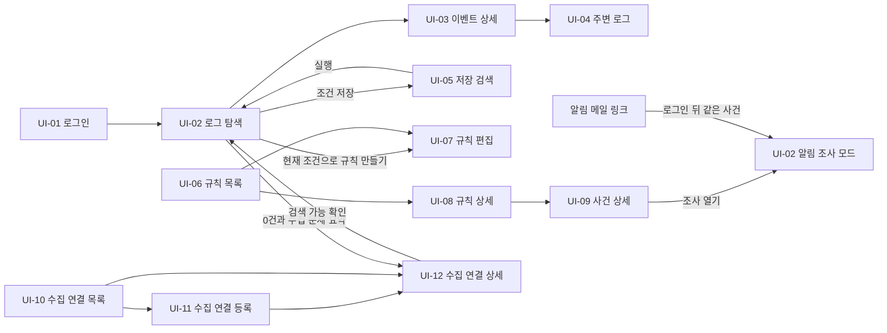

# LogDock 첫 출시 화면 흐름 명세 v0.1

작성일: 2026-11-04. **상태: 와이어프레임 기준으로 확정(2026-11-04). 2026-11-05 Q08-09 합의로 CM-03 출처에 `수집 대상`을 더했고, 사용자 요청으로 작업 결과 알림을 CM-08 토스트로 통일했다.** [결정 기록](../decisions.md)의 2026-11-04 합의에 따라 와이어프레임은 이 문서를 기준으로 시작한다. 새 사용자 정책은 정하지 않았고 모든 동작은 각 행에 적은 합의와 설계 확정에서 가져왔다. 화면 구현 승인이 아니며, API·schema 설계나 측정에서 제약이 나오면 이 문서와 와이어프레임을 함께 고친다.

여러 문서에 흩어져 있던 화면 관련 합의를 화면 단위로 모았다. 입력은 [제품 명세](product-features-v0.1.md), [검색·조사 상세](investigation-workflows-v0.1.md), [관리·운영 상세](platform-operations-v0.1.md), [수집 명세](collection-agent-v0.1.md), [Q05·Q07·Q10 기획안](../planning/q05-q07-q10-plan-v0.1.md), [Q08 기획안](../planning/q08-search-plan-v0.1.md), [Q12 기획안](../planning/q12-plan-v0.1.md), [Q02·Q16 인계서](../planning/q02-q16-handoff-v0.1.md)다. 시각 디자인, 컴포넌트 라이브러리, API 경로와 필드 이름은 정하지 않는다. 상태 이름은 설명용이며 enum이나 API 확정이 아니다.

## 1 기준

- **범위:** Q01에서 첫 출시에 넣은 기능만 그린다. 후속·보류 기능은 3절에 모았다.
- **환경:** 데스크톱 Chrome 한 화면 기준이다(Q15-01).
- **계정:** 공용 계정 하나를 여러 사람이 동시에 쓴다(Q10-01, Q10-05, Q10-06). 사용자별 목록·역할·권한 구분 화면은 없다.
- **첫 화면:** 로그인 뒤 로그 탐색(UI-02)이 열린다. 조사 명세 2절이 로그 탐색을 기본 조사 진입으로 둔 것을 따른다. 현재 연결 확인 화면은 이 흐름으로 대체한다. 그 소개 문구가 서비스 화면에 맞지 않다는 사용자 지적에 따라 첫 화면에 제품 소개 문구를 두지 않는다.
- **상태 표시:** 상태는 색만으로 구분하지 않고 상태 이름 글자를 함께 쓴다(조사 명세 8절, Q12 6절). 모르는 값은 0이나 정상으로 채우지 않고 `미확인`으로 쓴다(운영 명세 4절).
- **작업 결과 알림:** 저장·삭제·발송·보류처럼 방금 한 작업의 결과는 화면 안에 넣지 않고 CM-08 토스트로 띄운다. 입력 칸 오류, 계속 이어지는 상태, 전역 배너, 확인 창, 키 원문은 사라지면 놓치므로 화면에 둔다(2026-11-05 사용자 요청, 결정 기록).
- **시각:** 배포 설정의 표시 시간대 하나로 보여 주고 시간대를 함께 적는다(SD-07).
- **본문 안전:** 로그 본문과 필드 이름·값은 글자로만 그린다(SD-36). 검색 조건을 URL에 평문으로 넣지 않는다. 새로고침 복원은 세션 범위로 하고 로그아웃 때 지운다(SD-35).
- **수치:** 합의된 값만 화면에 쓰고 나머지는 `N`으로 비워 둔다(7절).

## 2 화면 목록과 이동

| 화면 ID | 화면 | 하는 일 | 기능 |
| --- | --- | --- | --- |
| UI-01 | 로그인 | 공용 계정으로 로그인하고 원래 가려던 화면으로 돌아간다 | F09 |
| UI-02 | 로그 탐색 | 조건으로 검색하고 발생량·분포·목록을 본다. 알림 링크로 열면 알림 조사 모드가 된다 | F03, F08 |
| UI-03 | 이벤트 상세 | 로그 한 건의 시각·본문·필드·품질을 보고 복사한다 | F04 |
| UI-04 | 주변 로그 | 같은 로그 흐름의 앞뒤와 같은 서비스·서버의 시간순 로그를 본다 | F04 |
| UI-05 | 저장 검색 | 공용 목록의 검색 조건을 실행·수정·삭제한다 | F07 |
| UI-06 | 알림 규칙 목록 | 규칙의 켬/끔과 평가 상태를 본다 | F08 |
| UI-07 | 알림 규칙 편집 | 규칙을 만들고 고친다 | F08 |
| UI-08 | 알림 규칙 상세 | 현재 상태, 해소 대기, 사건 이력을 본다 | F08 |
| UI-09 | 사건 상세 | 발화 당시 조건·건수와 수신자별 전달 결과를 본다 | F08 |
| UI-10 | 수집 연결 목록 | 서비스별 연결과 관리·관측 상태를 보고 서비스 이름과 보관을 관리한다 | F01, F06 |
| UI-11 | 수집 연결 등록 | 서비스와 수집 대상을 정하고 키와 설정을 받는다 | F01, F02, F09 |
| UI-12 | 수집 연결 상세 | 연결 상태를 보고 설정·키·보관·구간 삭제를 처리한다 | F01, F06, F09, F10 |
| UI-13 | 저장 공간과 보존 | 보관 기간, 저장량, 조회 가능 시작일, 조기 삭제를 본다 | F10 |
| UI-14 | 메일 상태 | 메일 연결 상태를 보고 테스트 발송과 운영 수신 주소를 관리한다 | F08 |
| UI-15 | 감사 이력 | 로그인·자격·키·설정 변경 기록을 본다 | F09 |
| UI-16 | 계정과 세션 | 비밀번호를 바꾸고 로그아웃이나 전체 세션 종료를 한다 | F09 |

상단 메뉴는 `로그 탐색`, `저장 검색`, `알림`, `수집 연결`, `시스템`(UI-13~15), `계정`(UI-16)이다. UI-13~16은 메뉴와 전역 배너에서 연다.

## 3 그리지 않는 것

첫 출시 밖의 기능은 메뉴·버튼·빈 자리로도 두지 않는다. 나중에 채택하면 그때 화면을 더한다.

| 그리지 않는 것 | 근거 |
| --- | --- |
| 실시간 조회. 조사 명세 2절 표의 `실시간`도 그리지 않는다 | Q01 후속 |
| 요청 ID 연관 조회 전용 화면. 요청 ID는 일반 검색으로 찾는다 | Q01 후속, SD-23 |
| 내부 공유 링크, 파일 내보내기 | Q01 후속 |
| 급증 알림, 회복 메일 | Q12 |
| MFA, 개인·팀 계정, 역할 | Q10-04, Q10-05, Q11 |
| 정규식·직접 쿼리 입력 | Q08-03 |
| 임의 필드별 건수, 결과 목록의 필드 컬럼 추가, 배열 값 비교와 날짜 범위 비교 | Q08-08, SD-34, SD-19 |
| 연결을 다른 서비스로 옮기기, 연결 등록 완전 삭제 | Q07-04, Q07-07 |
| 대기 로그 강제 폐기 | Q05-03 |
| 웹에서 보관 기간 변경, 로그 한 건 단위 삭제 | Q13-02, Q13-03 |
| 웹에서 에이전트 원격 중지·재개·설정 적용 | Q05-02, Q06, Q02·Q16 인계서 3절 |
| 이메일 비밀번호 자동 복구 | Q10-03 |
| 메일 서버 주소·계정·비밀번호 입력 | Q12-08 |
| Issue 관리, 과금·플랜 화면 | 결정 기록의 보류 항목, D09 |
| 모바일·다른 브라우저용 화면 | Q15-01 |

## 4 공통 요소

여러 화면이 같은 요소를 쓴다. 와이어프레임은 이 요소를 먼저 그리고 화면마다 다시 만들지 않는다.

| ID | 요소 | 동작과 표시 | 근거 |
| --- | --- | --- | --- |
| CM-01 | 상단 메뉴와 전역 배너 | 2절의 메뉴를 둔다. 배너는 메일 연결 오류, 알림 평가 중단, 메일 최종 실패 건수(Q12 6절), 감사 기록 장애와 공백(Q10-14), 디스크 경고와 조기 삭제 발생(Q13-01), 저장 공간 측정 불가(WQ-76), 운영 수신 주소 없음(WQ-83, 운영 메일이 아무에게도 가지 않음)이다. 원인이 풀리면 내려가는 배너와 사람이 `확인`을 누를 때까지 남는 지나간 일 배너(감사 기록 공백, 조기 삭제 발생)로 나뉜다(API 계약 초안 4.4절, WQ-03). 배너를 누르면 해당 화면으로 간다. `수집 연결` 메뉴에는 조치가 필요한 연결 수를 표시한다. 메일 최종 실패를 확인 처리하는 방식은 API 설계에서 정한다 | Q12 6절, Q10-14, Q13-01, 운영 명세 4절 |
| CM-02 | 시간 범위 선택 | 상대 범위와 고정 범위를 고른다. 시간 기준은 발생 시각(기본)과 수신 시각 중 고른다. 실행할 때 절대 범위로 바꿔 `적용 범위`와 시간대를 표시한다. 범위는 시작 포함·끝 제외다 | Q08-04, SD-06, SD-07, Q11 |
| CM-03 | 조건 편집기 | 출처(서비스·서버·환경·수집 대상)와 레벨은 여러 값을 고르면 OR, 항목 사이는 AND다. `수집 대상`은 등록된 수집 연결 하나를 고르며, 서비스별로 묶은 후보에 서버 표시명과 대상을 함께 보여 준다(예: `app-01 · /var/log/nginx/access.log`). 값 목록에 `미확인`·`미입력`·`보관됨`을 따로 둔다. 레벨 `ERROR`는 `미확인`을 포함하지 않는다. 본문은 포함·제외 조건을 여러 개 넣으면 AND이고, 기본은 대소문자 미구분이며 구분 옵션이 있다. 입력은 글자 그대로 찾는다. 필드는 같음·다름·있음·없음·숫자 범위(이상·이하·초과·미만)를 점 경로로 넣고 최근 필드 이름을 후보로 보여 준다. 지원하지 않는 연산은 비활성이다. 괄호 조합은 없다. 검색·저장 검색·알림 규칙이 같은 편집기를 쓴다 | Q08-01, Q08-02, Q08-09, SD-09, SD-12, SD-13, SD-15, SD-19~SD-22, SD-25, SD-30, SD-37 |
| CM-04 | 결과 상태 표시 | `실행 전`, `조회 중`(취소 가능, 0건으로 확정해 보이지 않음), `완료`(적용 범위, 반환 행, `HH:MM:SS까지 수신된 로그 기준`), `완료 0건`(조회 가능 시작일, 선택 범위의 수집 문제 요약, 판정 불가 제외 건수), `부분·한도`(실패 범위와 계속 가능 여부. 부분 집계를 전체 건수로 쓰지 않음), `시간 초과·오류`(사유 코드, 요청 참조, 재시도), `취소`, `만료·접근 제한`. 조건 오류가 나면 이전 결과를 `이전 조건의 결과`로 표시한다 | 조사 명세 3절, SD-22, SD-28, SD-29, SD-32, SD-33 |
| CM-05 | 수집 상태 표시 | 관리 상태(`등록·연결 대기`, `사용`, `종료 진행`, `전송 차단`, `보관`)와 관측 상태를 따로 표시한다. 관측 상태는 `연결 대기`, `관측됨·무로그`, `수집/전송 진행`, `읽기 일시정지`, `설정/복구 확인 필요`, `디스크 사용 불가`, `이벤트 거부 관측`, `전송 오류/보류`, `복구 중`, `관측 오래됨/미확인`, `시각 확인 필요`, `중단/보관`이다. 하나의 `정상` 표시로 합치지 않고 마지막 보고 시각을 함께 쓴다 | 운영 명세 4절, Q05·Q07·Q10 기획안 3절 |
| CM-06 | 시각·품질 표시 | 결과 행과 상세에 `시각 대체`, `시각 의심`, `시간대 추정`, `해석 실패`, `필드 일부 생략`을 글자로 표시한다. 상세에는 발생·관측·수신 시각과 시각 출처를 함께 보여 준다 | SD-01, SD-02, SD-24, SD-34, Q08-05, Q08-06 |
| CM-07 | 민감 작업 확인 | 대상과 영향을 보여 주고 비밀번호를 다시 받은 뒤 실행한다. 최근 재인증이 유효하면 다시 묻지 않으며 유효 시간은 설계에서 정한다. 키 폐기나 보관처럼 에이전트에 닿는 작업은 `요청 접수`, `중앙 확정`, `에이전트 관측`을 나눠 보여 준다. 감사 기록 장애로 보류되면 `보류`로 표시하고, 복구돼도 자동으로 적용하지 않으니 복구 뒤 다시 실행하라고 안내한다(2026-11-05 Q10-14 후속 합의). 키 발급·교체·폐기, 등록·설정 변경, 보관·재활성, 구간 로그 삭제, 비밀번호 변경에 쓰고 알림 규칙 변경에는 쓰지 않는다 | Q10-05, Q10-11, Q10-14, Q13-03, TD-17 |
| CM-08 | 토스트 알림 | 방금 한 작업의 결과를 화면 오른쪽 위, 상단 메뉴와 전역 배너 아래에 겹쳐 띄운다. 종류는 `성공`·`실패`·`보류`·`안내`를 글자로 쓴다. 성공·안내는 `N`초 뒤 사라지고 실패·보류는 사용자가 닫을 때까지 남는다. 무엇을 했거나 하지 않았는지, 실패 사유와 다음에 할 일을 쓰고 바로 가는 링크는 하나까지 둔다. 새 토스트를 위에 쌓고 초점을 빼앗지 않는다. 입력 칸 오류, 계속 이어지는 상태, 전역 배너(CM-01), 확인 창(CM-07), 키 원문은 토스트로 띄우지 않는다 | 2026-11-05 사용자 요청, 조사 명세 8절, Q10-08 |

## 5 화면별 흐름과 상태

### UI-01 로그인

- **진입:** 세션이 없거나 만료됐을 때(비활동 1시간 또는 로그인 후 최대 24시간), 알림 메일 링크를 열었을 때.
- **요소:** 계정 이름과 비밀번호 입력, 로그인. 비밀번호를 잊었거나 잠겼으면 서버 운영자가 로컬 절차로 재설정한다는 안내.
- **동작:** 성공하면 원래 가려던 화면으로 돌아간다. 메일 링크였으면 같은 사건의 알림 조사 모드로, 그 밖에는 UI-02로 간다.
- **그릴 상태:** 로그인 실패(계정 존재나 자격 세부를 드러내지 않는 문구), 시도 제한으로 잠시 막힘(대기 `N분`), 세션 만료 안내, 감사 기록 장애 중 로그인(로그인은 계속된다).
- **근거:** Q10-03, Q10-06, Q10-14, Q12 5절.

### UI-02 로그 탐색

- **진입:** 로그인 뒤 첫 화면, 메뉴, 저장 검색 실행, 사건의 `조사 열기`와 메일 링크(알림 조사 모드).
- **요소:** CM-02 시간 범위, CM-03 조건, 실행과 취소. 시간별 발생량 그래프와 서비스·서버·레벨별 건수. 결과 목록은 기준 시각·서비스·서버·레벨·본문 요약 열로 고정하고 CM-06 표시를 붙인다. 정렬은 최신순(기본)과 오래된순이고 다음 행은 `더 보기`로 불러온다. 목록 위에 CM-04 상태, 조회 가능 시작일, 선택 범위의 수집 문제 요약, `판정 불가 37건 제외` 같은 건수와 바로 보기를 둔다.
- **동작:** 행을 누르면 UI-03 패널을 연다. `조건 저장`은 이름을 받아 UI-05 목록에 넣는다. 이름이 겹치면 거부하고 개수 상한(`N개`)에 닿으면 저장을 막고 안내한다. `현재 조건으로 알림 규칙 만들기`는 조건을 복사해 UI-07을 연다. 저장 검색·규칙과는 복사 관계라 한쪽을 고쳐도 다른 쪽은 바뀌지 않는다고 알린다.
- **알림 조사 모드:** 상단에 `알림 조사`와 규칙·사건을 표시한다. 시간 기준은 수신 시각, 범위는 평가한 절대 구간으로 고정하고 수신 시각 최신순으로 정렬하며 발생 시각을 함께 보여 준다. `당시 12건, 현재 9건`처럼 두 건수와 차이 사유(보존 만료, 조기 삭제, 수동 삭제, 판정 불가, 일부 구간만 평가(TD-13), 늦은 반영)를 표시한다. 규칙이 바뀌었거나 삭제됐으면 당시 조건으로 열고 `현재 규칙과 다름`을 표시한다. 서비스 이름이 바뀌었으면 현재 이름으로 보여 주고 대상은 그대로다. 조건을 고치면 모드를 벗어났다고 표시한다. 알림 이력이 만료됐거나 없는 사건이면 `알림 이력 보관 기간이 지났습니다`를 보여 준다.
- **그릴 상태:** CM-04의 상태 전부, 알림 조사 모드의 위 상태, 조건 오류(필드와 수정 이유 표시).
- **근거:** 조사 명세 3·7절, Q08-01~Q08-09, SD-22, SD-26~SD-34, Q11, Q12 5절, TD-05.

### UI-03 이벤트 상세

- **진입:** UI-02나 UI-04의 행 선택. UI-02 위에 패널로 열려 목록 위치를 잃지 않는다.
- **요소:** 출처(서비스·서버·환경·수집 연결), 발생·관측·수신 시각과 시각 출처, 레벨 원본 값과 정규화 값, 본문(긴 행 접기·줄바꿈, JSON 펼침, ANSI 색 코드는 표시할 때만 처리), 필드(점 경로), stack trace, CM-06 표시.
- **동작:** 로그 한 건의 본문과 필드 복사, 필드를 눌러 조건에 추가, `주변 로그`로 UI-04 열기. 닫으면 원래 조건·선택 행·스크롤로 돌아가고 초점도 그 행으로 돌아간다.
- **그릴 상태:** 보존 만료나 삭제로 가져올 수 없음(목록에 남은 정보가 지금 조회 가능하다는 뜻이 아님을 표시), 세션 만료.
- **근거:** 조사 명세 2·4·8절, Q09-04, SD-18, SD-25, SD-34, SD-36.

### UI-04 주변 로그

- **진입:** UI-03의 `주변 로그`.
- **요소:** 선택한 로그를 가운데 두고 같은 로그 흐름의 앞뒤 로그를 원본 순서로 보여 준다. 위쪽에 풀어 준 조건(레벨·본문·필드·시간)과 유지되는 조건(원래 검색, 선택 로그, 같은 흐름)을 표시한다. 정상 파일 회전 경계를 넘을 때 경계를 표시한다.
- **동작:** 앞·뒤 방향으로 더 불러오기(선택 행 유지), `같은 서비스·서버 시간순` 보기로 전환(다른 파일 로그를 포함하며 `시간상 근접 이벤트`로 표시), 행을 눌러 UI-03, 원래 검색으로 돌아가기.
- **그릴 상태:** 파일 순서를 확인할 수 없어 회전 경계 너머를 이어 붙이지 않음, 수집하지 않은 구간·거부됨·보존 만료·수동 삭제·조회 한도·관측 불가를 구분한 표시, 범위 한도(앞뒤 `N건`, 최대 시간 폭 `N`).
- **근거:** Q09-01, Q09-02, Q09-03, 조사 명세 4절.

### UI-05 저장 검색

- **요소:** 공용 계정의 목록 하나. 이름, 조건 요약, 시간 방식(상대·고정), 최근 수정 시각, 실행 전 경고.
- **동작:** 실행(UI-02로 열기), 이름·조건·시간 수정, 확인 뒤 즉시 삭제. 자동 삭제는 없다.
- **그릴 상태:** 빈 목록, 보관된 연결을 참조하는 조건의 실행 전 경고, 다른 사람이 먼저 고친 경우 덮어쓰기 전 경고, 개수 상한 도달, 상대 시간 조건은 열 때마다 결과가 다를 수 있다는 안내.
- **근거:** Q11-01, Q11-02, Q11-03, 조사 명세 6절, SD-30.

### UI-06 알림 규칙 목록

- **요소:** 규칙마다 이름, 켬/끔, 평가 상태(`정상`, `지속`, `해소 대기`), 감시 품질(`완전`, `일부 미관측`, `감시 불가`, `대상 없음`), 조건 요약, 마지막 발화, 마지막 전달 결과, 마지막 성공 평가 시각.
- **동작:** 새 규칙(UI-07), 켬/끔, 상태 필터, 행을 눌러 UI-08.
- **그릴 상태:** 빈 목록, 평가 중단(CM-01 배너와 함께), 규칙 수 상한(`N개`) 도달, 메일 설정이 없어 켤 수 없음.
- **근거:** Q12 5·6절, TD-05, TD-08, TD-18.

### UI-07 알림 규칙 편집

- **진입:** UI-06의 새 규칙, UI-08의 수정, UI-02의 `현재 조건으로 알림 규칙 만들기`.
- **요소:** 이름, 조건(CM-03. 집계는 중앙 수신 시각 기준임을 표시), 시간 구간(1~1,440분, 1·5·15·60분 버튼, 기본값 없음), 임계 건수(1 이상, 기본값 없음), 해소 대기(1~1,440분, 비우면 시간 구간과 같음), 수신 주소(최대 10개, 저장 때 형식만 검사하고 `확인 안 됨` 표시), 최근 구간의 실제 건수 미리보기, 예상 동작 문구.
- **동작:** 저장, 테스트 메일 발송, 삭제. 삭제해도 사건 이력과 메일 링크는 남는다. 필터·시간 구간·임계를 바꾸면 상태가 `정상`으로 초기화된다고 저장 전에 알린다. 이름·수신 주소·해소 대기만 바꾸면 상태를 유지한다.
- **그릴 상태:** 필터가 하나도 없는 규칙의 경고(확인 뒤 저장 가능), 레벨 `ERROR`를 고르면 `미확인` 레벨이 빠진다는 안내, 입력 오류, 감사 기록 장애로 저장 보류, 다른 사람이 먼저 저장함(버전이 맞지 않으면 저장하지 않고 다시 불러옴). 재인증은 요구하지 않는다.
- **근거:** Q12-01, Q12-03, Q12-04, Q12-12, TD-05, TD-06, TD-17, SD-09, SD-30.

### UI-08 알림 규칙 상세

- **요소:** 현재 평가 상태와 감시 품질, 해소 대기 진행, 미평가 구간, 일부 미관측 대상, 사건 이력. 사건 이력은 로그 보관 기간과 같이 보관한다.
- **동작:** 사건을 눌러 UI-09, 수정(UI-07), 켬/끔.
- **그릴 상태:** 사건 없음, 대상 전부 관측 불가(`감시 불가`, 해소 계산 멈춤), 일부만 관측 불가(계산 계속, `일부 미관측` 표시), 평가 실패 회차, 대상 없음(대상 연결이 모두 보관돼 건수 0으로 평가하며 경고).
- **근거:** Q12-05, Q12-14, Q12 5·6절, TD-18.

### UI-09 사건 상세

- **요소:** 당시 규칙 이름과 조건, 평가 구간, 건수와 임계, 판정 불가 건수, 해소 시각. 수신자별 전달 상태(`대기`, `전송 중`, `재시도 대기`, `메일 서버 수락`, `최종 실패`, `취소`)와 사유. `메일 서버 수락`은 도착 확인이 아니라고 함께 적는다. 해소 뒤에 보낸 메일에는 해소 사실을 표시한다.
- **동작:** `조사 열기`로 UI-02 알림 조사 모드를 연다.
- **그릴 상태:** 재시도 중(최대 12회, 총 4시간), 전송 여부 불명(같은 메일 식별자로 재시도), 최종 실패.
- **근거:** Q12-09, Q12-10, Q12-11, Q12 5·6절.

### UI-10 수집 연결 목록

- **요소:** 서비스별로 묶은 연결 목록. 연결마다 수집 대상(파일, 파일명 규칙, journald), 서버 표시명(없으면 `미입력`), 환경 태그, CM-05 관리 상태와 관측 상태, 마지막 보고 시각, 대기량. 보관된 서비스와 연결은 따로 골라 본다.
- **동작:** 새 연결 등록(UI-11), 연결 열기(UI-12), 서비스 이름 변경, 서비스 보관·재활성(CM-07), 상태 필터. 서비스 이름을 바꿔도 연결, 기존 로그, 저장 검색과 알림 규칙의 대상은 그대로라고 알린다.
- **그릴 상태:** 연결이 하나도 없음(등록 안내), 조치가 필요한 연결, 관측 오래됨, 서비스 보관 전 영향 확인(하위 연결의 수신 차단, 남은 대기, 이 서비스를 쓰는 저장 검색과 알림 규칙).
- **근거:** Q07-01, Q07-03, Q07-07, Q07-08, Q05·Q07·Q10 기획안 3·5절, 운영 명세 4절.

### UI-11 수집 연결 등록

단계형으로 진행한다. 확정 전에 그만두거나 실패하면 키를 발급하지 않는다.

| 단계 | 입력과 표시 | 근거 |
| --- | --- | --- |
| 1 서비스 | 기존 서비스를 고르거나 새 서비스 이름을 입력한다 | Q07-01 |
| 2 수집 대상 | 로그 서버 기준 경로로 파일 하나(`app.log`)나 파일명 규칙(`app-*.log`)을 넣는다. 지정한 폴더 안에서만 찾고 하위 폴더는 따로 등록한다. 또는 journald 대상을 고른다. 컨테이너 로그는 journald로 읽는다. journald 대상의 입력 형태는 API 설계에서 정한다 | Q02·Q16 인계서 3절, Q02-06, 2026-11-03 컨테이너 로그 합의 |
| 3 형식 | 일반 텍스트, JSON, 여러 줄 중 고른다. 여러 줄은 새 이벤트 시작 규칙이 필요하다. 인코딩은 UTF-8이다. `로그 시간대`는 선택 입력이며 비우면 에이전트 서버 시간대로 해석해 `시간대 추정`을 표시한다. 추출 규칙은 내장 형식이 맞지 않을 때만 넣는 선택 입력이며 이후 로그에만 적용된다 | Q02-03, Q02-04, Q08-06, Q08-07, D02 |
| 4 선택 정보 | 환경 태그와 서버 표시명을 넣는다. 비워도 등록할 수 있다 | Q07-08 |
| 5 확인과 확정 | 서비스·대상·형식 요약을 보여 준다. 같은 서버의 같은 로그가 이미 등록됐다고 확인되면 기존 연결을 안내하고 막는다. CM-07로 확정한다 | Q07-06, Q10-05 |
| 6 키와 설정 받기 | 키 원문은 이 화면에서 한 번만 보여 준다. 중앙 주소·키·대상을 담은 설정을 복사하거나 내려받는다. 닫으면 다시 볼 수 없고, 복사하지 못했으면 새 키를 발급해 교체한다고 알린다 | Q10-07, Q10-08 |
| 7 적용과 확인 | 사용자가 로그 서버의 에이전트에 설정을 적용한다. 중앙은 원격으로 적용하지 않는다. `등록 완료 → 설정 제공 → 에이전트 적용 확인 → 읽기 → 중앙 수신 확인 → 검색 가능`을 단계별로 따로 표시한다. 최초 연결은 새 로그부터 읽으며 파일별 시작 경계를 표시한다 | Q05·Q07·Q10 기획안 3절, D02 |

- **그릴 상태:** 확정 중 실패나 취소(키 미발급), 동시 수정 충돌, 감사 기록 장애로 확정 보류, 등록은 됐지만 에이전트 적용 미확인, 무로그(읽기 성공으로 단정하지 않음).

### UI-12 수집 연결 상세

- **요소:** CM-05 관리 상태와 관측 상태, 마지막 보고, 마지막 전송 확인(ACK), 대기 bytes와 가장 오래된 대기 항목, 일시정지 사유, 해석 실패와 거부 건수, 확인된 손실과 누락 가능 구간, 서버 시계·시간대 확인 경고, 적용된 설정 버전, UI-11 7단계의 증거 표시, 키 메타데이터(발급일·상태·교체 진행. 원문은 없음), 진단 이력. D03 크기 초과 거부는 메일 없이 여기에만 표시하고, 진단 저장이 실패한 기간은 공백으로 표시한다.
- **동작:** 설정 내려받기를 뺀 동작은 모두 CM-07을 거친다.
  - 설정 수정: 새 설정을 다시 복사해 에이전트에 적용해야 하며 적용 중 수집이 잠시 멈춘다고 알린다. 다른 서버나 전혀 다른 로그로 바꾸려면 새 연결로 등록한다고 안내한다(Q07-05).
  - 키 교체: 새 키를 한 번 보여 준다. 사용자가 적용하고 정상 수신을 확인한 뒤 기존 키를 직접 폐기한다. 교체 중에는 키가 2개이며 자동 종료 기한은 없다.
  - 키 폐기(사고 대응 포함): 중앙 폐기를 먼저 하고 로컬 읽기 중지는 서버 운영자가 한다. 폐기 요청, 중앙 확정, 에이전트 관측을 나눠 표시한다. 대기 로그는 보존된다.
  - 보관·재활성: 보관하면 중앙 새 수신을 막고 과거 로그는 보관 기간까지 검색된다. 재활성은 같은 등록으로 돌아가며 옛 키는 살아나지 않는다.
  - 구간 로그 삭제: 이 연결과 시간 구간을 지정해 중앙 로그를 지운다. 확인 단계에서 되돌릴 수 없다는 것, 에이전트 대기와 원본 파일은 지우지 않는다는 것, 실제 공간 회수까지 시간이 걸린다는 것, 같은 구간이 다시 전송돼도 저장하지 않는다는 것을 보여 준다.
  - 설정 내려받기: 키 원문을 뺀 설정 틀만 준다. 비밀 값이 없고 변경이 아니라서 CM-07을 거치지 않고 감사 기록 장애 때도 보류하지 않는다.
- **`지금부터 다시 수집` 안내:** 복구 근거가 없어 `설정/복구 확인 필요`이면 누락 영향과 대상, 서버에서 적용할 방법을 안내한다. 웹에서 에이전트에 실행을 지시하지 않는다. 웹에 실행 동작이 없으므로 Q10-05가 민감 작업으로 적은 `Q06 수동 재개`의 재인증은 웹에서 실행하는 기능이 생길 때 적용한다.
- **그릴 상태:** 미관측 중(마지막 값을 현재처럼 보이지 않게 `마지막 보고 기준`으로 표시), 키 차단 뒤 마지막 보고, 대기량 미상(0으로 쓰지 않음), 감사 기록 장애로 변경 보류(긴급 키 폐기는 차단 상태를 확정할 수 있으면 허용).
- **근거:** 운영 명세 4·6절, Q05-01, Q05-02, Q06, Q07-07, Q10-07, Q10-08, Q10-10, Q10-11, Q10-14, Q12-07, Q13-03, Q14, Q16-05, SD-05.

### UI-13 저장 공간과 보존

- **요소:** 로그 보관 기간(모든 서비스 공통 6개월. 서버 설정으로만 바꿀 수 있어 읽기 전용), 로그 저장량과 남은 공간, 조회 가능 시작일, 조기 삭제 발생 여부와 시각, 디스크 경고 상태(기준 `N`), 측정 시각과 집계 기간.
- **그릴 상태:** 정상, 디스크 경고, 조기 삭제 발생(6개월보다 짧아진 실제 보관 범위 표시), 값 미확인.
- **근거:** Q13, Q13-01, Q13-02, 운영 명세 6절.

### UI-14 메일 상태

- **요소:** 메일 서버 연결 상태, 마지막 성공 전송, 테스트 발송, 운영 수신 주소 목록(최대 10개, 형식 검사, `확인 안 됨` 표시, 테스트 메일). 운영 수신 주소는 수집 끊김·알림 평가 실패 메일과 디스크 경고 메일을 받는다.
- **표시하지 않는 것:** 비밀번호 같은 비밀 값. 메일 서버 설정은 서버 설정에서만 바꾼다.
- **그릴 상태:** 연결 오류, 테스트 발송 성공과 실패, 운영 수신 주소 없음, 메일 설정 없음(알림 규칙을 켤 수 없음), 평문 사내 릴레이 허용 경고.
- **근거:** Q12-06, Q12-08, Q12-12, Q12-15, TD-08, TD-21, Q12 6절.

### UI-15 감사 이력

- **요소:** 시각, 공용 계정, 동작, 대상, 결과 목록. 조회 가능 시작일, 조기 정리 구간, 기록 공백 구간. 비밀번호·키 원문, 로그 본문, 검색어는 남기지 않는다.
- **동작:** 기간과 동작 종류로 거른다.
- **그릴 상태:** 감사 기록 장애 중(공백 표시), 목표 90일보다 일찍 정리됨.
- **근거:** Q10-12, Q10-13, Q10-14.

### UI-16 계정과 세션

- **요소:** 비밀번호 변경(현재 비밀번호 확인, 최소 15자·긴 문구 허용, 흔하거나 유출된 값은 거부 사유 표시), 현재 세션 로그아웃, 전체 세션 종료(현재 세션 포함), 세션 규칙 안내(비활동 1시간, 로그인 후 최대 24시간), 분실·잠금 때 서버 운영자의 로컬 재설정 안내.
- **그릴 상태:** 변경 성공 뒤 모든 세션 종료와 다시 로그인, 감사 기록 장애로 비밀번호 변경 보류, 전체 세션 종료는 차단 상태를 확정할 수 있을 때만 완료로 표시.
- **근거:** Q10-03, Q10-06, Q10-14.

## 6 화면을 잇는 주요 흐름

| 흐름 | 화면 순서 | 근거 |
| --- | --- | --- |
| 새 수집원 연결 | UI-10 → UI-11(1~7단계) → UI-12에서 증거 단계 확인 → UI-02에서 검색 가능 확인 | 제품 명세 핵심 흐름 1 |
| 오류 원인 조사 | UI-02 조건 검색 → 발생량·분포 확인 → UI-03 → UI-04 → 필요하면 조건 저장(UI-05)이나 규칙 만들기(UI-07) | 제품 명세 핵심 흐름 2 |
| 로그가 안 보일 때 | UI-02 `완료 0건`의 수집 문제 요약과 조회 가능 시작일 → UI-12 상태 → 필요하면 UI-13에서 보존과 조기 삭제 확인 | 제품 명세 핵심 흐름 3, SD-32, SD-33 |
| 알림 받고 조사 | 메일 링크 → 필요하면 UI-01 → UI-02 알림 조사 모드 → UI-03 → UI-09 전달 결과 | Q12 5절 |
| 키 교체와 사고 대응 | UI-12 → CM-07 → 새 키 1회 표시 → 서버에서 적용 → 정상 수신 확인 → 기존 키 폐기. 사고 때는 중앙 폐기를 먼저 하고 로컬 중지는 운영자가 한다 | Q05-02, Q10-10, Q10-11 |
| 수집 복구 확인 필요 | UI-10에서 `설정/복구 확인 필요` 확인 → UI-12의 누락 안내와 서버 적용 방법 → 서버에서 적용 → UI-12에서 재개 확인 | Q06, 운영 명세 4절 |

## 7 수치 표기

합의했거나 설계값으로 정한 값은 그대로 쓴다.

| 값 | 근거 |
| --- | --- |
| 세션: 비활동 1시간, 로그인 후 최대 24시간 | Q10-06 |
| 비밀번호 최소 15자 | Q10-03 |
| 알림 시간 구간 1~1,440분, 버튼 1·5·15·60분, 임계 1 이상, 둘 다 기본값 없음 | Q12-01 |
| 해소 대기 1~1,440분, 비우면 시간 구간과 같음 | Q12-03 |
| 규칙당 수신 주소 최대 10개 | Q12-12 |
| 메일 재시도 최대 12회, 총 4시간 | Q12-09 |
| 수집 끊김이나 알림 평가 실패가 10분 지속되면 묶어서 운영 메일 1통 | Q12-06 |
| 로그 보관 공통 6개월, 감사 이력 목표 90일 | Q13, Q10-13 |
| 연결당 유효 키 1개, 교체 중 2개 | Q10-07 |

아래 값은 아직 정하지 않았다. 와이어프레임에는 `N`으로 쓰고 측정이나 설계 뒤 채운다. 설정값과 한도에 예시 숫자를 넣지 않는다. 검색 결과 건수 같은 표시 값은 합성 숫자를 써도 된다.

| 값 | 정하는 곳 |
| --- | --- |
| 검색 화면을 열 때의 기본 시간 범위(`최근 N`) | 화면 설계 |
| 검색 실행 예산, 조건 수와 검색식 길이 상한 | 측정 뒤 Q15 |
| `더 보기` 한 번에 불러오는 행 수 | 설계와 측정 |
| 주변 로그 앞뒤 건수와 최대 시간 폭 | D16, 측정 |
| 저장 검색 개수 상한, 알림 규칙 수 상한 | 측정 |
| 로그인 시도 제한 횟수와 대기 시간 | Q10-03 후속 설계 |
| 디스크 경고 기준 | Q13 설계 |
| 관측 오래됨 판정 기준 | D16 |
| 긴 본문 표시량, 필드 수·깊이·값 길이 상한 | 설계 |
| 미래 시각 허용 오차 | 측정 M8 |
| 토스트 표시 시간과 한 번에 보이는 수(CM-08) | 화면 설계 |

## 8 와이어프레임 작업 기준

사용자는 와이어프레임을 여러 에이전트에 화면 묶음별로 나눠 맡길 계획이다. 공통 요소가 묶음마다 갈리지 않도록 아래 순서로 진행한다.

| 순서 | 묶음 | 화면 | 메모 |
| --- | --- | --- | --- |
| 1 | 공통 틀 | CM-01~CM-07, UI-01, UI-16 | 먼저 끝낸다. 다른 묶음은 이 결과를 가져다 쓰고 바꾸지 않는다 |
| 2 | 검색·조사 | UI-02~UI-04(알림 조사 모드 포함) | 2~5는 동시에 진행한다 |
| 3 | 저장 검색·알림 | UI-05~UI-09, UI-14 | |
| 4 | 수집 연결 | UI-10~UI-12 | |
| 5 | 시스템 | UI-13, UI-15 | |
| 6 | 검토 | 전체 | 한 에이전트가 이 문서와 대조한다 |

모든 묶음이 지킬 규칙:

- 이 문서와 문서가 가리키는 합의만 그린다. 3절의 기능은 메뉴·버튼·빈 자리로도 넣지 않는다.
- 화면마다 5절의 `그릴 상태`를 모두 그린다. 정상 화면만 그리지 않는다.
- 수치는 7절을 따른다.
- 예시 데이터는 합성으로 쓴다(서비스 `주문`·`결제`, 서버 `app-01`, 파일 `app.log`). 실제 조직·서버·경로·운영 로그를 넣지 않는다.
- 화면 ID와 공통 요소 ID를 파일 이름과 제목에 그대로 쓴다.
- 문구는 한국어로 쓰고 상태는 이 문서의 상태 이름을 그대로 쓴다.
- 회색조 저충실도로 그린다. 색, 글꼴, 아이콘 디자인은 하지 않는다.
- 문서와 다르게 그려야 할 이유가 생기면 임의로 바꾸지 말고 검토 단계에 올린다.

**산출 형식:** `docs/wireframes/` 아래 화면 ID마다 정적 HTML 파일 하나(예: `UI-02-log-search.html`)와 공통 스타일 파일 하나를 둔다. 외부 스크립트·글꼴 없이 브라우저에서 바로 열리게 하고, 한 파일 안에 상태별 화면을 제목을 붙여 차례로 그린다. 와이어프레임 전용이며 실제 화면 구현 코드로 쓰지 않는다.

**검토 기준:** 화면별로 5절의 요소·동작·그릴 상태가 모두 있는지, 3절 기능이 들어가지 않았는지, 공통 요소와 상태 이름이 화면마다 같은지, 7절 밖의 설정 숫자가 없는지 본다. 고칠 점은 해당 묶음에 돌려보낸다.

## 9 남는 설계와 확인 범위

- 화면의 필드 이름, 상태 이름, 오류 사유 코드는 API·schema 설계에서 확정한다. 그 과정에서 바뀌면 이 문서와 와이어프레임을 함께 고친다. 2026-11-04 합의에서 감수한 영향이다.
- 측정으로 수치가 정해지면 7절의 `N`을 채운다.
- 와이어프레임을 그리며 남긴 검토 항목 91건의 처리는 [정리표](../planning/wireframe-review-items-v0.1.md)를 따른다. `설계로 넘김` 77건의 기본안은 화면·API 설계에서 확정하고 그때 이 문서와 와이어프레임을 고친다.
- `수집 대상` 후보가 길 때의 찾기 방식과 서버 표시명이 없는 연결의 구분 표시는 화면·API 설계에서 정한다(SD-37). 와이어프레임은 서비스별 묶음과 찾기 칸으로 그렸다.
- 접근성은 조사 명세 8절(키보드 접근, 초점 복귀, 색만으로 구분하지 않음)을 따르고 평가 수준은 D16 지원표에서 정한다.
- 화면 구현은 기존 순서대로 기획 완료와 와이어프레임 뒤에 한다.
- 이번 작업은 기존 문서를 화면 단위로 모은 정적 문서 작업이다. 새 사용자 정책을 정하지 않았고 와이어프레임·화면·API를 만들거나 실행 검증하지 않았다.
